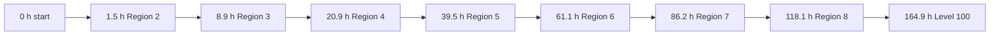

# Progression Bottleneck Analysis

Where players are expected to stall, why, and which levers fix each stall. Based on the income model in [[Wild Animal Cash Rewards]] and the costs in [[Cost Tables]]. All values **PROPOSED**; replace the model with telemetry from the [[Balance Simulation Plan]] once available.

## 1. Progression curve

XP to reach the next level: `XP(L) = round(100 × L^1.6)` ([[Player Progression and Levelling]]). Hours below are solo active play at the modelled XP per hour of each region, ignoring boss XP (so they slightly overestimate).

| Phase | Levels | XP needed | XP per hour | Hours in phase | Cumulative hours | Cumulative raw Cash |
|---|---|---:|---:|---:|---:|---:|
| Region 1 Whisperwood Forest | 1 → 8 | 7,223 | 4,840 | 1.5 | 1.5 | 7,600 |
| Region 2 Sunscorch Savanna | 8 → 18 | 58,341 | 7,912 | 7.4 | 8.9 | 69,900 |
| Region 3 Emerald Canopy | 18 → 28 | 146,852 | 12,232 | 12.0 | 20.9 | 228,700 |
| Region 4 Coral Coast | 28 → 40 | 332,248 | 17,792 | 18.7 | 39.5 | 587,800 |
| Region 5 Frostfang Tundra | 40 → 52 | 541,000 | 25,054 | 21.6 | 61.1 | 1,176,900 |
| Region 6 Skyreach Peaks | 52 → 65 | 863,567 | 34,518 | 25.0 | 86.2 | 2,117,400 |
| Region 7 Emberheart Caldera | 65 → 80 | 1,407,903 | 44,072 | 31.9 | 118.1 | 3,658,900 |
| Region 8 Starfall Sanctuary | 80 → 100 | 2,659,572 | 56,781 | 46.8 | 164.9 | 6,582,600 |

**Shape:** time per region grows from 7 to 32 hours, then 47 hours for the final 20 levels. The level curve outpaces the region XP multiplier, so later regions feel longer. This is reasonable for a long-term collection game but the jump from Region 1 (1.5 h) to Region 2 (7.4 h) is steep and is the first risk point for retention.

## 2. Bottleneck register

| # | Bottleneck | Where | Type | Severity | Expected stall | Levers |
|---:|---|---|---|---|---|---|
| B-1 | Region 2 → 3 level gap | Level 8 → 18 | XP | High (early churn risk) | 7.4 h for one region | Boss XP; raise Region 2 XP multiplier to 1.6; lower the Region 3 gate to level 16 |
| B-2 | Mini-boss gates | Every region | Skill / power | Medium | A player under-powered for the gate boss | Training Grounds as a reliable lever; boss tells and readable patterns ([[Boss AI]]); co-op credit |
| B-3 | Station L4 gate | Region 6 + 1 world boss | Event timing | Medium | Waiting for a world boss spawn (45–60 min cadence) | Announce schedules; world bosses from earlier regions satisfy the gate |
| B-4 | Starfall Sanctuary gate | Level 80 + Cinderjaw + 2 different world bosses | Event timing + XP | Medium–High | Players at level 80 who lack a second world boss | Clear UI checklist ([[UI - Progression Interface]]); Ironbark and Thunderhoof are early and frequent |
| B-5 | Base cost wall | Modules L4–L5 | Cash | Medium | L4 across all modules = 195,314; L5 = 488,283 | Plot level cap spreads purchases; Shrine payback < 25 h at Region 4+ |
| B-6 | Station L5 cost | 1,000,000 Cash | Cash | Low (time-gated by Region 8 anyway) | ~16 h of raw Region 8 income if not saved | Saving begins in Region 7; simulation shows 50% spenders already have it on arrival |
| B-7 | Storage cap | 60 eggs | Throughput | Medium in Regions 6–8 | Rolls blocked; frequent trips to merge | Storage expansion ([[Storage Expansion Economics]]); merge-as-you-go UX |
| B-8 | Owned-animal cap | 100 (working assumption, [[Open Questions#Q-022]]) | Throughput | High in Regions 5–8 | Inventory full from ~300 hatches per hour | Release action (Q-406), ascension prompts, bulk ascend |
| B-9 | Secret A5 grind | Endgame | Cash + luck | Intended | 2–3.7 million Cash per species | None needed; this is the long-term goal |
| B-10 | Early module slots | Stage 0 has 2 slots, cap L1 | Choice | Low | New players unsure what to build | Recommended build order in the UI |

## 3. Recommended early build order (PROPOSED, for UI guidance)

| Order | Purchase | Cost | Typical timing | Why |
|---:|---|---:|---|---|
| 1 | Multiplier Shrine L1 | 3,000 | ~40 min | Pays back in ~6 h in Region 1 and permanently |
| 2 | Egg Merging Station L1 | 2,500 | ~1 h | Starts the merge chain early |
| 3 | Plot Stage 1 | 5,000 | ~2 h | Unlocks slots 3–4 and L2 cap |
| 4 | Shrine L2, Training Grounds L1 | 7,500 + 1,500 | Region 2 | Income and combat power for the Dustmane gate |
| 5 | Station L2 | 15,000 | Region 2 | Rare → Epic merges |
| 6 | Trophy Hall L1 | 1,000 | After first trophies | Cheap +1–3% |

## 4. Base-spend simulation (summary)

From [[Expected Value Calculations]]: at 50% of income spent on the base, 40 of 44 levels are owned by ~63 h (Region 6) and all 44 at ~118 h, exactly when Region 8 unlocks. At 30% spend, ~140 h. The final level is gated by **progression, not Cash**, for most players, which is the intended relationship.

## 5. Long-term goals (economy view)

| Goal | Scale | Owner document |
|---|---|---|
| Complete the 60-species index | All regions, rare spawns | [[Animal Index Feature Specification]] |
| Max base (44 levels) | 2,332,972 Cash, ~118–140 h | [[Player Base System]] |
| A5 on every species | 1,083,000 Cash in fees plus duplicates | [[Ascension Progression Table]] |
| A5 Tyrannosaurus Rex (the hardest single goal) | ~3.7 million Cash expected | [[Expected Value Calculations]] |
| All 12 boss trophies | Every boss, incl. world bosses | [[Module - Trophy Hall]] |
| Level 100 | ~165 h | [[Player Progression and Levelling]] |

Endgame framing and post-launch goals: [[Long-Term Goals and Endgame]].

## 6. What to measure in beta

| Metric | Target band |
|---|---|
| Median hours to Region 2 / 4 / 6 / 8 | 1–2 / 15–25 / 50–70 / 100–130 |
| Share of players stalled > 3 sessions at a gate boss | < 15% per gate |
| Median Cash balance at each gate | 0.5–3 hours of income |
| First station purchase | Within the first 2 hours for > 70% of players |

## Related documents
- [[Wild Animal Cash Rewards]]
- [[Expected Value Calculations]]
- [[Cost Tables]]
- [[Region Unlock Progression]]
- [[Player Progression and Levelling]]
- [[Long-Term Goals and Endgame]]
- [[Balance Simulation Plan]]
- [[Economy and Monetisation Index]]
