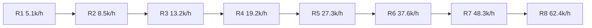

# Wild Animal Cash Rewards

The main Cash source. This page defines the reward formula (from [[Canonical Proposed Values]] §6), states the **assumptions** behind the cash-per-hour model, and gives per-region income estimates used by every other economy page.

> [!success] CONFIRMED
> Defeating wild animals earns Cash (D-014). Wild animals respawn, and rarer ones respawn more slowly (D-011). Progression luck does **not** affect wild encounter rarity (D-017).

## 1. Reward formula (PROPOSED)

```
Cash = BaseCash(rarity) × RegionMultiplier × (1 + CashBonuses)
XP   = BaseXP(rarity)   × RegionMultiplier
```

| Rarity | Base Cash | Base XP | Respawn | Spawn behaviour |
|---|---:|---:|---|---|
| Common | 10 | 10 | 20 s | Fixed points |
| Uncommon | 16 | 15 | 35 s | Fixed points |
| Rare | 28 | 25 | 60 s | Fewer fixed points |
| Epic | 50 | 45 | 120 s | Dedicated points |
| Legendary | 95 | 80 | 300 s | One point per region, 50% per window |
| Mythical | 190 | 150 | 900 s window | Rare-spawn event, 25% per window, announced |
| Secret | 400 | 300 | 2,700 s window | Rare-spawn event, 10% per window, announced |

Region multipliers: ×1.0, ×1.5, ×2.2, ×3.2, ×4.5, ×6.2, ×8.5, ×11.5 (Regions 1–8). `CashBonuses` = Multiplier Shrine + Trophy Hall, additive, max 0.62 ([[Progression Multipliers]]).

**Kill credit (D-040, PROPOSED):** each player who dealt ≥ 10% of the target's max HP within the combat-tag window (8 s) receives the full reward. Implications for group farming are analysed in [[Inflation and Farming Exploit Risks]].

## 2. Modelling assumptions

> [!info] PROPOSED modelling assumptions (not design values)
> These assumptions exist only to estimate income. They should be replaced with telemetry from the [[Balance Simulation Plan]] and playtests. They are not spawn tables; spawn composition is owned by [[Wild Animal Spawning and Respawn]] and the region documents.

| Assumption | Value | Reasoning |
|---|---|---|
| Player plays solo, at the recommended level, with a team of the region's typical rarity | — | Baseline case |
| Kills per minute (KPM) | R1 6.0, R2 5.5, R3 5.0, R4 5.0, R5 4.5, R6 4.5, R7 4.0, R8 3.5 | Time to kill ~4–5 s plus ~5–6 s travel; later regions have tougher mixes and sparser points |
| Kill mix (Common/Uncommon/Rare/Epic %) | R1 60/30/10/0, R2 50/30/15/5, R3–R4 40/30/20/10, R5–R6 35/30/20/15, R7 30/30/25/15, R8 25/30/25/20 | Rarer animals appear more often in later regions |
| Legendary kills per hour | 2 | Six server spawns per hour per region, shared credit, travel time |
| Mythical kills per hour | 0.5 in Regions 5–8 | One server event per hour on average; player attends half |
| Secret kills per hour | 0.1 in Regions 7–8 | 0.13 server events per hour |
| Boss Cash | Excluded | Boss rewards are **UNDECIDED** ([[Open Questions#Q-015]]); options in [[Boss Rewards]] |

### Sanity check on time to kill

Region 1, level 5 player with three Common Bruisers. Using the canonical damage formula against a wild Common with DEF 10 (factor `100 / 110 ≈ 0.91`), each Bruiser deals about `20 × 0.91 ≈ 18` per hit at ~0.95 hits/s, so ≈ 52 DPS for the team. The player (Strength `10 + 2 × 4 = 18`, combo averaging 1.0 × Strength per 0.45 s hit) adds about `18 ÷ 0.45 × 0.91 ≈ 36` DPS. Team DPS ≈ 90 against a wild Common with `200 × 2.0 = 400` HP gives ≈ 4.4 s per kill. With ~5.5 s travel and targeting, ≈ 6 kills per minute. Later regions assume player power keeps pace with the region multiplier (rarer team, ascension, Training Grounds).

## 3. Income by region

Average base Cash per kill = Σ(mix × BaseCash). Raw income excludes all bonuses.

| Region | Mult | KPM | Avg base Cash per kill | Raw base Cash per hour | **Raw Cash per hour** | XP per hour | Rolls per hour (raw) |
|---|---:|---:|---:|---:|---:|---:|---:|
| 1 Whisperwood Forest | 1.0 | 6.0 | 13.6 | 5,086 | **5,086** | 4,840 | 25 |
| 2 Sunscorch Savanna | 1.5 | 5.5 | 16.5 | 5,635 | **8,452** | 7,912 | 42 |
| 3 Emerald Canopy | 2.2 | 5.0 | 19.4 | 6,010 | **13,222** | 12,232 | 66 |
| 4 Coral Coast | 3.2 | 5.0 | 19.4 | 6,010 | **19,232** | 17,792 | 96 |
| 5 Frostfang Tundra | 4.5 | 4.5 | 21.4 | 6,063 | **27,284** | 25,054 | 136 |
| 6 Skyreach Peaks | 6.2 | 4.5 | 21.4 | 6,063 | **37,591** | 34,518 | 188 |
| 7 Emberheart Caldera | 8.5 | 4.0 | 22.3 | 5,677 | **48,254** | 44,072 | 241 |
| 8 Starfall Sanctuary | 11.5 | 3.5 | 24.3 | 5,428 | **62,422** | 56,781 | 312 |

Raw base Cash per hour stays almost flat (5,100–6,100) by design: tougher mixes offset slower kills. **Growth comes almost entirely from the region multiplier**, which keeps the curve easy to reason about and tune.

### With base bonuses

| Region | +0% | +20% (Shrine L2) | +50% (Shrine L5) | +62% (Shrine L5, 12 trophies) |
|---|---:|---:|---:|---:|
| 1 | 5,086 | 6,103 | 7,629 | 8,239 |
| 2 | 8,452 | 10,142 | 12,678 | 13,692 |
| 3 | 13,222 | 15,866 | 19,833 | 21,420 |
| 4 | 19,232 | 23,078 | 28,848 | 31,156 |
| 5 | 27,284 | 32,741 | 40,926 | 44,200 |
| 6 | 37,591 | 45,109 | 56,386 | 60,897 |
| 7 | 48,254 | 57,905 | 72,381 | 78,171 |
| 8 | 62,422 | 74,906 | 93,633 | 101,124 |



## 4. Rare-spawn contribution

At Starfall Sanctuary, one Mythical (190 × 11.5 = 2,185) and one Secret (400 × 11.5 = 4,600) are each worth less than one minute of normal farming income in total (~1,040 Cash per minute). Rare spawns are therefore **excitement and index events, not economic events**. This is intentional: it limits the value of server-hopping for rare spawns ([[Inflation and Farming Exploit Risks]]).

## 5. Implementation notes

- Reward is computed and granted on the server when the wild animal's HP reaches 0 ([[Combat Rewards]], [[Service - EconomyService]]).
- Contributor list is built from damage records within the 8 s combat-tag window ([[Multiplayer Combat Rules]]).
- Each grant writes a ledger entry: `{ reason = "WildDefeat", species, region, base, mult, bonus, amount }`.
- Rounding: `math.floor(x + 0.5)` once, after all multipliers.
- Test hook: a debug command (Studio only) that prints the reward breakdown for the last kill. Statistical checks of reward totals: [[Test Cases - Combat]].

## Related documents
- [[Economy Overview]]
- [[Cash Sources and Sinks]]
- [[Progression Multipliers]]
- [[Combat Rewards]]
- [[Wild Animal Spawning and Respawn]]
- [[Region Unlock Progression]]
- [[Progression Bottleneck Analysis]]
- [[Inflation and Farming Exploit Risks]]
