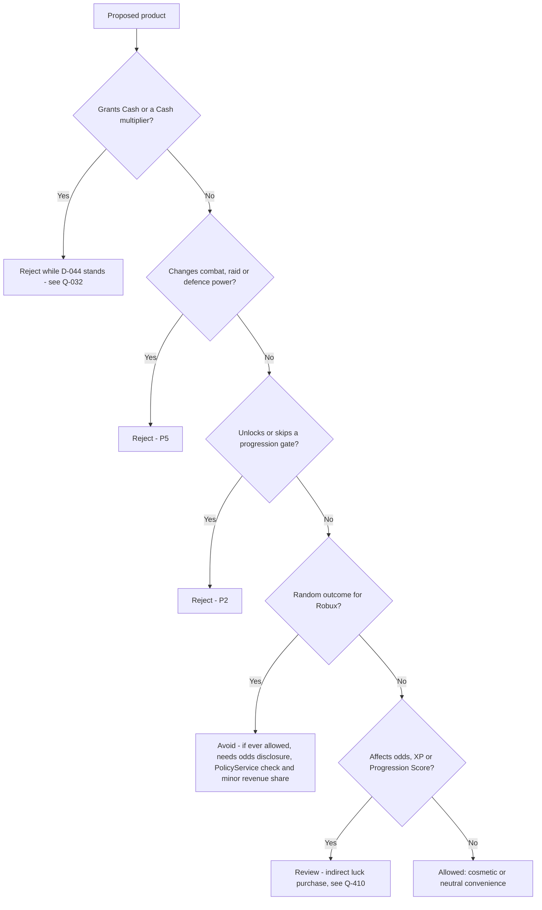

# Monetisation Principles

The rules every Robux product must satisfy. Product ideas live in [[Monetisation Product Concepts]]; the free player's journey in [[Free-to-Play Experience]]; platform rules in [[Roblox Monetisation Policy Requirements]].

> [!success] CONFIRMED (D-027)
> - Monetisation is **balanced**.
> - The game is **fully playable without Robux**.
> - **No essential progression** is placed behind purchases.
> - **Paid random rewards are not the main revenue mechanism.**

> [!info] PROPOSED (D-044)
> **Cash is never sold for Robux**, directly or indirectly. Whether any Robux product may grant Cash is **UNDECIDED** ([[Open Questions#Q-032]]).

## 1. The principles

| # | Principle | Test a product must pass | Status |
|---:|---|---|---|
| P1 | Full playability | Every region, animal, module level, station level and ascension level is reachable with Cash earned in play | **CONFIRMED** (D-027) |
| P2 | No essential progression for sale | The product does not unlock, skip or shorten a progression gate (region, boss, station, module level, storage step needed for core loops) | **CONFIRMED** (D-027) |
| P3 | No Cash for Robux | The product grants no Cash and no Cash multiplier, now or through a bundle | **PROPOSED** (D-044) |
| P4 | No paid randomness as a core earner | No loot boxes for Robux. Paid random items, if any are ever added, must be a minor revenue share, disclose odds, and respect PolicyService restrictions | **CONFIRMED** principle (D-027); details **PROPOSED** |
| P5 | No PvP power for sale | Nothing purchasable increases raid attack, raid defence, shield time, theft protection or combat stats | **PROPOSED** |
| P6 | Cosmetics first | The main revenue comes from deterministic cosmetics, base cosmetics and convenience that does not affect power | **PROPOSED** |
| P7 | Readability and honesty | Price in Robux is shown before purchase; no fake discounts, no fake scarcity, no countdown pressure on standard items | **PROPOSED** |
| P8 | Child-appropriate design | No manipulative patterns (confirm-shaming, "last chance" spam, pop-ups during combat or hatching) | **PROPOSED** |
| P9 | Respect odds disclosure everywhere | Even free random systems show odds before commitment (D-017) | **CONFIRMED** principle |
| P10 | Reversible mistakes | Accidental purchases of consumables can be refunded through support policy where Roblox allows; purchases are logged with receipts | **PROPOSED** |

## 2. Classification of product types

## 3. Ethics

- **Audience.** Roblox has a large young audience. We design every purchase screen as if the buyer is a child and the reviewer is their parent.
- **No pressure loops.** Purchase prompts are only shown when the player opens the shop or interacts with a cosmetic vendor. Never after a defeat, a theft or a disappointing hatch.
- **No pay-to-protect.** A raid victim must never be shown "buy protection" offers. Post-raid screens show only free options (shield, guards, vault upgrades with Cash).
- **Transparent value.** Bundles list every item and the individual prices; a "value" percentage is shown only if it is mathematically true.
- **Parity of joy.** Free players get cosmetic rewards too (boss trophies, A5 auras, index milestone titles), so the most prestigious visuals are earned, not bought.

## 4. Revenue model target (PROPOSED)

| Revenue stream | Target share | Notes |
|---|---:|---|
| Cosmetics (player, animal accessories, emotes, trails) | 40–50% | Deterministic, direct purchase |
| Base cosmetics (module skins, shield tints, decor) | 20–30% | Show-off value in a shared world |
| Game passes (cosmetic and convenience) | 15–25% | One-time purchases |
| Other (private servers if offered, Q-413; engagement-based platform payouts, *unverified* details) | 5–10% | Platform-dependent |
| Paid random items | **0% at launch** | Satisfies D-027 trivially |

## 5. Governance

- Every new product is checked against this page and listed in [[Monetisation Product Concepts]] with a status.
- Products that touch economy, odds or raids need sign-off from the Economy and Progression Designer and the owner.
- Changes are recorded in the [[Decision Register]] and [[Changelog]].

## Related documents
- [[Monetisation Product Concepts]]
- [[Free-to-Play Experience]]
- [[Roblox Monetisation Policy Requirements]]
- [[Design Principles and Fairness Charter]]
- [[Economy Overview]]
- [[UI - Shop]]
- [[Economy and Monetisation Index]]
