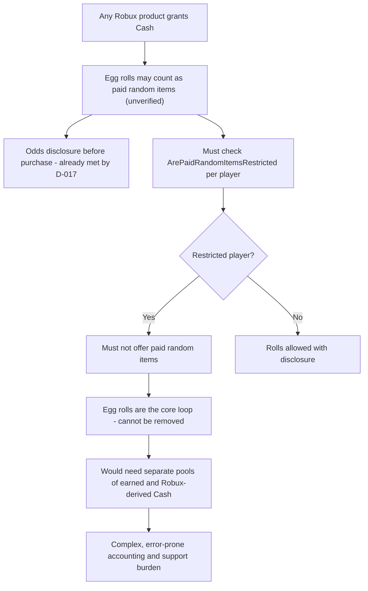

# Roblox Monetisation Policy Requirements

The platform rules our monetisation and egg systems must respect, how we interpret them, and the design risk around Cash and paid random items.

> [!danger] Verification required
> Roblox policies change. Every policy statement on this page is a **summary in our own words** and is marked *unverified* until the Monetisation Designer checks it against the current official Roblox policy and documentation and records the check date in [[Roblox Platform References]]. Do not quote this page as Roblox policy. No policy text is quoted here and no URLs are given.

## 1. Requirements as we understand them (*unverified*)

| # | Requirement (our summary) | Applies to us? | Our approach | Status |
|---:|---|---|---|---|
| R-1 | Experiences that sell **paid random items** (random outcomes obtained directly or indirectly with Robux) must **disclose the odds** before purchase (*unverified* wording) | Not at launch, provided Cash cannot be obtained with Robux | We disclose odds for **all** rolls and hatches anyway (D-017) | *unverified* |
| R-2 | In some jurisdictions or for some users, paid random items are **restricted**. `PolicyService:GetPolicyInfoForPlayerAsync` returns a table that includes `ArePaidRandomItemsRestricted`; when it is true, paid random items must not be offered to that player | Only if we ever have paid random items | Check on join, cache, fail safe | API **real**; obligations *unverified* |
| R-3 | Developer product purchases must be granted reliably via `MarketplaceService.ProcessReceipt`, returning `PurchaseGranted` only after the grant is durable | Yes | Idempotent handler ([[Monetisation Product Concepts]]) | API real; best practice |
| R-4 | User-generated text (e.g. animal names) must be filtered | Yes (name tags) | TextService filtering server-side ([[Security Architecture]]) | *unverified* details |
| R-5 | Experience content and monetisation must suit the experience's declared maturity and audience settings | Yes | Child-appropriate design ([[Monetisation Principles]]) | *unverified* |
| R-6 | No off-platform payments or links to external purchases | Yes | No external links; `PolicyInfo` also exposes allowed external link references (*unverified* field details) | *unverified* |
| R-7 | Trading of paid items may be restricted for some users (a policy field for paid item trading exists in `PolicyInfo`, *unverified* name and semantics) | Not at launch (no trading, D-045) | Re-check if trading is ever added ([[Open Questions#Q-026]]) | *unverified* |

## 2. Are egg rolls paid random items?

Egg rolls are random (two-stage, D-015) and are bought with **Cash**. Whether they count as paid random items depends on whether **Cash can be obtained with Robux, directly or indirectly**.

> [!info] PROPOSED (D-044)
> Cash is never sold for Robux, so egg rolls bought with Cash are not paid random items.

> [!warning] UNDECIDED ([[Open Questions#Q-032]])
> Can any Robux product grant Cash, directly or indirectly? Until the owner decides, every product proposal is evaluated as if the answer must stay **no**.

### Risk analysis: what counts as "indirectly"

| Product idea | Path to Cash | Risk that rolls become paid random (*unverified* interpretation) | Recommendation |
|---|---|---|---|
| Buy Cash packs | Direct | **Very high** | Never |
| Cash ×2 boost | Indirect: Robux → more Cash per kill | **High** | Never while D-044 stands |
| Bundle containing Cash | Direct | **Very high** | Never |
| XP boost | No Cash; raises level and Progression Score, which improves odds | Low for "paid random" classification, but it is an indirect **odds** purchase | Review (Q-410); not at launch |
| Robux storage expansion | No Cash; allows holding more eggs | Low | Base storage only, if at all ([[Storage Expansion Economics]]) |
| Fast travel pass | Saves time, so more Cash per hour | Low–medium (time-to-Cash conversion) | Make fast travel free for all |
| Cosmetics | None | None | Allowed |
| Raid rewards involving stolen eggs from a payer | Value moves between players; no Robux involved | None | — |

### Consequences if rolls did become paid random items



> [!danger] Core-loop risk
> If Cash ever becomes obtainable with Robux, a restricted player could be barred from the **core loop** (egg rolls), or we would need to track "earned" versus "Robux-derived" Cash separately and only allow earned Cash to roll. Both outcomes are unacceptable for launch. This is the main compliance argument for keeping D-044 and answering Q-032 with "no".

## 3. Implementation: PolicyService check

Even with no paid random items at launch, we query policy on join so future features can rely on a cached, fail-safe flag.

```lua
-- Illustrative Luau (not executed)
local PolicyService = game:GetService("PolicyService")
local Players = game:GetService("Players")

local policyCache: { [number]: { paidRandomRestricted: boolean } } = {}

local function loadPolicy(player: Player)
	local ok, info = pcall(function()
		return PolicyService:GetPolicyInfoForPlayerAsync(player)
	end)
	-- Fail safe: if the call fails, treat paid random items as restricted.
	local restricted = true
	if ok and type(info) == "table" and info.ArePaidRandomItemsRestricted ~= nil then
		restricted = info.ArePaidRandomItemsRestricted
	end
	policyCache[player.UserId] = { paidRandomRestricted = restricted }
end

Players.PlayerAdded:Connect(loadPolicy)
Players.PlayerRemoving:Connect(function(player) policyCache[player.UserId] = nil end)
```

The flag must be checked server-side before any future paid random feature is offered or processed. Client UI only hides options; the server enforces. API notes: [[Roblox API Reference Notes]].

## 4. Odds disclosure (applies to all random systems)

Already required by our own CONFIRMED rule (D-017) and enforced technically (D-041):
- The exact current odds for each rarity, and the hatch pool odds, are shown before every roll or hatch.
- Odds are bound to an `oddsVersion` token; stale tokens are rejected.
- Odds never change silently after a purchase.

Details: [[Randomised Reward Compliance]], [[Egg Roll System]], [[Hatch System]].

## 5. Verification checklist (before beta)

| # | Item | Owner | Done |
|---:|---|---|---|
| 1 | Confirm current Roblox definition of paid random items and whether "indirectly with Robux" covers Robux-derived soft currency | Monetisation Designer | ☐ |
| 2 | Confirm current odds-disclosure obligations and display requirements | Monetisation Designer | ☐ |
| 3 | Confirm `PolicyInfo` field names and semantics in current documentation | Lead Engineer | ☐ |
| 4 | Confirm text filtering requirements for player-named animals | Lead Engineer | ☐ |
| 5 | Confirm maturity and audience questionnaire implications for raids and PvP | Producer | ☐ |
| 6 | Record findings and dates in [[Roblox Platform References]] | Monetisation Designer | ☐ |

## Related documents
- [[Monetisation Principles]]
- [[Monetisation Product Concepts]]
- [[Randomised Reward Compliance]]
- [[Roblox API Reference Notes]]
- [[Roblox Platform References]]
- [[Storage Expansion Economics]]
- [[Economy and Monetisation Index]]
