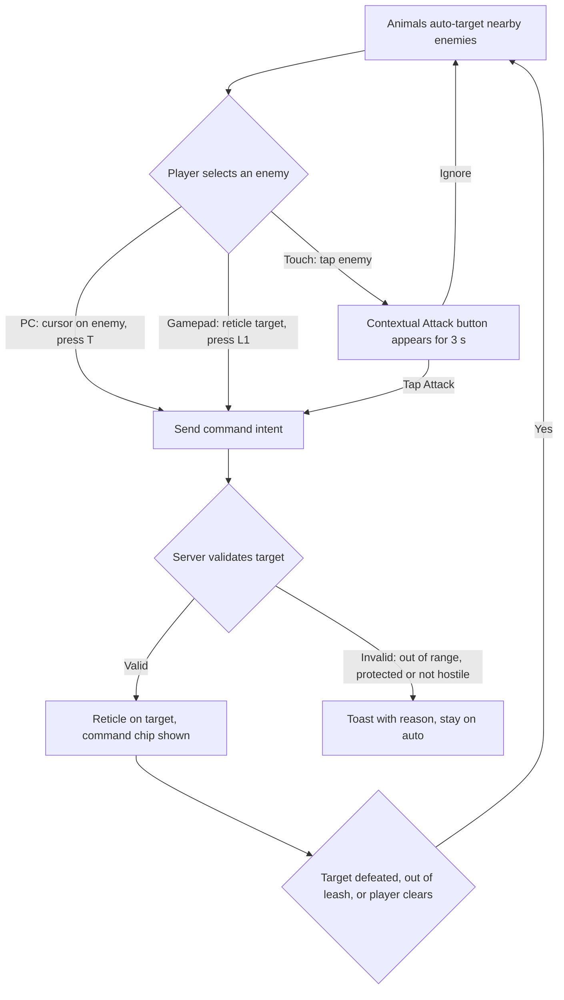

# UI - Animal Team Display

> [!success] CONFIRMED
> - Exactly **three** equipped animals (D-006).
> - Abilities can be **manual or automatic**; both kinds exist (D-008).
> - Animals **auto-target** nearby enemies; the player can issue **manual target commands** (D-009).

> [!info] PROPOSED
> Layout, button behaviour, the team-wide command model and all bindings are **PROPOSED**. The 0.5 s global cooldown between manual animal abilities is **PROPOSED** in [[Canonical Proposed Values]] §4.

## Purpose

The in-combat view of the three equipped animals. It must answer, at a glance: *Who is alive? Whose ability can I fire now? Which abilities fire by themselves? Who is the team attacking?* It also hosts the manual target command.

## Layout

Three portrait cards in a fixed order matching the team slots set in [[UI - Team Selection]]. Each card has a portrait, health bar and one ability button. A command chip sits above the stack when a manual target command is active.

## Hierarchy

1. Health of each animal (alive / low / knocked out).
2. Manual ability readiness (the only part the player acts on).
3. Automatic ability status (information only).
4. Current command target.

## Elements

| Element | Type | Content | Behaviour |
|---|---|---|---|
| Portrait | `ImageLabel` in `Frame/Rarity` | Pre-rendered animal portrait, ascension stars | Long-press / right-click opens a read-only detail card |
| Health bar | `Bar/Health` (compact) | Fill + number on Large, fill only on Compact (number on long-press) | Low-health icon below 25% |
| Manual ability button | `Btn/Combat` 64 × 64 + `Radial/Cooldown` | Ability icon, `Chip/Manual` glyph ("TAP", `1`/`2`/`3`, or D-pad glyph) | Press fires the ability; shows remaining seconds when cooling down |
| Automatic ability indicator | `ImageLabel` + radial, not a button | Ability icon, `Chip/Auto` "AUTO" | Cannot be pressed; tap shows a tooltip "Fires automatically when ready" |
| Global cooldown sweep | Overlay | 0.5 s sweep on the *other* manual buttons after one fires | Visual only; server enforces |
| Knocked-out overlay | Overlay | Greyed portrait, "KO" label, cross icon | Ability disabled; recovery rules per [[Animal Combat Behaviour]] and [[Player Defeat and Penalties]] |
| Command chip | Chip | Target icon + "Team: attacking Boar" + clear "×" | Tap "×" returns the team to auto-targeting |
| Target reticle | World `BillboardGui` + `Highlight` | Reticle over the commanded enemy | Distinct outline style from the auto-target hint ([[Combat Feedback and Readability]]) |
| Contextual Attack button | `Btn/Combat` (touch only) | "Attack" with team icon | Appears near the tapped enemy for 3 s (**PROPOSED**) |

The ability on each animal, and whether it is manual or automatic, comes from the animal's data in [[Animal Abilities Catalogue]]; the UI never decides it.

> [!warning] UNDECIDED (Q-507)
> Whether a player may switch a manual ability to automatic casting (an "auto-cast" toggle) or whether activation type is fixed per ability. The UI supports both: if a toggle is approved, a long-press on a manual button would flip it and the chip would read "AUTO (set by you)". Until then, activation type is fixed per ability.

## Interactions

### Manual target command



- **PROPOSED:** commands are team-wide at launch (all three animals switch to the target). Per-animal commands are not in the launch UI; see [[Targeting and Command System]] for the authoritative behaviour.
- `G` / tapping the chip's "×" / `ButtonL1` double-press clears the command.

### Abilities

- Manual: press → intent sent → button enters a brief pending state (max one frame of prediction) → radial starts on server confirmation. If rejected (out of range, stunned, global cooldown), the button shakes and a short caption shows the reason.
- Automatic: no input; the radial shows its cooldown so the player can plan around it.

## States

| State | Card appearance |
|---|---|
| Healthy, manual ready | Bright button, ready glow (no glow with Reduced Motion; a static border instead) |
| Manual cooling down | Radial + seconds |
| Global cooldown | 0.5 s sweep |
| Auto ability ready / cooling | AUTO chip, radial |
| Low health | Low-health icon + bar |
| Knocked out | Grey overlay, KO label |
| Animal not in combat range | Portrait dimmed 30% with "Far" caption (**PROPOSED**) |
| Commanded | Command chip; small target icon on each portrait |

## Empty states

If fewer than three animals are equipped (only possible before onboarding completes, see Q-510 in [[UI - Team Selection]]), empty slots show a dashed outline and "Empty slot" with no ability button.

## Error states

| Reason code (illustrative) | Copy |
|---|---|
| `AbilityOnCooldown` | Radial resyncs silently |
| `AnimalKnockedOut` | "Wolf is knocked out" |
| `TargetInvalid` | "Can't target that" |
| `TargetProtected` | "That target can't be attacked right now" (for example a non-PvP player) |

## Loading states

On spawn, cards render from the replicated team snapshot. Until the snapshot arrives, cards show skeletons and buttons are disabled.

## Mobile layout

Vertical stack on the left edge between the player panel and the thumbstick region. Card 72 wide; manual ability button 56–64 to the right of each portrait, so the left thumb can reach it without crossing the thumbstick. Health numbers hidden to save space.

## Desktop layout

Horizontal row at bottom-left beside the hotbar, card 96 wide with health numbers and key glyphs `1`, `2`, `3`.

> [!note] Console / gamepad
> `DPadLeft` / `DPadUp` / `DPadRight` fire manual abilities of slots 1 / 2 / 3. The glyph on each manual button shows its D-pad direction. Target commands use the reticle (nearest enemy in the camera's centre cone) with `ButtonL1`.

## Accessibility

- Manual versus automatic is shown by a button frame **and** the "TAP" / "AUTO" text chip, not by colour.
- Knocked-out state uses a cross icon and "KO" text.
- Enemy reticle is distinguishable by outline shape for colour-vision modes.
- Ability-ready chime has a visual equivalent (radial completes, button brightens).

## Roblox implementation notes

```text
HUD/SafeArea/TeamDisplay (Frame, UIListLayout vertical on Compact, horizontal on Large)
├─ Slot1 · Slot2 · Slot3 (Frame + UICorner + UIStroke rarity ornament)
│  ├─ Portrait (ImageLabel)
│  ├─ HealthBar (Frame/Frame)
│  ├─ AbilityButton (ImageButton, manual only) + CooldownRadial (ImageLabel + UIGradient)
│  └─ AutoIndicator (ImageLabel, auto only)
└─ CommandChip (TextButton)
```

- Manual abilities bind via `ContextActionService` actions (`AnimalAbility1..3`); the on-screen button calls the same handler.
- The client sends `UseAnimalAbility(slot)` and `CommandTarget(targetId)` intents; ability validity, cooldowns, global cooldown and target legality are checked on the server ([[Abilities and Cooldowns]], [[Implementation - Remote Validation Layer]]).
- Health and cooldown state replicate per animal (illustrative attributes on the companion model). Reticle uses one pooled `Highlight` and `BillboardGui`.
- Touch enemy selection uses a screen-point raycast from `workspace.CurrentCamera:ViewportPointToRay`, filtered to hostile targets with `CollectionService` tags.

## Wireframe

```text
 Team: attacking Boar  [×]
+-----------+  +------+
| (Wolf)  ★★|  | [⚔]  |  TAP   ← manual, ready
| ████████░ |  +------+
+-----------+
+-----------+  +------+
| (Fox)     |  | (◔)  |  AUTO  ← auto, cooling 3s
| ██████░░░ |  +------+
+-----------+
+-----------+  +------+
| (Deer) KO |  | [ ✖ ]|  disabled
| ░░░░░░░░░ |  +------+
+-----------+
```

## Related documents

- [[Abilities and Cooldowns]] · [[Targeting and Command System]] · [[Animal Combat Behaviour]] · [[Animal Abilities Catalogue]]
- [[UI - Main HUD]] · [[UI - Team Selection]] · [[Combat Feedback and Readability]] · [[Animation - Animal Abilities]]
