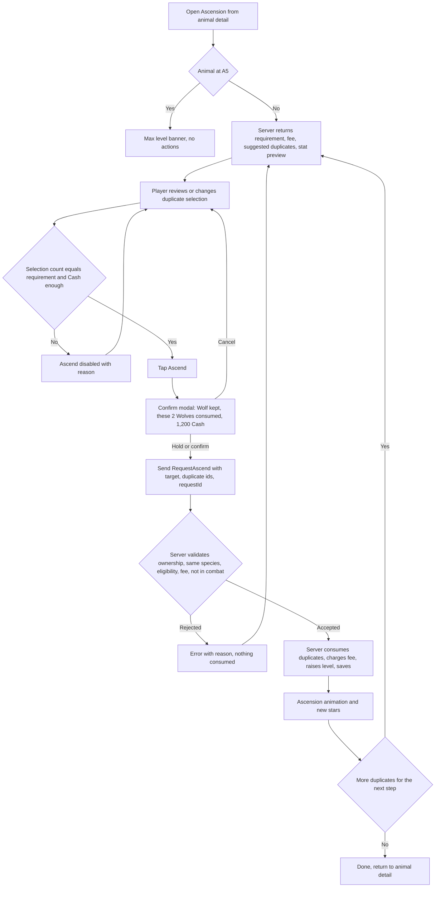

# UI - Ascension

> [!success] CONFIRMED
> Ascension consumes the required duplicates of the same animal; the **original is kept** (D-019). Duplicates come from independent hatches (D-018).

> [!info] PROPOSED
> Five levels A1–A5 ([[Open Questions#Q-004]]), duplicate requirements and Cash fees per [[Canonical Proposed Values]] §9 ([[Open Questions#Q-005]]), +8% HP/ATK/DEF and +5% ability effectiveness per level. Fodder selection rules, hold-to-confirm and the layout are **PROPOSED**.

## Purpose

Turn duplicates into permanent progress on one chosen animal, making it unmistakable **which animal is kept**, **which duplicates are consumed**, and what the player gains and pays.

## Layout

- Left / top: the target animal (3D preview, current stars, next stars).
- Centre: stat comparison (current → next).
- Right / bottom: duplicate selector with the required count, fee and the confirm button.

## Hierarchy

1. Target animal and "A2 → A3".
2. What will be consumed (portraits).
3. Gains (stat deltas, visual tier).
4. Cost (duplicates + Cash) and confirm.

## Elements

| Element | Type | Content | Behaviour |
|---|---|---|---|
| Target card | `Card/Animal` (large) + `Preview/3D` | "Wolf · Rare · A2" with "Kept" label | Preview shows the next visual tier on toggle ([[Animation - Ascension]]) |
| Step label | `type.title` | "A2 → A3" | |
| Stat comparison | Table | HP, ATK, DEF before → after, ability "+10% → +15%" | Server-calculated values |
| Visual tier note | Caption | "A3: soft aura" | From [[Canonical Proposed Values]] §9 |
| Requirement counter | `Counter/Selection` | "Duplicates 2 / 2 selected" | |
| Duplicate grid | `UIGridLayout` of `Card/Animal` | Only same-species instances | Tap toggles; auto-selected on open |
| Ineligible duplicate | Card + `Chip/Locked` | "Equipped", "Guard", "Favourite" | Cannot be consumed (**PROPOSED**); tap explains |
| Warning chip | `Chip` (warning) | "A1 — its ascension will be lost", "Golden variant" | Shown on selected duplicates with value |
| Fee | `Btn/PriceCash` label | "1,200 Cash" | |
| Ascend | `Btn/HoldConfirm` or `Btn/Primary` | "Hold to ascend" | Hold required for Legendary and above, or when any selected duplicate is ascended or a variant (**PROPOSED**); tap-twice alternative in Settings |
| Max level state | Banner | "Wolf is at maximum ascension (A5)" | All controls hidden |

### Auto-selection of duplicates (PROPOSED)

When the screen opens, the server suggests duplicates in this order: lowest ascension first, then non-variants before variants, then oldest first. Equipped, guard and favourite animals are never suggested. The player can change the selection.

> [!warning] UNDECIDED (Q-503)
> Whether a variant (for example a Golden Wolf) counts as a duplicate of its base species for ascension. The UI supports both: if variants count, they appear in the grid with a "Golden variant" warning chip; if not, they are hidden from the grid.

> [!warning] UNDECIDED (Q-504)
> Where ascension can be performed: anywhere outside combat (UI working assumption) or only at the base. If base-only is chosen, the screen opens in a locked view away from base, like [[UI - Team Selection]].

## Worked example (PROPOSED values)

Wolf (Rare) at A2 → A3. Rare duplicates per step are 1 / 1 / 2 / 3 / 3, so A3 needs **2** duplicates. Fee = 400 × 3 = **1,200 Cash**. Stat bonus rises from +16% to +24%: HP before species tweak 374 × 1.16 = 434 → 374 × 1.24 = 464. Ability effectiveness +10% → +15%.

## Interactions



The confirm modal always shows the target portrait under the heading **"Kept"** and each consumed portrait under **"Consumed"**, with the rarity, ascension and variant of each. This directly reflects D-019.

## States

| State | Display |
|---|---|
| Requirement met | Ascend enabled |
| Not enough duplicates | "You need 1 more Wolf" — factual, no hint that hatching is more likely to give one (D-018) |
| Not enough Cash | "You need 300 more Cash" |
| In combat | Disabled: "Finish combat first" |
| Pending | Spinner; grid locked |
| Animation | Reveal layer, skippable after first viewing |
| A5 | Max banner |

## Empty states

No duplicates owned: the grid shows `Empty/Block` "You have no other Wolves. Duplicates from hatching can be used here." No copy suggests the player is "due" a duplicate.

## Error states

| Reason code (illustrative) | Copy |
|---|---|
| `DuplicateNotEligible` | "One selected Wolf can't be used (equipped, guard or favourite)." |
| `WrongSpecies` | "Only Wolves can be used." (modified client only) |
| `InsufficientCash` | "Not enough Cash." |
| `AnimalMissing` | "One of these animals is no longer in your collection." (for example stolen) |
| `MaxLevel` | "Already at maximum ascension." |

## Loading states

The target card renders from the collection snapshot immediately; the requirement, stat preview and suggested selection show skeletons until the quote arrives. Ascend stays disabled until then.

## Mobile layout

Target and step label at the top with a small static preview (animated only on tap); stat comparison as a two-column list; duplicate grid in a horizontal scroll; fee and Ascend pinned at the bottom.

## Desktop layout

Three columns: target with animated preview, stats, duplicate grid with fee and Ascend.

> [!note] Console / gamepad
> `ButtonA` toggles a duplicate; hold `ButtonY` to ascend (the hold progress fills the button); right stick rotates the preview.

## Accessibility

- "Kept" and "Consumed" are text headings, not colour.
- Hold-to-confirm has the tap-twice alternative ([[UI Accessibility Standards]] §4).
- Stat changes are text ("374 → 464"), with optional bars.

## Roblox implementation notes

```text
Panels/Ascension (Frame)
├─ Target (Frame) → ViewportFrame + WorldModel, Stars (UIListLayout)
├─ Stats (Frame, UIListLayout)
├─ Duplicates (ScrollingFrame + UIGridLayout)
└─ Footer → Fee, AscendButton (TextButton + hold fill Frame)
Modals/AscendConfirm (Frame) → Kept row, Consumed row (UIListLayout)
```

- Quote: illustrative `GetAscensionQuote(animalId)`; commit: `RequestAscend(animalId, duplicateIds, requestId)`. The server is authoritative on eligibility, fee and level, and performs the change as one transaction ([[Implementation - Ascension Transaction]], [[Service - AscensionService]]).
- Hold-to-confirm is a client courtesy only; it adds no security. The server must still validate everything.

## Wireframe

```text
+-------------------------------- Ascension --------------------------------[X]+
|  KEPT                         |  A2 → A3              |  CONSUME 2/2          |
|  ( 3D Wolf preview )          |  HP   434 → 464       |  +----+ +----+ +----+ |
|  Wolf · Rare · ★★             |  ATK   39 → 42        |  |Wolf| |Wolf| |Wolf | |
|  [Preview A3 look]            |  DEF   22 → 23        |  | ✓  | | ✓  | |Equip| |
|                               |  Ability +10% → +15%  |  +----+ +----+ +----+ |
|                               |  A3: soft aura        |  Fee 1,200 Cash       |
|                               |                       |  [ Hold to ascend ]   |
+-------------------------------------------------------------------------------+
```

Stats in the wireframe use the formula values before the species tweak; real values come from [[Animal Statistics Database]] and [[Ascension Progression Table]].

## Related documents

- [[Ascension System]] · [[Ascension Progression Table]] · [[Ascension Expected Value Analysis]] · [[Independent Random Outcomes]]
- [[UI - Animal Inventory]] · [[UI - Egg Hatching]] · [[Animation - Ascension]] · [[Sound - Ascension]]
- [[Implementation - Ascension Transaction]] · [[Service - AscensionService]] · [[Test Cases - Ascension]]
