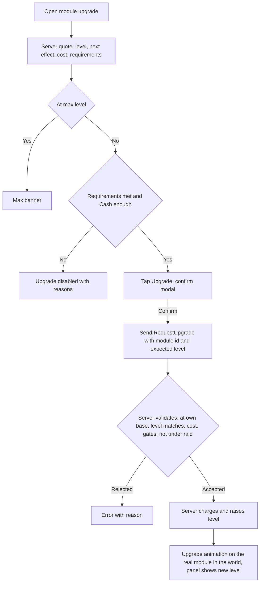

# UI - Base Upgrades

> [!success] CONFIRMED
> - Each base section is upgraded separately (D-022).
> - The Egg Merging Station must be upgraded for higher rarities and changes appearance with each upgrade (D-020).

> [!info] PROPOSED
> Module costs `Cost(L) = BaseCost × 2.5^(L − 1)` for L1–L5 and effects ([[Canonical Proposed Values]] §12); station costs and gates (§10, **UNDECIDED** [[Open Questions#Q-019]]); plot expansion `5,000 × 3^(n − 1)`. Upgrades are instant with an animation; no build timers are proposed. Layout is **PROPOSED**.

## Purpose

Show one module's full upgrade path, what the next level does, what it costs, what it will look like, and any extra gate, then let the player buy it at their base.

## Layout

- Left / top: module 3D preview with a Current / Next toggle.
- Right / bottom: level track L1–L5, next-level effect, cost, requirements, Upgrade button.
- Module switcher: horizontal strip of all modules (to move between upgrades without going back).

## Hierarchy

1. Next level effect (why upgrade).
2. Cost and affordability.
3. Visual change preview.
4. Full level track.

## Elements

| Element | Type | Content | Behaviour |
|---|---|---|---|
| Module switcher | `Tab/Bar` (scrollable) | All modules incl. Egg Merging Station and Plot | Badge "Upgrade available" when affordable |
| Preview | `Preview/3D` | Module model at current / next level (`MOD-##`) | Toggle Current / Next; rotate by drag / right stick |
| Level track | 5 pips | L1–L5, current filled | Tap a pip to read that level's effect |
| Effect (next) | Text block | e.g. "Training Grounds L4: +20% player Strength, +16% equipped animal stats" | Cumulative values from server config |
| Effect delta | Caption | "+5% Strength, +4% animal stats" | |
| Cost | `Btn/PriceCash` | "Upgrade · 23,438 Cash" | Disabled with "You need 4,210 more Cash" |
| Requirements | Checklist | e.g. station L2 "Region 2 unlocked ✓" | Unmet items explain how to meet them |
| Max level | Banner | "Maximum level reached" | |
| Upgrade confirm | `Modal/Confirm` | Module, from → to, cost, effect | Mandatory |

### Cost examples (PROPOSED, from §12 and §10)

| Item | Current → next | Cost |
|---|---|---:|
| Training Grounds | L3 → L4 | 23,438 |
| Shield Generator | L1 → L2 | 6,250 |
| Multiplier Shrine | build L1 | 3,000 |
| Egg Merging Station | L1 → L2 (Stonebound Hatchery Forge, needs Region 2) | 15,000 |
| Plot expansion | stage 2 → 3 | 45,000 |

## Interactions



The request includes the **expected current level** so a double tap cannot buy two levels; the server rejects a mismatch.

## States

| State | Display |
|---|---|
| Affordable | Upgrade enabled |
| Unaffordable | Disabled with amount needed |
| Gate unmet | Requirement row unticked with reason |
| Away from base | Read-only; "Upgrade at your base" (**PROPOSED**) |
| Under raid | Disabled (**PROPOSED**, Q-506) |
| Pending | Spinner |
| Max | Banner |

## Empty states

Module not built: the screen shows "Build" as L1 with the build cost; the preview shows the L1 model.

## Error states

| Reason code (illustrative) | Copy |
|---|---|
| `LevelMismatch` | "This module was already upgraded." (panel refreshes) |
| `InsufficientCash` | "Not enough Cash." |
| `GateNotMet` | "Unlock Sunscorch Savanna first." |
| `ModuleUnavailable` | "This module isn't available yet." (if launch availability excludes it, Q-007) |
| `NotAtOwnBase` / `BaseUnderRaid` | As in [[UI - Base Management]] |

## Loading states

Module switcher and level track render from base data; preview loads its model asynchronously with a static image placeholder; Upgrade disabled until the quote arrives.

## Mobile layout

Preview in the top 40% (static image by default, 3D on tap to save frame rate); level track, effect and cost below; Upgrade pinned at the bottom. Module switcher as a scrolling strip under the header.

## Desktop layout

Preview on the left half; details on the right half; switcher along the top.

> [!note] Console / gamepad
> `ButtonL1`/`ButtonR1` change module; `ButtonX` toggles Current / Next preview; `ButtonY` upgrades.

## Accessibility

- Level pips include numbers ("L3"), not only filled shapes.
- Effects are written as full sentences with numbers.
- The Current / Next toggle also changes a text label ("Showing: Next level").

## Roblox implementation notes

```text
Panels/BaseUpgrades (Frame)
├─ Switcher (ScrollingFrame, UIListLayout horizontal)
├─ Preview (ViewportFrame + Camera; model cloned per level)
├─ Track (Frame, UIListLayout horizontal) → Pip ×5
└─ Details (Frame) → Effect, Requirements (UIListLayout), UpgradeButton
```

- Commit: illustrative `RequestUpgrade(moduleId, expectedLevel, requestId)` to [[Service - BaseService]]; all costs, effects and gates come from server config ([[Configuration Modules]]).
- The in-world module change is replicated by the server; the panel only reflects the new level after replication.

## Wireframe

```text
+---------------------------- Base Upgrades -------------------------------[X]+
| [Training ●] [Egg Vault] [Defence] [Shield] [Shrine] [Trophy] [Pens] [Merge] |
|-----------------------------------------------------------------------------|
|  ( 3D Training Grounds )     |  Training Grounds        L ● ● ● ○ ○        |
|  [Current] [Next]            |  Next: Level 4                               |
|                              |  +20% player Strength (+5%)                  |
|                              |  +16% equipped animal stats (+4%)            |
|                              |  Requirements: none                          |
|                              |  [ Upgrade · 23,438 Cash ]                   |
+-----------------------------------------------------------------------------+
```

## Related documents

- [[Base Upgrade System]] · [[Cost Tables]] · [[Egg Merging Station]] · [[Base Layout and Plot Expansion]]
- [[Module - Training Grounds]] · [[Module - Egg Vault]] · [[Module - Defence Station]] · [[Module - Shield Generator]] · [[Module - Multiplier Shrine]] · [[Module - Trophy Hall]] · [[Module - Animal Pens]]
- [[UI - Base Management]] · [[Animation - Base Upgrades]] · [[Test Cases - Bases and Upgrades]]
