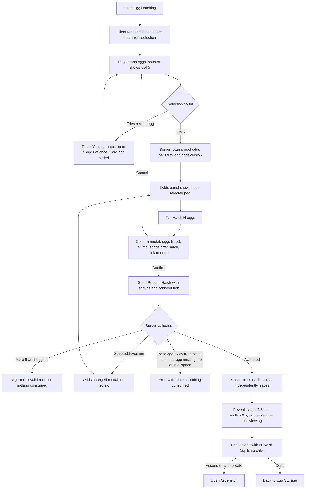

# UI - Egg Hatching

> [!success] CONFIRMED
> - Hatching picks an animal from the egg rarity's pool (D-015).
> - Up to **five** eggs can be hatched at once (D-016). Six or more is impossible in the UI and rejected by the server.
> - Hatch odds are affected by progression luck and must be shown before committing, never changed silently (D-017).
> - Every hatch is independent: no duplicate protection, no bias towards unowned animals (D-018).

> [!info] PROPOSED
> - Hatch presentation: instant result, 3.5 s single-egg and 5.0 s multi-hatch animation, skippable after first viewing ([[Canonical Proposed Values]] §7; timed incubation is an alternative, [[Open Questions#Q-023]]).
> - Hatch location: backpack eggs anywhere outside combat; base-stored eggs only at the base (**PROPOSED**).
> - `oddsVersion` re-confirm (D-041) applies to hatch odds as well as roll odds.
> - Layout and selection behaviour are **PROPOSED**.

## Purpose

Select one to five eggs, see the **current hatch odds for each selected egg's pool**, confirm, and enjoy the reveal. Results land in the collection with clear NEW / Duplicate labelling that never implies protection or bias.

## Layout

- Selection tray (top): five slots, "x / 5 selected".
- Egg picker (middle): tabs Backpack / Base storage, grid of `Card/Egg`.
- Odds panel (right on Large, collapsible sheet on Compact): one tab per distinct rarity among the selected eggs, listing every animal in that pool and its current chance.
- Footer: Hatch button with count, animal storage indicator.

## Hierarchy

1. Selection tray and the "x / 5" counter.
2. Hatch button.
3. Odds panel (must be reachable in one tap from the Hatch button's surface).
4. Picker grid.

## Elements

| Element | Type | Content | Behaviour |
|---|---|---|---|
| Selection tray | 5 slots | Selected eggs in order | Tap a filled slot to remove |
| Selection counter | `Counter/Selection` | "3 / 5 selected" | At 5 / 5 all unselected cards dim with "Maximum 5" |
| Picker tabs | `Tab/Bar` | "Backpack 7 / 10" · "Base storage 31 / 50" | Base tab disabled with "Base eggs can only be hatched at your base" away from base |
| Egg card | `Card/Egg` | Egg art, rarity, `Chip/Safe` or `Chip/Raidable` | Tap toggles selection |
| Quick select | `Btn/Ghost` | "Select up to 5 Common" etc. | Fills remaining slots, never beyond 5 |
| Odds panel tabs | `Tab/Bar` | One tab per selected rarity, e.g. "Common (3)" "Rare (1)" | |
| Pool list | `ScrollingFrame` + `UIListLayout` | Animal portrait (or silhouette if undiscovered), name (or "???"), current % | Values from the server quote |
| Index state marker | Chip | Owned / Discovered / Undiscovered per pool row | Factual only; does not affect odds (D-018) |
| Independence note | Caption | "Each egg hatches independently. Animals you already own are just as likely." | Always visible in the odds panel |
| Animal storage indicator | `Counter/Capacity` | "Animal space: 74 / 100 · needs 3" | Hatch blocked if space < selected count (Q-508) |
| Hatch button | `Btn/Primary` | "Hatch 3 eggs" | Disabled with reason when 0 selected, in combat, or no space |
| Results grid | Up to 5 `Card/Animal` | Animal, rarity, `Chip/New` or `Chip/Duplicate` | "View", "Ascend" (if duplicate), "Done" |

### Should undiscovered animals be named in the pool list?

D-017 requires that the player sees the actual odds. **PROPOSED:** undiscovered animals appear as a silhouette and "???" with their exact percentage. The odds of every outcome are disclosed; only the species name is withheld until discovery. If the compliance review in [[Randomised Reward Compliance]] decides names must be shown, the list switches to names with no layout change.

## Interactions



- The confirm modal is mandatory for any hatch (eggs are consumed). It lists each egg's rarity and offers "View odds" which scrolls the odds panel into view.
- The quote refreshes whenever the selection changes (debounced 0.3 s, **PROPOSED**); the Hatch button is disabled until the quote for the *current* selection arrives.
- Odds pushes while open follow the same 1.0 s lockout and "Your odds have updated" label as [[UI - Egg Rolling]].

### Reveal order

Eggs reveal in selection order. For a multi-hatch the 5.0 s sequence shows all eggs cracking together, then each result card flips in turn. Skip (after first viewing) jumps to the results grid. No near-miss presentation is allowed (see [[UI - Egg Rolling#Copy rules]]).

## States

| State | Display |
|---|---|
| Nothing selected | Hatch disabled: "Select up to 5 eggs" |
| 1–4 selected | Hatch enabled when quote loaded |
| 5 selected | Unselected cards dimmed, "Maximum 5" |
| Away from base | Base tab disabled with reason; backpack hatch allowed outside combat |
| In combat | Hatch disabled: "Finish combat first" |
| Own base under raid | Base storage eggs disabled (**PROPOSED**, Q-506) |
| Not enough animal space | Hatch disabled: "Not enough animal space (needs 3, has 2)" |
| Pending | Spinner; selection locked |
| Reveal | Reveal layer |

> [!warning] UNDECIDED (Q-508)
> What happens when a hatch would exceed owned-animal capacity (itself **UNDECIDED**, [[Open Questions#Q-022]]): block the hatch (UI working assumption), or allow overflow into a holding area. The UI blocks with an explanation and a link to [[UI - Animal Inventory]].

## Empty states

- No eggs anywhere: "You have no eggs. Roll eggs at the egg shrine." with a route button.
- Backpack empty but base storage has eggs (away from base): "Your eggs are in base storage. Return to your base to hatch them."

## Error states

| Reason code (illustrative) | Copy |
|---|---|
| `TooManyEggs` | "You can hatch up to 5 eggs at once." (only reachable by a modified client; log it) |
| `OddsVersionStale` | "Your odds changed. Please review them." |
| `EggNotFound` | "One of these eggs is no longer available." (for example stolen from base storage in a raid) |
| `NotAtOwnBase` | "Base eggs can only be hatched at your base." |
| `InCombat` | "Finish combat first." |
| `AnimalStorageFull` | "Not enough animal space." |

In every rejection, no egg is consumed; the server reply includes the authoritative egg list and the tray is reconciled to it.

## Loading states

Picker grids render from the replicated egg inventory immediately. The odds panel shows skeleton rows until the quote arrives; the Hatch button stays disabled until then.

## Mobile layout

Tray across the top; picker grid below in four columns; odds panel is a sheet that slides up from a "View odds (2 pools)" bar directly above the Hatch button, so the odds are one tap from the commit point. The confirm modal repeats the link.

## Desktop layout

Three columns: picker (left), tray and Hatch button (centre), odds panel permanently open (right).

> [!note] Console / gamepad
> `ButtonA` toggles selection, `ButtonX` opens the odds sheet, `ButtonY` = Hatch. `ButtonL1`/`ButtonR1` switch Backpack / Base tabs; inside the odds sheet they switch pool tabs.

## Accessibility

- Selection is shown by a tick badge, a thicker border and the tray, not only by highlight colour.
- Odds rows contain text percentages; silhouettes have "???" text.
- Reveal respects Reduced Motion and Reduce Flashing; Mythical and Secret reveals keep their impact through sound and scale rather than flashes.

## Roblox implementation notes

```text
Panels/EggHatching (Frame)
├─ Tray (Frame, UIListLayout horizontal) → Slot ×5 (ImageButton)
├─ Picker (Frame) → Tabs, Grid (ScrollingFrame + UIGridLayout)
├─ OddsPanel (Frame) → PoolTabs, PoolList (ScrollingFrame + UIListLayout)
└─ Footer → AnimalSpace, HatchButton
Reveal/HatchReveal (Frame) → up to 5 ViewportFrames (static models; one animated at a time)
```

- The tray has exactly five slot instances; the selection model in the client rejects a sixth before any network call. The server independently rejects any request with more than five egg ids ([[Service - HatchService]], [[Implementation - Remote Validation Layer]]).
- Quote: illustrative `GetHatchQuote(eggIds)` → `{pools = {[rarity] = {{animalId, pct, discovered}}}, oddsVersion}` from [[Service - LuckService]] using [[Hatch Pool Tables]].
- Commit: `RequestHatch(eggIds, oddsVersion, requestId)`; result list returned after persistence. The reveal shows only server results.
- Reveal viewports: models are pre-loaded with `ContentProvider:PreloadAsync` during the confirm modal to avoid a pop-in at reveal; stay within the viewport cap in [[UI Design System]] §4.10.

## Wireframe

```text
+-------------------------------- Hatch Eggs --------------------------------[X]+
| Selected 3/5: [Common][Common][Rare][ + ][ + ]                               |
|-------------------------------------------------+-----------------------------|
| [Backpack 7/10] [Base storage 31/50]            | Odds: [Common (2)] [Rare (1)]|
| +----+ +----+ +----+ +----+                     | Rabbit       10.2%  Owned   |
| |C ✓ | |C ✓ | |R ✓ | |U   |                     | Squirrel     10.2%  Owned   |
| |Safe| |Safe| |Safe| |Safe|                     | ???           3.06% Undisc. |
| +----+ +----+ +----+ +----+                     | Raccoon       6.12% Disc.   |
|                                                 | …                           |
|                                                 | Each egg hatches            |
|                                                 | independently.              |
|-------------------------------------------------+-----------------------------|
| Animal space 74/100 · needs 3                        [ Hatch 3 eggs ]         |
+-------------------------------------------------------------------------------+
```

The Common-pool figures are the P = 0.30 values derived from [[Canonical Proposed Values]] §7–8 (8 Standard × 10, 2 Scarce × 6, 2 Elusive × 3 = 98 total weight: Standard 10.2%, Scarce 6.12%, Elusive 3.06%). Authoritative values: [[Hatch Pool Tables]].

## Test hooks

- Attempt to add a sixth egg in the UI: blocked with toast, no request sent.
- Send a forged 6-egg request: server rejects, nothing consumed ([[Test Cases - Egg Rolls and Hatching]]).
- Hatch a base egg after walking out of the base with the panel open: rejected with `NotAtOwnBase`.
- Verify NEW / Duplicate chips never accompany copy about luck.

## Related documents

- [[Hatch System]] · [[Hatch Pool Tables]] · [[Independent Random Outcomes]] · [[Dynamic Progression Luck]] · [[Randomised Reward Compliance]]
- [[UI - Egg Rolling]] · [[UI - Egg Storage]] · [[UI - Ascension]] · [[UI - Animal Inventory]]
- [[Animation - Egg Hatch]] · [[Sound - Eggs]] · [[Service - HatchService]] · [[Implementation - Egg Roll and Hatch Flow]]
