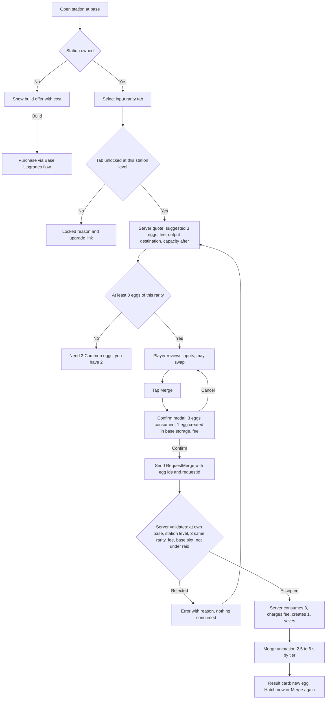

# UI - Egg Merging

> [!success] CONFIRMED
> - **3** eggs of one rarity → **1** egg of the next rarity (D-020).
> - Requires a purchased Egg Merging Station; higher rarities need station upgrades; the station changes appearance with each upgrade (D-020).
> - Secret eggs cannot be merged further (no higher rarity exists).

> [!info] PROPOSED
> Station levels, costs, gates and merge fees ([[Canonical Proposed Values]] §10, final values **UNDECIDED** [[Open Questions#Q-019]]); merging at the base; inputs from backpack or base storage; output to base storage; 2.5–6 s animation with no timer (timers are an alternative, [[Open Questions#Q-034]]). The layout and input auto-pick order are **PROPOSED**.

## Purpose

Let the player combine three same-rarity eggs into one higher-rarity egg at their station, with clear information about which merges the current station level allows, the fee, which eggs are used and where the result goes (including its raid exposure).

## Layout

Opened from the station's `ProximityPrompt` at the base, or from [[UI - Egg Storage]] while at base:

- Top: station card (name, level, 3D preview of the current station model, next upgrade).
- Middle: merge recipe row (input rarity tabs, three input slots → output slot).
- Bottom: fee, output destination, Merge button.

## Hierarchy

1. Recipe: 3 × input → 1 × output.
2. Availability for this station level.
3. Fee and output destination (raidable).
4. Station upgrade path.

## Elements

| Element | Type | Content | Behaviour |
|---|---|---|---|
| Station card | `Card/Module` + `Preview/3D` | "Twig Nest Press · Level 1" | "Upgrade" opens [[UI - Base Upgrades]] on the station |
| Recipe tabs | `Tab/Bar` | Common, Uncommon, Rare, Epic, Legendary, Mythical | Locked tabs show `Chip/Locked` "Needs Stonebound Hatchery Forge (Level 2)" |
| Secret tab | Disabled tab | "Secret" | Reason: "Secret is the highest rarity and can't be merged." |
| Input slots ×3 | `Card/Egg` | Selected eggs with location chips | Auto-filled; tap to swap from a picker |
| Output slot | `Card/Egg` (preview) | "Uncommon Egg" silhouette | Shows destination chip `Chip/Raidable` |
| Owned counter | Caption | "You have 21 Common eggs (7 merges possible)" | |
| Fee | Price label | "100 Cash" | From the server quote |
| Destination note | Caption + chip | "The new egg goes to base storage (raidable). Base storage after merge: 29 / 50" | Always shown |
| Merge ×1 | `Btn/PriceCash` (Primary) | "Merge · 100 Cash" | |
| Merge all | `Btn/Secondary` | "Merge ×7 · 700 Cash" | **PROPOSED** convenience; confirm modal mandatory |
| Not purchased card | `Card/Product` | "Build Twig Nest Press · 2,500 Cash" | Shown instead of the recipe when the station is not owned |

### Input auto-pick order (PROPOSED)

The server suggests inputs from **base storage first**, then backpack. Rationale: the output always goes to base storage, so using base eggs first keeps the player's raid exposure lowest and leaves safe backpack eggs untouched. The player can override.

### Capacity rule

The output needs a free base storage slot *after* the inputs are removed. Total storage always frees by two per merge, but if **all three inputs come from the backpack and base storage is full**, the merge cannot place the output. The UI detects this case and offers "Use a base egg instead" to swap one input.

## Interactions



- High-tier merges (Legendary → Mythical, Mythical → Secret) use `Btn/HoldConfirm` in the modal (**PROPOSED**).
- Merge results are deterministic (always the next rarity), so the result card shows no odds. Hatching the new egg later shows hatch odds as normal.

## States

| State | Display |
|---|---|
| Station not owned | Build offer |
| Rarity locked by station level | Tab locked with the required station name and level |
| Not enough eggs | Merge disabled: "Need 3 Rare eggs (you have 2)" |
| Not enough Cash | Disabled with amount needed |
| Base storage full (all inputs from backpack) | Disabled with "Base storage is full. Use a base egg as an input." + swap action |
| Away from base | Panel cannot open; menu entry shows "Merging happens at your base" |
| Own base under raid | Disabled (**PROPOSED**, Q-506) |
| Pending / animating | Spinner, then Reveal layer |

## Empty states

No eggs of any mergeable rarity: "You need 3 eggs of the same rarity to merge." with "Get eggs".

## Error states

| Reason code (illustrative) | Copy |
|---|---|
| `StationLevelTooLow` | "Upgrade your station to merge Rare eggs." |
| `NotSameRarity` | "All three eggs must be the same rarity." (modified client only) |
| `BaseStorageFull` | "No space in base storage for the new egg." |
| `EggNotFound` | "One of these eggs is no longer available." |
| `NotAtOwnBase` | "Merging happens at your base." |
| `BaseUnderRaid` | "Your base is under raid. Merging is paused." |

## Loading states

Station card renders from base data; the recipe shows skeleton slots until the quote arrives; Merge disabled until then.

## Mobile layout

Station card collapsed to a single row with a small static image; recipe row centred (three 72-unit slots → arrow → one 88-unit slot); fee, destination and Merge pinned to the bottom.

## Desktop layout

Station 3D preview on the left third; recipe and controls on the right two-thirds; recipe tabs along the top.

> [!note] Console / gamepad
> `ButtonL1`/`ButtonR1` change rarity tabs; `ButtonA` on an input opens the swap picker; `ButtonY` merges.

## Accessibility

- Input and output rarity are named in text; the arrow carries a "becomes" text label for screen magnifier users.
- The raidable destination is an icon + text chip.

## Roblox implementation notes

```text
Panels/EggMerging (Frame)
├─ StationCard (Frame) → ViewportFrame (station model by level), Name, Level, UpgradeButton
├─ RecipeTabs (Frame, UIListLayout horizontal)
├─ Recipe (Frame) → Input ×3 (ImageButton), Arrow (ImageLabel), Output (ImageLabel)
└─ Footer → Fee, Destination, MergeButton, MergeAllButton
```

- Quote: illustrative `GetMergeQuote(rarity)`; commit: `RequestMerge(eggIds, requestId)` handled by [[Service - MergeService]] as one transaction ([[Implementation - Egg Merge Transaction]]).
- Station level and allowed recipes are read from server config so the tab locks always match the server gate.
- Station preview uses the same `MOD-##` model as the base, swapped per level ([[Egg Merging Station]]).

## Wireframe

```text
+------------------------------- Egg Merging -------------------------------[X]+
| [ (station) ] Twig Nest Press · Level 1          [Upgrade › Level 2]          |
|-------------------------------------------------------------------------------|
| [Common] [Uncommon] [Rare 🔒] [Epic 🔒] [Legendary 🔒] [Mythical 🔒] [Secret ✖] |
|                                                                               |
|    [C base] + [C base] + [C base]   ==becomes==>   [ Uncommon Egg ]           |
|                                                    [⚠ Raidable · base]        |
|  You have 21 Common eggs (7 merges possible)                                  |
|  Base storage after merge: 29/50                                              |
|                         [ Merge ×7 · 700 Cash ]   [ Merge · 100 Cash ]         |
+-------------------------------------------------------------------------------+
```

## Related documents

- [[Egg Merging]] · [[Egg Merging Station]] · [[Egg Storage]] · [[Cost Tables]]
- [[UI - Egg Storage]] · [[UI - Base Upgrades]] · [[UI - Egg Hatching]] · [[Animation - Egg Merge]]
- [[Service - MergeService]] · [[Implementation - Egg Merge Transaction]] · [[Test Cases - Egg Merging]]
