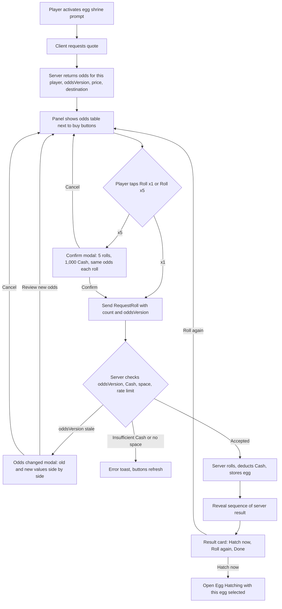

# UI - Egg Rolling

> [!success] CONFIRMED
> - Cash buys egg rolls (D-014). The roll decides egg **rarity**; the animal is picked later at hatch (D-015).
> - Hidden progression luck changes egg-rarity odds. The formula may stay hidden, but the **actual odds must be shown before the player commits** and must **never change silently** after purchase (D-017).
> - Every outcome is independent: no duplicate protection, no history influence (D-018).

> [!info] PROPOSED
> - `oddsVersion` tokens bind displayed odds to the purchase; stale tokens are rejected (D-041, **PROPOSED**).
> - Price 200 Cash per roll; ×5 for 1,000 Cash, no discount ([[Canonical Proposed Values]] §7, pricing model **UNDECIDED** [[Open Questions#Q-020]]).
> - Baseline odds 65 / 22 / 9 / 3 / 0.8 / 0.18 / 0.02 % at the P = 0.30 pivot (D-031); final odds **UNDECIDED** ([[Open Questions#Q-016]]).
> - The layout, display precision and re-confirm flow on this page are **PROPOSED**.

## Purpose

Let the player spend Cash on egg rolls with full knowledge of what they are buying: the **player's own current odds** for each of the seven rarities, the exact price and where the egg will go. Make the moment exciting through presentation, never through misleading copy.

## Layout

A single panel opened from the egg shrine `ProximityPrompt` in [[Hub - Hatchling Haven]]:

- Left / top: egg display (3D egg on a pedestal, `Preview/3D`).
- Centre: **odds table** — always visible on the same surface as the buy buttons.
- Bottom: price buttons (Roll ×1, Roll ×5), Cash balance, destination indicator.

## Hierarchy

1. The odds table ("Your current odds").
2. The buy buttons with exact prices.
3. Destination and storage space.
4. Egg display and flavour.

## Elements

| Element | Type | Content | Behaviour |
|---|---|---|---|
| Odds heading | `type.heading` | "Your current odds" + info icon | Info opens `Modal/Info`: "These are your odds right now. They improve as you progress through the game. Each roll is independent." |
| Odds table | `UIListLayout` of 7 rows | Rarity ornament + rarity name + percentage + "about 1 in N" | Values from the server quote only |
| Odds updated label | Caption + highlight | "Your odds have updated" | Shown when a pushed update replaces the table (see below) |
| Price ×1 | `Btn/PriceCash` (Primary) | "Roll ×1 · 200 Cash" | Disabled with reason if unaffordable or no space |
| Price ×5 | `Btn/PriceCash` (Secondary) | "Roll ×5 · 1,000 Cash" | Each roll uses the displayed odds independently |
| Cash balance | `Counter/Currency` (full number) | "12,410 Cash" | Updates after server confirmation |
| Destination indicator | Chip + counter | "Goes to: Backpack 7 / 10 · Safe from raids" | Changes to the base storage message when applicable (Q-501) |
| Odds details | `Btn/Ghost` | "How odds work" | Opens explanation and links to [[Randomised Reward Compliance]] wording |
| Result card | `Card/Egg` (large) in Reveal layer | "Rare Egg" + rarity ornament | Actions: "Hatch now", "Roll again", "Done" |
| Multi-result strip | 5 × `Card/Egg` | Results of a ×5 roll in roll order | Same actions |

### Odds display rules (PROPOSED)

- Percentages show **three significant figures**, never rounded to zero: 65.0%, 22.0%, 9.00%, 3.00%, 0.800%, 0.180%, 0.0200%.
- Rows below 1% also show "about 1 in N" with N rounded to the nearest whole number (0.800% → about 1 in 125; 0.180% → about 1 in 556; 0.0200% → about 1 in 5,000).
- The seven displayed values are exactly the server's values for this player at this moment; the client never recomputes, rounds for sum, or caches them across sessions.
- Displayed percentages may sum to 99.9–100.1% because of rounding; a footnote says "Totals may not add to exactly 100% due to rounding."

> [!warning] UNDECIDED (Q-501)
> Where a newly rolled egg goes when the backpack is full: automatically into base storage (where it becomes raidable), or the roll is blocked. The UI supports both. If auto-routing is chosen, the destination indicator switches to "Goes to: Base storage 31 / 50 · **Raidable**" with the raidable chip **before** purchase, so the player is never surprised. If both stores are full, both buy buttons are disabled with "Egg storage full".

> [!warning] UNDECIDED (Q-502)
> Whether rolls can be bought away from the egg shrine (for example from the menu). This page assumes the shrine is the only purchase point; elsewhere, the menu entry shows a route instead.

## Interactions



### Odds change while the panel is open

If the player's odds change while the panel is open (for example a level-up from a background XP grant), the server pushes a new quote:

1. The odds table animates to the new values; changed rows show "was 3.00%" in a caption for 5 s.
2. "Your odds have updated" label appears.
3. Both buy buttons are disabled for **1.0 s** (**PROPOSED**) so a tap already in progress cannot buy at odds the player did not see.

If a purchase races the push, the server rejects the stale `oddsVersion` and the client shows `Modal/OddsChanged`. The purchase is **not** made; nothing is charged. The player must look at the new odds and tap again. This is how the UI satisfies "never altered silently" (D-017, D-041).

### Confirmation policy

- Roll ×1: no extra modal; the odds and price are on the button's own surface. **PROPOSED** setting "Confirm every roll" (off by default) adds a modal.
- Roll ×5: always a `Modal/Confirm` showing total Cash, count, destination and "Each roll uses the odds shown".

## Copy rules

These rules apply to this screen, [[UI - Egg Hatching]], [[UI - Egg Merging]], notifications and the shop.

> [!danger] Banned copy and patterns (D-018)
> The UI must never state or imply that outcomes depend on previous outcomes. Banned:
> - "due", "overdue", "you're due a…", "any time now", "so close", "almost", "next one could be the one"
> - "pity", "bad-luck protection", "guaranteed after N rolls", "luck meter", "streak"
> - counters such as "rolls since your last Legendary"
> - "your odds are building / charging / filling up" (progression luck comes from progression, not from rolling)
> - "lucky!" or "unlucky" labels on ordinary outcomes
> - Near-miss presentation: showing a higher-rarity egg "almost" landing before settling on a lower one.

Allowed factual copy: "Your current odds", "Odds improve as you progress through the game", "Each roll is independent", "You got a Rare Egg".

## States

| State | Display |
|---|---|
| Quote loaded | Full panel |
| Pending purchase | Buttons show spinner; odds table locked (no further updates applied until the reply) |
| Odds updated | Highlight + 1.0 s lockout |
| Cannot afford | Button disabled; tap shows "You need 120 more Cash" |
| Storage full | Buttons disabled; "Egg storage full" with "Manage eggs" link |
| Reveal | Reveal layer; HUD hidden |
| In combat | Panel cannot open (shrine is in the safe hub; defensive check only) |
| Purchase restricted by policy | See danger callout below |

## Empty states

Not applicable: the panel always has odds and prices. If the player has 0 Cash, buttons are disabled with "Defeat wild animals to earn Cash".

## Error states

| Reason code (illustrative) | Copy | Recovery |
|---|---|---|
| `OddsVersionStale` | "Your odds changed before this roll. Please review your new odds." | `Modal/OddsChanged` |
| `InsufficientCash` | "Not enough Cash." | Refresh balance |
| `StorageFull` | "Egg storage full." | "Manage eggs" |
| `RateLimited` | "Slow down a moment." | Re-enable after server-given delay |
| `NotAtShrine` | "Move closer to the egg shrine." | Close panel |
| Timeout | "Still waiting for the server…" | Snapshot refresh of Cash and eggs before re-enabling |

## Loading states

On open, the odds table shows seven skeleton rows and the buy buttons are disabled until the quote arrives. **The buy buttons are never enabled without a loaded quote.** If the quote fails, show "Couldn't load your odds" with Retry; buying is impossible until odds are shown.

## Mobile layout

Egg display on the left 35%, odds table centre-right, buy buttons pinned at the bottom (Roll ×1 primary on the right for thumb reach). The odds table never scrolls on Compact: seven rows at 36 units fit in the reference height.

## Desktop layout

Egg pedestal centred top; odds table to the right; buy buttons under the odds table. Hovering a row shows the "about 1 in N" value if hidden by width.

> [!note] Console / gamepad
> Focus starts on Roll ×1. `ButtonY` = Roll ×5, `ButtonX` = "How odds work". The odds table is not focusable (static text), so focus cannot get stuck in it.

## Accessibility

- Every odds row carries the rarity **name**; colour and ornament are secondary.
- Reveal follows Reduce Flashing and Reduced Motion ([[UI Accessibility Standards]] §3); the result card appears instantly when reveals are skipped.
- Numbers are full-precision text and readable at 150% text scale.

## Roblox implementation notes

```text
Panels/EggRolling (Frame)
├─ EggDisplay (ViewportFrame + WorldModel, egg model per Egg Art Direction)
├─ OddsTable (Frame, UIListLayout) → Row ×7 (Frame: Ornament ImageLabel, Name TextLabel, Pct TextLabel, OneIn TextLabel)
├─ Destination (Frame) → Chip, Counter
└─ Buttons (Frame, UIListLayout horizontal) → RollOne, RollFive (TextButton + UICorner + UIStroke)
Reveal (ScreenGui, DisplayOrder 35) → RollReveal (Frame)
```

- Quote: RemoteFunction (illustrative `GetRollQuote`) returns `{odds = {7 numbers}, oddsVersion, price, bulkPrice, destination}` computed by [[Service - LuckService]] and [[Service - EggService]].
- Purchase: `RequestRoll(count, oddsVersion, requestId)`. The server validates the token, Cash, capacity and rate limit, rolls with a server `Random` and persists before replying ([[Implementation - Egg Roll and Hatch Flow]]).
- The reveal animation plays **only after** the server result arrives; no client-side random "spin" that could suggest a different outcome ([[Animation - Egg Roll]]).
- Odds pushes arrive on a RemoteEvent (illustrative `OddsUpdated`); the client swaps the table and applies the 1.0 s lockout.

> [!danger] Compliance
> Egg rolls are bought with Cash, and Cash is never sold for Robux (D-044 **PROPOSED**, [[Open Questions#Q-032]]). If that ever changes, rolls would count as paid random items and the panel must be gated with `PolicyService:GetPolicyInfoForPlayerAsync` (`ArePaidRandomItemsRestricted`). See [[Roblox Monetisation Policy Requirements]] and [[Randomised Reward Compliance]].

## Wireframe

```text
+-------------------------------- Egg Shrine --------------------------------[X]+
|                         |  Your current odds  (i)                            |
|        ( 3D egg )       |  [C] Common     65.0%                              |
|       on pedestal       |  [U] Uncommon   22.0%                              |
|                         |  [R] Rare        9.00%                             |
|                         |  [E] Epic        3.00%                             |
|                         |  [L] Legendary   0.800%   about 1 in 125           |
|                         |  [M] Mythical    0.180%   about 1 in 556           |
|                         |  [S] Secret      0.0200%  about 1 in 5,000         |
|                         |  Each roll is independent. [How odds work]         |
|-------------------------------------------------------------------------------|
|  Goes to: Backpack 7/10 · [Safe from raids]        Cash 12,410                |
|                    [ Roll ×5 · 1,000 Cash ]   [ Roll ×1 · 200 Cash ]          |
+-------------------------------------------------------------------------------+
```

The wireframe shows the baseline odds at P = 0.30; each player sees their own values from [[Dynamic Luck Probability Tables]].

Odds changed modal:

```text
+------------------- Your odds have changed -------------------+
|  Your odds changed before this roll. Nothing was charged.    |
|  Rare        9.00%  →  9.12%                                 |
|  Epic        3.00%  →  3.06%   (other rows unchanged)        |
|           [ Cancel ]        [ Review new odds ]              |
+--------------------------------------------------------------+
```

(The new values in this modal are illustrative only.)

## Test hooks

- Purchase with a forged or stale `oddsVersion` is rejected and nothing is charged ([[Test Cases - Egg Rolls and Hatching]]).
- Buttons stay disabled until the quote loads; kill the quote response and verify no purchase path exists.
- String scan of the localisation table for banned copy terms.

## Related documents

- [[Egg Roll System]] · [[Dynamic Progression Luck]] · [[Dynamic Luck Probability Tables]] · [[Independent Random Outcomes]] · [[Randomised Reward Compliance]] · [[Egg Pricing]]
- [[UI - Egg Hatching]] · [[UI - Egg Storage]] · [[Animation - Egg Roll]] · [[Sound - Eggs]]
- [[Implementation - Egg Roll and Hatch Flow]] · [[Service - EggService]] · [[Service - LuckService]]
