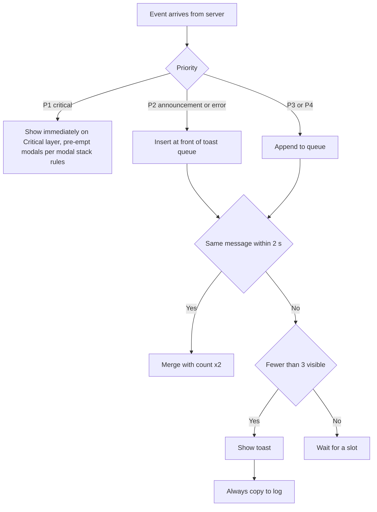

# UI - Notifications

> [!info] PROPOSED
> Every notification type, priority, duration and queue rule on this page is **PROPOSED**. Toast component sizes and durations are defined once in [[UI Design System]] §4.6. Event sources (rare spawns, world boss cadence, raids) follow [[Canonical Proposed Values]] §5–6 and the raid documents.

## Purpose

One system for every message the game sends the player: quick toasts, server-wide announcements, critical alerts and a log for anything missed. It must keep combat readable (no spam over the action area), make critical events impossible to miss (raids on your base), and never use urgency or scarcity to pressure spending.

## Layout

| Surface | Layer | Position |
|---|---|---|
| Toast stack | Toasts (60) | Top-centre under the inset, max 3 visible, newest on top |
| Server announcement | Toasts (60) | Wider banner above the toast stack |
| Critical banner | Critical (70) | Full-width top banner |
| Notification log | Panels (30) | Side panel (Large) / sheet (Compact) from the HUD bell |
| Badge | HUD | Bell icon unread count |

## Hierarchy

Critical banner > server announcement > error toast > warning toast > success / info toast > log-only.

## Elements

The notification catalogue: every event, its surface and priority.

| Event | Surface | Priority | Copy example | Action |
|---|---|---|---|---|
| Your base is being raided | Critical banner + alarm | P1 critical | "Your base is being raided!" | Defend ([[UI - Raid Interface]]) |
| Disconnect / data failure | `Modal/Critical` | P1 critical | "Connection lost. Reconnecting…" | Reconnect |
| World boss in 2 minutes | Announcement | P2 | "Thunderhoof appears in 2:00 · Sunscorch Savanna" | Show route |
| Mythical / Secret rare spawn | Announcement | P2 | "A Mythical animal has appeared in Starfall Sanctuary!" | Show route |
| Egg stolen / animal stolen | Warning toast + log | P2 | "A raider took 2 eggs from your base." | View summary |
| Odds updated (panel closed) | Log only | P4 | "Your egg odds have updated." | Opens odds view |
| Odds updated (panel open) | Inline on the panel, not a toast | — | See [[UI - Egg Rolling]] | — |
| New animal discovered | Success toast | P3 | "New animal discovered: Boar" | View in Index |
| Level up | Success toast + HUD pulse | P3 | "Level 10! Ground Slam unlocked." | View progress |
| Region unlocked | Success toast | P3 | "Sunscorch Savanna unlocked" | Show route |
| Ascension complete | Success toast | P3 | "Wolf reached A3" | — |
| Backpack full / base storage full | Warning toast | P3 | "Backpack full (10 / 10)" | Manage eggs |
| Animal space near full | Warning toast (at 80%, once per session) | P3 | "Animal space 80 / 100" | View animals |
| Purchase complete | Success toast | P3 | "Purchase complete: [product name]" | — |
| Action rejected | Error toast | P2 | "Couldn't hatch: you are in combat." | — |
| Shield expiring | Info toast | P3 | "Your base shield ends in 5 minutes." | Base |
| Team unlocked at base | Info toast | P4 | "You're at your base. You can edit your team." | Team |

## Interactions

- Tap a toast → runs its action, if any; swipe up (Compact) or click × (Large) dismisses.
- Toasts never appear over the action cluster or the team display.
- The bell opens the **log**: the last 50 notifications (**PROPOSED**), grouped by "Today" / "Earlier", each with its action.
- Critical banner: cannot be dismissed while the raid is active, only collapsed into a HUD chip.

### Queue rules



- **Combat damping:** while the player is in combat, P3 and P4 toasts are held (max 10 s) and then shown, or go to the log only if more than 5 are waiting.
- **Reveal damping:** during roll, hatch, merge and ascension reveals, only P1 shows; others wait.
- **Announcement rate:** at most one server announcement every 10 s; extras queue.

> [!danger] No pressure tactics
> Notifications never advertise Robux products, countdown sales or "limited time" offers, and never tell players they are "due" a rare result ([[UI - Egg Rolling#Copy rules]], [[Monetisation Principles]]).

## States

| State | Behaviour |
|---|---|
| Idle | Nothing shown; bell with badge if unread |
| Normal toasting | Stack of up to 3 |
| Combat damping | P3/P4 held |
| Critical active | Banner pinned; other toasts continue below it |
| Log open | Badge clears |

## Empty states

Log with no notifications: "Nothing new. Notifications about raids, bosses and your progress appear here."

## Error states

Unknown notification type from the server: logged for analytics ([[Service - AnalyticsAndLoggingService]]) and not shown. Missing localisation key: show the English fallback string, never the raw key.

## Loading states

Notifications that arrive before the HUD is ready (during join) are queued and shown after the loading screen, except P1.

## Mobile layout

Toasts 90% of safe-area width (max 520), 56 high; announcements 64 high; critical banner 72 high with a 56-high Defend button. Log as a full-height sheet.

## Desktop layout

Toasts 420 wide top-centre; log as a 400-wide right panel.

> [!note] Console / gamepad
> Toasts are not focusable. The log opens from the menu hub; `ButtonA` on an entry runs its action. The critical banner's action binds to `ButtonY` while shown.

## Accessibility

- Every toast has an icon and text; type is never colour-only.
- Toast durations scale +50% when text scale is 130% or more (**PROPOSED**), and any toast can be found again in the log.
- Critical alerts pair sound with the visual banner; the banner cannot be disabled.

## Roblox implementation notes

```text
Toasts (ScreenGui, DisplayOrder 60)
├─ Announcement (Frame)
└─ Stack (Frame, UIListLayout vertical, VerticalAlignment Top) → Toast clones (Frame + UICorner + UIStroke)
Critical (ScreenGui, DisplayOrder 70) → RaidBanner, CriticalModal
Panels/NotificationLog (ScrollingFrame + UIListLayout)
```

- One client `NotificationController` ([[Client Controllers]]) owns the queue; other controllers call it, never create toasts directly.
- Server events arrive on a RemoteEvent (illustrative `Notify(type, params)`); copy is built from localisation keys and parameters on the client.
- Server-wide announcements could use `MessagingService` for cross-server events if ever needed; current proposals are per-server only.

## Wireframe

```text
+--------------------------------------------------------------------------+
| ⚠ YOUR BASE IS BEING RAIDED!                       [ Defend your base ]  |
+--------------------------------------------------------------------------+
|        [⏱ Thunderhoof appears in 2:00 · Sunscorch Savanna   Show route] |
|        [✓ New animal discovered: Boar              View in Index ]       |
|        [▲ Backpack full (10/10)                    Manage eggs   ]       |
|        [✓ Level 10! Ground Slam unlocked.  ×2                    ]       |
|                                                                [🔔 4]   |
+--------------------------------------------------------------------------+
```

## Related documents

- [[UI Design System]] · [[UI - Main HUD]] · [[UI - Raid Interface]] · [[UI - Boss Health Bar]] · [[UI - Settings]]
- [[Sound - UI Feedback]] · [[Sound - Base and Raid Alerts]] · [[Wild Animal Spawning and Respawn]] · [[Client Controllers]]
