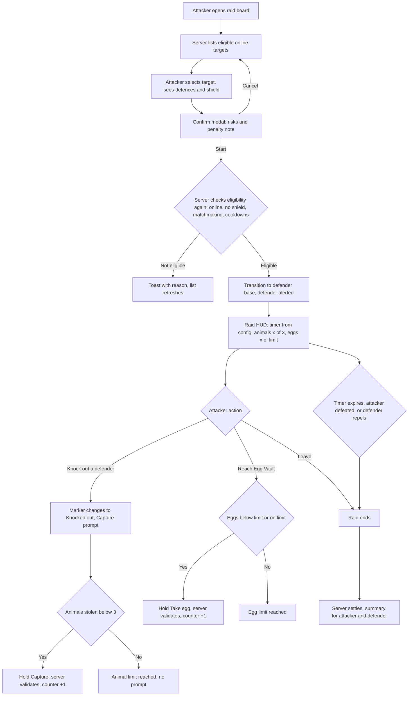
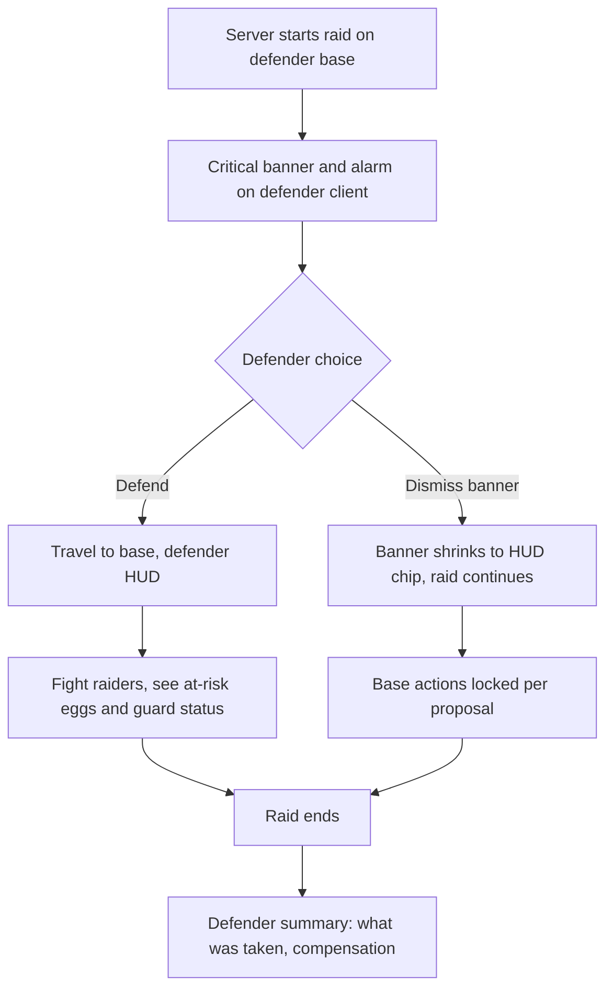

# UI - Raid Interface

> [!success] CONFIRMED
> - Raiding is optional (D-024).
> - Eggs in base storage can be stolen; **backpack eggs never** (D-021).
> - A defending animal can be stolen **only after it has been knocked out**; undefeated defenders cannot be stolen (D-024).
> - **Maximum three animals stolen per successful raid** (D-024).
> - **Offline bases cannot be raided** (D-024).
> - Bases are protected by shields and physical defences (D-024).

> [!warning] UNDECIDED
> - Raid duration: **UNDECIDED** ([[Open Questions#Q-012]]). The timer reads a configurable value; no default is shown on this page.
> - Egg theft limit: **UNDECIDED** ([[Open Questions#Q-013]]). The egg counter reads a configurable value and supports "no limit".
> - What a stolen animal keeps ([[Open Questions#Q-025]]), matchmaking ([[Open Questions#Q-029]]), shield acquisition ([[Open Questions#Q-030]]), which animals defend ([[Open Questions#Q-033]]), attacker and defender defeat penalties ([[Open Questions#Q-014]]).

> [!info] PROPOSED
> All layouts, flows and copy on this page are **PROPOSED**. Raid rules are owned by [[Base Raiding System]], [[Raid Lifecycle and States]], [[Egg Theft Rules]] and [[Animal Theft Rules]].

## Purpose

Give the **attacker** a clear, fair picture of a raid before committing, and live counters during it; give the **defender** an immediate, readable alert and a calm view of what is and is not at risk. The UI must make the protection rules visible: backpack eggs safe, undefeated defenders protected, three-animal cap, offline immunity.

## Layout

Four surfaces:

1. **Raid board** (attacker, pre-raid): list of eligible targets and a target detail card.
2. **Raid HUD** (attacker, in raid): counters in the combat overlay slot of the [[UI - Main HUD]] context strip.
3. **Defender alert and HUD** (defender): Critical-layer banner, then a defender HUD.
4. **Raid summary** (both): end-of-raid results.

## Hierarchy

- Attacker in raid: timer → animals stolen x / 3 → eggs taken x / limit → own health.
- Defender: "Your base is under raid" → what is at risk (base eggs, knocked-out defenders) → what is safe (backpack eggs) → Defend action.

## Elements

| Element | Surface | Type | Content | Behaviour |
|---|---|---|---|---|
| Target list | Board | `ScrollingFrame` + `UIListLayout` | Eligible online bases only | Offline bases never appear (D-024); shielded bases appear greyed with "Shielded" or are hidden (per [[Shield Mechanics]]) |
| Target card | Board | Card | Owner display name, base level summary, defence summary, shield state | No exact egg inventory is shown (**PROPOSED**) |
| Risk note | Board | Caption | "If you are defeated during a raid, penalties apply." | Penalty text from config (Q-014) |
| Start raid | Board | `Btn/Primary` | "Start raid" | Confirm modal |
| Raid timer | Raid HUD | Counter | "mm:ss" | Duration from server config (Q-012); hidden if config marks raids as untimed |
| Animals counter | Raid HUD | `Counter/Theft` | "Animals stolen 1 / 3" | At 3 / 3: "Animal limit reached" and capture prompts disappear |
| Eggs counter | Raid HUD | `Counter/Theft` | "Eggs taken 4 / N" or "Eggs taken 4" | N from config (Q-013); at N / N: "Egg limit reached" |
| Defender markers | Raid HUD | World `BillboardGui` | Over each defending animal | "Protected" padlock while standing; "Knocked out · Capture" when downed |
| Capture prompt | World | `ProximityPrompt` (hold) | "Capture Wolf" | Only on knocked-out defenders and only while animals < 3 |
| Egg take prompt | World | `ProximityPrompt` (hold) | "Take egg" at the Egg Vault | Only while eggs < limit (if any) |
| Leave raid | Raid HUD | `Btn/Secondary` | "Leave raid" | Confirm modal states what happens to items already taken, using the outcome rules in [[Raid Lifecycle and States]] (not decided here) |
| Defender banner | Critical | Banner + sound | "Your base is being raided!" + raider name | Persistent until the raid ends; tap → Defend |
| Defend action | Banner | `Btn/Primary` | "Defend your base" | Uses the base travel method in [[Player Base System]] |
| At-risk summary | Defender HUD | Rows | "Base eggs at risk: 31 · Backpack eggs: safe (7)" | Live |
| Defender status | Defender HUD | Row of portraits | Guards' health, KO state | KO'd guards show "At risk" |
| Raid summary | Both | `Modal/Info` | Taken / lost lists, rewards, compensation | Per [[Raid Rewards and Defender Compensation]] |

## Interactions





## States

| State | Attacker | Defender |
|---|---|---|
| Pre-raid | Board | — |
| Raid starting | Transition fade | Banner + alarm |
| Active | Raid HUD | Defender HUD or chip |
| Limit reached (animals) | "Animal limit reached" | "Raider has reached the animal limit" |
| Limit reached (eggs) | "Egg limit reached" (only if a limit is configured) | Same, mirrored |
| Attacker defeated | Defeat overlay (penalties Q-014) | "Raider defeated" toast |
| Ended | Summary | Summary |
| Disconnect | See [[Raid Disconnection Handling]]; "Reconnecting…" then summary | Same |

## Empty states

- No eligible targets: "No bases can be raided right now. Bases can only be raided while their owners are online and unshielded." + Refresh.
- Defender base storage empty: at-risk summary reads "Base eggs at risk: 0".

## Error states

| Reason code (illustrative) | Copy |
|---|---|
| `TargetOffline` | "That player went offline. Offline bases can't be raided." |
| `TargetShielded` | "That base is now shielded." |
| `NotEligible` | "You can't raid this base." (matchmaking, Q-029) |
| `DefenderNotKnockedOut` | "Knock out this defender before capturing it." |
| `AnimalLimitReached` | "You can steal up to 3 animals per raid." |
| `EggLimitReached` | "You've reached the egg limit for this raid." |
| `NoSpace` | "You have no space for more eggs." (attacker's destination per [[Egg Theft Rules]]) |

## Loading states

The board shows skeleton rows while the target list loads; targets refresh every time the board opens and before Start (eligibility can change at any moment). Transition into the raid uses the Transition layer with "Entering raid…".

## Mobile layout

Raid HUD counters sit in the top-centre context strip as two compact chips ("🐾 1/3", "🥚 4/N") with the timer between them; capture and take prompts use Roblox's touch-friendly `ProximityPrompt` UI (hold). The defender banner spans the top under the inset with a large Defend button.

## Desktop layout

Counters with full labels ("Animals stolen 1 / 3"). Board is a two-pane panel (list left, card right).

> [!note] Console / gamepad
> Prompts use their default gamepad hold key; the defender banner's Defend action is bound to `ButtonY` while the banner is visible (**PROPOSED**).

## Accessibility

- Counters are text, not only icons. The "Protected" and "Knocked out" markers use different shapes (padlock versus downed icon) plus text.
- The defender alarm always has the visual banner; audio can be lowered but the banner cannot be disabled.
- No raid decision modal times out; only the raid itself is timed.

## Roblox implementation notes

```text
CombatOverlay/RaidHUD (Frame) → Timer, AnimalsCounter, EggsCounter, LeaveButton
Critical/RaidAlert (Frame) → Banner, DefendButton
Panels/RaidBoard (Frame) → TargetList (ScrollingFrame + UIListLayout), TargetCard
Modals/RaidSummary (Frame)
Workspace defender models → BillboardGui markers (pooled), ProximityPrompt (server-created)
```

- All raid state is server-authoritative ([[Service - RaidService]], [[Implementation - Raid Session Controller]]). Counters render server-replicated values; the client never increments them.
- Capture and take `ProximityPrompt`s are created and enabled by the server only when legal (defender knocked out, under the limit); the client never shows a prompt the server has not enabled. Every trigger is re-validated ([[Raid Anti-Exploit Validation]]).
- The egg limit and timer are optional fields in the raid config; the UI hides the "/ N" part and the timer when the config value is absent.

## Wireframe

Attacker raid HUD:

```text
+--------------------------------------------------------------------------+
| [HP ███████]     RAID  ⏱ mm:ss   🐾 Animals stolen 1/3   🥚 Eggs taken 4/N |
|                                                   [Leave raid]           |
|     (defender Wolf)  [🔒 Protected]                                      |
|     (defender Fox)   [⤓ Knocked out · Hold E: Capture]                    |
+--------------------------------------------------------------------------+
```

Defender alert:

```text
+--------------------------------------------------------------------------+
| ⚠ YOUR BASE IS BEING RAIDED by Player123        [ Defend your base ]     |
|   Base eggs at risk: 31 · Backpack eggs: safe (7) · Guards: 2 up, 1 KO   |
+--------------------------------------------------------------------------+
```

`mm:ss` and `N` are config-driven placeholders, not proposed values.

## Related documents

- [[Base Raiding System]] · [[Raid Lifecycle and States]] · [[Raid Eligibility and Offline Protection]] · [[Egg Theft Rules]] · [[Animal Theft Rules]] · [[Shield Mechanics]]
- [[Raid Disconnection Handling]] · [[Raid Anti-Exploit Validation]] · [[Raid Rewards and Defender Compensation]]
- [[UI - Base Management]] · [[UI - Egg Storage]] · [[UI - Notifications]] · [[Animation - Raid Interactions]] · [[Sound - Base and Raid Alerts]] · [[Test Cases - Raiding]]
