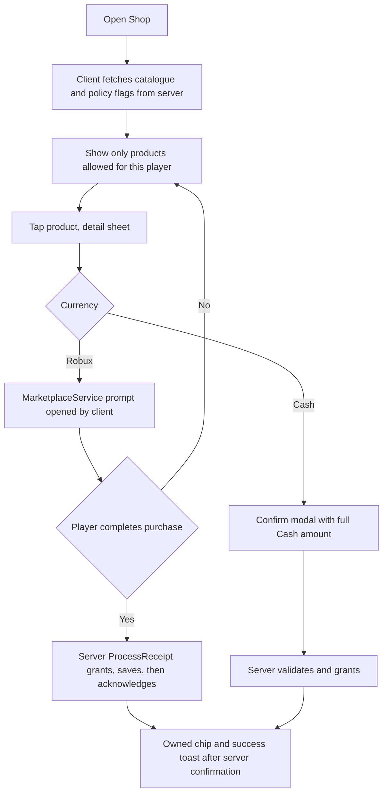

# UI - Shop

> [!success] CONFIRMED
> The game is fully playable without Robux; no essential progression is behind purchases; paid random rewards are not the main revenue mechanism (D-027). Extra egg storage can be bought; its currency and price are **UNDECIDED** ([[Open Questions#Q-009]], [[Open Questions#Q-010]]).

> [!info] PROPOSED
> - **Cash is never sold for Robux** (D-044, **PROPOSED**; related question [[Open Questions#Q-032]]). The shop therefore contains no Cash bundles, Cash multiplier sales framed as Cash, or "Cash for Robux" conversions.
> - Product catalogue is owned by [[Monetisation Product Concepts]]; this page defines how products are presented, not which products exist.
> - Layout and presentation rules are **PROPOSED**.

## Purpose

A calm, honest storefront. Players can see exactly what each product does, what it costs, and that nothing in it is required to progress. The design actively avoids pressure patterns.

## Layout

Tabs: **Featured · Passes · Cosmetics · Storage · Free** (tab set follows the product catalogue). Each tab is a grid of `Card/Product`. A product detail sheet opens on tap.

## Hierarchy

1. Product name and what it does (plain sentence).
2. Price (Robux icon + amount, or Cash).
3. Owned state.
4. Art.

## Elements

| Element | Type | Content | Behaviour |
|---|---|---|---|
| Product card | `Card/Product` | Art, name, one-line effect, price | Tap opens detail |
| Detail sheet | Panel | Full description, exact effect values, whether permanent or consumable, owned state | |
| Buy (Robux) | `Btn/PriceRobux` | "R$ [price]" | Opens the native Roblox purchase prompt; no custom confirm in front of it |
| Buy (Cash) | `Btn/PriceCash` | "[amount] Cash" | Custom `Modal/Confirm` (Cash purchases are in-game) |
| Owned chip | Chip | "Owned" | Game passes checked with `UserOwnsGamePassAsync` |
| Storage tab | Cards | Backpack +5 (×3 steps to 25), Base +25 (×6 steps to 200) **PROPOSED** steps | Price and currency hidden until Q-009 / Q-010 are decided; until then the tab shows "Storage expansion is coming" in internal builds and is hidden in public builds |
| Free tab | List | Free rewards (if any exist in the catalogue) | Links to free sources; reinforces D-027 |
| Fairness note | Caption | "Everything in the game can be earned by playing." | Always visible at the bottom |

### Presentation rules (PROPOSED)

> [!danger] Banned patterns
> - No Cash for Robux, directly or indirectly (no "Robux → gems → Cash" chains) — D-044 proposal.
> - No countdown timers, "limited stock", or fake scarcity.
> - No pre-ticked options or default-selected higher bundles.
> - No "you're close to a Legendary" or other luck pressure (see [[UI - Egg Rolling#Copy rules]]).
> - No pop-up shop interstitials on join, after a defeat, or after a failed roll or hatch.
> - No paid random items unless the owner approves them **and** they are gated by `PolicyService:GetPolicyInfoForPlayerAsync` (`ArePaidRandomItemsRestricted`) with odds shown in the same format as [[UI - Egg Rolling]]. See [[Randomised Reward Compliance]] and [[Roblox Monetisation Policy Requirements]].

Prices are displayed as returned by `MarketplaceService:GetProductInfo` (*unverified* caching behaviour; refresh on open) so they always match the native prompt.

## Interactions



- The UI shows "Owned" or grants effects **only after** the server confirms the grant (developer products through `ProcessReceipt`; passes through `UserOwnsGamePassAsync` and the purchase-finished signal).
- `MarketplaceService:PromptProductPurchase` and `PromptGamePassPurchase` are called from the client; the client never grants anything itself.

## States

| State | Display |
|---|---|
| Available | Buy button |
| Owned (pass) | "Owned" chip, buy hidden |
| Processing | "Completing purchase…" caption until the server confirms |
| Policy-restricted product | Not listed at all |
| Shop closed (in combat, in raid) | Menu entry disabled with reason |

## Empty states

A tab with no products (for example Storage before Q-009 / Q-010): the tab is hidden in public builds. If the whole catalogue is empty: "Nothing in the shop right now. Everything in the game can be earned by playing."

## Error states

| Situation | Copy |
|---|---|
| Catalogue failed to load | "Couldn't load the shop." + Retry |
| Purchase cancelled | No message (cancelling is normal) |
| Grant delayed | "Your purchase is being processed. It will appear shortly." — the receipt is retried by Roblox until acknowledged (*unverified* retry timing) |
| Cash purchase rejected | "Not enough Cash." |

## Loading states

Grid shows skeleton cards; Buy buttons disabled until prices and policy flags have loaded.

## Mobile layout

Two-column grid; detail as a bottom sheet with the price button pinned at the bottom; tabs as a scrolling bar.

## Desktop layout

Four-column grid, detail as a right panel.

> [!note] Console / gamepad
> Standard selectable grid; `ButtonA` opens detail and then the native prompt. Native purchase prompts on console follow platform rules (*unverified* per platform).

## Accessibility

- Price buttons show currency icon **and** the currency name in their accessible label ("200 Robux" / "2,500 Cash").
- Product effects are written in full sentences with numbers.

## Roblox implementation notes

```text
Panels/Shop (Frame)
├─ Tabs (Frame, UIListLayout)
├─ Grid (ScrollingFrame + UIGridLayout + UIAspectRatioConstraint)
└─ Detail (Frame) → Art, Description, BuyButton
```

- The product list, prices and per-player policy flags come from a server call; policy is checked on the server with `PolicyService:GetPolicyInfoForPlayerAsync` and cached per session.
- Receipt handling is server-only (`MarketplaceService.ProcessReceipt`), idempotent by `PurchaseId`, and saves before returning `PurchaseGranted` ([[Roblox Monetisation Policy Requirements]], [[Data Consistency and Transactions]]).

## Wireframe

```text
+---------------------------------- Shop ----------------------------------[X]+
| [Featured] [Passes●] [Cosmetics] [Storage] [Free]                           |
|-----------------------------------------------------------------------------|
| +------------------+ +------------------+ +------------------+               |
| | (art)            | | (art)            | | (art)            |               |
| | Pass name        | | Pass name        | | Cosmetic name    |               |
| | One-line effect  | | One-line effect  | | One-line effect  |               |
| | [ R$ price ]     | | [ Owned ]        | | [ R$ price ]     |               |
| +------------------+ +------------------+ +------------------+               |
|  Everything in the game can be earned by playing.                           |
+-----------------------------------------------------------------------------+
```

Product names and prices are placeholders; the catalogue is defined in [[Monetisation Product Concepts]].

## Related documents

- [[Monetisation Principles]] · [[Monetisation Product Concepts]] · [[Free-to-Play Experience]] · [[Roblox Monetisation Policy Requirements]] · [[Randomised Reward Compliance]]
- [[Storage Expansion Economics]] · [[UI - Egg Storage]] · [[UI - Egg Rolling]] · [[UI - Notifications]]
