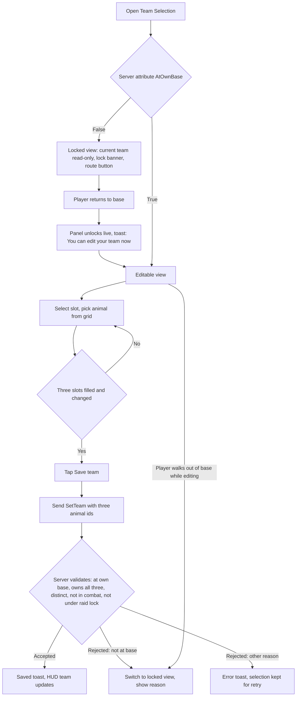

# UI - Team Selection

> [!success] CONFIRMED
> - A player equips **exactly three** animals (D-006).
> - The team can be changed **only at the player's own base**. It is locked from leaving the base until returning (D-010).

> [!info] PROPOSED
> Screen layout, the edit-and-save model and the locked-state copy are **PROPOSED**. The authoritative rule is in [[Team Equipping and Base Lock Rule]]; this page only presents it.

## Purpose

Let the player choose their three combat animals while at their own base, and make the base lock understandable everywhere else: away from base the same screen opens in a **locked, read-only** state that explains why and how to change the team.

## Layout

- Top: three large team slots with 3D preview of the focused slot.
- Middle: team summary (roles, rarities, manual/auto ability mix).
- Bottom (Compact) or right (Large): owned-animal picker grid with filters.
- Footer: Save team (`Btn/Primary`) and Revert (`Btn/Secondary`).

## Hierarchy

1. Lock state (if away from base, this replaces everything else as the headline).
2. The three slots.
3. Picker grid.
4. Summary and Save.

## Elements

| Element | Type | Content | Behaviour |
|---|---|---|---|
| Lock banner | `Chip/Locked` + text block | "Team locked. You can only change your team at your base." | Shown only when `AtOwnBase` is false; Save and picker disabled |
| Route button | `Btn/Secondary` | "Show route to base" | Shows the way to the player's base using the travel method in [[Player Base System]] |
| Team slots ×3 | `Card/Animal` (large) | Portrait, name, rarity frame, role, ascension stars, ability with `Chip/Manual` or `Chip/Auto` | Tap selects slot; drag or tap-to-place from the grid |
| 3D preview | `Preview/3D` (`ViewportFrame` + `WorldModel`) | Focused animal idle animation | One animated viewport only |
| Team summary | Row of chips | Role icons, "2 manual · 1 auto" | Information only; no combined power number |
| Picker grid | `ScrollingFrame` + `UIGridLayout` of `Card/Animal` | Owned animals | Filters: rarity, role, family; sort: rarity, ascension, newest |
| Unavailable card | `Card/Animal` + `Chip/Locked` | Reason, for example "Assigned as guard" if guard rules forbid dual use ([[Animal Guards and Base Defence AI]], [[Open Questions#Q-033]]) | Tap shows the reason |
| Save team | `Btn/Primary` | "Save team" | Enabled only when three slots are filled and the selection differs from the saved team |
| Revert | `Btn/Secondary` | "Revert" | Restores the saved team |
| Unsaved indicator | Caption | "Unsaved changes" | Closing with unsaved changes asks to save or discard |

## Interactions



- **Tap-to-place:** tap a slot, then tap an animal; or tap an animal first, then tap a slot. Drag-and-drop is an optional shortcut on touch and mouse, never the only method.
- **Swap:** placing an animal already in another slot swaps the two slots.
- **Unsaved changes on close:** `Modal/Confirm` "Save your new team?" with Save / Discard.

## States

| State | Display |
|---|---|
| At base, saved team | Editable, Save disabled |
| At base, unsaved changes | Save enabled, "Unsaved changes" caption |
| Away from base | Locked view; the lock is explained, not just shown |
| At base but in combat | Editable picker, Save disabled with reason "Finish combat first" (**PROPOSED**) |
| Own base under raid | Save disabled with reason "Your base is under raid" (**PROPOSED**, **UNDECIDED** whether required, Q-506) |
| Pending save | Save shows spinner; slots locked |

## Empty states

- Fewer than three owned animals: empty slots show "Hatch more animals to fill your team" with a link to [[UI - Egg Storage]]. 

> [!warning] UNDECIDED (Q-510)
> Whether a player who owns fewer than three animals may leave the base with a partial team, or whether onboarding always guarantees three. The UI supports both: if partial teams are allowed, Save accepts 1–2 animals with a warning; if not, Save stays disabled. See [[New Player Onboarding]].

- Picker filtered to nothing: "No animals match these filters" with "Clear filters".

## Error states

| Reason code (illustrative) | Copy |
|---|---|
| `NotAtOwnBase` | "You left your base. Return to your base to change your team." |
| `InCombat` | "Finish combat before changing your team." |
| `AnimalNotOwned` | "One of these animals is no longer in your collection." (refresh grid) |
| `DuplicateInstance` | "Each slot needs a different animal." |
| `BaseUnderRaid` | "Your base is under raid. Team changes are paused." |
| Timeout | "Still saving…" then snapshot refresh per [[UI Design System]] §7 |

## Loading states

Slots render from the replicated team first; the picker grid shows skeleton cards until the collection page arrives (paged at 40 cards, **PROPOSED**).

## Mobile layout

- Slots in a horizontal row across the top (each 120 wide), preview hidden by default and shown on long-press to save frame rate.
- Picker grid fills the lower 55%; four columns on a 844-wide reference.
- Save and Revert pinned at the bottom of the safe area.

## Desktop layout

- Left 40%: slots stacked vertically with the 3D preview of the focused slot.
- Right 60%: picker grid, six columns, with filters in a top bar.

> [!note] Console / gamepad
> Focus starts on slot 1. `ButtonA` on a slot moves focus to the grid; `ButtonA` on a card places it; `ButtonY` saves; `ButtonX` opens filters; `ButtonB` backs out (asks to save if unsaved). Grids set `NextSelectionUp` explicitly from the first grid row back to the slots.

## Accessibility

- The lock state is written in plain text with the reason and the remedy, not only a padlock icon.
- The lock transition announces itself with a toast as well as the visual change.
- Drag-and-drop is optional; tap-to-place works everywhere.

## Roblox implementation notes

```text
Panels (ScreenGui, DisplayOrder 30)
└─ TeamSelection (Frame)
   ├─ UIScale
   ├─ LockBanner (Frame, Visible bound to AtOwnBase == false)
   ├─ Slots (Frame, UIListLayout) → Slot1..3 (ImageButton + UICorner + UIStroke)
   ├─ Preview (ViewportFrame → WorldModel → animal model clone, Camera)
   ├─ Picker (ScrollingFrame, AutomaticCanvasSize Y, UIGridLayout + UIAspectRatioConstraint per cell)
   └─ Footer (Frame) → SaveButton, RevertButton
```

- `AtOwnBase` is a server-set attribute; the panel listens with `GetAttributeChangedSignal` and flips to the locked view immediately.
- Save sends `SetTeam({id1, id2, id3}, requestId)`; the server is the only authority on the lock and ownership ([[Service - TeamService]], [[Schema - Equipped Team]]). The client never assumes the change succeeded until the new team snapshot replicates.
- The 3D preview clones a lightweight display model from `ReplicatedStorage` and destroys it on close.

## Wireframe

Locked view (away from base):

```text
+---------------------------- Your Team ---------------------------[X]+
|  [🔒] Team locked. You can only change your team at your base.       |
|       [ Show route to base ]                                         |
|----------------------------------------------------------------------|
|   +----------+   +----------+   +----------+                         |
|   |  Wolf    |   |  Fox     |   |  Deer    |                         |
|   |  Rare ★★ |   |  Unc  ★  |   |  Unc     |                         |
|   |  TAP     |   |  AUTO    |   |  TAP     |                         |
|   +----------+   +----------+   +----------+                         |
|   Roles: Bruiser · Assassin · Support     2 manual · 1 auto          |
+----------------------------------------------------------------------+
```

Editable view (at base):

```text
+---------------------------- Your Team ---------------------------[X]+
| [Slot 1: Wolf] [Slot 2: Fox ] [Slot 3: (selected) Deer ]   (3D view) |
|----------------------------------------------------------------------|
| Filters: [Rarity ▾] [Role ▾] [Family ▾]   Sort: [Rarity ▾]           |
| +------+ +------+ +------+ +------+ +------+ +------+                |
| |Tiger | |Owl   | |Boar  | |Wolf  | |Rabbit| |Seal  |                |
| |Epic  | |Unc   | |Com   | |Rare E| |Com   | |Unc G |  E=Equipped    |
| +------+ +------+ +------+ +------+ +------+ +------+  G=Guard       |
|                        Unsaved changes   [Revert] [ Save team ]      |
+----------------------------------------------------------------------+
```

## Related documents

- [[Team Equipping and Base Lock Rule]] · [[Service - TeamService]] · [[Schema - Equipped Team]]
- [[UI - Animal Team Display]] · [[UI - Animal Inventory]] · [[UI - Base Management]]
- [[UI Navigation Map]] · [[Test Cases - Inventory and Storage]]
