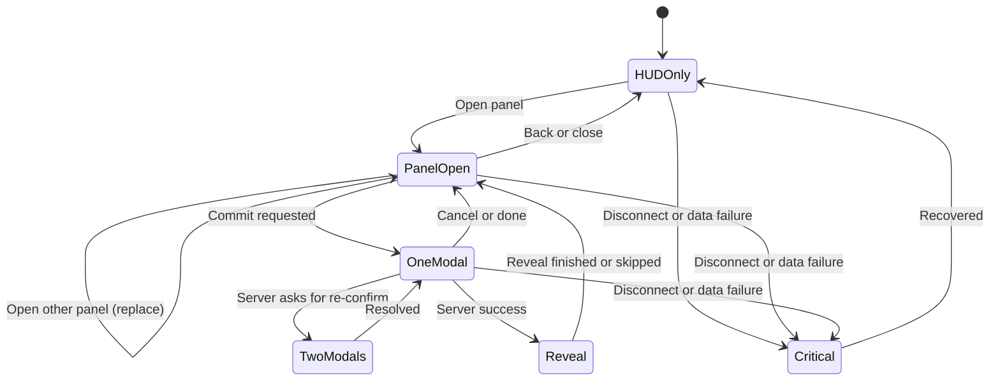
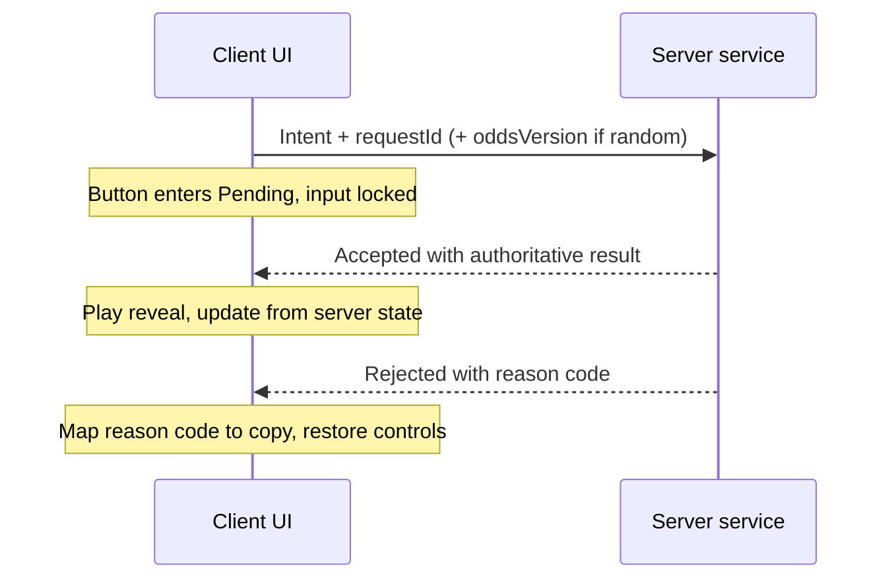

# UI Design System

The component library, layout rules and layering model that every screen in [[UI and UX Index]] is built from. It is **mobile-first**: every component is specified for a phone in landscape first and then scaled up for tablet, PC and console.

> [!info] Ownership boundary
> This page does **not** define colours, fonts or visual surface treatment. Those live in:
> - [[Colour Palette]]: every colour value, including the rarity colours (the rarity colour keys also appear in [[Canonical Proposed Values]] §1).
> - [[Typography]]: typefaces, weights and the type scale.
> - [[UI Visual Styling]]: corner radii, strokes, shadows, gradients, iconography and panel art.
>
> This page defines **what components exist, how they behave, how big they are, how they are spaced and how they stack**. Where a component needs a colour or font, it names a *semantic token* (for example `state.danger`) whose value is set in the art documents.

> [!info] PROPOSED
> Every size, duration, layer number and rule on this page is **PROPOSED** by the UI/UX team unless it restates a **CONFIRMED** game rule from the [[Decision Register]]. Values introduced here are listed at the end so they can be moved into [[Canonical Proposed Values]].

---

## 1. Design principles

1. **The server decides, the UI explains.** No screen ever shows an outcome the server has not confirmed. Buttons send *intents*; results come back from the server. See [[Server-Client Responsibilities]].
2. **Show the truth before the commit.** Any purchase, roll, hatch, merge or ascension shows its full cost and, for random outcomes, the player's **current actual odds** on the same surface as the commit button (D-017, D-041).
3. **Never imply hidden mercy.** Copy and visuals must never suggest that a result is "due", that luck is "building", or that a duplicate makes the next result better (D-018). See the banned-copy list in [[UI - Egg Rolling#Copy rules]].
4. **Every disabled control says why.** A disabled button is still focusable and tappable; activating it shows the reason (a tooltip on PC, a toast on touch, a focus caption on gamepad).
5. **Colour is never the only signal.** Rarity, status and danger always combine colour with a shape, icon and text label. See [[UI Accessibility Standards]].
6. **Thumb reach first.** Combat controls live in the bottom-right arc on phones; menus open from the top; destructive actions are never placed where a combat tap could hit them.

---

## 2. Semantic tokens used by components

The token *names* below are the contract between UI implementation and [[Colour Palette]] / [[Typography]]. Values are owned by those pages.

| Token group | Tokens | Used for |
|---|---|---|
| Surfaces | `ui.surface.base`, `ui.surface.raised`, `ui.surface.overlay`, `ui.scrim` | Panel backgrounds, cards, modal backdrop |
| Text | `ui.text.primary`, `ui.text.secondary`, `ui.text.disabled`, `ui.text.onAccent` | All labels |
| Accent | `ui.accent.primary`, `ui.accent.secondary` | Primary buttons, selection, focus ring |
| State | `state.success`, `state.warning`, `state.danger`, `state.info`, `state.locked` | Toasts, validation, lock overlays |
| Currency | `currency.cash`, `currency.robux` | Price labels and counters |
| Rarity | `rarity.common` … `rarity.secret` (seven tokens) | Rarity frames, odds rows, badges |
| Safety | `safety.safe`, `safety.raidable` | Backpack "Safe from raids" versus base storage "Raidable" chips |
| Type roles | `type.display`, `type.title`, `type.heading`, `type.body`, `type.label`, `type.caption`, `type.numeric` | Mapped to the scale in [[Typography]] |

---

## 3. Layout grid and scaling

### 3.1 Breakpoints and reference resolutions (PROPOSED)

Roblox GUI offsets are measured in the viewport's pixel units (on mobile these behave as device-independent points; *unverified* across every device). Each breakpoint has its own reference resolution, and a single `UIScale` on each top-level `ScreenGui` maps reference units to the live viewport.

| Breakpoint | Detected when | Reference resolution | UIScale clamp | Typical device |
|---|---|---|---|---|
| Compact | Touch enabled and viewport short side < 500 | 844 × 390 | 0.85 – 1.25 | Phone, landscape |
| Medium | Touch enabled and short side 500 – 900 | 1180 × 820 | 0.85 – 1.25 | Tablet |
| Large | Mouse or keyboard primary input | 1600 × 900 | 0.80 – 1.50 | PC, laptop |
| TV | Gamepad is the last input type on a large screen | 1600 × 900, then × 1.15 | 0.90 – 1.60 | Console, PC with controller |

`UIScale.Scale = clamp(min(viewport.X / ref.X, viewport.Y / ref.Y), lo, hi)`, recomputed on `workspace.CurrentCamera:GetPropertyChangedSignal("ViewportSize")`. Breakpoint changes (for example a gamepad being connected) re-layout without closing open panels.

### 3.2 Safe areas

All interactive content sits inside the safe area. The top bar inset comes from `GuiService:GetGuiInset()`; device cut-outs and rounded corners are handled through the `ScreenGui.ScreenInsets` property where available (*unverified* per platform; fall back to a 16-unit side margin). Background art (scrims, panel art) may bleed to the edges; text and buttons may not.

### 3.3 Spacing scale (PROPOSED)

All padding, gaps and margins use this scale, expressed in reference units before `UIScale`:

| Token | Value | Typical use |
|---|---:|---|
| `space.0` | 0 | Flush edges |
| `space.1` | 4 | Icon-to-label gap, badge inset |
| `space.2` | 8 | Gap between adjacent touch targets (minimum) |
| `space.3` | 12 | Card inner padding (Compact) |
| `space.4` | 16 | Card inner padding (Large), safe-area side margin |
| `space.5` | 24 | Section gap inside a panel |
| `space.6` | 32 | Panel outer padding (Large) |
| `space.7` | 48 | Separation between major regions (Large only) |

Implemented with `UIPadding`, `UIListLayout.Padding` and `UIGridLayout.CellPadding`. No other spacing values are allowed without adding them here.

### 3.4 Touch target minimums (PROPOSED)

Measured **after** `UIScale` is applied.

| Context | Minimum hit area | Recommended | Notes |
|---|---:|---:|---|
| Any touch-interactive element | 44 × 44 | 48 × 48 | Hard floor. Smaller visuals get an invisible hit-area `TextButton` behind them |
| Primary action (Roll, Hatch, Confirm) | 56 × 56 | 64 high, ≥ 160 wide | |
| Combat basic attack (mobile) | 80 × 80 | 96 × 96 | Bottom-right anchor |
| Combat specials, dodge, animal abilities (mobile) | 56 × 56 | 64 × 64 | |
| Gap between two adjacent touch targets | 8 | 12 | `space.2` minimum |
| Mouse-only element (PC) | 32 × 32 | 40 × 40 | |
| Gamepad-focusable element | 48 × 48 | 56 × 56 | Must show the focus ring |

---

## 4. Component library

Component names are used verbatim in every screen document and in the UI template library (`ReplicatedStorage/UI/Components`, see [[Roblox Project Hierarchy]]).

### 4.1 Buttons

| Component | Base class | Purpose | Sizes (H, Compact / Large) | Rules |
|---|---|---|---|---|
| `Btn/Primary` | `TextButton` (+ `UICorner`, `UIStroke`) | The one main action on a surface | 56 / 48 | Max one per panel region |
| `Btn/Secondary` | `TextButton` | Alternatives, "Cancel" | 48 / 40 | |
| `Btn/Ghost` | `TextButton`, transparent | Tertiary links, "Details" | 44 / 32 | |
| `Btn/Danger` | `TextButton` | Destructive or irreversible actions (consume, release) | 56 / 48 | Always routes through `Modal/Confirm` |
| `Btn/Icon` | `ImageButton` | Close, filters, menu icons | 48 / 36 | Always has a text tooltip and accessible label |
| `Btn/HoldConfirm` | `TextButton` + progress fill | High-value irreversible commits | 64 / 56 | Hold duration 1.0 s; can be switched to tap-twice in Settings ([[UI - Settings]]) |
| `Btn/PriceCash` | `TextButton` | Cash purchase (roll, upgrade, fee) | as Primary | Shows Cash icon + full amount; disabled with reason when unaffordable |
| `Btn/PriceRobux` | `TextButton` | Robux purchase | as Primary | Shows the Robux icon + price; always opens the native Roblox prompt |
| `Btn/Combat` | `ImageButton` + cooldown radial | Combat inputs | see §3.4 | Never inside a `ScrollingFrame` |

**Button states:** Default, Hover (pointer only), Pressed, Focused (gamepad ring), Disabled (with reason), Pending (spinner, input locked until server reply or timeout), Success (0.3 s confirmation pulse).

### 4.2 Cards

| Component | Content | Notes |
|---|---|---|
| `Card/Animal` | Portrait image, name, `Frame/Rarity`, role icon, ascension stars (0–5), chips (Equipped, Guard, Favourite, NEW) | Grid cell 112 × 136 (Compact), 128 × 156 (Large). Portrait is a pre-rendered image, not a `ViewportFrame` |
| `Card/Egg` | Egg image, rarity label, location chip (`Chip/Safe` or `Chip/Raidable`) | Square 96 (Compact), 112 (Large) |
| `Card/Module` | Module icon, name, level `L1`–`L5`, next-level cost | Used in [[UI - Base Management]] and [[UI - Base Upgrades]] |
| `Card/Product` | Product art, name, description, `Btn/PriceRobux` or `Btn/PriceCash` | Used in [[UI - Shop]] |
| `Card/IndexEntry` | Discovery state art (silhouette / colour), name or "???", rarity frame, owned count | Used in [[UI - Animal Index Screen]] |

### 4.3 Rarity frames

`Frame/Rarity` is a border plus corner ornament applied to any card. It must be readable without colour. Ornament shapes are **PROPOSED** here as functional identifiers; their art is drawn per [[Rarity Visual Language]] and [[UI Visual Styling]].

| Rarity | Colour token | Ornament (shape key) | Text label | Motion |
|---|---|---|---|---|
| Common | `rarity.common` | Plain border | "Common" | None |
| Uncommon | `rarity.uncommon` | One corner notch | "Uncommon" | None |
| Rare | `rarity.rare` | Two corner notches | "Rare" | None |
| Epic | `rarity.epic` | Four hex-cut corners | "Epic" | None |
| Legendary | `rarity.legendary` | Laurel corners | "Legendary" | Slow sheen (disabled by Reduced Motion) |
| Mythical | `rarity.mythical` | Crown crest at top | "Mythical" | Slow sheen |
| Secret | `rarity.secret` | Star crest and prismatic border | "Secret" | Prismatic `UIGradient` rotation |

The rarity name text is mandatory on every detail view and in every odds table. On small grid cards the ornament plus a one-letter code (C, U, R, E, L, M, S) is acceptable.

### 4.4 Tabs

`Tab/Bar` uses a horizontal `UIListLayout` of `Tab/Item` buttons; content switches with `UIPageLayout` (animated) or visibility toggles (Reduced Motion). On gamepad, `ButtonL1` / `ButtonR1` switch tabs. Maximum six tabs per bar on Compact; overflow scrolls horizontally inside a `ScrollingFrame`.

### 4.5 Modals

| Component | Use | Dismiss | Blocks |
|---|---|---|---|
| `Modal/Confirm` | Any commit that spends currency or consumes items | Cancel button, Back, tap on scrim (only if nothing is pending) | Everything below |
| `Modal/OddsChanged` | Server rejected a stale `oddsVersion` | Must choose "Review new odds" or "Cancel" | Everything below |
| `Modal/Info` | Rules, explanations, locked-state reasons | Any dismiss input | Everything below |
| `Modal/Error` | Server rejection that needs a decision | "OK" or a recovery action | Everything below |
| `Modal/Critical` | Disconnect, data-load failure | Recovery action only | Everything, including panels |

Every modal has a title, a body, at most two action buttons (primary on the right on PC, primary at the bottom on Compact), and a visible close affordance unless it is `Modal/Critical`.

### 4.6 Toasts

`Toast` is a non-blocking message in the top-centre stack. Types and durations (PROPOSED):

| Type | Icon | Duration | Example |
|---|---|---:|---|
| Info | `state.info` circle | 3 s | "Egg moved to base storage" |
| Success | `state.success` tick | 3 s | "Wolf reached A2" |
| Warning | `state.warning` triangle | 5 s | "Backpack full (10 / 10)" |
| Error | `state.danger` cross | 6 s, or until tapped | "Couldn't hatch: you are in combat" |

At most three toasts are visible; further toasts queue. Identical toasts within 2 s merge with a "×2" counter. Full rules are in [[UI - Notifications]].

### 4.7 Progress bars and meters

| Component | Class structure | Notes |
|---|---|---|
| `Bar/Health` | `Frame` (track) → `Frame` (fill) + delayed "ghost" fill | Ghost fill trails damage by 0.4 s. Low-health state below 25% adds a pulsing icon, not only colour |
| `Bar/XP` | Track + fill + `type.numeric` label "1,240 / 1,620 XP" | |
| `Bar/Segmented` | Track with N phase markers | For [[UI - Boss Health Bar]]; N comes from boss config |
| `Bar/Capacity` | Track + fill + "x / y" | Fill reaches `state.warning` at 80% and `state.danger` at 100% plus a "Full" label |
| `Radial/Cooldown` | `ImageLabel` with `UIGradient` rotation mask over the button | Shows remaining seconds as text when > 1 s |
| `Bar/Hold` | Fill inside `Btn/HoldConfirm` | |

### 4.8 Counters

| Component | Format | Examples |
|---|---|---|
| `Counter/Currency` | Icon + abbreviated amount; full amount in tooltip and in all confirmations | "12.4K" (full: 12,410 Cash) |
| `Counter/Capacity` | "x / y" + label | "Backpack 7 / 10" |
| `Counter/Selection` | "x / max selected" | "3 / 5 selected" |
| `Counter/Theft` | "x / max" or "x" when no limit is configured | "Animals stolen 1 / 3", "Eggs taken 4 / N" |
| `Counter/Level` | "Lv 24" | |

**Number formatting (PROPOSED):** below 10,000 show the full number with thousands separators; 10,000–999,999 as "12.4K"; millions as "1.25M"; billions as "1.25B". Confirmations, prices on commit buttons and receipts always show the full number.

### 4.9 Chips and badges

| Chip | Meaning | Icon + text (mandatory) |
|---|---|---|
| `Chip/Equipped` | In the active team of three | Paw + "Equipped" |
| `Chip/Guard` | Assigned as a base guard ([[Animal Guards and Base Defence AI]]) | Shield-paw + "Guard" |
| `Chip/New` | First time this species is owned | Star + "NEW" |
| `Chip/Duplicate` | Player already owns this species | Stack + "Duplicate · use for ascension" |
| `Chip/Safe` | Egg is in the backpack and can never be stolen | Lock-shield + "Safe from raids" |
| `Chip/Raidable` | Egg is in base storage | Open-vault + "Raidable" |
| `Chip/Locked` | Feature locked by location, level or state | Padlock + reason |
| `Chip/Auto` / `Chip/Manual` | Ability activation type (D-008) | "AUTO" / "TAP" (touch), "1/2/3" (PC), button glyph (gamepad) |

### 4.10 Other primitives

- `Tooltip`: PC hover after 0.4 s; touch long-press 0.5 s; gamepad shows as a focus caption.
- `Empty/Block`: illustration, one-line explanation, one action button. Every list has one.
- `Skeleton`: grey placeholder shapes shown while data loads; replaced in place.
- `Spinner`: only inside a pending button or a `Skeleton` region, never full-screen except in the transition layer.
- `Preview/3D`: a `ViewportFrame` (with a `WorldModel` child when the model must animate). Capped at **2 animated and 4 static** live viewports per screen (PROPOSED) to protect mobile frame rate ([[Performance Guidelines]]).

---

## 5. Z-order and the modal stack

### 5.1 Layers (PROPOSED)

Each layer is its own `ScreenGui` with `ResetOnSpawn = false` and `ZIndexBehavior = Sibling`. Inside a layer, `ZIndex` orders siblings.

| Layer | ScreenGui name | DisplayOrder | Contents | Blocks input below? |
|---|---|---:|---|---|
| World | `BillboardGui` / `SurfaceGui` in the 3D world | — | Nameplates, wild HP bars, `ProximityPrompt`s, target reticles | No |
| HUD | `HUD` | 10 | [[UI - Main HUD]], [[UI - Animal Team Display]], strength chip | No |
| Combat overlay | `CombatOverlay` | 20 | [[UI - Boss Health Bar]], raid HUD counters, PvP opponent bar | No |
| Panels | `Panels` | 30 | One full-screen or side panel at a time | Partially (scrim over HUD, combat inputs stay live) |
| Reveal | `Reveal` | 35 | Roll, hatch, merge and ascension reveal sequences | Yes |
| Modals | `Modals` | 40 | The modal stack (§5.2) | Yes |
| Toasts | `Toasts` | 60 | Toast stack, server announcements | No |
| Critical | `Critical` | 70 | Raid-on-your-base alert, `Modal/Critical` | Yes for `Modal/Critical`; banner does not block |
| Transition | `Transition` | 80 | Loading screen, teleport fades | Yes |

Roblox CoreGui (top bar, chat, the Roblox menu and native purchase prompts) always renders above developer `ScreenGui`s; the design never places essential content under the top-bar inset.

### 5.2 Modal stack rules

1. At most **one panel** is open. Opening another panel replaces it (the previous panel is remembered for Back).
2. At most **two modals** stack above a panel (for example `Modal/Confirm` → `Modal/OddsChanged`). A third request queues until the stack shrinks.
3. Back (`ButtonB`, `Backspace`, the on-screen close button) closes the **top-most** dismissible element only.
4. A modal with a pending server request cannot be dismissed; its scrim ignores taps until the reply or the timeout.
5. `Modal/Critical` pre-empts everything and clears the stack when the recovery action runs.
6. The raid alert banner on the Critical layer never steals focus from an open purchase confirmation; it waits until the confirmation resolves, then takes focus.

---

## 6. Motion (PROPOSED)

| Token | Duration | Easing (`TweenService`) | Use |
|---|---:|---|---|
| `motion.fast` | 0.12 s | Quad Out | Button press, chip toggle |
| `motion.standard` | 0.20 s | Quad Out | Panel slide, tab switch |
| `motion.slow` | 0.35 s | Back Out | Modal pop, reward card |
| `motion.reveal` | per [[Canonical Proposed Values]] §7 | scripted | Hatch 3.5 s single, 5.0 s multi |

With **Reduced Motion** on, every `motion.*` tween becomes a 0.1 s fade and looping sheens stop ([[UI Accessibility Standards]]).

---

## 7. Server interaction pattern (applies to every screen)

- Every intent carries a client-generated `requestId` so retries are idempotent ([[Implementation - Remote Validation Layer]]).
- **Timeout (PROPOSED): 8 s.** On timeout the UI does not assume success or failure. It shows "Still waiting for the server…", re-fetches the authoritative snapshot, and only then re-enables the button.
- Reason codes map to player-facing copy in one table owned by each screen's *Error states* section. Unknown codes show a generic "Something went wrong. Nothing was changed on this screen." only after the snapshot confirms nothing changed.
- Rate limits ([[Implementation - Rate Limiting]]) surface as "Slow down a moment", never as a silent no-op.

---

## 8. Values introduced on this page (for Canonical Proposed Values)

All **PROPOSED**: breakpoint reference resolutions and `UIScale` clamps (§3.1); spacing scale 0/4/8/12/16/24/32/48 (§3.3); touch target minimums 44 / 56 / 80, adjacent gap 8, mouse 32, gamepad 48 (§3.4); hold-to-confirm 1.0 s; toast durations 3 / 3 / 5 / 6 s with three visible (§4.6); low-health threshold 25%; capacity warning at 80%; number formatting thresholds (§4.8); viewport cap 2 animated + 4 static (§4.10); `DisplayOrder` layers 10 / 20 / 30 / 35 / 40 / 60 / 70 / 80 and a two-modal stack (§5); motion durations 0.12 / 0.20 / 0.35 s (§6); server request timeout 8 s (§7).

## Related documents

- [[UI and UX Index]] · [[UI Navigation Map]] · [[UI Accessibility Standards]]
- [[Colour Palette]] · [[Typography]] · [[UI Visual Styling]] · [[Rarity Visual Language]]
- [[Client Controllers]] · [[Roblox Project Hierarchy]] · [[Remote Communication Contract]] · [[Performance Guidelines]]
- [[Sound - UI Feedback]] · [[Template - UI Screen]] · [[M18 - UI and UX]]
