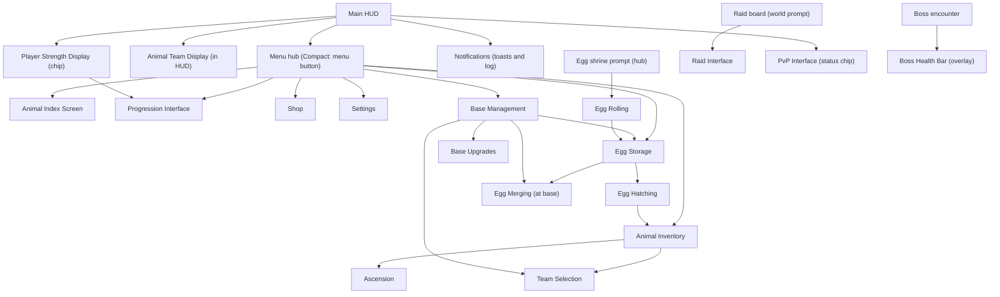

# UI Navigation Map

How the player gets from the HUD to every screen, which screens are available in which gameplay context, how Back works, and how every input device drives the interface. Component names refer to [[UI Design System]].

> [!success] CONFIRMED rules that shape navigation
> - The team of exactly **three** can only be changed at the player's **own base**; it is locked from leaving until returning (D-006, D-010).
> - Actual odds are shown before any roll or hatch is committed (D-017).
> - Up to **five** eggs hatch at once (D-016).
> - Merging needs a purchased Egg Merging Station (D-020).
> - PvP and raiding are optional (D-023, D-024).

> [!info] PROPOSED
> The menu structure, entry points, availability matrix and every key binding below are **PROPOSED**.

---

## 1. Information architecture

The HUD is the root. Every panel is at most **two steps** from the HUD (menu → panel) or one step from a world prompt.

## 2. Entry points

| Screen | Primary entry | Secondary entries | World prompt |
|---|---|---|---|
| [[UI - Main HUD]] | Always visible outside cut-scenes | — | — |
| [[UI - Player Strength Display]] | HUD chip | Progression Interface | — |
| [[UI - Animal Team Display]] | Part of the HUD | — | — |
| [[UI - Team Selection]] | Base Management "Team" button | Inventory "Edit team"; HUD team portraits (long-press / right-click) | Team pedestal at base (`ProximityPrompt`) |
| [[UI - Animal Inventory]] | Menu "Animals" | Hatch results "View animal" | — |
| [[UI - Animal Index Screen]] | Menu "Index" | Discovery toast "View in Index" | — |
| [[UI - Egg Rolling]] | Egg shrine `ProximityPrompt` | Egg Storage "Get eggs" (shows route if away) | Hub egg shrine ([[Hub - Hatchling Haven]]) |
| [[UI - Egg Hatching]] | Egg Storage "Hatch" | Roll result "Hatch now" | — |
| [[UI - Egg Storage]] | Menu "Eggs" | Capacity-full toasts | Egg Vault at base |
| [[UI - Ascension]] | Inventory animal detail "Ascend" | Duplicate chip on hatch result | — |
| [[UI - Egg Merging]] | Merging Station `ProximityPrompt` | Egg Storage "Merge" (at base) | Station at base |
| [[UI - Base Management]] | Menu "Base" | Arriving at base toast | Base core prompt |
| [[UI - Base Upgrades]] | Base Management module card | Module `ProximityPrompt` | Each module |
| [[UI - Raid Interface]] | Raid board `ProximityPrompt` | Raid alert banner (defender) | Raid board (location per [[Base Raiding System]]) |
| [[UI - PvP Interface]] | HUD PvP chip | Depends on activation method (**UNDECIDED**, [[Open Questions#Q-011]]) | Possibly zone or duel prompt |
| [[UI - Boss Health Bar]] | Automatic on boss engagement | World boss announcement toast | — |
| [[UI - Notifications]] | Automatic | Menu "Notifications" log | — |
| [[UI - Settings]] | Menu "Settings" | First-run prompt | — |
| [[UI - Progression Interface]] | Menu "Progress" | Level-up toast; Strength chip | — |
| [[UI - Shop]] | Menu "Shop" | Storage-full modal "Expand storage" (only once Q-009 is decided) | — |

> [!warning] UNDECIDED
> Whether egg rolls can be bought from the menu away from the shrine is **UNDECIDED** (Q-502). The navigation above assumes the shrine is the only purchase point and that remote access only shows a route.

## 3. Availability by context

Contexts are server-authoritative player attributes (for example `AtOwnBase`, `InCombat`, `RaidRole`). The client reads them only to grey out entries; the server re-validates every action.

| Screen | Exploring | In combat (8 s tag) | Hub | At own base | Raiding (attacker) | Own base under raid | Boss fight |
|---|---|---|---|---|---|---|---|
| Animal Inventory | ✔ | View only | ✔ | ✔ | ✖ | ✔ | View only |
| Team Selection | Locked view | Locked view | Locked view | ✔ edit | ✖ | **PROPOSED** locked (Q-506) | Locked view |
| Animal Index | ✔ | ✔ view | ✔ | ✔ | ✖ | ✔ | ✔ view |
| Egg Rolling | Route only | ✖ | ✔ at shrine | Route only | ✖ | ✖ | ✖ |
| Egg Hatching (backpack eggs) | ✔ | ✖ | ✔ | ✔ | ✖ | ✔ | ✖ |
| Egg Hatching (base eggs) | ✖ | ✖ | ✖ | ✔ | ✖ | **PROPOSED** ✖ (Q-506) | ✖ |
| Egg Storage | View | View | View | ✔ transfers | ✖ | **PROPOSED** view only (Q-506) | View |
| Ascension | ✔ (Q-504) | ✖ | ✔ | ✔ | ✖ | ✔ | ✖ |
| Egg Merging | ✖ | ✖ | ✖ | ✔ | ✖ | **PROPOSED** ✖ (Q-506) | ✖ |
| Base Management / Upgrades | View | ✖ | View | ✔ | ✖ | View | ✖ |
| Shop | ✔ | ✖ | ✔ | ✔ | ✖ | ✔ | ✖ |
| Settings | ✔ | ✔ | ✔ | ✔ | ✔ | ✔ | ✔ |
| Progression | ✔ | View | ✔ | ✔ | ✖ | ✔ | View |

✔ available · View = read-only · Locked view = opens with lock explanation · Route only = shows how to get there · ✖ menu entry disabled with reason.

Backpack eggs follow the **PROPOSED** hatch-location rule in [[Canonical Proposed Values]] §7: anywhere outside combat; base-stored eggs only at the base.

> [!warning] UNDECIDED (Q-506)
> Which base actions are locked while the player's own base is being raided (storage transfers, base-egg hatching, merging, team changes, guard reassignment). The **PROPOSED** UI recommendation is to lock all of them for the raid's duration so a defender cannot pull eggs out of reach mid-raid; the final rule belongs to [[Raid Anti-Exploit Validation]].

## 4. Back, close and focus rules

1. Back closes the top-most dismissible element: modal → panel → menu hub → HUD.
2. Closing a panel opened from another panel returns to the opener (one level of history only).
3. Back on the HUD does nothing in-game; on PC, `Escape` is reserved by Roblox for its own menu and is never rebound.
4. When a panel opens with gamepad input, focus goes to its primary action or first grid cell. When it closes, focus returns to the element that opened it.
5. A panel never opens on top of the Reveal layer; it waits until the reveal finishes.

## 5. Input bindings (PROPOSED)

Bindings are implemented with `ContextActionService:BindActionAtPriority` so that panel bindings (priority high) shadow combat bindings (priority default) while a panel has focus. Every binding is rebindable in [[UI - Settings]] except system-reserved keys.

| Action | Touch | Keyboard and mouse | Gamepad |
|---|---|---|---|
| Move / camera | Roblox thumbstick / drag | WASD / right-drag | Left stick / right stick |
| Basic attack | Attack button | Left mouse | `ButtonR2` |
| Power Strike | Special 1 | `Q` | `ButtonX` |
| Ground Slam (L10) | Special 2 | `E` | `ButtonY` |
| Rally Cry (L25) | Special 3 | `R` | `ButtonR1` |
| Dodge roll | Dodge button | `F` | `ButtonB` |
| Animal manual ability 1 / 2 / 3 | Tap portrait ability button | `1` / `2` / `3` | `DPadLeft` / `DPadUp` / `DPadRight` |
| Command team: attack target | Tap enemy, then "Attack" | `T` on cursor target | `ButtonL1` on reticle target |
| Cycle target | Tap another enemy | `Tab` | `ButtonL2` hold + right stick |
| Clear command (back to auto-target) | Tap command chip | `G` | `ButtonL1` double-press |
| Open menu hub | Menu button | `M` | `DPadDown` |
| Animals / Eggs / Index / Progress | Menu items | `I` / `B` / `N` / `P` | Via menu hub |
| Interact with prompt | Prompt button | `E` hold (Roblox default) | `ButtonX` hold (Roblox default) |
| Back / close | Close button | `Backspace` | `ButtonB` |
| Switch tab | Tap tab | `[` / `]` | `ButtonL1` / `ButtonR1` (in panels) |

> [!danger] Binding conflicts
> `E` is both Ground Slam and the default `ProximityPrompt` key, and `ButtonX` is both Power Strike and the default gamepad prompt key. The **PROPOSED** resolution: prompts use their default *hold* activation, while specials fire on press. If playtests show mis-fires, move prompts to `ProximityPrompt.KeyboardKeyCode = Enum.KeyCode.Z` and `GamepadKeyCode = Enum.KeyCode.ButtonA` per prompt. Default prompt key behaviour is *unverified* for every Roblox client version.

Gamepad UI navigation uses `GuiService.SelectedObject`, `GuiObject.Selectable` and explicit `NextSelectionUp/Down/Left/Right` on grids where automatic selection guesses wrong. Whether the `ButtonSelect` default toggle of UI navigation should be kept is a test item for [[Test Cases - Mobile Performance]] and console certification (*unverified* default behaviour).

## 6. Context transitions the UI must handle

| Transition | UI response |
|---|---|
| Player leaves own base with Team Selection open | Panel switches to the locked state instantly; any pending change is discarded by the server (D-010) |
| Combat tag starts while a panel is open | Panel stays open, red edge vignette, combat-blocked actions disable with reason; combat inputs remain live |
| Own base raid starts | Critical banner; base actions lock per the Q-506 proposal (see §3); open merge or transfer modals close with "Your base is under raid" |
| Odds change while Egg Rolling or Hatching is open | Inline odds update, Roll/Hatch disabled for 1.0 s, "Your odds have updated" label (see [[UI - Egg Rolling]]) |
| Teleport or region streaming | Transition layer fade; panels close; toasts queue until arrival |
| Disconnect | `Modal/Critical` with reconnect; see [[Disconnect Handling]] |

## Related documents

- [[UI and UX Index]] · [[UI Design System]] · [[UI Accessibility Standards]]
- [[Team Equipping and Base Lock Rule]] · [[Combat States and State Machine]] · [[Raid Lifecycle and States]]
- [[Client Controllers]] · [[Session Flow and Player Journey]] · [[New Player Onboarding]]
