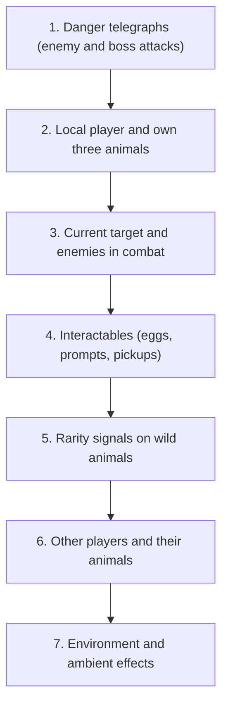
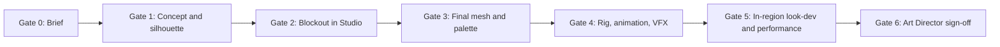

# Art Bible

The top-level visual rulebook for *Fight Animals for Eggs*. It states the style, the non-negotiables, the readability hierarchy and the review gates every asset must pass. Detailed rules live in the specialist pages listed in [[Art Direction Index]]; this page does not repeat them.

> [!success] CONFIRMED — D-026 Visual direction
> Colourful, polished, low-poly animals with clear silhouettes. No horror, no "Italian brainrot", no meme animals ([[Decision Register]]).

Everything else on this page is **PROPOSED** by the Art Director unless marked otherwise.

## 1. Style statement

**"Toy-box safari, built from clean facets."** Every animal looks like a premium collectible figure: chunky readable shapes, a small number of flat or softly graded colour regions, a friendly face with a visible eye highlight, and one or two exaggerated signature features (a lion's mane, an elephant's ears, a narwhal's tusk). Worlds look like hand-built dioramas lit by warm, clean sunlight. Rarity is expressed through light, material and motion, never through gore, fear or grotesque distortion.

| Axis | Where we sit | Not this |
|---|---|---|
| Geometry | Low-poly, faceted, intentional bevels on silhouette edges | Photoreal sculpted meshes; Minecraft-style cubes |
| Proportion | Stylised: enlarged heads and signature features, compact bodies | Anatomical realism; extreme chibi blobs |
| Colour | Saturated, value-separated, limited palette per asset | Muddy naturalism; full-rainbow noise |
| Surface | Flat colour and gentle gradients; selective PBR on high tiers | Photographic textures, noisy fur maps |
| Mood | Adventurous, bright, optimistic, a little epic at high tiers | Dark, gritty, creepy, ironic |
| Humour | Expressive animation and personality | Memes, internet references, absurd hybrids |

## 2. Visual pillars

1. **Readable at a glance.** A player must identify species, side (own, ally, wild, hostile) and danger in under half a second. Each animal passes the 64 px silhouette test ([[Animal Modelling Principles]]).
2. **Rarity you can feel.** Each step up the seven tiers adds light, motion and material richness in a fixed, learnable order ([[Rarity Visual Language]]).
3. **Satisfying feedback.** Every hit, hatch, merge and upgrade has a clear visual payoff sized to its importance ([[Combat Feedback and Readability]], [[VFX Bible]]).
4. **Worlds worth exploring.** Each region has a distinct palette, landmark set and lighting mood ([[Environment Art Direction]]).
5. **Performance is part of the look.** Low-poly is not just a style; it is how 16 players, 48 companions and up to 60 fully simulated wild animals stay at the frame-rate targets in [[Canonical Proposed Values]] §15.

## 3. Content safety and tone rules

These rules implement D-026 and apply to every asset, including events and live-ops content ([[Content Expansion Guidelines]]).

| Banned | Why | Acceptable alternative |
|---|---|---|
| Blood, wounds, gore, bones, skulls | Horror tone | Stars, sparks, dust puffs, "dizzy" swirls on hit |
| Glowing red eyes, slit-pupil glares on companions, drooling jaws | Horror tone | Round pupils with highlights; determined brows for aggression |
| Teeth shown at rest on predators | Reads as menacing | Teeth appear only during attack poses; rounded, cream `#F5EFE0` |
| Human faces, human limbs or human clothing on animals | Brainrot and meme territory | Natural anatomy with stylised proportions |
| Object-animal hybrids (animals wearing shoes, animals fused with food or furniture) | Brainrot territory | Signature natural features exaggerated |
| Internet catchphrases, meme poses, reaction faces, text on animals | Meme territory | Species-appropriate emotes ([[Animation Bible]]) |
| Real-world brands, logos, flags, religious symbols | Legal and cultural risk | Original fictional iconography |
| Photographic or stock textures | Style break; licence risk | Hand-authored palette atlases ([[Material and Texture Direction]]) |
| Darkness used to frighten (pitch-black zones, jump-scare lighting) | Horror tone | Dusk and night lighting with a readability floor ([[Lighting Direction]]) |

Prehistoric and colossal animals (Mosasaurus, Tyrannosaurus Rex, Titanoboa and others in the **PROPOSED** "ancient lineage" theme, D-033, [[Open Questions#Q-027]]) are drawn **heroic, not monstrous**: warm accent colours, visible eye highlights, rounded tooth shapes and proud postures.

## 4. Readability hierarchy

When two elements compete for attention, the higher one wins in value contrast, saturation and motion.

Practical consequences:
- Ambient environment particles never use the feedback colours in [[Colour Palette]].
- Other players' companion auras render at reduced intensity (**PROPOSED**: 50% particle rate, no Bloom-driving Neon) compared with the local player's own team.
- Environment props stay at least 15% lower in saturation than animals in the same region.

## 5. Shape language

| Element | Shape family | Reads as |
|---|---|---|
| Friendly, collectible animals | Rounded masses with a few crisp facets | Approachable, toy-like |
| Role accent: Tank | Broad, square, low centre of mass | Sturdy |
| Role accent: Bruiser | Trapezoid torso, heavy forequarters | Strong |
| Role accent: Assassin | Long, forward-leaning, pointed features | Fast, precise |
| Role accent: Skirmisher | Light wedge, raised hindquarters, big feet or wings | Agile |
| Role accent: Ranged | Elongated head or limb that "points" | Distance |
| Role accent: Support | Circles, soft curves, upright posture | Caring |
| Role accent: Controller | Spirals, coils, asymmetric flourishes | Tricky |
| Danger (telegraphs, hazards) | Sharp triangles, chevrons, hard edges | Threat |
| Rewards (eggs, chests, cash) | Ovals, circles, stars | Value |

Role accents are secondary to species anatomy. Roles come from [[Animal Roles]]; species come from the animal documents (for example [[Wolf]]).

## 6. Technical style summary

| Topic | Headline rule (PROPOSED) | Owner page |
|---|---|---|
| Triangle budgets | 2,000 (Common) to 8,000 (Secret) per animal at LOD0 | [[Animal Modelling Principles]] |
| Textures | Shared 256×256 palette atlas for Common–Rare; 512 and 1,024 SurfaceAppearance sets above | [[Material and Texture Direction]] |
| Materials | SmoothPlastic default; Neon for accents only; Glass, Foil, ForceField for specific roles | [[Material and Texture Direction]] |
| Lighting | Lighting.Technology ShadowMap baseline; per-region Atmosphere, ColorCorrection, Bloom, SunRays | [[Lighting Direction]] |
| Rarity effects | Fixed escalation ladder, seven steps | [[Rarity Visual Language]] |
| Variants | Five material sets, VAR-001 to VAR-005 | [[Variant Visual Treatments]] |
| Rigging and animation | Rig types and clip lists | [[Animal Rig Standards]], [[Animation Bible]] |
| VFX | Particle budgets and catalogue | [[VFX Bible]] |
| Naming and IDs | Asset IDs and file names | [[Asset Naming Conventions]], [[Asset Register]] |

## 7. Production pipeline and review gates

| Gate | Pass criteria (PROPOSED) | Evidence required |
|---|---|---|
| 0 Brief | Placeholder block filled in [[Visual Reference Placeholders]]; species, rarity, role, region confirmed against [[Canonical Proposed Values]] §2 | Completed brief |
| 1 Concept | 64 px silhouette test passed against its confusion group; tone rules in §3 met | Silhouette sheet, colour callout |
| 2 Blockout | Size class correct beside a 5-stud reference player; reads at 60 studs | Studio screenshot set |
| 3 Final mesh | Within triangle budget; UVs on palette atlas or SurfaceAppearance set; naming per [[Asset Naming Conventions]] | Mesh stats, file list |
| 4 Rig and motion | Rig meets [[Animal Rig Standards]]; idle, move, attack, hit, defeat clips present | Turntable and clip review |
| 5 Look-dev | Reads in its home region lighting and in the Hub; rarity and variant layers tested; frame-time cost within [[Performance Guidelines]] | Capture in each lighting preset |
| 6 Sign-off | Art Director and owning designer approve; register row updated | [[Asset Register]] status |

## 8. Worked example: reviewing a new Epic animal

Asset: ANM-034 [[Tiger]] (Epic, Big Cats, Assassin, Emerald Canopy).

1. **Silhouette:** compared at 64 px against Leopard, Cheetah, Snow Leopard, Lion and Sabre-Tooth Tiger. Tiger's anchor is the heavier head ruff and broad shoulder mass; stripes do not count because silhouettes ignore colour.
2. **Tone:** teeth hidden at idle; eyes round with highlight; stripes are clean bands, not "claw marks".
3. **Budget:** Epic budget is 4,000 triangles; size class L. SurfaceAppearance 512×512 ColorMap.
4. **Rarity:** Epic world signals per [[Rarity Visual Language]] (violet `#A55BFF` nameplate pip count 4; ground ring on the wild version).
5. **Lighting:** checked under Emerald Canopy preset (dense Atmosphere, strong SunRays); the orange body (species palette in [[Tiger]]) still separates from jungle green `#2FA86A` in greyscale.
6. **Result:** passes Gate 5. The Art Director signs off and the [[Asset Register]] row moves to "approved".

## 9. Edge cases

- **Colossal species as companions** (Blue Whale, Megalodon, Woolly Mammoth): scale is compressed to the companion size cap. See [[Animal Modelling Principles]]. Owner acceptance of compression is **UNDECIDED** (Q-604).
- **Aquatic animals on land:** follow the **PROPOSED** air-swim approach (D-043); land movement is **UNDECIDED** ([[Open Questions#Q-028]]). Models must look correct both floating and resting.
- **Player avatars:** players bring their own Roblox avatars, which the game does not restyle. Companion scale is referenced to a 5-stud standard avatar. Whether avatar type or scale is constrained is **UNDECIDED** (Q-601).
- **Seasonal content:** reskins and event props must still pass §3 and use the [[Colour Palette]] feedback rules.

## Related documents
- [[Art Direction Index]]
- [[Colour Palette]]
- [[Animal Modelling Principles]]
- [[Rarity Visual Language]]
- [[Environment Art Direction]]
- [[Lighting Direction]]
- [[Material and Texture Direction]]
- [[Animation Bible]]
- [[VFX Bible]]
- [[Asset Register]]
- [[Vision Statement and Pillars]]
- [[Design Principles and Fairness Charter]]
