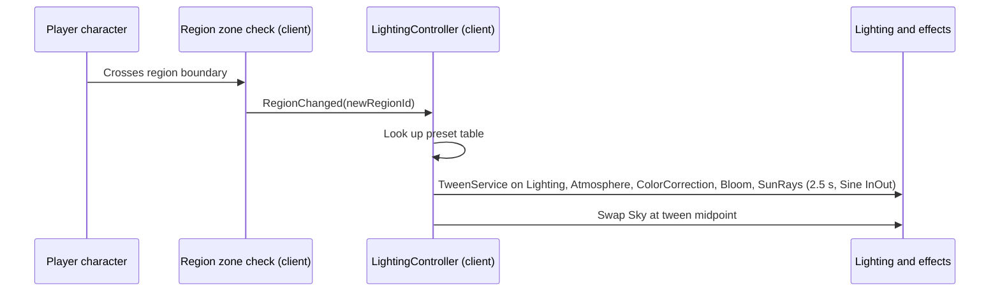

# Lighting Direction

Global lighting technology, per-region lighting presets, post-processing, special presentation lighting (hatch, merge, boss) and the readability floor that keeps every region bright enough to play. Every exact value on this page is **PROPOSED** for look-development and will be tuned in Studio.

> [!success] CONFIRMED
> Colourful, polished visual direction with no horror (D-026). One large shared world (D-025).

> [!warning] UNDECIDED
> Whether the world has a running day/night cycle or a fixed time of day per region is **UNDECIDED** (Q-603). This page assumes **fixed per-region time of day** as the working proposal because it keeps readability and colour design controllable.

## 1. Global settings

| Property | Value (PROPOSED) | Reason |
|---|---|---|
| `Lighting.Technology` | `ShadowMap` | Sun shadows with predictable cost for 16 players, up to 60 fully simulated wild animals and heavy particle use. `Future` is the alternative; compare both in [[M20 - Optimisation]] |
| `Lighting.GlobalShadows` | `true` | Grounding for animals |
| `Lighting.ShadowSoftness` | 0.25 | Soft but defined toy-like shadows |
| `Lighting.EnvironmentDiffuseScale` | 0.6 (region overrides below) | Fills shadows with sky colour |
| `Lighting.EnvironmentSpecularScale` | 0.5 | Enough for Foil and Glass to read without glare |
| `Lighting.GeographicLatitude` | 30 | Sun arcs high and pleasant at most ClockTimes |
| `Sky` | One custom skybox per region set (ENV-011), cartoon clouds, no photographic skies | Style rule ([[Art Bible]]) |
| `Terrain.Clouds` (Clouds instance) | Cover and Density per region | Cheap depth cue |

`Lighting.Technology` is set once for the place and is not expected to be changeable at runtime (*unverified*). Region looks are therefore built only from properties that can be tweened.

## 2. How region presets are applied

Lighting is changed **on the client only** when the local player enters a region zone. Client-side changes to `Lighting` do not replicate, so each player sees the preset of the region they are in.



Implementation notes (illustrative, owned by [[Client Controllers]]):

```lua
-- Illustrative Luau, not tested in Studio
local TweenService = game:GetService("TweenService")
local Lighting = game:GetService("Lighting")
local INFO = TweenInfo.new(2.5, Enum.EasingStyle.Sine, Enum.EasingDirection.InOut)

local function applyPreset(preset)
	TweenService:Create(Lighting, INFO, preset.Lighting):Play()
	TweenService:Create(Lighting.Atmosphere, INFO, preset.Atmosphere):Play()
	TweenService:Create(Lighting.RegionColorCorrection, INFO, preset.ColorCorrection):Play()
	TweenService:Create(Lighting.RegionBloom, INFO, preset.Bloom):Play()
	TweenService:Create(Lighting.RegionSunRays, INFO, preset.SunRays):Play()
end
```

Effect instance names (`RegionColorCorrection`, `RegionBloom`, `RegionSunRays`) are conventions from [[Asset Naming Conventions]]. Presentation effects (hatch, boss) use separate instances layered on top so they never overwrite the region preset.

## 3. Region presets: Lighting properties

| Region | `ClockTime` | `Brightness` | `Ambient` | `OutdoorAmbient` | `ColorShift_Top` | `ExposureCompensation` | `EnvironmentDiffuseScale` |
|---|---:|---:|---|---|---|---:|---:|
| [[Hub - Hatchling Haven]] | 14.0 | 2.6 | `#5E5A70` | `#8C8FA8` | `#FFF2D9` | 0.0 | 0.6 |
| [[Region - Whisperwood Forest]] | 15.2 | 2.4 | `#4F5A4C` | `#7A8E78` | `#FFE9C2` | 0.0 | 0.6 |
| [[Region - Sunscorch Savanna]] | 16.6 | 3.0 | `#5C4A3C` | `#A0866A` | `#FFD9A0` | −0.1 | 0.5 |
| [[Region - Emerald Canopy]] | 13.0 | 2.0 | `#3E5A48` | `#5E8A6E` | `#F2FFD9` | 0.1 | 0.7 |
| [[Region - Coral Coast]] | 12.0 | 3.2 | `#56708A` | `#86A9C2` | `#FFFFFF` | −0.1 | 0.6 |
| [[Region - Frostfang Tundra]] | 10.5 | 2.2 | `#5E6E8A` | `#9AB0CC` | `#E6F0FF` | −0.3 | 0.7 |
| [[Region - Skyreach Peaks]] | 8.6 | 2.8 | `#56608A` | `#8FA0C4` | `#FFF0E0` | −0.1 | 0.6 |
| [[Region - Emberheart Caldera]] | 18.3 | 1.6 | `#4A2E2A` | `#84584E` | `#FFB27A` | 0.2 | 0.5 |
| [[Region - Starfall Sanctuary]] | 0.5 | 1.2 | `#3A3B70` | `#5A5C9A` | `#C9C2FF` | 0.3 | 0.8 |

## 4. Region presets: Atmosphere

| Region | `Density` | `Offset` | `Color` | `Decay` | `Glare` | `Haze` |
|---|---:|---:|---|---|---:|---:|
| Hub | 0.28 | 0.25 | `#C7D9F2` | `#8FA8D6` | 0.20 | 1.0 |
| Whisperwood Forest | 0.33 | 0.20 | `#CFE3C2` | `#7E9E6A` | 0.15 | 1.4 |
| Sunscorch Savanna | 0.30 | 0.15 | `#F4D9A6` | `#D9925A` | 0.60 | 2.0 |
| Emerald Canopy | 0.42 | 0.10 | `#BFE8C8` | `#4E8C66` | 0.10 | 2.4 |
| Coral Coast | 0.24 | 0.30 | `#CDEFFF` | `#6FB8E0` | 0.40 | 0.8 |
| Frostfang Tundra | 0.36 | 0.20 | `#DDEBFA` | `#9DB8E3` | 0.30 | 1.6 |
| Skyreach Peaks | 0.20 | 0.40 | `#D6E2FF` | `#A8B7E8` | 0.50 | 0.6 |
| Emberheart Caldera | 0.40 | 0.10 | `#E8A27A` | `#7A2E1E` | 0.30 | 2.6 |
| Starfall Sanctuary | 0.30 | 0.25 | `#8C8CE0` | `#3A2A7A` | 0.00 | 1.0 |

## 5. Region presets: post-processing

| Region | ColorCorrection `Brightness` / `Contrast` / `Saturation` / `TintColor` | Bloom `Intensity` / `Size` / `Threshold` | SunRays `Intensity` / `Spread` | Clouds `Cover` / `Density` |
|---|---|---|---|---|
| Hub | 0.02 / 0.08 / 0.15 / `#FFFBF2` | 0.6 / 24 / 1.6 | 0.06 / 0.6 | 0.45 / 0.5 |
| Whisperwood Forest | 0.00 / 0.08 / 0.18 / `#FFF6E6` | 0.5 / 24 / 1.7 | 0.10 / 0.7 | 0.50 / 0.5 |
| Sunscorch Savanna | 0.02 / 0.10 / 0.12 / `#FFEBD1` | 0.7 / 28 / 1.5 | 0.12 / 0.5 | 0.25 / 0.3 |
| Emerald Canopy | 0.00 / 0.06 / 0.22 / `#F2FFF2` | 0.5 / 20 / 1.6 | 0.18 / 0.8 | 0.70 / 0.6 |
| Coral Coast | 0.03 / 0.06 / 0.20 / `#F4FCFF` | 0.7 / 24 / 1.5 | 0.08 / 0.5 | 0.35 / 0.4 |
| Frostfang Tundra | 0.00 / 0.12 / 0.05 / `#EEF6FF` | 0.5 / 24 / 1.8 | 0.06 / 0.4 | 0.65 / 0.6 |
| Skyreach Peaks | 0.02 / 0.10 / 0.10 / `#F6F7FF` | 0.5 / 24 / 1.7 | 0.12 / 0.6 | 0.80 / 0.7 (clouds below the peaks) |
| Emberheart Caldera | 0.00 / 0.12 / 0.15 / `#FFE4D6` | 0.9 / 28 / 1.2 | 0.10 / 0.5 | 0.55 / 0.6 |
| Starfall Sanctuary | 0.04 / 0.08 / 0.20 / `#EDE8FF` | 1.0 / 32 / 1.1 | 0.00 / 0.0 | 0.30 / 0.3 |

Bloom `Threshold` is the main control for Neon accents: lower thresholds (Emberheart, Starfall) make lava cracks and starlight glow; higher thresholds (Frostfang) stop snow from blooming.

## 6. Readability floor

To keep the no-horror rule and to protect combat readability, every preset must satisfy:

| Check | Requirement (PROPOSED) |
|---|---|
| `OutdoorAmbient` lightness | CIELAB L* ≥ 40; Starfall's `#5A5C9A` (L* ≈ 41) is the darkest allowed, Emberheart's `#84584E` is L* ≈ 42 |
| Animal in shadow | Mid-grey test animal (`#9AA5B1`) under shade must remain ≥ 35% screen luminance |
| Telegraph contrast | `#FF4B3E` telegraph decal reads against the region's ground colour at 3:1 or better |
| Night regions | Starfall uses a bright moon and high `OutdoorAmbient` plus emissive crystals; no area is darker than the floor |
| Fog | Atmosphere never hides a wild animal within 60 studs (the leash range in [[Canonical Proposed Values]] §4) |

## 7. Presentation lighting

These layered setups are triggered by the systems that own the moments. Timings belong to animation documents.

| Moment | Setup (PROPOSED) | Owner of timing |
|---|---|---|
| Egg hatch (Common–Epic) | Temporary `ColorCorrectionEffect` named `HatchColorCorrection`: Saturation +0.1, Contrast +0.05; `DepthOfFieldEffect` FocusDistance on egg, InFocusRadius 6, FarIntensity 0.4 | [[Animation - Egg Hatch]] |
| Egg hatch (Legendary–Mythical) | Above, plus `HatchBloom` Intensity 1.2 Threshold 1.0 for 0.6 s; TintColor shifts toward rarity light tint (`#FFE2A3` or `#FFC2D8`) | [[Animation - Egg Hatch]] |
| Egg hatch (Secret) | Brightness −0.25 dim to near `#1B1B2F` for 0.4 s, then prismatic burst; Bloom 1.5 for 0.5 s | [[Animation - Egg Hatch]] |
| Egg merge | Station-local `PointLight` in output egg's rarity key, Range 12, Brightness 2 ramp | [[Animation - Egg Merge]] |
| Boss engage | `BossColorCorrection` Contrast +0.06, Saturation +0.05; no darkening | [[Animation - Boss Attacks]] |
| Raid active (inside defender base) | Subtle `ColorCorrection` TintColor `#FFF2E6` plus ForceField shield glow; never red flashing | [[Animation - Raid Interactions]] |

Local lights: `PointLight` and `SpotLight` with `Shadows = false` by default (under ShadowMap local lights are expected not to cast shadows; under Future they can, at extra cost; *unverified*). Maximum **8** dynamic local lights per region chunk and **3** per base (PROPOSED).

## 8. Edge cases

- **Region borders**: a player standing on a border can flicker between presets. Use 6-stud hysteresis: change preset only after the player is 6 studs inside the new zone.
- **Teleports to base**: the base uses the Hub preset unless the base plot sits in a region (layout owned by [[Base Layout and Plot Expansion]]).
- **Players in different regions in one server**: no issue, presets are client-local.
- **Low graphics quality**: Roblox scales down effects at lower quality levels (exact behaviour *unverified*). Presets must look acceptable with Atmosphere and post-processing reduced; test at quality level 1 on mobile ([[Test Cases - Mobile Performance]]).
- **Reduced effects option**: whether the game provides its own "reduced effects" setting (less Bloom, fewer particles) is **UNDECIDED** (Q-607).

## 9. Test hooks

- Debug command cycles all nine presets in place and captures screenshots from a fixed camera with a reference animal line-up (one of each size class).
- Automated check asserts every preset table has all properties listed in §3–§5.
- Frame-time capture per preset on the mobile reference device ([[Performance Guidelines]]).

## Related documents
- [[Art Direction Index]]
- [[Environment Art Direction]]
- [[Colour Palette]]
- [[Rarity Visual Language]]
- [[Boss Art Direction]]
- [[VFX - Environment Ambient Effects]]
- [[Performance Guidelines]]
- [[Client Controllers]]
- [[World Overview and Map]]
