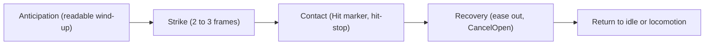
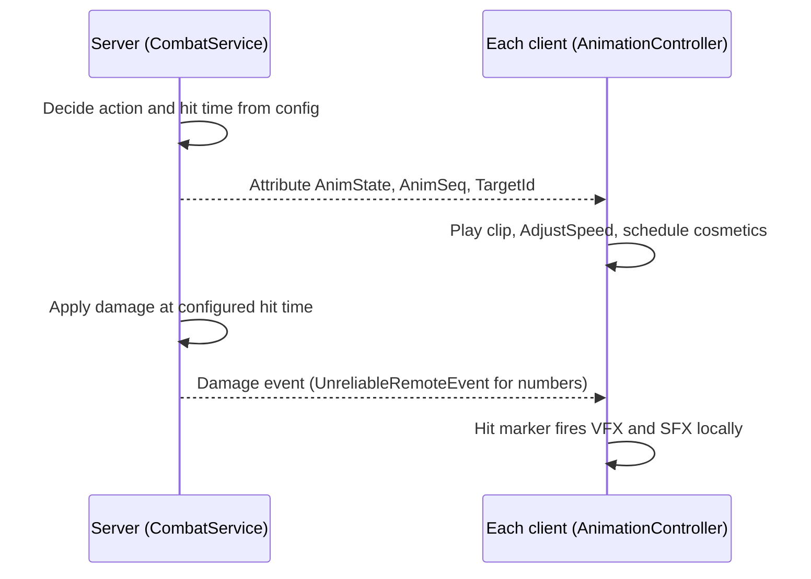

# Animation Bible

The rules every animation in *Fight Animals for Eggs* follows: style, timing language, technical conventions, playback authority, transitions, level of detail, accessibility and asset ID allocation. Individual animation sets are specified in the documents listed in [[Animation and VFX Index]]. Rigs are defined in [[Animal Rig Standards]].

> [!success] CONFIRMED inputs
> Real-time hybrid combat with the player and animals fighting together (D-005); exactly three equipped animals (D-006); manual and automatic abilities (D-008); up to five eggs hatched at once (D-016); merge 3 → 1 (D-020); defenders stealable only after knock-out, maximum three animals per successful raid (D-024); colourful, polished, low-poly, no horror and no meme animals (D-026).

> [!info] PROPOSED
> All styles, durations, frame splits, budgets and IDs in this document are **PROPOSED**.

---

## 1. Style pillars

| Pillar | What it means in a keyframe | What it rules out |
|---|---|---|
| **Readable at 40 studs on a phone** | Every action has one dominant silhouette pose held for at least 2 frames at 30 fps. Strike poses extend a limb or head clearly outside the body outline. | Small, internal motions as the only tell of an attack |
| **Snappy, not floaty** | Fast-in, slow-out. Strikes travel in 2–3 frames; recovery eases over 5–10 frames. | Linear interpolation on strikes; symmetric ease in and out on impacts |
| **Faceted solidity** | Low-poly parts rotate as rigid blocks. Exaggerate squash through joint pose (crouch depth, spine compression), never through part scaling. | Scaling parts for squash and stretch (breaks faceted shading and hitboxes) |
| **Friendly physicality** | Hits shove, wobble and daze. Knock-outs show dizzy, sleepy or swirly-eyed poses. | Gore, limp ragdolls, writhing, horror poses, mocking or meme dances (D-026) |
| **Animal truth first, then exaggeration** | Gaits come from the real animal (feline rotary gallop, pachyderm amble); timing is then exaggerated by about 20% for clarity. | Generic "dog run" on every quadruped |
| **Server truth, client theatre** | Animations dramatise results the server has already decided (combat hits, egg rarity, hatch result). | Animations that imply a different outcome from the real one (§6) |

---

## 2. Technical conventions

| Convention | Value |
|---|---|
| Authoring frame rate, animals, world, eggs, bases | **30 fps**. Frame numbers in all ANI documents are at 30 fps unless stated. |
| Authoring frame rate, player combat | **60 fps**, because player combo timing (0.45 s per hit, [[Canonical Proposed Values]] §4) is not a whole number of 30 fps frames. Player docs state "@60". |
| Timing notation | `f0–6` = frames 0 to 6 inclusive. "Contact f8" = the `Hit` marker frame. Durations in seconds are authoritative; frames are derived (`frame = round(seconds × fps)`). |
| Interpolation | Cubic, ease-out on the frame after contact; constant (stepped) for one frame on contact when a "hit-stop" is wanted. |
| Looping clips | First and last keyframe identical; `Looped = true`. Loop length is a multiple of the gait's stride. |
| Root motion | **None.** All clips are in place. Translation comes from the AI mover or the player controller. Leaps and rolls fake their arc with `Pelvis` height only; horizontal displacement is code-driven and tuned to the clip duration. |
| Asset name | `ANI-###_<Class>_<Name>`, e.g. `ANI-019_QL_Run`. See [[Asset Naming Conventions]]. |
| Shared template plus model | Per-animal or per-boss variants of a template clip use `ANI-###/ANM-###` or `ANI-###/BOS-##`, e.g. `ANI-263/ANM-044`. The template ID fixes timing; the variant may change poses only. |

---

## 3. Timing language

Every action clip is described in four phases. Configuration stores the phase boundaries in seconds; the clip must match them.

| Phase | Purpose | Rule |
|---|---|---|
| Anticipation | Tells the target and onlookers what is coming | ≥ 0.15 s for companion basic attacks; ≥ 0.6 s for wild animal heavy attacks; ≥ 0.8 s for boss attacks ([[Animation - Boss Attacks]]) |
| Strike | The fast travel | 2–3 frames at 30 fps; motion blur comes from Trails, not smear frames |
| Contact | The frame damage is applied by the server's configured hit time | Hold 1–2 frames ("hit-stop") on heavy hits; the `Hit` marker sits on the first held frame |
| Recovery | Returns to neutral and leaves a punish window | Ends on a pose that blends into idle within 0.1–0.2 s |

### 3.1 Attack cadence and playback speed

Basic attack interval = `1 / AS` seconds, where AS comes from [[Animal Statistics Database]]. Each role's basic attack clip is authored for the role's reference interval (`1 / (1.00 × RoleAS)`), and the client sets `track:AdjustSpeed(authoredInterval / actualInterval)`, clamped to **0.85–1.20**. Outside that clamp the clip is played at the clamp limit and the idle-hold fills the remainder (fast clips are never sped up beyond 1.20, because strikes become unreadable). See [[Animation - Animal Attacks and Hit Reactions]] for the role table.

---

## 4. Playback authority and replication

1. The server is authoritative for **what** happens and **when** it takes effect ([[Server-Client Responsibilities]]).
2. Clients play animations locally from replicated attributes. `AnimSeq` increments on every new action so a repeated attack retriggers even if `AnimState` is unchanged.
3. Latency: a client that receives the state late fast-forwards with `track.TimePosition = elapsed` when `elapsed < anticipation`, otherwise it skips straight to recovery. It never plays a strike after the damage number has appeared ([[Latency Handling]]).
4. The local player's own avatar is animated by the local client immediately on input (prediction). If the server rejects the action, the client cancels into idle with a 0.08 s fade ([[Player Combat]]).

---

## 5. Transitions and blending

| From → to | Method | Fade (s) |
|---|---|---:|
| Idle ↔ Movement | Weight crossfade driven by speed (§5.1) | 0.2 |
| Movement → Action (attack) | Play Action over Movement | 0.08 |
| Action → Action2 (ability interrupts basic attack) | Stop Action, play Action2 | 0.1 |
| Any → Action3 (stagger, stun) | Stop Action and Action2, play Action3 | 0.05 |
| Any → Action4 (KO, capture, showcase) | Stop everything except Core, play Action4 | 0.15 |
| Action4 → Idle (recovery from KO) | Play get-up clip, then Idle | 0.2 |

### 5.1 Speed-driven locomotion blend

`speed` is the horizontal speed of `HumanoidRootPart` sampled every frame on the client.

| Speed (studs/s) | Active clips | Playback speed |
|---|---|---|
| 0–0.5 | Idle | 1.0 |
| 0.5–6 | Walk, weight 1 | `speed / walkAuthoredSpeed`, clamped 0.6–1.3 |
| 6–10 | Walk → Run crossfade by `(speed − 6) / 4` | each clip at its own scaled speed |
| > 10 | Run | `speed / runAuthoredSpeed`, clamped 0.8–1.25 |

Authored speeds per class are in [[Animation - Animal Locomotion]]. Companions move at `16 × RoleMS` studs/s (14.4 to 20.8) and wild animals at their own MS, so every class must look correct across that range without foot sliding at the authored speed.

---

## 6. Honesty in randomised-reward animation

> [!danger] Compliance rule for egg rolls, hatches and merges
> The server decides the egg rarity before the roll animation starts and decides the hatched animal before the hatch animation starts (D-015, D-017). Animations must therefore:
> 1. **Never show a colour, sound or effect of a rarity higher than the actual result** during a reveal. No "near-miss" fake-outs that flash Legendary gold before landing on Common.
> 2. Escalate only up to the true tier: a Rare reveal may pass through Common and Uncommon beats, then stop at Rare.
> 3. Be skippable after first viewing without changing the result.
> 4. Never vary their length or tension based on spend, streaks or the player's history (D-018).
>
> See [[Randomised Reward Compliance]] and [[Animation - Egg Roll]].

---

## 7. Camera and animation

Animations never move the camera themselves. Camera moves are requested by the animation's controller through the camera service defined in [[Camera Behaviour Guidelines]] and are listed per animation in each ANI document.

---

## 8. Level of detail and mobile performance

Target: 60 FPS on a mid-range PC and a 30 FPS minimum on a mid-range phone ([[Canonical Proposed Values]] §15). Animation costs CPU per playing track per rig, so the client applies distance LOD to every non-local rig.

| LOD | Distance from camera (studs) | What plays | Update |
|---|---|---|---|
| A0 Full | 0–60 | All tracks, fidgets, secondary motion, foot markers | Every frame |
| A1 Reduced | 60–120 | Locomotion, attacks, hit reactions, KO. No fidgets, no foot markers, no secondary (ears, tail) clips | Every frame |
| A2 Minimal | 120–200 | Locomotion and KO only; attacks replaced by a 0.3 s generic "lunge" | Clip speed unchanged; client stops tracks on rigs outside the camera frustum |
| A3 Frozen | > 200 or not streamed in | Nothing; rig holds last pose or is not streamed ([[Replication Strategy]]) | — |

| Budget (per client) | Low quality | Medium | High |
|---|---:|---:|---:|
| Max rigs at A0 | 12 | 20 | 30 |
| Max simultaneously playing tracks (all rigs) | 60 | 110 | 180 |
| Max tracks playing on one rig | 3 | 3 | 4 |

Rules:
- The local player's three companions and the local player are always A0.
- The quality tier is shared with VFX ([[VFX Bible]]): low, medium or high, chosen automatically from frame time and overridable in [[UI - Settings]].
- Keyframe economy: loops ≤ 1 keyframe per joint per 3 frames on average; one-shots may be denser around contact. Remove keys on joints that do not move (they still cost evaluation).
- Load tracks once per rig on spawn and reuse them. Never call `LoadAnimation` per attack.
- Preload all animation assets for the local team and the current region with `ContentProvider:PreloadAsync` during the region transition.

---

## 9. Accessibility

| Setting | Effect on animation |
|---|---|
| Reduce motion (in [[UI - Settings]]) | Cinematic camera moves become cuts or static framing; reveal sequences drop their spin and shake beats but keep their length and colour cues; screen shake disabled |
| Fast reveals | After first viewing of a tier, roll, hatch, merge and ascension sequences play at their "short" length (each document lists it) |
| Colour-independent cues | Every rarity tier is also distinguished by shape and sound, not only colour ([[UI Accessibility Standards]], [[Rarity Visual Language]]) |

Photosensitivity: no full-screen flash brighter than 80% white, and no more than three flashes in any one second, in any animation or its VFX ([[VFX Bible]]).

---

## 10. Asset ID allocation

| Range | Document |
|---|---|
| ANI-001 – ANI-099 | [[Animation - Animal Locomotion]] |
| ANI-100 – ANI-139 | [[Animation - Animal Attacks and Hit Reactions]] (attacks) |
| ANI-140 – ANI-179 | [[Animation - Animal Attacks and Hit Reactions]] (hit reactions) |
| ANI-180 – ANI-219 | [[Animation - Animal Defeat and Victory]] |
| ANI-220 – ANI-259 | [[Animation - Player Attacks and Specials]] |
| ANI-260 – ANI-319 | [[Animation - Animal Abilities]] |
| ANI-320 – ANI-399 | [[Animation - Boss Attacks]] |
| ANI-400 – ANI-419 | [[Animation - Egg Roll]] |
| ANI-420 – ANI-439 | [[Animation - Egg Hatch]] |
| ANI-440 – ANI-459 | [[Animation - Ascension]] |
| ANI-460 – ANI-479 | [[Animation - Egg Merge]] |
| ANI-480 – ANI-499 | [[Animation - Base Upgrades]] |
| ANI-500 – ANI-519 | [[Animation - Shield Activation]] |
| ANI-520 – ANI-549 | [[Animation - Raid Interactions]] |
| ANI-550 – ANI-599 | Reserved for live content ([[Content Expansion Guidelines]]) |

The [[Asset Register]] is the master list. New clips use [[Template - Animation]].

---

## 11. Master duration table (PROPOSED unless marked)

| Sequence | Duration | Source |
|---|---|---|
| Player basic combo hit | 0.45 s per hit, reset after 1.2 s idle | [[Canonical Proposed Values]] §4 |
| Player dodge roll | 0.45 s clip, 0.3 s invulnerability, 12 studs | §4 (clip length local) |
| Companion basic attack | 0.65–1.18 s by role | [[Animation - Animal Attacks and Hit Reactions]] |
| Egg roll reveal | 1.6 s (Common) to 7.0 s (Secret) | [[Animation - Egg Roll]] |
| Single hatch | 3.5 s | §7 |
| Multi-hatch (2–5 eggs) | 5.0 s | §7 |
| Ascension ceremony | 3.0 s (A1) to 6.5 s (A5) | [[Animation - Ascension]] |
| Egg merge | 2.5 s (Common → Uncommon) to 6.0 s (Mythical → Secret) | §10 and [[Animation - Egg Merge]] |
| Base module upgrade | 2.4 s (L1) to 4.0 s (L5) | [[Animation - Base Upgrades]] |
| Shield dome raise | 1.5 s | [[Animation - Shield Activation]] |
| Raid steal channel | Configurable; prototype value in [[Animation - Raid Interactions]] | Mechanic owned by [[Egg Theft Rules]] |

---

## 12. Review and sign-off

1. Blocking pass (key poses only) reviewed in-engine on a phone at 40 studs.
2. Timing pass: contact frames checked against configuration (rig checklist item 7 in [[Animal Rig Standards]]).
3. Polish pass: secondary motion on ears, tails and fins; Trails attached.
4. Performance pass: keyframe density, track count and LOD behaviour checked in [[Test Cases - Mobile Performance]].
5. Done when it meets [[Definition of Done]].

---

## Related documents
- [[Animation and VFX Index]]
- [[Animal Rig Standards]]
- [[Camera Behaviour Guidelines]]
- [[VFX Bible]]
- [[Sound Bible]]
- [[Combat Feedback and Readability]]
- [[Randomised Reward Compliance]]
- [[Performance Guidelines]]
- [[Template - Animation]]
- [[Asset Register]]
