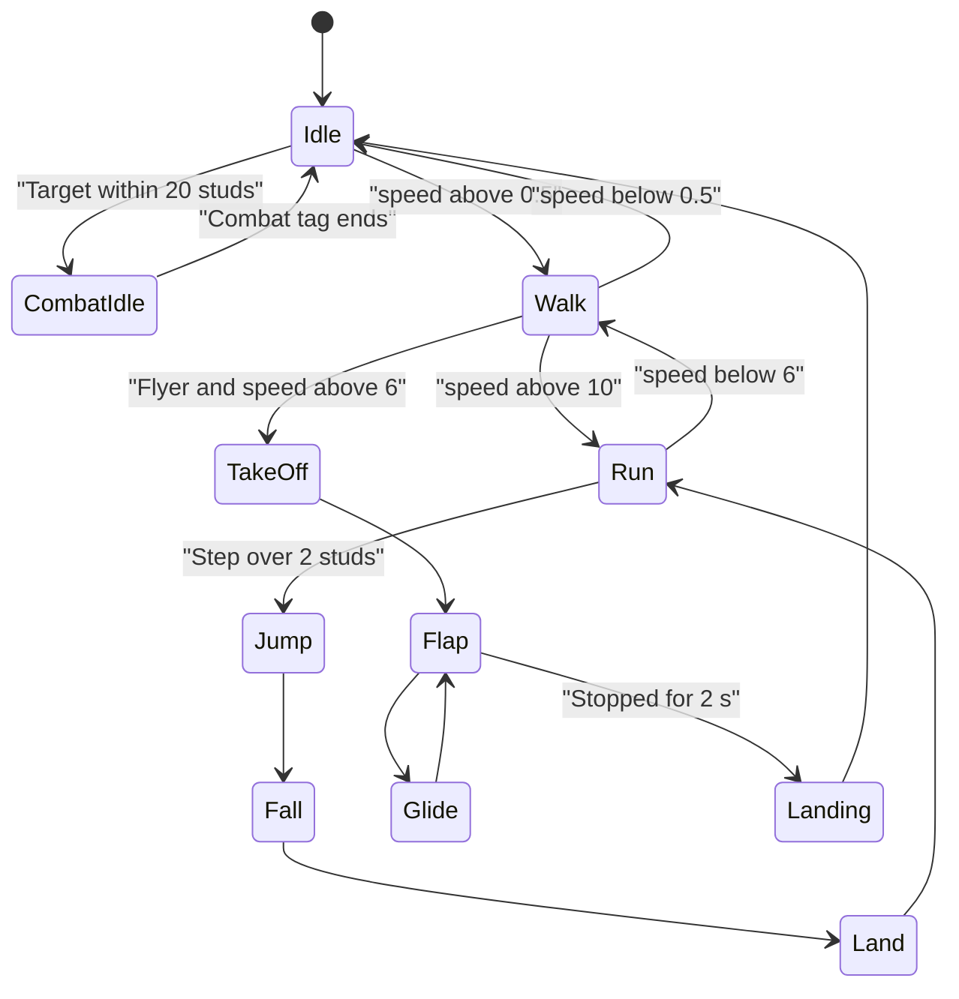

# Animation - Animal Locomotion

Idle, walk, run, jump, flight, slither and air-swim sets for the seven rig classes in [[Animal Rig Standards]]. Locomotion is used by companions, wild animals and guard animals alike; bosses have their own sets in [[Animation - Boss Attacks]].

> [!info] PROPOSED
> All clips, frame splits, authored speeds and IDs are **PROPOSED**. Movement speeds come from [[Canonical Proposed Values]] §3 (reference MS 16 studs/s × role multiplier 0.90–1.30, so 14.4 to 20.8 studs/s for companions).

> [!warning] UNDECIDED
> How aquatic animals move on land is **UNDECIDED** ([[Open Questions#Q-028]]). The air-swim set follows D-043 (**PROPOSED**). A ground fallback (ANI-078) is specified so production is not blocked either way.

---

## 1. Shared rules

| Rule | Value |
|---|---|
| Frame rate | 30 fps, in-place, no root motion ([[Animation Bible]] §2) |
| Priorities | Idle clips: `Idle`. Loops and traversal: `Movement` |
| Blend | Speed-driven Idle → Walk → Run ([[Animation Bible]] §5.1) |
| Combat idle | When the rig has a combat target within 20 studs, the class combat idle replaces the calm idle (fade 0.2 s) |
| Turn | Rigs rotate by code at up to 540°/s (QS, BD), 360°/s (QL, BP, SP, AQ, PB). A turn-in-place clip plays when the facing error exceeds 60° while speed < 0.5 |
| Ground alignment | Rig pitch follows slope up to 20° (code tilt of `HumanoidRootPart` visual offset), legs are not IK-adjusted at launch |
| Catch-up | Companions further than the AI's catch-up distance ([[Animal Combat Behaviour]]) play ANI-095 out / ANI-096 in |
| Foot markers | Medium size band and larger only ([[Animal Rig Standards]] §5); drive footstep dust VFX-060 and foley SFX-200 to SFX-207 |

### 1.1 Authored speeds and loop lengths

| Class / profile | Walk authored speed (studs/s) | Walk loop (frames / s) | Run authored speed | Run loop (frames / s) |
|---|---:|---|---:|---|
| QS | 5 | 16 / 0.53 | 16 | 10 / 0.33 |
| QS hop (Rabbit, Frog) | 5 | 16 / 0.53 (small hops) | 16 | 12 / 0.40 |
| QS-C scuttle (Crab) | 4 | 12 / 0.40 | 14 | 8 / 0.27 |
| QL Feline | 5 | 30 / 1.00 | 17 | 16 / 0.53 |
| QL Canine | 5 | 28 / 0.93 | 16 | 15 / 0.50 |
| QL Ungulate | 5 | 28 / 0.93 | 16 | 16 / 0.53 |
| QL Plantigrade | 4.5 | 32 / 1.07 | 15 | 18 / 0.60 |
| QL Pachyderm | 4.5 | 36 / 1.20 | 14 | 22 / 0.73 (amble) |
| QL Sprawler | 4 | 32 / 1.07 | 14 | 18 / 0.60 |
| BP | 4 | 32 / 1.07 | 16 | 14 / 0.47 |
| BD ground | 4 | 16 / 0.53 | 12 | 10 / 0.33 |
| BD flight | — | — | 18 (cruise) | 18 / 0.60 flap loop |
| SP | 5 | 24 / 0.80 | 16 | 16 / 0.53 |
| AQ | 5 | 30 / 1.00 cruise | 16 | 18 / 0.60 fast |
| PB | 5 | 32 / 1.07 | 16 | 18 / 0.60 |
| PB-H hop (Kangaroo) | 5 | 20 / 0.67 (short hops) | 17 | 14 / 0.47 |

Run playback scales between 0.8 and 1.25 ([[Animation Bible]] §5.1), so a Run authored at 16 studs/s covers 12.8 to 20 studs/s cleanly. Feline is authored at 17 so the fastest Skirmisher (Cheetah, ~20.8) stays inside the clamp.

---

## 2. Asset table

| ID | Class | Clip | Loop | Priority | Duration | Status |
|---|---|---|---|---|---|---|
| ANI-001 | QS | Idle (breathing, ear twitch) | Yes | Idle | 2.0 s (60 f) | **PROPOSED** |
| ANI-002 | QS | Idle fidget (scratch, sniff, groom; 3 variants in one clip, cut by markers) | No | Idle | 1.6 s each | **PROPOSED** |
| ANI-003 | QS | Walk | Yes | Movement | 0.53 s | **PROPOSED** |
| ANI-004 | QS | Run (bound) | Yes | Movement | 0.33 s | **PROPOSED** |
| ANI-005 | QS | Jump take-off | No | Movement | 0.27 s (8 f) | **PROPOSED** |
| ANI-006 | QS | Fall loop | Yes | Movement | 0.4 s | **PROPOSED** |
| ANI-007 | QS | Land | No | Movement | 0.23 s (7 f) | **PROPOSED** |
| ANI-008 | QS | Turn in place (90°, mirrored in code) | No | Movement | 0.33 s | **PROPOSED** |
| ANI-009 | QS hop | Run override (Rabbit, Frog) | Yes | Movement | 0.40 s | **PROPOSED** |
| ANI-010 | QS-C | Scuttle walk and run (sideways bias) | Yes | Movement | 0.40 / 0.27 s | **PROPOSED** |
| ANI-011 | QS | Sentry idle (Meerkat upright scan) | Yes | Idle | 3.0 s | **PROPOSED** |
| ANI-012 | QS | Combat idle | Yes | Idle | 1.0 s | **PROPOSED** |
| ANI-015 | QL | Idle | Yes | Idle | 3.0 s | **PROPOSED** |
| ANI-016 | QL | Idle fidget (head shake, tail flick, paw lick; per profile) | No | Idle | 2.0 s | **PROPOSED** |
| ANI-017 | QL | Walk (base; profile overrides below) | Yes | Movement | 0.93–1.20 s | **PROPOSED** |
| ANI-019 | QL | Run (base, canine timing) | Yes | Movement | 0.50 s | **PROPOSED** |
| ANI-020 | QL | Jump take-off | No | Movement | 0.33 s | **PROPOSED** |
| ANI-021 | QL | Fall loop | Yes | Movement | 0.5 s | **PROPOSED** |
| ANI-022 | QL | Land | No | Movement | 0.33 s | **PROPOSED** |
| ANI-023 | QL | Turn in place | No | Movement | 0.5 s | **PROPOSED** |
| ANI-024 | QL Feline | Run override (rotary gallop) | Yes | Movement | 0.53 s | **PROPOSED** |
| ANI-025 | QL Canine | Run override (transverse gallop) | Yes | Movement | 0.50 s | **PROPOSED** |
| ANI-026 | QL Ungulate | Run override (bounding gallop) | Yes | Movement | 0.53 s | **PROPOSED** |
| ANI-027 | QL Plantigrade | Run override (rolling lope) | Yes | Movement | 0.60 s | **PROPOSED** |
| ANI-028 | QL Pachyderm | Run override (amble) | Yes | Movement | 0.73 s | **PROPOSED** |
| ANI-029 | QL Sprawler | Walk and run override (lateral wave) | Yes | Movement | 1.07 / 0.60 s | **PROPOSED** |
| ANI-030 | QL | Combat idle | Yes | Idle | 1.2 s | **PROPOSED** |
| ANI-035 | BP | Idle (sit-squat, scratch) | Yes | Idle | 3.0 s | **PROPOSED** |
| ANI-036 | BP | Idle fidget (chest tap, look around) | No | Idle | 2.0 s | **PROPOSED** |
| ANI-037 | BP | Walk (knuckle walk) | Yes | Movement | 1.07 s | **PROPOSED** |
| ANI-038 | BP | Run (knuckle gallop) | Yes | Movement | 0.47 s | **PROPOSED** |
| ANI-039 | BP | Jump take-off | No | Movement | 0.3 s | **PROPOSED** |
| ANI-040 | BP | Fall loop | Yes | Movement | 0.4 s | **PROPOSED** |
| ANI-041 | BP | Land | No | Movement | 0.3 s | **PROPOSED** |
| ANI-042 | BP | Upright stand (used by showcase and Rally Cry reactions) | Yes | Idle | 2.0 s | **PROPOSED** |
| ANI-043 | BP | Combat idle | Yes | Idle | 1.0 s | **PROPOSED** |
| ANI-045 | BD | Ground idle | Yes | Idle | 2.4 s | **PROPOSED** |
| ANI-046 | BD | Fidget (preen, wing stretch) | No | Idle | 1.8 s | **PROPOSED** |
| ANI-047 | BD | Ground walk (hop or waddle) | Yes | Movement | 0.53 s | **PROPOSED** |
| ANI-048 | BD | Ground run | Yes | Movement | 0.33 s | **PROPOSED** |
| ANI-049 | BD | Take-off | No | Movement | 0.5 s | **PROPOSED** |
| ANI-050 | BD | Flight flap loop | Yes | Movement | 0.6 s | **PROPOSED** |
| ANI-051 | BD | Glide loop | Yes | Movement | 1.5 s | **PROPOSED** |
| ANI-052 | BD | Landing | No | Movement | 0.5 s | **PROPOSED** |
| ANI-053 | BD | Hover (combat altitude) | Yes | Movement | 0.5 s | **PROPOSED** |
| ANI-054 | BD | Penguin belly slide (run override) | Yes | Movement | 0.5 s | **PROPOSED** |
| ANI-055 | BD-P | Pterosaur quad-walk (Quetzalcoatlus ground) | Yes | Movement | 1.07 s | **PROPOSED** |
| ANI-056 | BD | Combat idle (ground birds) | Yes | Idle | 1.0 s | **PROPOSED** |
| ANI-060 | SP | Idle coil | Yes | Idle | 3.0 s | **PROPOSED** |
| ANI-061 | SP | Fidget (tongue flick, hood flare for Cobra) | No | Idle | 1.5 s | **PROPOSED** |
| ANI-062 | SP | Slither slow | Yes | Movement | 0.8 s | **PROPOSED** |
| ANI-063 | SP | Slither fast | Yes | Movement | 0.53 s | **PROPOSED** |
| ANI-064 | SP | Rear-up (alert; also combat idle) | Yes | Idle | 1.2 s | **PROPOSED** |
| ANI-065 | SP | Air-swim serpent (Electric Eel; replaces 062/063) | Yes | Movement | 1.0 / 0.6 s | **PROPOSED** |
| ANI-070 | AQ | Hover idle | Yes | Idle | 3.0 s | **PROPOSED** |
| ANI-071 | AQ | Fidget (barrel roll, blowhole spout, fin wave) | No | Idle | 2.0 s | **PROPOSED** |
| ANI-072 | AQ | Air-swim cruise | Yes | Movement | 1.0 s | **PROPOSED** |
| ANI-073 | AQ | Air-swim fast | Yes | Movement | 0.6 s | **PROPOSED** |
| ANI-074 | AQ | Turn bank (additive-style upper override, `Movement`) | No | Movement | 0.5 s | **PROPOSED** |
| ANI-075 | AQ | Dip (traversal over obstacles) | No | Movement | 0.8 s | **PROPOSED** |
| ANI-076 | AQ-CE | Cephalopod pulse swim | Yes | Movement | 1.0 / 0.67 s | **PROPOSED** |
| ANI-077 | AQ-PN | Pinniped low hover swim | Yes | Movement | 1.0 / 0.6 s | **PROPOSED** |
| ANI-078 | AQ-PN | Ground flop fallback (only if Q-028 rejects air-swim) | Yes | Movement | 0.8 s | **PROPOSED** |
| ANI-079 | AQ | Combat idle (hover, tail flick) | Yes | Idle | 1.2 s | **PROPOSED** |
| ANI-085 | PB | Idle | Yes | Idle | 3.0 s | **PROPOSED** |
| ANI-086 | PB | Fidget (head sweep, sniff) | No | Idle | 2.0 s | **PROPOSED** |
| ANI-087 | PB | Walk | Yes | Movement | 1.07 s | **PROPOSED** |
| ANI-088 | PB | Run | Yes | Movement | 0.6 s | **PROPOSED** |
| ANI-089 | PB | Jump and land (single clip, `LoopStart` / `LoopEnd` around the airborne hold) | No | Movement | 0.8 s + hold | **PROPOSED** |
| ANI-090 | PB-H | Hop cycle (Kangaroo; replaces 087/088) | Yes | Movement | 0.67 / 0.47 s | **PROPOSED** |
| ANI-091 | PB-H | Tail-prop idle | Yes | Idle | 3.0 s | **PROPOSED** |
| ANI-092 | PB | Combat idle | Yes | Idle | 1.2 s | **PROPOSED** |
| ANI-095 | All | Catch-up out (crouch and swirl) | No | Action | 0.4 s | **PROPOSED** |
| ANI-096 | All | Catch-up in (drop and shake off) | No | Action | 0.5 s | **PROPOSED** |

IDs 013–014, 018, 031–034, 044, 057–059, 066–069, 080–084, 093–094 and 097–099 are reserved for gaps found in production.

---

## 3. QS — Quadruped small

### 3.1 ANI-001 Idle (60 f, 2.0 s)

- **Start / end pose:** standing square, weight even, head level, ears up, tail relaxed at 20° above horizontal.
- **Sequence:** f0–29 chest rises 0.05 studs and head tilts 4° up (inhale), f30–59 return (exhale). Ear twitch on one ear at f42–45 (15° flick, return over 3 frames). Tail sways ±6° on a 60-frame sine, offset by 10 frames from the breath.
- **Mobile:** 4 keys per animated joint; ear and tail keys dropped at LOD A1.

### 3.2 ANI-003 Walk (16 f loop, 0.53 s at 5 studs/s)

Lateral-sequence walk: hind-left, front-left, hind-right, front-right.

| Frames | Event |
|---|---|
| f0 | HL contact (`FootHL` marker on Medium-band QS only; none on Tiny) |
| f4 | FL contact; HL passing under the body |
| f8 | HR contact (mirror of f0) |
| f12 | FR contact |
| f15 → f0 | Loop |

Body: pelvis bobs 0.04 studs down on each contact, head counter-bobs 2° to stay stable. Tail swings opposite to the pelvis yaw.

### 3.3 ANI-004 Run — bound (10 f loop, 0.33 s at 16 studs/s)

| Frames | Pose | Notes |
|---|---|---|
| f0 | Hind feet together contact, spine compressed (chest pitched 12° down) | Gather |
| f1–3 | Hind push; spine extends; front legs reach forward | Extension |
| f4 | Airborne, fully extended, all four feet off the ground | Flight phase |
| f5 | Front feet contact together | |
| f6–8 | Front feet pass under; hind legs swing forward; spine compresses | Gather |
| f9 → f0 | Hind contact | Loop |

Ears trail back 25° throughout; head stays level ±3°.

### 3.4 ANI-009 Hop run (Rabbit, Frog; 12 f loop)

- f0 crouch contact (all feet, pelvis 0.15 studs lower than idle), f1–3 explosive extension, f4–8 airborne arc (pelvis +0.4 studs at f6, legs trailing), f9 front contact, f10–11 hind feet land ahead of front, back to f0.
- Frog variant: legs splay outward 20° on extension; front feet land first and hold for 2 frames.

### 3.5 ANI-010 Scuttle (Crab)

Movement direction is any; the clip is authored with a 30° sideways bias and code yaws the visual 60° off the travel direction so the crab reads as scuttling sideways. Legs alternate in two tripods (A-L, B-R, C-L vs A-R, B-L, C-R): tripod 1 contact f0, tripod 2 contact f6 (walk) / f4 (run). Claws held raised, bobbing 0.03 studs per step.

### 3.6 Jump, fall and land (ANI-005, 006, 007)

Used for terrain steps over 2 studs and for leap abilities' generic body action.

- **ANI-005:** f0–3 crouch (pelvis −0.12), f4–5 extend, f6–7 airborne tuck. Hands off to ANI-006.
- **ANI-006:** legs tucked, ears back, 12-frame sway loop.
- **ANI-007:** f0 front contact, f1–3 absorb (pelvis −0.15, head dips 8°), f4–6 recover. Blend to locomotion at f4 if moving.

### 3.7 ANI-012 Combat idle (30 f)

Front legs 10% wider, chest lowered 0.1 studs, head pitched 6° down, tail raised to 35°. Weight shifts left/right every 15 frames. This is the tell for "this animal is engaged": it must read at 40 studs.

---

## 4. QL — Quadruped large

### 4.1 ANI-017 Walk (Feline 30 f)

Lateral-sequence walk. HL contact f0, FL f7, HR f15, FR f22. Shoulder blades rise 0.06 studs as each front leg passes vertical (f3, f18). Head bobs 0.05 studs, low carriage (head 0.2 studs below the withers). Tail tip curls on f10 and f25.

### 4.2 ANI-024 Feline run — rotary gallop (16 f, 0.53 s at 17 studs/s)

| Frames | Event |
|---|---|
| f0 | HL contact; spine maximally flexed (pelvis and chest pitched toward each other, 18°) |
| f1 | HR contact |
| f2–4 | Hind push; spine extends |
| f5–6 | First flight phase, fully extended (front legs reaching, hind legs trailing) |
| f7 | FR contact |
| f8 | FL contact |
| f9–11 | Front legs pass under; spine flexes; hind legs swing forward |
| f12–14 | Second flight phase, gathered (all four feet under the body) |
| f15 → f0 | HL contact (loop) |

Cheetah-specific: spine flex increased to 24° and tail raised for balance; this is a species pose change only (ANI-024/ANM-026), not a new timing.

### 4.3 ANI-025 Canine run — transverse gallop (15 f)

HL f0, HR f2, FL f7, FR f9; single gathered flight phase f11–14. Back stays level ±6°, head extended forward.

### 4.4 ANI-026 Ungulate run — bounding gallop (16 f)

HL f0, HR f1 (near-paired), FL f6, FR f8; extended flight phase f2–5 with a stiff back; head nods 8° in time with the front contact. Goat variant adds a 0.1-stud bounce on f3.

### 4.5 ANI-027 Plantigrade lope (18 f)

HL f0, FL f5, HR f9, FR f14. Shoulders roll ±7° (roll axis), head swings 5° side to side, forefeet plant flat with a 2-frame hold. No flight phase.

### 4.6 ANI-028 Pachyderm amble (22 f, 0.73 s at 14 studs/s)

Never all four feet off the ground (real elephant gait). Footfall HL f0, FL f5, HR f11, FR f16. Each contact has a 1-frame compression (pelvis −0.05) for weight. Trunk (if present) swings in a figure-eight with a 22-frame period. Ears flap once per cycle at f8. **Foot markers on every contact** drive VFX-060 dust and SFX-205.

### 4.7 ANI-029 Sprawler (Crocodile, Komodo Dragon)

Diagonal-pair walk: HL+FR contact f0, HR+FL contact f16 (walk) / f9 (run). The spine yaws ±14° in a lateral S-wave whose peak travels from chest to tail over 8 frames. Belly 0.3 studs above ground; tail drags with a 2-frame lag per segment. Run raises the belly to 0.5 studs ("high walk").

### 4.8 ANI-030 Combat idle (36 f)

Head lowered, front legs spread, weight on hind legs; tail lashes ±20° every 18 frames (Feline, Canine), head tosses (Ungulate), front-foot paw scrape at f24 (Pachyderm, Ungulate), jaw opens 10° at f12 (Sprawler).

---

## 5. BP — Biped primate

### 5.1 ANI-037 Knuckle walk (32 f)

Chest pitched 35° forward; hands contact on knuckles. Footfall: LH (left hand) f0, RF (right foot) f6, RH f16, LF f22. Shoulders roll ±8°. Gorilla: slower shoulder roll, heavier hand plant (2-frame hold). Monkey: tail S-curve up behind.

### 5.2 ANI-038 Knuckle gallop (14 f)

Both hands plant f0–1, both feet land ahead of hands f6–7 (vault through the arms), flight phase f9–12. Monkey only: brief upright two-legged steps are not used in the run to keep the silhouette consistent.

### 5.3 ANI-042 Upright stand

Rises from knuckles to upright over the first 8 frames when entered (if entered from idle), then holds with arms at sides and a 60-frame breath. Used by showcase (ANI-208 to ANI-214) and victory poses.

---

## 6. BD — Bird

### 6.1 Ground versus flight behaviour

| Group | Species | Default when following | In combat |
|---|---|---|---|
| Ground birds | Duck, Penguin, Flamingo, Peacock | Walk and run on the ground; Duck takes off only to cross gaps | Ground combat idle ANI-056 |
| Flyers | Woodpecker, Owl, Toucan, Golden Eagle, Peregrine Falcon, Haast's Eagle | Fly at 4 studs above ground when speed > 6 studs/s; land and ground-idle when the player stops for > 2 s | Hover at 3 studs (ANI-053) |
| Pterosaur | Quetzalcoatlus | Quad-walk below 6 studs/s, flies above | Hover at 4 studs |

Flight altitude is a visual offset applied by code to the rig on top of the AI mover's ground position, so hit detection stays on the ground plane ([[Animal Combat Behaviour]]).

### 6.2 ANI-049 Take-off (15 f, 0.5 s)

- f0–3: crouch, wings half-open (WingInner 40°).
- f4–5: legs extend (visual altitude +0.5), wings raised fully (downstroke ready).
- f6–8: powerful downstroke, altitude +1.5; dust burst VFX-062 at `A_Root` on f6.
- f9–11: upstroke, altitude +2.5.
- f12–14: second downstroke, altitude +4.0; hand off to ANI-050.
- **Sound:** SFX-208 (small) or SFX-209 (large) on f6 and f12.

### 6.3 ANI-050 Flap loop (18 f)

Downstroke f0–6 (fast; wing tips pass below the body line at f5), upstroke f7–17 (slow, wings fold at the wrist via WingOuter −35°). Body bobs 0.15 studs, rising on the downstroke. Raptors alternate 2 flap cycles with 1 glide cycle (ANI-051) when cruising straight.

### 6.4 ANI-053 Hover (15 f)

Body pitched 35° up, tail fan spread, rapid shallow strokes (amplitude 50% of flap). Owl: head stays locked on target (head yaw counter-rotates the body).

### 6.5 ANI-054 Penguin belly slide

Above 10 studs/s the Penguin drops to its belly: f0–5 transition dive, then a 15-frame loop of flipper paddles (both flippers stroke f0–4, glide f5–14). SFX-214 loop while sliding; snow or sand spray VFX-063 at `A_Chest`.

### 6.6 ANI-047 Waddle (Duck, Penguin)

Body rolls ±10° side to side; feet contact f0 (L) and f8 (R); wings held slightly out for balance on Penguin.

---

## 7. SP — Serpent

### 7.1 ANI-062 / ANI-063 Slither

Lateral undulation: a sine wave of yaw travels from Seg1 to Seg8 with a phase lag of 45° per segment. Amplitude 22° (slow) / 16° (fast). Head stays aimed at the travel direction (Neck counter-rotates). One full wave per loop (24 f slow, 16 f fast).

- **VFX:** VFX-063 dust puffs on Seg5 at the wave's outer peaks (frames 6 and 18 slow; 4 and 12 fast), A0 only.
- **SFX:** SFX-210 scrape loop, volume tied to speed.

### 7.2 ANI-064 Rear-up

Seg1 to Seg3 lift so the head is at 2.5 studs (Cobra) / 5 studs (Titanoboa), Seg4 to Seg8 form a coil on the ground. Head sways ±8° on a 36-frame figure-eight. Cobra hood flares (cosmetic `Hood` joint) on entry over 4 frames.

### 7.3 ANI-065 Electric Eel air-swim

Same undulation as slither, but the wave is vertical and lateral combined (30° vertical component), hover height 2.0 studs, with the AQ water trail VFX-061 on `A_Tail`.

---

## 8. AQ — Aquatic air-swim (D-043)

### 8.1 Behaviour

Aquatic companions float with `HumanoidRootPart` on the ground plane and a visual hover offset of **2.5 studs** (small) / **3.5 studs** (Large and Colossal), so hitboxes and pathing are identical to land animals. A thin water trail (VFX-061) and droplets show the "swimming through air" fiction.

### 8.2 ANI-072 Cruise (30 f) and ANI-073 Fast (18 f)

Fish and shark (lateral tail): Tail1 → Fluke yaw wave ±18° (cruise) / ±26° (fast), phase lag 60° per segment, head counter-yaw 4°. Cetaceans (Dolphin, Orca, Blue Whale, Narwhal) use the same timing with a **vertical** fluke wave (pitch, not yaw). Body bob 0.2 studs, peaking on the downstroke.

| Frame (cruise) | Event |
|---|---|
| f0 | Fluke at top (cetacean) or left extreme (fish) |
| f7 | Fluke passes neutral, fastest point |
| f15 | Opposite extreme; `VFX` marker spawns a droplet puff on `A_Tail` |
| f22 | Neutral |
| f29 → f0 | Loop |

### 8.3 ANI-076 Cephalopod pulse swim

Mantle contracts f0–5 (scale via joint pose: arms gather together behind the body), jet glide f6–20 (arms trail streamlined), arms flare f21–29 for the next stroke. Fast version: 20-frame loop. Avoid any writhing or tentacle-grab imagery (no horror, D-026).

### 8.4 ANI-077 Pinniped hover swim (Seal, Walrus)

Low hover (1.5 studs). Hind flippers paddle together (pitch ±25°) on a 30-frame loop, front flippers held out like wings and bank into turns. Walrus: slower, tusks lead; Seal: a playful 360° roll fidget in ANI-071.

### 8.5 ANI-078 Ground flop fallback

Only used if [[Open Questions#Q-028]] resolves against air-swimming for pinnipeds. Front flippers plant f0, body hump travels back f1–12, hind body lands f13, front lifts f14–23. Not produced until Q-028 is decided.

---

## 9. PB — Prehistoric large biped

### 9.1 ANI-087 Walk (32 f)

Digitigrade stride; footfalls L f0, R f16. Pelvis drops 0.1 studs on each contact (frames 1–2), head stays near level through neck counter-motion (classic "bird-like" stabilisation). Tail sways opposite to the pelvis yaw with a 3-frame lag per segment. Tiny arms tucked; they twitch on contacts.

### 9.2 ANI-088 Run (18 f, 0.6 s at 16 studs/s)

| Frames | Event |
|---|---|
| f0 | L foot contact, body lowest (pelvis −0.25) |
| f1–3 | Push, body rises; tail lifts horizontal |
| f4–7 | Flight phase, R leg swinging forward, head forward and low |
| f9 | R contact (`FootR`), body lowest |
| f10–12 | Push |
| f13–16 | Flight phase |
| f17 → f0 | Loop |

Foot markers on f0 and f9 drive VFX-060 (large dust) and SFX-206 (stomp). Camera micro-shake for the local player only when their own T-Rex companion runs within 10 studs (0.05 amplitude, see [[Camera Behaviour Guidelines]]).

### 9.3 ANI-090 Kangaroo hop (14 f fast)

f0 both feet contact, tail touches ground; f1–3 crouch absorb; f4–6 extension, tail lifts; f7–12 airborne arc (visual pelvis +0.6 studs at f9); f13 → f0 landing. Arms held tucked at chest height.

---

## 10. Catch-up (ANI-095 / ANI-096)

- **ANI-095 out (12 f):** f0–5 crouch with head down; f6–9 VFX-036 recall swirl spawns at `A_Root`; f10–11 rig hidden by code (transparency, not destroyed).
- **ANI-096 in (15 f):** rig shown at the new position; f0–3 drop from 0.5 studs, f4–8 shake-off (head and body twist ±15°), f9–14 settle into idle.
- **Sound:** SFX-218 at out f6 and in f0.
- **Camera:** none.

---

## 11. Transitions summary

---

## 12. Mobile performance notes

| Item | Rule |
|---|---|
| Wild crowds | Wild animals beyond 60 studs use LOD A1 (no fidgets, no foot markers); beyond 120 studs A2 ([[Animation Bible]] §8) |
| Serpents and AQ | The wave is authored, not procedural, to avoid per-frame script cost |
| Flyers | Altitude offset is applied in one `RunService.Heartbeat` (or `RenderStepped`, client only) loop per client for all flyers, never one connection per rig |
| Foot markers | Only Medium band and up, only at A0, and footstep SFX are capped by the Creature SoundGroup voice limit ([[Audio Mixing and Priority]]) |
| Pens | If owned animals are displayed in pens ([[Open Questions#Q-008]]), they use Idle and fidgets only, at LOD A1 beyond 30 studs |

## 13. Test hooks

- Foot sliding check at authored speed and at both clamp limits (0.8× and 1.25×) for every class.
- Flyer take-off and landing loop over 10 minutes of following: no stuck altitude.
- Distance LOD: spawn 60 wild animals in Whisperwood Forest on a low-tier phone; frame time must stay under 33 ms ([[Test Cases - Mobile Performance]]).

---

## Related documents
- [[Animal Rig Standards]]
- [[Animation Bible]]
- [[Animation - Animal Attacks and Hit Reactions]]
- [[Animal Combat Behaviour]]
- [[Animal Scalability and Performance Budgets]]
- [[VFX - Combat Effects]]
- [[Sound - Combat Impacts]]
- [[Camera Behaviour Guidelines]]
