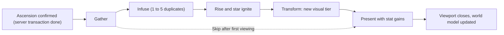

# Animation - Ascension

The ascension ceremony for each star level A1–A5: duplicates transform into light and flow into the original animal, a star ignites, and the animal gains its new visual tier.

> [!success] CONFIRMED
> Ascension consumes the required duplicates of the same animal; the original is kept (D-019).

> [!info] PROPOSED
> Five ascension levels A1–A5 (D-037, levels **UNDECIDED** [[Open Questions#Q-004]]), duplicate requirements ([[Open Questions#Q-005]]), and the visual tiers (A1 coloured trim, A2 rarity-coloured eye glint, A3 soft aura, A4 particle accents, A5 crest and full aura) come from [[Canonical Proposed Values]] §9. Ceremony lengths, frame splits and IDs here are **PROPOSED**. If Q-004 changes the number of levels, the A1–A4 template is reused and A5 remains the final-level ceremony.

---

## 1. Staging

The ceremony plays in a full-screen `ViewportFrame` with a `WorldModel` child inside [[UI - Ascension]], so it works wherever the ascension UI is available ([[Ascension System]]) and never disturbs the shared world. The original animal stands on a circular pedestal; duplicates enter from the sides.

| Item | Value |
|---|---|
| Viewport camera | 11 studs from the pedestal, 12° elevation, FOV 45 (A5: push-in to 8 studs) |
| Background | Soft radial gradient in the animal's rarity colour ([[Colour Palette]]) |
| Duplicate count shown | 1 to 5, from the duplicate table for this rarity and step; the step and the Cash fee were confirmed in the UI before the ceremony |
| Order of operations | The server completes the transaction (duplicates removed, level raised, fee deducted) **before** the ceremony starts ([[Implementation - Ascension Transaction]]) |

---

## 2. Asset table

| ID | Clip / sequence | Length (full / short) | Status |
|---|---|---|---|
| ANI-440 | Ceremony controller and pedestal rig | — | **PROPOSED** |
| ANI-441 | A1 ceremony | 3.0 s / 1.5 s | **PROPOSED** |
| ANI-442 | A2 ceremony | 3.5 s / 1.6 s | **PROPOSED** |
| ANI-443 | A3 ceremony | 4.0 s / 1.8 s | **PROPOSED** |
| ANI-444 | A4 ceremony | 4.8 s / 2.0 s | **PROPOSED** |
| ANI-445 | A5 ceremony | 6.5 s / 2.5 s | **PROPOSED** |
| ANI-446 | Duplicate hop-in and transform into a light orb (per class, uses the class victory peak) | 0.6 s | **PROPOSED** |
| ANI-447 | Star ignite (UI star rig) | 0.4 s | **PROPOSED** |
| ANI-448 | Skip to result | 0.4 s | **PROPOSED** |
| ANI-449 to ANI-455 | Power-up pose per class (QS, QL, BP, BD, SP, AQ, PB) | 0.8 s | **PROPOSED** |
| ANI-456 | Ascension refused (missing duplicates, insufficient Cash, or any other server refusal) | 0.5 s | **PROPOSED** |

IDs ANI-457 to ANI-459 are reserved. Short lengths play after the player has seen that star level's full ceremony once.

---

## 3. Phase structure (all levels)

| Phase | Purpose | A1 | A2 | A3 | A4 | A5 |
|---|---|---|---|---|---|---|
| 1 Gather | Original in showcase pose; duplicates hop in | f0–14 | f0–14 | f0–17 | f0–20 | f0–29 |
| 2 Infuse | Duplicates become orbs and stream into the original | f15–44 | f15–49 | f18–59 | f21–71 | f30–104 |
| 3 Rise | Original rises, power-up pose; the new star ignites | f45–59 | f50–67 | f60–80 | f72–98 | f105–134 |
| 4 Transform | New visual tier applied with a burst | f60–69 | f68–79 | f81–95 | f99–116 | f135–164 |
| 5 Present | Hero pose, stars row, stat gains | f70–89 | f80–104 | f96–119 | f117–143 | f165–194 |
| **Total** | | **90 f (3.0 s)** | **105 f (3.5 s)** | **120 f (4.0 s)** | **144 f (4.8 s)** | **195 f (6.5 s)** |

### 3.1 Duplicate stagger

Within phase 2, the N duplicates (1–5) are spread evenly: duplicate *k* (k = 1…N) starts its transform at `phase2Start + round((k − 1) × phase2Length / N)`. A Legendary at A1 needs one duplicate, a Common at A5 needs five ([[Ascension Progression Table]]); both fill the same phase length.

---

## 4. Shared beats (frame by frame, A1 example, 90 f)

| Frames | Original animal | Duplicates | VFX | SFX |
|---|---|---|---|---|
| f0 | Already in showcase key pose (ANI-208 to ANI-214, f20) | Off screen | Pedestal ring lights in rarity colour | SFX-370 ceremony open |
| f2–14 | Turns 20° to the camera, breathing | Hops in from the right, lands at f12 beside the pedestal (ANI-446 f0–10) | | Landing tick |
| f15–24 | Watches the duplicate, ears or crest perk up | Duplicate plays its class victory peak (a happy pose, never sad), then glows white (f20) and becomes a paw-print light orb (f24) | Glow, VFX-310 orb forms | SFX-371 transform chime |
| f25–44 | Glows faintly as the orb arrives | Orb arcs to the original's `A_Chest` along VFX-310 stream, absorbed at f40 | Absorb flash | SFX-372 stream, SFX-373 absorb tick |
| f45–52 | Power-up pose (ANI-449 to ANI-455): crouch then rise | | Pedestal rises 0.5 studs | SFX-374 rise swell |
| f53–59 | Peak of power-up pose | | Star 1 ignites in the star row above (ANI-447, VFX-311) | SFX-375 star ignite (pitch step 1) |
| f60–69 | Holds the peak; new visual tier appears: **A1 coloured trim** swaps in on the trim parts at f62 | | VFX-312 completion burst (small) | SFX-376 A1 burst |
| f70–89 | Hero pose hold with one blink at f80 | | Trim glints once at f75 | MUS-38 ascension fanfare (A1 edit) |

The UI shows the stat gains (+8% HP, ATK and DEF of base; +5% ability effectiveness, per [[Canonical Proposed Values]] §9) from f70.

---

## 5. Per-level differences

### 5.1 A2 — rarity-coloured eye glint (3.5 s)

- Infuse f15–49: orbs trail sparkles.
- Rise f50–67: the animal looks straight into camera at f60.
- Transform f68–79: **eye glint** appears (an emissive eye decal in the rarity colour) with a 6-frame lens-flare sparkle at f70.
- Star 2 ignites at f62 (pitch step 2).

### 5.2 A3 — soft aura (4.0 s)

- Gather f0–17: pedestal ring now double.
- Infuse f18–59: orbs spiral twice around the original before absorption.
- Rise f60–80: the original lifts 0.8 studs off the pedestal (visual) during the power-up pose.
- Transform f81–95: **soft aura** VFX-143 blooms outward from `A_Aura` (f81–88) and settles to its persistent level (f89–95).
- Star 3 ignites at f74.

### 5.3 A4 — particle accents (4.8 s)

- Infuse f21–71: each absorption sends a ripple through the aura.
- Rise f72–98: background gradient brightens; camera pushes 1 stud closer.
- Transform f99–116: **particle accents** VFX-144 (species-themed motes: leaves, snowflakes, bubbles, embers as sparks, feathers) burst outward and then orbit at their persistent rate.
- Star 4 ignites at f88; the four lit stars pulse in sequence at f110.

### 5.4 A5 — crest and full aura (6.5 s)

| Frames | Beat |
|---|---|
| f0–29 | Gather: pedestal ring triples; duplicates hop in one by one |
| f30–104 | Infuse: orbs form a ring above the original and rotate (f30–80), then rain into it (f81–104) |
| f105–118 | Rise: the original rises 1.5 studs; background fades to the rarity colour at full saturation |
| f119–134 | Power-up peak held; stars 1–4 flare; **star 5** ignites at f128 with a larger burst |
| f135–148 | Transform: a **crest** materialises above the head (A5 crest parts fade in, welded to `Head`), and the **full aura** VFX-145 expands |
| f149–164 | Burst: VFX-312 at maximum size, light rays, one camera push-in to 8 studs; "Light" viewport shake (none with reduce motion) |
| f165–194 | Present: the animal lands back on the pedestal, hero pose, all five stars glowing; MUS-39 A5 fanfare |

---

## 6. Skip, refusal and transitions

- **Skip (ANI-448):** after first viewing of a star level, tapping jumps to the present phase in 0.4 s; the new visual tier is shown immediately.
- **Refused (ANI-456):** pedestal ring flickers amber twice, the original shakes its head; UI explains the missing requirement. No duplicates are consumed.
- **After the ceremony:** the viewport closes with a 0.3 s fade, and the world model of the animal (if equipped and present) updates its visual tier at the same moment.

## 7. Mobile performance considerations

- The ViewportFrame contains only the pedestal, the original and up to five duplicates; the world behind is not rendered into it. Duplicates are destroyed as their orbs form.
- Orb streams use one Beam per active orb (maximum 5 at once at A5; 2 at once on low quality, with the rest queued by 4 frames).
- Persistent visual tiers on world models are budgeted in [[VFX - Rarity and Variant Effects]]; the ceremony may exceed world budgets briefly because the world HUD and other effects are hidden.
- Animations inside a ViewportFrame `WorldModel` are expected to play; frame cost on low-end phones is *unverified* and is a prototype measurement in [[Test Cases - Mobile Performance]].

## 8. Test hooks

| Test | Expected |
|---|---|
| Ascend a Common to A5 (5 duplicates) | Five orbs evenly staggered in phase 2; length 6.5 s |
| Ascend a Secret to A1 (1 duplicate) | One orb; length 3.0 s |
| Disconnect mid-ceremony | On rejoin the animal is at the new level; no duplicate restored or lost |
| Reduce motion | No push-in or shake; floats replaced by static poses; same length |

---

## Related documents
- [[Ascension System]]
- [[Ascension Progression Table]]
- [[UI - Ascension]]
- [[Implementation - Ascension Transaction]]
- [[Animation - Animal Defeat and Victory]]
- [[VFX - Rarity and Variant Effects]]
- [[Sound - Ascension]]
- [[Music Direction]]
- [[Rarity Visual Language]]
