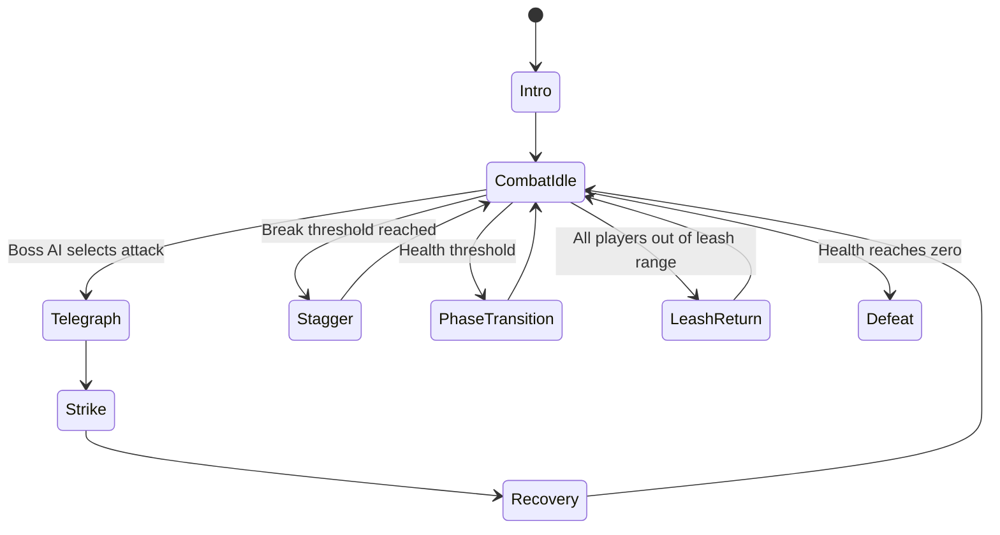

# Animation - Boss Attacks

Boss animation templates: intro, telegraphed attack archetypes, stagger, phase transition and defeat, for the eight mini-bosses and four world bosses listed in [[Boss Design Overview]].

> [!success] CONFIRMED
> Mini-bosses and world bosses exist (D-012).

> [!info] PROPOSED
> Templates, telegraph minimums, frame splits and IDs are **PROPOSED**. Which attacks each boss has, their damage and their phase thresholds are defined in each boss document and in [[Boss AI]]; boss rewards are **UNDECIDED** ([[Open Questions#Q-015]]) and never shown as final in any reward animation.

---

## 1. Telegraph rules

Bosses are fought by groups with companions on screen, often on phones. Every boss attack must be readable and avoidable with the Dodge Roll (0.3 s invulnerability, 12 studs, [[Animation - Player Attacks and Specials]]).

| Rule | Value (PROPOSED) |
|---|---|
| Minimum telegraph, standard attack | **0.8 s** from first readable pose to damage |
| Minimum telegraph, heavy attack | **1.2 s** |
| Minimum telegraph, ultimate | **2.0 s** |
| Minimum punish window after any attack | **0.8 s** of low-threat recovery |
| Telegraph colour (enemy danger) | Warm orange-red `#FF5A36` fill on a darker rim; no friendly effect may use this hue ([[VFX Bible]]) |
| Fill behaviour | Ground decals fill from the centre to the edge over the telegraph; **fully filled = damage frame** |
| Body tell | The boss pose must also telegraph (rear-up, wind-up, inhale). Decals are never the only cue |
| Sound tell | Every telegraph has a rising sound cue starting on its first frame ([[Sound - Bosses]]) |
| Shape honesty | The decal matches the true hit area within 0.5 studs |

> [!info] Accessibility
> With "Reduce motion" on, telegraph timings do not change; screen shake is removed. With colour-blind-friendly mode ([[UI Accessibility Standards]]), the decal adds a hatched pattern so it does not rely on hue alone.

---

## 2. Template table

Boss clips are authored per boss from these templates: `ANI-3xx/BOS-##` (the boss's own model ID). Timing in the template is the minimum; a boss document may lengthen, never shorten, a telegraph.

| ID | Template | Length (world boss) | Telegraph | Damage frame | Recovery (punish) | Priority | Status |
|---|---|---|---|---|---|---|---|
| ANI-320 | Intro reveal | 4.0 s (mini-boss 2.5 s) | — | — | — | Action4 | **PROPOSED** |
| ANI-321 | Idle / combat idle | 3.0 s loop | — | — | — | Idle | **PROPOSED** |
| ANI-322 | Locomotion set (walk, turn 90°, turn 180°) | class-based | — | — | — | Movement | **PROPOSED** |
| ANI-323 | Slam (circle) | 2.4 s (72 f) | 1.2 s | f38 | 1.0 s | Action2 | **PROPOSED** |
| ANI-324 | Sweep (arc in front) | 1.9 s (57 f) | 0.8 s | f26 | 0.9 s | Action2 | **PROPOSED** |
| ANI-325 | Charge (line) | 1.2 s tell + loop + 1.0 s | 1.2 s | on impact | 1.0 s | Action2 | **PROPOSED** |
| ANI-326 | Breath / cone | 1.4 s in + loop + 0.9 s | 1.4 s | `Release` f42 | 0.9 s | Action2 | **PROPOSED** |
| ANI-327 | Targeted volley (circles under players) | 2.6 s | 1.5 s per marker | per marker | 0.8 s | Action2 | **PROPOSED** |
| ANI-328 | Quake (ring or donut with a safe zone) | 3.5 s | 2.0 s | f60 | 1.2 s | Action2 | **PROPOSED** |
| ANI-329 | Summon helpers | 2.2 s | 1.5 s spawn markers | `Cast` f45 | 0.7 s | Action2 | **PROPOSED** |
| ANI-330 | Roar (enrage or buff) | 2.5 s | — | `Cast` f30 | — | Action2 | **PROPOSED** |
| ANI-331 | Ultimate | 4.5 s | 2.0–2.5 s | f75 | 1.5 s | Action3 | **PROPOSED** |
| ANI-332 | Stagger / vulnerable (break state) | 0.6 s in + loop + 0.8 s out | — | — | — | Action3 | **PROPOSED** |
| ANI-333 | Phase transition | 3.0 s | — | — | — | Action4 | **PROPOSED** |
| ANI-334 | Defeat | 4.0 s (mini-boss 2.5 s) | — | — | — | Action4 | **PROPOSED** |
| ANI-335 | Leash return (walks home, regains health) | class walk + 1.0 s settle | — | — | — | Movement | **PROPOSED** |
| ANI-336 | Flight take-off and dive (flying bosses) | 1.2 s + dive 1.5 s | 1.5 s shadow decal | on landing | 1.0 s | Action2 | **PROPOSED** |
| ANI-337 | Dive and resurface (air-swim bosses) | 1.0 s + hidden + 1.2 s | 1.2 s ripple decal | on emerge | 1.0 s | Action2 | **PROPOSED** |

IDs ANI-338 to ANI-399 are reserved for boss-specific signature attacks named in the boss documents.

### 2.1 Template fit for world bosses (PROPOSED starting point)

| World boss | Rig | Natural templates | Notes |
|---|---|---|---|
| [[World Boss - Ironbark Colossus]] | QL-Pachyderm at boss scale with shell parts | Slam, Quake, Summon, Sweep | Shell trees sway as secondary motion (Motor6D per tree cluster, within the BOSS budget) |
| [[World Boss - Thunderhoof]] | QL-Pachyderm | Charge, Slam, Quake, Roar | Trunk and ears are the main tells |
| [[World Boss - Abyssal Leviathan]] | AQ at boss scale | Dive and resurface, Breath, Sweep (tail), Targeted volley | Air-swims like a companion AQ (D-043) |
| [[World Boss - Ashwing Condor]] | BD at boss scale | Flight dive, Targeted volley, Breath (wind or ember gust), Sweep (wing) | Ground phases planned so melee players get turns |

Each boss document owns the final list; this table only records which templates the rig supports cheaply.

---

## 3. Template specifications

### 3.1 ANI-320 Intro reveal (world boss 4.0 s = 120 f)

| Frames | Action | Camera (players within 80 studs and not in combat) |
|---|---|---|
| f0–29 | Arrival: emerges from its arrival effect (rises from the ground, lands from the sky, surfaces from a ripple) | Optional cinematic: 2.5 s framing shot (see [[Camera Behaviour Guidelines]]), skippable, never forced on players in combat |
| f30–59 | Stretch to full height, signature body feature (shell trees, trunk, fins, wings) revealed | Slow push-in |
| f60–89 | Signature roar or call; ground dust ring | "Medium" shake at f60, only within 40 studs |
| f90–119 | Settle into combat idle; the boss health bar appears ([[UI - Boss Health Bar]]) | Camera returns to the player |

The boss is invulnerable and inactive during the intro. Mini-boss intros are 2.5 s, have no cinematic camera, and use f0–74 with the same beats compressed.

### 3.2 ANI-323 Slam (72 f)

| Frames | Phase | Body | Decal and sound |
|---|---|---|---|
| f0–11 | Tell start | Rears up or raises the striking limb; weight shifts back | Circle decal VFX-040 appears at 0% fill; telegraph riser SFX-271 starts |
| f12–35 | Hold | Peak pose held with a slow tremble; the highest point at f30 | Fill grows linearly to 100% at f36 |
| f36–37 | Strike | Drops | |
| **f38** | **Damage** (`Hit`) | Contact with the ground; 4-frame hit-stop | Shockwave VFX-023 at boss scale; SFX-272 slam |
| f42–71 | Recovery (punish window) | Stuck pose for 0.5 s, then a slow lift | Debris settles |

Telegraph = f0 to f36 = 1.2 s. Camera: "Heavy" shake for players inside the radius, "Medium" up to 1.5 × radius, none beyond.

### 3.3 ANI-324 Sweep (57 f)

f0–23 wind-up (body twists away from the sweep side; arc decal VFX-042 fills), f24–25 sweep travel, **f26 damage**, f27–29 follow-through, f30–56 recovery with the body over-rotated (back exposed). Telegraph 0.8 s. Camera: "Light" for hit players.

### 3.4 ANI-325 Charge

- **Tell (36 f, 1.2 s):** paw scrape ×3, head down, line decal VFX-041 drawn along the path at 0% and filling to 100% at f36.
- **`LoopStart`:** boss-scale run loop. Path is locked when the tell starts (no homing), so dodging sideways always works.
- **Impact:** damage on collision with players in the line; at the line's end the boss skids for 0.5 s.
- **Recovery (30 f):** dazed head shake (punish window 1.0 s).

### 3.5 ANI-326 Breath / Cone

- **In (42 f, 1.4 s):** deep inhale, chest expands, head rises; cone decal VFX-042 fills.
- **`Release` f42 / loop:** cone effect for the duration set by the boss document; the head sweeps no faster than 30°/s so players can walk out of it.
- **Out (27 f):** cough-shake, head lowers (punish window).
- Element looks are kid-friendly: wind, frost, ember sparks, spore puffs, never flames engulfing animals.

### 3.6 ANI-327 Targeted volley

- f0–14: boss rears and points (head or limb) at the sky.
- From f15: one circle marker VFX-043 appears under each targeted player (up to the boss document's count), each filling over **1.5 s**; markers are placed at the player's position when they appear and do not follow.
- Projectiles fall to land exactly as each marker fills.
- f66–77: recovery (0.4 s) plus the remaining punish time.

### 3.7 ANI-328 Quake (105 f, 3.5 s)

- f0–59 (2.0 s): boss crouches, then rises on hind legs; a donut or ring decal shows the danger area and a cool-blue `#7FD3FF` (PROPOSED) safe-zone marker VFX-044 shows where to stand.
- **f60 damage:** ground pulse.
- f61–104: recovery (1.2 s+).

### 3.8 ANI-329 Summon helpers

f0–44 call pose with spawn markers VFX-050 (leaf swirl, ice swirl or sand swirl matching the region) at each spawn point, **f45 `Cast`**: helpers appear using wild animal spawn presentation ([[VFX - Environment Ambient Effects]]); f46–65 settle. Helpers are wild animals of the region and use normal wild clips.

### 3.9 ANI-330 Roar (75 f)

f0–29 inhale and rise, **f30 `Cast`** roar (enrage aura VFX-045 starts if the boss document defines enrage), f30–59 roar hold, f60–74 settle. Camera: "Medium" shake within 40 studs at f30. SFX-275.

### 3.10 ANI-331 Ultimate (135 f, 4.5 s)

- f0–14: the boss moves to its ultimate position (code-driven), body glows at the signature feature.
- f15–74 (2.0 s): huge telegraph: arena-scale decal with clear safe zones VFX-044. The boss holds a strained pose with rising intensity. Music shifts (boss layer intensity cue, [[Music Direction]]).
- **f75 damage.**
- f76–134: long recovery (1.5 s) in which the boss is visibly exhausted (head low, panting): the best punish window of the fight.
- Camera: FOV widens by +5° during f15–74 for players within the arena so safe zones fit on screen; "Heavy" shake at f75.

### 3.11 ANI-332 Stagger / vulnerable

- **In (18 f):** boss stumbles back, sits or sags; VFX-047 vulnerable sparkles.
- **Loop (36 f):** dazed sway (the boss-scale version of the stun loop: always standing or sitting, never the KO lying pose).
- **Out (24 f):** shakes off, roars briefly.

### 3.12 ANI-333 Phase transition (90 f)

f0–29 boss rises and shakes off damage (invulnerable), f30 shockwave VFX-046 pushes players back (cosmetic push only unless the boss document specifies knockback), f30–59 visual change (armour pieces fall off, glow colour shifts, break-off parts hidden), f60–89 roar and resume. SFX-276. Music moves to the next phase stem.

### 3.13 ANI-334 Defeat (world boss 120 f)

| Frames | Action |
|---|---|
| f0–29 | Final stagger, sways twice |
| f30–59 | Sinks down (sits, kneels or lands), eyes close; no collapse onto the side (that pose is reserved for KO) |
| f60–89 | Settles into a peaceful rest; VFX-049 golden defeat burst at f60 |
| f90–119 | Dissolves in sparkles upward; reward feedback follows ([[Boss Rewards]], **UNDECIDED** Q-015) |

Companions of participating players play their victory clips 1.0 s after f60 ([[Animation - Animal Defeat and Victory]]). Camera: optional 2.0 s victory orbit for players not in another fight.

---

## 4. Transitions

Attacks never chain without a recovery. If the boss document wants combos, each step must still have its own telegraph of at least 0.8 s.

## 5. Mobile performance considerations

- Bosses are always LOD A0 within 200 studs; boss clips may be denser (≤ 1 key per joint per 2 frames).
- Telegraph decals are flat `Part`s with `Decal` or `SurfaceGui` fills animated by one client loop; never particle-based.
- Targeted volley: at most 8 markers per client at once; extra markers for other players far away are drawn as outlines only at low quality.
- Boss VFX share the tier caps in [[VFX Bible]]; telegraphs are exempt from caps (they are gameplay-critical), cosmetic debris is not.

## 6. Test hooks

| Test | Expected |
|---|---|
| Measure every boss attack's telegraph on a 30 FPS phone | Never below the minimums in §1 |
| Decal versus server hit area | Within 0.5 studs |
| Dodge the Slam at fill 95% | Player is invulnerable at the damage frame; no damage |
| Phase transition during a player's Ground Slam | Boss is invulnerable from f0 to f29; damage numbers show "Immune" ([[Combat Feedback and Readability]]) |

---

## Related documents
- [[Boss Design Overview]]
- [[Boss AI]]
- [[Boss Art Direction]]
- [[Test Cases - Bosses]]
- [[UI - Boss Health Bar]]
- [[Camera Behaviour Guidelines]]
- [[VFX - Combat Effects]]
- [[Sound - Bosses]]
- [[Music Direction]]
- [[Mini-Boss - Bramblehorn]]
- [[World Boss - Ironbark Colossus]]
