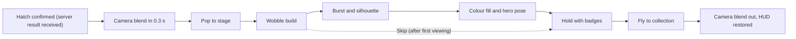

# Animation - Egg Hatch

The single-egg hatch (3.5 s) and the multi-hatch of two to five eggs (5.0 s), including the five-egg stage layout, rarity embellishments, duplicate and discovery beats, skip and refusal.

> [!success] CONFIRMED
> Hatching picks an animal from the egg's rarity pool (D-015). Up to **five** eggs can be hatched at once (D-016). Every hatch is independent: no duplicate protection and no bias towards unowned animals (D-018). The team can be changed only at the player's own base (D-010).

> [!danger] The result is decided before the animation starts
> The server selects every animal and adds it to the collection before replying. The client starts the hatch sequence only after it receives the result, so the animation can never influence or reveal anything other than the true outcome ([[Hatch System]], [[Implementation - Egg Roll and Hatch Flow]]). Odds shown before hatching follow D-017.

> [!info] PROPOSED
> Lengths come from [[Canonical Proposed Values]] §7 (3.5 s single, 5.0 s multi, skippable after first viewing; timed incubation is the alternative under [[Open Questions#Q-023]]). Layouts, frame splits and IDs are **PROPOSED**. Hatch location rules (backpack eggs anywhere outside combat, base eggs only at the base) are **PROPOSED** in the same section.

---

## 1. Asset table

| ID | Clip / sequence | Length | Status |
|---|---|---|---|
| ANI-420 | Single hatch sequence controller | 3.5 s (105 f) | **PROPOSED** |
| ANI-421 | Multi-hatch sequence controller (2–5 eggs) | 5.0 s (150 f) | **PROPOSED** |
| ANI-422 | Egg pop to hatch stage (prop) | 0.4 s | **PROPOSED** |
| ANI-423 | Wobble build (prop; intensity parameter by rarity) | 0.8 s | **PROPOSED** |
| ANI-424 | Crack and shell burst (prop) | 0.6 s | **PROPOSED** |
| ANI-425 | Animal emergence (silhouette fill + the class showcase ANI-208 to ANI-214) | 1.0 s to key pose | **PROPOSED** |
| ANI-426 | Skip to result | 0.5 s | **PROPOSED** |
| ANI-427 | Player reaction (reuses ANI-411 set) | — | **PROPOSED** |
| ANI-428 | Fly to collection | 0.5 s | **PROPOSED** |
| ANI-429 | Hatch refused (in combat, or base egg away from base) | 0.5 s | **PROPOSED** |
| ANI-430 | Egg idle wobble (inventory and storage viewports) | 3.0 s loop | **PROPOSED** |

IDs ANI-431 to ANI-439 are reserved.

---

## 2. Staging

| Item | Single | Multi |
|---|---|---|
| Stage position | 6 studs in front of the player on the nearest flat ground (raycast); falls back to the UI viewport if no flat ground within 3 studs | Centre 9 studs in front of the player |
| Camera | Scriptable, 10 studs from the stage, 15° elevation, FOV 50, 0.3 s blend in | 16 studs, 18° elevation, FOV 60 (up to 70 for wide layouts) |
| Player avatar | Turns to face the stage, plays ANI-411 lean-in, then a tier-scaled cheer at the reveal | Same, cheer on the last reveal |
| Other players | Hidden within 8 studs of the stage on the hatching player's client only, to keep the shot clear | Same |
| HUD | Hidden except the skip hint ([[UI - Egg Hatching]]) | Same |

Hatching is refused in combat (combat tag active) and for base-stored eggs away from the base (ANI-429: the egg icon shakes, SFX-349, the UI shows the reason).

---

## 3. Single hatch — frame by frame (ANI-420, 105 f, 3.5 s)

The egg's rarity is already known (it is a Rare egg, for example), so its rarity colour is used freely from frame 0. The suspense is **which animal**.

| Frames | Beat | Egg / animal | VFX | SFX | Camera |
|---|---|---|---|---|---|
| f0–11 | Pop to stage | Egg arcs from the backpack (or base storage) to the stage, lands f9, settles f10–11 | Rarity-tinted landing glow | SFX-335 pop, land tick | Blend in (0.3 s) |
| f12–19 | Wobble 1 | ±8° rock | Egg rarity aura VFX-101 to VFX-107 at full | SFX-336 wobble (pitch by rarity) | Hold |
| f20–27 | Wobble 2 | ±12° rock, small hop | Aura brightens | SFX-336 | Hold |
| f28–35 | Wobble 3 | ±16° rock, hop, pause at f34 | Aura flickers | SFX-336, then 2 frames of silence at f34–35 | Push-in 10 → 9 studs over f28–47 |
| f36–47 | Crack | Cracks spread from the top down over 12 frames | VFX-302 rarity-tinted light leaks | SFX-337 crack build | Hold |
| f48–53 | Burst | Shell bursts outward; fragments fall and fade over 0.5 s | VFX-303 shell burst + tier reveal VFX-121 to VFX-127 | SFX-338 burst + SFX-339 to SFX-345 tier layer | Light shake on Legendary and above (unless reduce motion) |
| f54–62 | Silhouette | Animal appears as a bright white silhouette in the showcase crouch (showcase f0–4) | Flash of light at `A_Chest` | | Hold |
| f63 | Colour fill | Silhouette dissolves into the animal's full colours (and variant treatment if any) | VFX-160 new-discovery sparkle if this species was not owned before | SFX-346 discovery chime, or SFX-347 duplicate tick | |
| f63–74 | Hero pose | Showcase f5–19, key pose at f74 (showcase f20) | Rarity aura on the animal ([[VFX - Rarity and Variant Effects]]) | Species hatch call from [[Sound - Animal Vocalisations]] at f66; rarity stinger MUS-31 to MUS-37 (hatch edit) | Slight 8° orbit |
| f75–104 | Hold and info | Breathing hold; name, rarity, role and a "New" or "+1 duplicate" badge appear (UI) | | | Hold |
| f105 | End | Player taps Continue, or after 2.0 s more the sequence auto-continues; animal flies to collection (ANI-428) | | SFX-348 | Blend out 0.4 s |

### 3.1 Rarity embellishments inside the fixed 3.5 s

| Rarity | Extra beats (inside the same frames) |
|---|---|
| Common | None |
| Uncommon | Leaf sparks on the burst |
| Rare | Six light rays on the burst (f48–60) |
| Epic | Rays + orbiting motes around the animal f63–90 |
| Legendary | Gold light pillar at f48, camera shake "Light" |
| Mythical | Pillar + petal spiral around the animal f54–90 |
| Secret | A 0.3 s local night flash (f45–53) to `#1B1B2F`, then prismatic burst and aurora ribbons; shake "Medium" |

All embellishments reflect the egg's already-known rarity, so none of them is a deceptive signal.

### 3.2 Duplicates

A duplicate hatch plays exactly the same sequence as a new animal (no "dud" treatment). The only differences: the "+1 duplicate" badge instead of "New", SFX-347 instead of SFX-346, and the badge shows ascension progress towards the next star ([[Ascension System]]). Duplicates are a positive outcome because they feed ascension (D-019).

---

## 4. Multi-hatch — layout and frame by frame (ANI-421, 150 f, 5.0 s)

### 4.1 Layouts

Slots sit on a shallow arc facing the camera, centre slot nearest. Coordinates are in studs relative to the stage centre (x = right, z = towards the camera).

| Eggs | Slot x positions | Slot z | Order of eggs in slots |
|---:|---|---|---|
| 2 | −2.5, +2.5 | 0, 0 | Lower rarity left |
| 3 | −4, 0, +4 | −0.8, 0, −0.8 | Highest rarity centre |
| 4 | −5.4, −1.8, +1.8, +5.4 | −1.2, 0, 0, −1.2 | Two highest in the inner slots |
| 5 | −7, −3.5, 0, +3.5, +7 | −1.8, −0.5, 0, −0.5, −1.8 | Highest centre, next two inner, lowest two outer |

```text
5-egg layout (top view, camera at the bottom)

   [4]                              [5]        z = -1.8
            [2]            [3]                 z = -0.5
                    [1]                        z =  0.0   (highest rarity)
                     ^
                   camera
```

- Slot spacing grows with animal size: slot pitch = max(3.5, footprint of the largest animal + 0.5) studs. If the layout is wider than 18 studs, the camera pulls back and FOV widens to at most 70.
- Ties (same rarity) keep the order the player selected them in [[UI - Egg Hatching]].

### 4.2 Frame by frame (5 eggs)

| Frames | Beat | Detail | Camera |
|---|---|---|---|
| f0–14 | Pop to slots | Eggs arc in, outer slots first: slot 4 f0, slot 5 f3, slot 2 f6, slot 3 f9, slot 1 f12 | Blend in 0.3 s |
| f15–44 | Shared wobble build | All eggs wobble in unison three times (f15, f25, f35), each wobble larger; auras pulse in each egg's own colour | Hold |
| f45 | Burst slot 4 | Lowest rarity first (slot order reversed: outer → inner → centre) | |
| f54 | Burst slot 5 | | |
| f63 | Burst slot 2 | | |
| f72 | Burst slot 3 | | |
| f81 | Burst slot 1 (centre, highest) | Gets the full embellishment from §3.1; others use 60% particle rate | Push-in 1 stud; shake per §3.1 for the centre egg only |
| burst + 0–8 | Silhouette | Each animal appears as a silhouette 9 frames | |
| burst + 9 | Colour fill | New or duplicate badge per animal | |
| f90–119 | Group hold | All animals in their showcase key poses; names and badges over each | Gentle 6° orbit |
| f120–149 | Summary | Summary panel slides in with the five results ([[UI - Egg Hatching]]); animals fly to collection one by one from f135 (3-frame stagger) | Blend out at f150 |

For **2–4 eggs** the burst frames are spread across the same window f45–f81: 4 eggs at f45, f57, f69, f81; 3 eggs at f45, f63, f81; 2 eggs at f54, f81. Total length stays 5.0 s.

### 4.3 Sound layering in a multi-hatch

Only the centre (highest) egg plays its full tier SFX layer and the rarity stinger; the others play the burst SFX-338 at −6 dB with their tier layer at −9 dB. Stingers never stack: if several eggs share the top rarity, one stinger plays ([[Audio Mixing and Priority]]).

---

## 5. Skip (ANI-426)

After a player has seen the full sequence once (per mode: single and multi), a tap skips to the hold beat (f75 single, f90 multi) over 0.5 s: eggs burst at once, animals appear directly in their key poses, badges show. The result was stored before the animation began, so skipping changes nothing.

## 6. Transitions



After the sequence the player regains control. If the player is at their base, the summary offers "Go to team selection" ([[UI - Team Selection]]); away from the base it does not, because the team is locked outside the base (D-010).

## 7. Mobile performance considerations

| Item | Low | Medium | High |
|---|---|---|---|
| Shell fragments per egg | 6 | 10 | 16 |
| Multi-hatch non-centre burst rate | 40% | 60% | 60% |
| Silhouette effect | Material swap to white `Neon` | Same | Same plus `Highlight` fill (counts against the Highlight budget) |
| Animals animated during group hold | Centre plus 2 | All 5 | All 5 |

Preload: when the hatch is confirmed the client already knows the five animals, so it calls `ContentProvider:PreloadAsync` on their models and showcase clips during the 0.3 s camera blend and the 0.5 s pop; the wobble build holds (no extra wobbles, simply a longer pause before the crack) if loading is not finished, up to 1.0 s, then proceeds with a low-detail placeholder.

## 8. Test hooks

| Test | Expected |
|---|---|
| Hatch 1, 2, 3, 4 and 5 eggs | 3.5 s for one; 5.0 s for two to five; layouts as §4.1 |
| 5-egg hatch with rarities C, C, R, E, L | Legendary in the centre, Epic and Rare inner, Commons outer; bursts in the order C, C, R, E, L |
| Duplicate hatch | Same sequence, "+1 duplicate" badge, no negative effect |
| Attempt to hatch during combat | ANI-429 refusal, no egg consumed |
| Hatch away from base | Summary does not offer team selection |
| Reduce motion on | No orbit, no push-in, no shake; same durations |

---

## Related documents
- [[Hatch System]]
- [[Egg Animations]]
- [[Animation - Egg Roll]]
- [[Animation - Animal Defeat and Victory]]
- [[Independent Random Outcomes]]
- [[UI - Egg Hatching]]
- [[Animal Index Feature Specification]]
- [[VFX - Rarity and Variant Effects]]
- [[Sound - Eggs]]
- [[Camera Behaviour Guidelines]]
