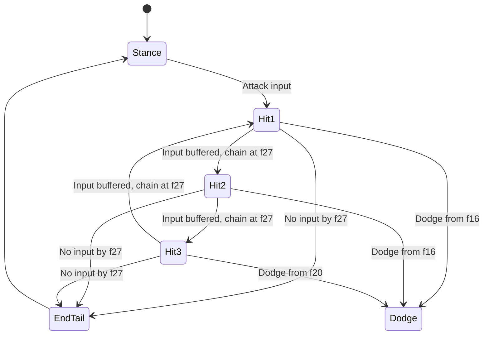

# Animation - Player Attacks and Specials

The player character's three-hit basic combo, the specials Power Strike, Ground Slam and Rally Cry, the Dodge Roll, the target-command gesture, and player hit and defeat reactions.

> [!success] CONFIRMED
> The player fights alongside their animals, has basic attacks and special moves, and special moves may have cooldowns (D-005). Player strength is a separate statistic (D-007).

> [!info] PROPOSED gameplay values used here (from [[Canonical Proposed Values]] §4)
> Combo: 3 hits at Strength × 0.8 / 0.8 / 1.4, **0.45 s per hit**, resets after **1.2 s** idle. Power Strike: Strength × 3.0, single target, 6 s cooldown, level 1. Ground Slam: Strength × 2.0 to all enemies within **10 studs**, 12 s cooldown, level 10. Rally Cry: team +15% damage for 6 s, 25 s cooldown, level 25. Dodge Roll: **0.3 s** invulnerability, **12-stud** roll, 4 s cooldown. All clip frame splits below are **PROPOSED**.

> [!warning] UNDECIDED
> Whether the game forces R15 avatars and whether players' own avatar animation packs are kept for locomotion is **UNDECIDED** (Q-702). This document assumes R15 with the player's locomotion pack kept and all combat clips authored here.

---

## 1. Conventions for player clips

| Item | Rule |
|---|---|
| Rig | Roblox R15 (`Humanoid`, `Animator` under the Humanoid) |
| Frame rate | **60 fps** (frames written "@60"); 0.45 s = 27 frames |
| Weapon | Authored unarmed with stylised gauntlet hands. If [[Player Combat]] adds held tools, the set is re-posed as `ANI-22x/<tool>` variants with identical timing |
| Root displacement | The `Root` Motor6D (in `LowerTorso`) may lift the body visually (Ground Slam jump). Horizontal displacement (lunges, roll distance) is applied by the player controller, tuned to the frames below |
| Priority | Combo, specials and roll: `Action2` (so they override the player's locomotion pack and any emote at `Action`). Rally Cry and the command gesture: `Action2` on upper-body joints only. Hit reactions: `Action3`. Defeat: `Action4` |
| Prediction | The local client plays the clip on input; the server validates cooldown and range and applies damage at the configured hit time ([[Animation Bible]] §4). On rejection the clip is stopped with a 0.08 s fade |
| Input buffer | An attack input pressed up to 0.25 s before the chain point is queued |

---

## 2. Asset table

| ID | Clip | Length | Hit / effect time | Status |
|---|---|---|---|---|
| ANI-220 | Combo hit 1 — right straight | 27 f chain + 12 f end tail | Contact f10 (0.167 s) | **PROPOSED** |
| ANI-221 | Combo hit 2 — left hook | 27 f + 12 f tail | Contact f11 (0.183 s) | **PROPOSED** |
| ANI-222 | Combo hit 3 — two-hand overhead hammer (finisher) | 27 f + 24 f tail | Contact f15 (0.25 s) | **PROPOSED** |
| ANI-223 | Power Strike | 45 f (0.75 s) | Contact f20 (0.333 s) | **PROPOSED** |
| ANI-224 | Ground Slam | 60 f (1.0 s) | Impact f30 (0.5 s) | **PROPOSED** |
| ANI-225 | Rally Cry (upper body) | 54 f (0.9 s) | Buff applied f18 (0.3 s) | **PROPOSED** |
| ANI-226 | Dodge Roll | 27 f (0.45 s) | Invulnerable f3–20 (0.05–0.35 s) | **PROPOSED** |
| ANI-227 | Target command gesture (upper body) | 30 f (0.5 s) | Command sent on input, gesture is cosmetic | **PROPOSED** |
| ANI-228 | Player flinch (upper body) | 12 f (0.2 s) | — | **PROPOSED** |
| ANI-229 | Player stagger | 30 f (0.5 s) | — | **PROPOSED** |
| ANI-230 | Player knockdown and get-up | 72 f (1.2 s) | Server lockout drives early get-up | **PROPOSED** |
| ANI-231 | Player defeated (downed) entry + loop | 60 f + 120 f loop | — | **PROPOSED** |
| ANI-232 | Player respawn / revive | 60 f (1.0 s) | — | **PROPOSED** |
| ANI-233 | Combat stance idle | 90 f loop | — | **PROPOSED** |
| ANI-234 | Special unavailable "fizzle" (upper body) | 18 f (0.3 s) | — | **PROPOSED** |

IDs ANI-235 to ANI-259 are reserved (raid carry clips live in [[Animation - Raid Interactions]]).

---

## 3. Basic three-hit combo

### 3.1 Flow

- Cadence is fixed: each hit starts exactly 27 frames (0.45 s) after the previous one when chained.
- The combo index resets to hit 1 after 1.2 s without an attack (server-tracked; the client mirrors it).
- Targeting: the player snaps facing to the current target within 60° of camera-forward and within 6 studs ([[Targeting and Command System]]); otherwise attacks go camera-forward.

### 3.2 ANI-220 — Hit 1, right straight (@60)

| Frames | Phase | Pose and motion |
|---|---|---|
| f0–3 | Anticipation | Weight shifts to the back foot, right fist draws back to the hip, torso twists 20° right |
| f4–7 | Anticipation hold | Left hand guards the chin; read pose |
| f8–9 | Strike | Torso snaps 35° left; right arm extends; controller lunges 1.0 stud forward over f8–12 |
| **f10** | **Contact** (`Hit` "1") | Arm fully extended; 2-frame hit-stop (f10–11) |
| f12–17 | Follow-through | Arm recoils halfway; `CancelOpen` at f16 (dodge only) |
| f18–26 | Recovery | Return towards guard; chain point at f27 |
| f27–38 | End tail (only if no chain) | Settle into combat stance ANI-233 |

### 3.3 ANI-221 — Hit 2, left hook (@60)

f0–4 drop left shoulder, f5–8 load, f9–10 hook travels in a horizontal arc, **f11 contact** (hit-stop f11–12), f13–17 follow-through with 15° over-rotation, `CancelOpen` f16, f18–26 recover, chain f27, end tail f27–38.

### 3.4 ANI-222 — Hit 3, finisher (@60)

| Frames | Phase | Pose and motion |
|---|---|---|
| f0–5 | Anticipation | Both hands clasp and rise above the head; up on the toes |
| f6–12 | Anticipation hold | Back arched; the clasped hands glow (VFX-004 charge stage) |
| f13–14 | Strike | Hammer down; controller lunges 1.5 studs |
| **f15** | **Contact** (`Hit` "3") | Hands at the target's chest height; 4-frame hit-stop (f15–18) |
| f19–26 | Follow-through | Hands to knee height, knees bent; `CancelOpen` f20 |
| f27–50 | End tail | Longer recovery so finishers feel weighty; chain still allowed at f27 |

### 3.5 Combo presentation

| Hit | VFX | SFX | Camera (local player only) |
|---|---|---|---|
| 1 | VFX-003 hand Trail f8–12, VFX-001 spark on contact | SFX-150 swing whoosh f8, SFX-152 hit f10 | None |
| 2 | VFX-003 Trail f9–13, VFX-001 | SFX-150 (pitch +5%), SFX-152 | None |
| 3 | VFX-004 charge f6–12, finisher burst on contact | SFX-151 heavy swing f13, SFX-153 finisher f15 | Shake profile "Light" on f15 ([[Camera Behaviour Guidelines]]) |

---

## 4. Specials

### 4.1 ANI-223 — Power Strike (45 f @60, 0.75 s)

- **Start pose:** combat stance or any combo chain point (the special can be fired at a chain point; it resets the combo to hit 1).
- **End pose:** combat stance.

| Frames | Phase | Pose and motion | VFX / SFX |
|---|---|---|---|
| f0–5 | Wind-up | Right fist pulls back past the hip; body drops 0.3 studs; left arm extends forward to aim | SFX-220 charge rise starts |
| f6–17 | Charge hold | Fist trembles (±1° at 30 Hz); eyes on target | VFX-005 energy gathers at the right hand, growing over 12 frames |
| f18–19 | Strike | Explosive step forward; controller lunges 2 studs over f18–21 | Trail on right hand |
| **f20** | **Contact** (`Hit` "PS") | Full extension, back leg straight | VFX-005 impact shockwave; SFX-221 impact |
| f20–24 | Hit-stop | Pose held 5 frames | |
| f25–33 | Follow-through | Arm pulled back, shoulders reset | |
| f34 | `CancelOpen` | Dodge or attack may start | |
| f35–44 | Recovery | Back to stance | |

- **Camera:** shake "Medium" at f20 plus an FOV punch of −3° for 0.15 s.
- **Transitions:** from stance (fade 0.08 s), out to stance or into Hit 1 at f34.
- **Mobile:** one Trail, one burst emitter (rate-capped per tier), one PointLight pulse 0.2 s (skipped on low).

### 4.2 ANI-224 — Ground Slam (60 f @60, 1.0 s)

| Frames | Phase | Pose and motion | VFX / SFX |
|---|---|---|---|
| f0–11 | Crouch | Knees bend deeply, fists pulled to the chest | SFX-222 wind-up |
| f12–23 | Leap | Root Motor6D lifts the body 2.5 studs (visual), fists rise above the head, knees tucked | Dust puff on take-off (f12) |
| f24–29 | Drop | Body accelerates down (ease-in), fists lead | Trail on both hands |
| **f30** | **Impact** (`Hit` "GS") | One knee and both fists strike the ground | VFX-006 10-stud shockwave ring and debris; SFX-223 slam |
| f30–33 | Hit-stop | Held | |
| f34–44 | Hold low | Shoulders heave once | Ring expands to full radius by f42 |
| f45 | `CancelOpen` | | |
| f46–59 | Recovery | Stand up into stance | |

- **Radius readability:** the shockwave ring VFX-006 reaches exactly **10 studs**, matching the damage radius, so players learn the true area.
- **Camera:** shake "Heavy" (0.35 s) at f30 for the local player; other players within 20 studs get "Light" only if they enable "Shake from others" in [[UI - Settings]] (off by default).
- **Movement:** the player cannot move during f0–44.

### 4.3 ANI-225 — Rally Cry (54 f @60, 0.9 s, upper body only)

Keys only `UpperTorso`, `Head`, arms and hands, so the legs keep the current locomotion and the player can move while shouting.

| Frames | Pose | VFX / SFX |
|---|---|---|
| f0–11 | Gather: arms drop and cross, chin down | SFX-224 inhale swell |
| f12–17 | Burst: arms fling up and outward, head thrown back | |
| **f18** | Peak (`VFX` marker "VFX-007"): buff applied by the server at 0.3 s | VFX-007 golden ring pulses outward from the player to the three companions; SFX-225 rally horn |
| f18–35 | Hold shout pose, slight shake | Buff motes rise on each companion |
| f36–53 | Arms lower to guard | |

- **Companion acknowledgement:** each companion not in an Action or Action2 clip plays the peak 15 frames (@30) of its victory clip as a "perk up", staggered by 0.1 s.
- **Camera:** none (no shake for a buff).

### 4.4 ANI-226 — Dodge Roll (27 f @60, 0.45 s)

| Frames | Phase | Pose and motion |
|---|---|---|
| f0–2 | Dip | Body drops and leans into the roll direction; facing snaps to the roll direction |
| **f3–20** | **Invulnerable roll** (0.3 s) | One full forward roll (360° on the pitch axis by animation of the Root joint); the controller moves the player 12 studs between f0 and f21 (≈ 34 studs/s), easing out over the last 4 frames |
| f21 | `CancelOpen` | Attacks and specials may start |
| f21–26 | Rise | Up into stance |

- **Direction:** the movement input direction, or camera-forward when there is no input.
- **VFX:** VFX-008 dust puff at f2 and f21, faint afterimage Trail on the torso f3–20.
- **SFX:** SFX-226 roll cloth whoosh at f3; if a hit is negated during the window, SFX-177 "blocked" tink.
- **Camera:** none. Never shake or move the camera during a dodge.

---

## 5. Utility and reactions

### 5.1 ANI-227 — Target command gesture

Upper body only (right arm and head). f0–8 arm sweeps up, f9 point at target (index extended), hold f9–20, f21–29 lower. Purely cosmetic: the command is sent on input. The ground target marker VFX-030 and SFX-158 confirm the command ([[Targeting and Command System]]).

### 5.2 Hit reactions

| ID | Trigger (PROPOSED) | Frames @60 |
|---|---|---|
| ANI-228 Flinch | Any damage to the player while not in a special | f0–3 head and chest snap 10° away, f4–11 return. Upper body only, does not stop movement or combos |
| ANI-229 Stagger | A single hit ≥ 20% of player max HP (cosmetic; never cancels a server-accepted action) | f0–8 step back, f9–20 head shake, f21–29 recover |
| ANI-230 Knockdown | Server `KnockedBack` on the player (boss slams) | f0–10 lift and fall back, f11 ground contact (dust, SFX-155), f12–39 lie and sit up, f40–71 get-up. Get-up starts at `lockout − 0.55 s` |

Camera on player damage: shake "Light" on stagger, "Medium" on knockdown, nothing on flinch.

### 5.3 ANI-231 — Defeated (downed)

Defeat consequences per battle type are **UNDECIDED** ([[Open Questions#Q-014]]). The clip is neutral: f0–20 knees buckle, f21–40 sit down heavily, f41–59 lie back with a dizzy-star loop (VFX-014), then a 120-frame breathing loop until the server respawns or revives the player. No dramatic death pose (D-026).

### 5.4 ANI-232 — Respawn / revive

f0–15 sparkle column (VFX-035), f16–35 player lands in a crouch, f36–59 stand to stance. SFX-157.

### 5.5 ANI-234 — Fizzle

When a special is pressed during its cooldown the client plays a short upper-body fist shake and a grey puff from the hand; no SFX beyond the UI "unavailable" tick ([[Sound - UI Feedback]]). Never consumes the input buffer.

---

## 6. Mobile performance considerations

- Player clips are high priority and always at LOD A0 for the local player. Other players' clips follow the distance LOD ([[Animation Bible]] §8); at A2 other players' combos are reduced to hit 1 only.
- Hand Trails: one active Trail per hand per player; other players' Trails are disabled at low quality.
- Touch controls: specials are on separate buttons ([[UI - Main HUD]]). The 0.25 s input buffer is equally generous on touch and keyboard.

## 7. Test hooks

| Test | Expected |
|---|---|
| Hold attack for 3 s | Hits start at 0.00, 0.45, 0.90, 1.35 s…, cycling 1-2-3 |
| Wait 1.2 s after hit 2, attack | Combo restarts at hit 1 |
| Dodge through a boss slam with the impact at roll time 0.10 s | No damage; SFX-177 plays |
| Ground Slam ring | Visual ring edge at 10 studs ±0.25 |
| Server rejects Power Strike (cooldown desync) | Clip stops within 0.1 s, no impact VFX |

---

## Related documents
- [[Player Combat]]
- [[Player Strength]]
- [[Abilities and Cooldowns]]
- [[Targeting and Command System]]
- [[Combat States and State Machine]]
- [[Camera Behaviour Guidelines]]
- [[VFX - Combat Effects]]
- [[Sound - Combat Impacts]]
- [[Sound - Abilities]]
- [[UI - Main HUD]]
