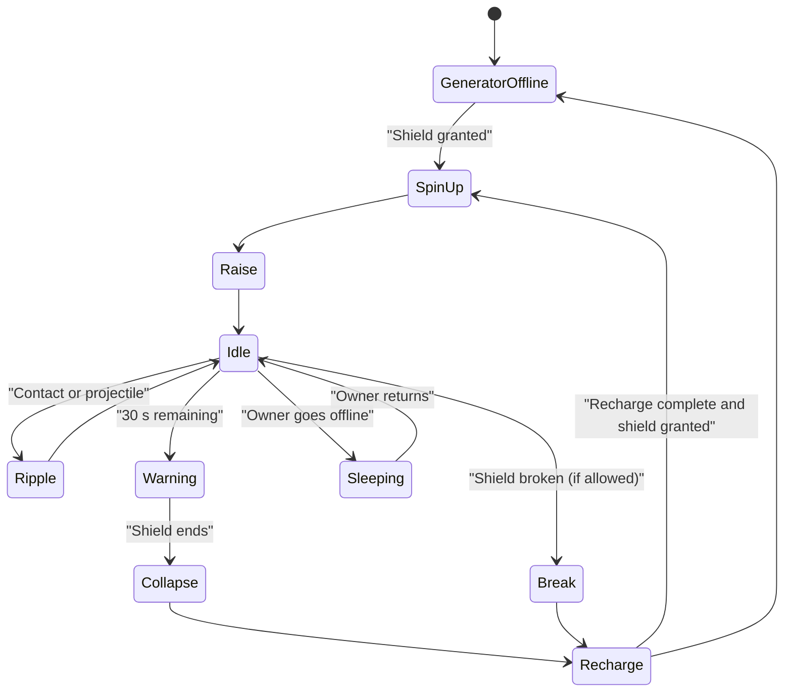

# Animation - Shield Activation

The base shield's visual life cycle: generator spin-up, dome raise, idle, impact ripple, expiry warning, collapse, break and the raider repel bounce.

> [!success] CONFIRMED
> Bases are protected by shields and physical defences (D-024). Offline bases cannot be raided.

> [!warning] UNDECIDED
> How shields are acquired (automatic after a raid, generated by the base, or purchasable) is **UNDECIDED** ([[Open Questions#Q-030]]). Shield duration, recharge and whether a shield can be broken are owned by [[Shield Mechanics]] and [[Module - Shield Generator]]. This document animates every state those rules may need; it sets no gameplay values.

> [!info] PROPOSED
> Clips, durations, colours and the 30 s expiry warning lead time (animation-side only) are **PROPOSED**.

---

## 1. Visual design

| Element | Spec (PROPOSED) |
|---|---|
| Dome shape | Hemisphere covering the base plot plus 4 studs; built from 8 horizontal rings of hexagonal panels |
| Material | `Enum.Material.ForceField` on a sphere `MeshPart` for the living shimmer, plus 8 ring `MeshPart`s with a hex texture for the raise and collapse |
| Colour | Friendly shield cyan `#5CE1FF`; owner's view slightly brighter than visitors' view |
| Idle transparency | 0.85 (visitors), 0.9 (owner, so their own base stays clear) |
| Generator | The [[Module - Shield Generator]] rotor and pylons are the visual source; the dome always grows from it |
| Readability rule | A shielded base must be identifiable as shielded from 150 studs; a dome that is about to expire must look different from a stable one (§3.5) |

Offline bases are not raidable; whether they also display a dome is a presentation choice. Recommendation: offline bases show a dim, static "sleeping" dome (no shimmer, transparency 0.92) so passers-by understand they are protected, at almost no cost.

---

## 2. Asset table

| ID | Clip | Length | Loop | Status |
|---|---|---|---|---|
| ANI-500 | Generator spin-up | 1.0 s (30 f) | No | **PROPOSED** |
| ANI-501 | Dome raise | 1.5 s (45 f) | No | **PROPOSED** |
| ANI-502 | Dome idle | 4.0 s (120 f) | Yes | **PROPOSED** |
| ANI-503 | Impact ripple (contact or projectile) | 0.5 s (15 f) | No | **PROPOSED** |
| ANI-504 | Expiry warning (last 30 s) | 1.0 s loop, accelerating | Yes | **PROPOSED** |
| ANI-505 | Collapse on expiry | 1.2 s (36 f) | No | **PROPOSED** |
| ANI-506 | Break (only if [[Shield Mechanics]] allows shields to be broken) | 1.0 s (30 f) | No | **PROPOSED** |
| ANI-507 | Raider repel bounce (player R15 clip) | 0.6 s (36 f @60) | No | **PROPOSED** |
| ANI-508 | Generator recharge loop (shield down, recharging) | 2.0 s | Yes | **PROPOSED** |
| ANI-509 | Generator offline idle (no shield, not recharging) | 4.0 s | Yes | **PROPOSED** |
| ANI-510 | Offline "sleeping" dome idle | static, 8.0 s slow pulse | Yes | **PROPOSED** |

IDs ANI-511 to ANI-519 are reserved.

---

## 3. Frame by frame

### 3.1 ANI-500 Generator spin-up (30 f)

| Frames | Action | VFX / SFX |
|---|---|---|
| f0–9 | Rotor starts turning, accelerating from 0 to 90°/s | SFX-455 spin-up rises |
| f10–19 | Pylons' rune strips light from bottom to top | Pylon glow |
| f20–29 | Rotor at full speed (360°/s), small energy sparks between pylons | Sparks VFX-340 pre-stage |

### 3.2 ANI-501 Dome raise (45 f)

| Frames | Action | VFX | SFX |
|---|---|---|---|
| f0–8 | A beam shoots from the generator to the dome apex | VFX-340 Beam | SFX-456 raise starts |
| f9–14 | Apex flare; the top hex ring appears | Flare | |
| f15–35 | Rings 2–8 unfold downward, one every 3 frames (f15, f18, f21, f24, f27, f30, f33) | Each ring flashes as it appears | Ring ticks rising in pitch |
| f36–40 | Bottom ring touches the ground; a ripple runs up the dome to the apex | Ground ring dust | Lock "thoom" |
| f41–44 | ForceField sphere fades in to idle transparency; ring meshes fade out | VFX-341 idle starts | SFX-457 idle hum begins (spatial) |

**Camera:** no change. On the owner's first-ever shield activation, a 2.0 s optional overview shot (pull up to 40 studs above the base) plays if the owner is at the base and not combat-tagged; afterwards never.

### 3.3 ANI-502 Dome idle (120 f loop)

ForceField shimmer runs automatically. Additionally a faint hex "scan" band travels from the ground to the apex every 4 s (texture offset on one ring mesh), and the generator rotor turns at 180°/s. LOD: beyond 150 studs the band and rotor stop; beyond 300 studs only the dome silhouette remains (no ForceField, a plain transparent sphere).

### 3.4 ANI-503 Impact ripple (15 f)

Triggered when a raider touches the dome or a projectile hits it. A hex-patterned decal (`VFX-342`) appears at the contact point, expands to 6 studs over f0–8 and fades by f14. Rate-limited to 4 ripples per second per dome. SFX-458 at the contact point.

### 3.5 ANI-504 Expiry warning

Starts 30 s before the shield ends (if [[Shield Mechanics]] gives shields an end time). The dome flickers: transparency dips to 0.95 for 2 frames.

| Time remaining | Flicker interval | Colour |
|---|---|---|
| 30–11 s | Every 1.0 s | Cyan |
| 10–4 s | Every 0.5 s | Cyan shifting to pale white |
| 3–0 s | Every 0.25 s | Pale white |

The owner gets a UI countdown ([[UI - Notifications]]); SFX-459 ticks only in the last 10 s and only for the owner and players within 40 studs. Flicker frequency never exceeds 4 per second (photosensitivity limit is 3 full-screen flashes per second; these are local, low-contrast dips, and with reduce motion they are replaced by a steady colour change).

### 3.6 ANI-505 Collapse on expiry (36 f)

| Frames | Action |
|---|---|
| f0–5 | ForceField sphere swapped for the 8 ring meshes |
| f6–23 | Rings fade upward, bottom first, one every 2 frames, each shedding hex flakes (VFX-343) |
| f24–29 | Apex flare |
| f30–35 | Beam retracts into the generator; rotor slows (switch to ANI-508 or ANI-509) |

SFX-460 descending chime. Calm and clear, not alarming: expiry is a normal event.

### 3.7 ANI-506 Break (30 f)

Only produced if shields can be broken. f0–3 the dome flashes at the breaking point, f4–9 cracks spider across the hexes, f10–15 panels shatter outward into flakes (VFX-344), f16–29 flakes fall and fade; generator sparks and stops. SFX-461. Camera: "Medium" shake for players within 30 studs, owner included.

### 3.8 ANI-507 Raider repel bounce (36 f @60, player clip)

When a non-owner walks into an active dome, the server pushes them back 4 studs (push owned by [[Shield Mechanics]]). The player plays: f0–5 recoil from the contact (arms up, torso back 20°), f6–23 stumble back two steps, f24–35 recover. Priority `Action3`. Impact ripple ANI-503 plays at the contact point. SFX-462.

---

## 4. Transitions

## 5. Mobile performance considerations

| Item | Low | Medium | High |
|---|---|---|---|
| ForceField sphere | Plain transparent sphere (no ForceField) | ForceField | ForceField |
| Hex scan band | Off | On | On |
| Ripple decals per dome | 2 per second | 4 | 4 |
| Flakes on collapse or break | 20 | 40 | 80 |
| Domes rendered | Own base + nearest 2 | Nearest 4 | Nearest 8 |

ForceField material cost on low-end devices is *unverified*; the fallback sphere exists for that reason. Each dome is one draw-heavy transparent object: transparency sorting artefacts with other transparent parts (water, glass) must be checked in [[Test Cases - Mobile Performance]].

## 6. Test hooks

| Test | Expected |
|---|---|
| Activate a shield | 1.0 s spin-up, 1.5 s raise; idle hum audible only within its RollOffMaxDistance ([[Sound - Base and Raid Alerts]]) |
| Walk into another player's shield | 0.6 s repel clip, ripple at contact, server pushback |
| Shield with 30 s left | Warning starts; intervals 1.0 / 0.5 / 0.25 s at the thresholds |
| Owner goes offline | Dome switches to the sleeping idle within 2 s of the server state |

---

## Related documents
- [[Shield Mechanics]]
- [[Module - Shield Generator]]
- [[Base Defence Overview]]
- [[Raid Eligibility and Offline Protection]]
- [[Animation - Raid Interactions]]
- [[Animation - Base Upgrades]]
- [[VFX Bible]]
- [[Sound - Base and Raid Alerts]]
