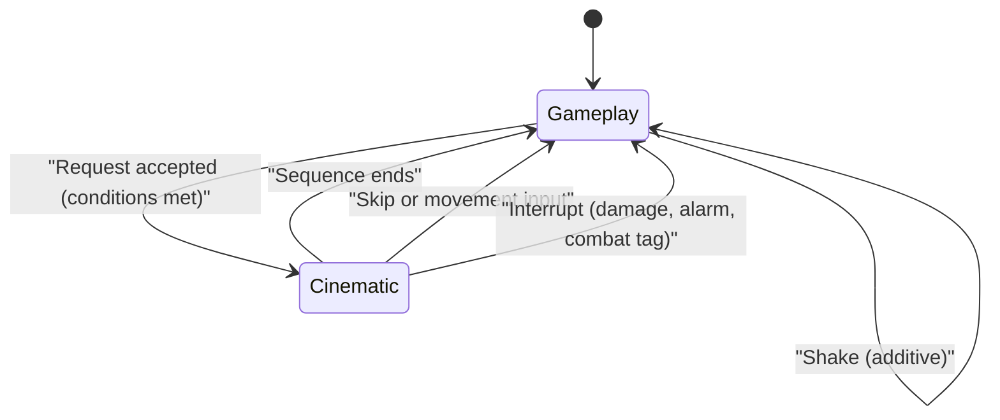

# Camera Behaviour Guidelines

How the camera behaves in gameplay, combat, presentations (rolls, hatches, merges, upgrades, bosses) and raids; the shake and FOV-punch profiles; and the rules for taking and returning camera control.

> [!info] PROPOSED
> Everything in this document is **PROPOSED** by the Animation Director, in consultation with [[UI Accessibility Standards]] and [[Client Controllers]].

---

## 1. Principles

1. **The player owns the camera during play.** Cinematic control is only taken in safe contexts: out of combat, not during a raid, and only for the player's own presentations.
2. **Every takeover is short, skippable and reversible.** Moving the thumbstick, pressing a movement key or tapping skip returns control within 0.3 s, except during the first viewing of a reward reveal (which is still short).
3. **Interrupts beat cinematics.** Taking damage, a raid alarm, a combat tag, or a teleport cancels any cinematic camera immediately (0.2 s blend back).
4. **No camera effect hides gameplay information.** Shakes never exceed amplitudes that blur telegraphs; FOV changes never push the player's own character off-centre.
5. **Reduce motion is honoured everywhere** (§7).

---

## 2. Gameplay camera

| Setting | Value | Roblox mechanism |
|---|---|---|
| Camera type | Default follow camera | `Camera.CameraType = Enum.CameraType.Custom` |
| Subject | Player character | `Camera.CameraSubject` = the Humanoid |
| Zoom range | 8–40 studs, default 18 | `Player.CameraMinZoomDistance`, `Player.CameraMaxZoomDistance` |
| Field of view | 70° | `Camera.FieldOfView` |
| First person | Disabled (minimum zoom 8 keeps the team in view) | Min zoom |
| Mobile | Same values; the default touch camera controls | — |

### 2.1 Keeping the team in view

Three companions follow within the follow radius defined in [[Animal Combat Behaviour]]. With large companions (Large and Colossal size bands in [[Animal Rig Standards]]) the default zoom may not show all three. Rule: when any equipped companion is in the Colossal band, the default zoom becomes 22 studs (the player can still zoom freely).

### 2.2 Boss arenas

When a boss fight starts and the player has not zoomed manually in the last 10 s, the camera eases to at least 26 studs over 1.0 s so telegraph decals fit on screen ([[Animation - Boss Attacks]]). It never zooms the player in.

### 2.3 No lock-on at launch

There is no hard target lock. Facing assistance for attacks is handled by the player controller ([[Targeting and Command System]]), not the camera.

---

## 3. Shake profiles

Shake is an additive rotational and positional offset applied to `Camera.CFrame` on the client after the default camera update (`RunService:BindToRenderStep` at a priority after `Enum.RenderPriority.Camera`).

| Profile | Peak rotation | Peak position | Frequency | Duration | Decay | Used by |
|---|---:|---:|---:|---:|---|---|
| Micro | 0.15° | 0.02 studs | 30 Hz | 0.10 s | Linear | Own heavy companion footsteps (T-Rex, pachyderms) within 10 studs |
| Light | 0.4° | 0.05 studs | 25 Hz | 0.20 s | Exponential | Combo finisher, player stagger, Legendary reveal |
| Medium | 0.9° | 0.12 studs | 20 Hz | 0.30 s | Exponential | Power Strike, player knockdown, boss roar, Secret reveal |
| Heavy | 1.6° | 0.25 studs | 16 Hz | 0.35 s | Exponential | Ground Slam (own), boss slams on the player, boss ultimate |

Rules:
- **One shake at a time.** A new shake replaces the current one only if its profile is stronger or the current one is more than 50% decayed.
- **Distance attenuation** for world-sourced shakes (boss attacks): full inside the attack radius, 50% up to 1.5 × radius, none beyond.
- **Others' actions:** shakes from other players' actions are off by default ("Shake from others" toggle in [[UI - Settings]]).
- **Companions never shake the camera** except the Micro footstep profile above.
- **Rate cap:** at most 4 shakes per second.

### 3.1 FOV punches

| Punch | Change | In | Hold | Out | Used by |
|---|---:|---:|---:|---:|---|
| Strike punch | −3° | 0.05 s | 0.05 s | 0.15 s | Power Strike contact |
| Arena widen | +5° | 0.5 s | while active | 0.5 s | Boss ultimate telegraph |

---

## 4. Cinematic camera modes

All modes use `Enum.CameraType.Scriptable` and tween `Camera.CFrame` and `FieldOfView` with `TweenService`. "Distance" is from the subject's focus point.

| Mode | Trigger | Distance / elevation / FOV | Blend in / out | Skippable | Conditions |
|---|---|---|---|---|---|
| Egg roll | Roll confirmed at the shrine | 12 studs, 20°, FOV 55 (×5: FOV 65); push-ins per tier in [[Animation - Egg Roll]] | 0.3 / 0.4 s | After first viewing of the tier | At the shrine, not combat-tagged. Away from the shrine the reveal plays in the UI viewport and the world camera is untouched |
| Single hatch | Hatch confirmed | 10 studs, 15°, FOV 50 | 0.3 / 0.4 s | After first viewing | Not combat-tagged (hatching is refused in combat) |
| Multi-hatch | Hatch of 2–5 confirmed | 16 studs, 18°, FOV 60–70 | 0.3 / 0.4 s | After first viewing | As above |
| Merge | Merge confirmed at the station | 14–16 studs, 20°, FOV 50–55 | 0.3 / 0.4 s | After first viewing of the tier | At own base, not during a raid |
| Base upgrade spotlight | Upgrade from the module prompt | 3/4 view at 2.5 × module height | 0.3 / 0.4 s | Any movement input | Within 40 studs, not during a raid |
| Shield first activation | First ever shield | 40 studs above the base, looking down | 0.5 / 0.5 s | Any input | Once per account |
| Boss intro | World boss spawns | 2.5 s framing shot of the boss | 0.4 / 0.4 s | Any input | Within 80 studs and not combat-tagged; never forced on players already fighting |
| Boss victory orbit | Boss defeated | 2.0 s orbit around the player and team | 0.3 / 0.3 s | Any input | Off by default in PvP areas and raids |
| Ascension | Ascension confirmed | Viewport camera inside [[UI - Ascension]] (world camera untouched) | — | After first viewing | — |

### 4.1 Never take the camera when

- The player is combat-tagged (8 s since damage, [[Canonical Proposed Values]] §4).
- A raid involving the player (as raider or defender) is active.
- The player is in a PvP encounter ([[PvP System]]).
- The player is moving fast (falling, being knocked back).
- Another cinematic is active (queue instead; drop the queued one if it waits more than 3 s).

---

## 5. Taking and restoring control



Illustrative Luau (not tested in Studio):

```lua
-- CameraDirector (client). Illustrative only.
local CameraDirector = {}
local camera = workspace.CurrentCamera
local saved

function CameraDirector.request(modeName: string, focus: CFrame, params)
	if CombatState.isTagged() or RaidState.isActive() or CameraDirector.active then
		return false
	end
	saved = {
		cframe = camera.CFrame,
		fov = camera.FieldOfView,
		cameraType = camera.CameraType,
	}
	CameraDirector.active = modeName
	camera.CameraType = Enum.CameraType.Scriptable
	local goal = focus * CFrame.Angles(math.rad(-params.elevation), 0, 0) * CFrame.new(0, 0, params.distance)
	TweenService:Create(camera, TweenInfo.new(params.blendIn), { CFrame = goal, FieldOfView = params.fov }):Play()
	return true
end

function CameraDirector.release(blendOut: number)
	if not CameraDirector.active then return end
	local tween = TweenService:Create(camera, TweenInfo.new(blendOut), { CFrame = saved.cframe, FieldOfView = saved.fov })
	tween.Completed:Once(function()
		camera.CameraType = Enum.CameraType.Custom
		CameraDirector.active = nil
	end)
	tween:Play()
end
```

Restoring to `Custom` lets the default camera script resume from the current CFrame; whether it snaps or blends from a Scriptable CFrame on every device is *unverified* and is checked in prototype.

---

## 6. Raids and PvP

- No cinematic takeovers for either side.
- No shake from other players' actions unless the setting is on.
- The defender's camera is never moved when the alarm fires; direction to the threat is shown by HUD pointers ([[UI - Raid Interface]]).

---

## 7. Accessibility

| Setting | Effect |
|---|---|
| Reduce motion | All shakes and FOV punches off; cinematic push-ins, orbits and spins replaced by static framings or cuts; blend times unchanged |
| Shake intensity slider (0–100%) | Scales every profile's amplitudes |
| Shake from others | Off by default |
| Skip all reveals | Allowed after first viewing; first viewings remain mandatory but short |

Roblox may expose a platform-level reduced-motion preference to games; whether it does and under which API is *unverified*, so the in-game setting in [[UI - Settings]] is the source of truth.

---

## 8. Mobile considerations

- Cinematic framings are designed for a 16:9 phone in landscape with the HUD hidden; UI banners never cover the subject's centre third.
- Touch users skip with a single tap anywhere; on gamepad, the A or B button; on keyboard, Space or any movement key.
- Shake amplitude is the same on phones; the slider lets players reduce it.

## 9. Test hooks

| Test | Expected |
|---|---|
| Start a hatch, take damage from a wild animal before the burst | Not possible (hatch refused in combat); if damage arrives during the sequence anyway, the camera returns in 0.2 s and the result is still in the collection |
| Raid alarm during a merge | Merge camera released immediately |
| Two shakes within 0.1 s (Light then Heavy) | Heavy replaces Light |
| Reduce motion on, Secret reveal | No shake or push-in; same duration |

---

## Related documents
- [[Animation Bible]]
- [[Animation - Egg Roll]]
- [[Animation - Egg Hatch]]
- [[Animation - Boss Attacks]]
- [[Animation - Player Attacks and Specials]]
- [[Client Controllers]]
- [[UI Accessibility Standards]]
- [[UI - Settings]]
- [[Test Cases - Mobile Performance]]
