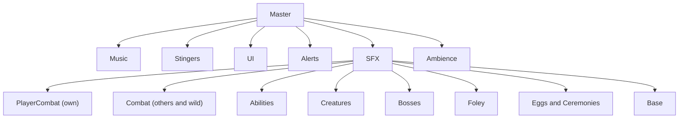

# Audio Mixing and Priority

The SoundGroup hierarchy, reference levels, voice limits per category, cooldowns, ducking, voice stealing and mobile limits that keep a 16-player shared world with up to 64 combatants (players plus three companions each) readable rather than noisy. Sound content rules are in the [[Sound Bible]].

> [!info] PROPOSED
> All groups, levels, limits and timings are **PROPOSED**. Server size of 16 is a working assumption ([[Open Questions#Q-031]]).

---

## 1. SoundGroup hierarchy



Each node is a `SoundGroup` under `SoundService`; child groups are parented to their parent group (nesting multiplies volumes). Player settings sliders map to Music, SFX, Ambience and UI ([[UI - Settings]]). Stingers follow the Music slider; Alerts follow the SFX slider but never go below 30% of their reference level while a raid involving the player is active (so a player who muted effects still hears an alarm, at low level).

---

## 2. Reference levels and voice limits

Reference levels are relative to Master at 0 dB. Voice limits are enforced by our client sound controller; Roblox's own engine limits on concurrent sounds are *unverified* and treated as a ceiling we must stay well below.

| Group | Reference level | Voice limit (Low / Medium / High tier) | Highest priority inside | Notes |
|---|---:|---|---|---|
| Music | −8 dB | 2 / 2 / 3 stems | — | Crossfades use 2 voices; High adds an intensity stem |
| Stingers | −4 dB | 1 / 1 / 1 | V1 | A new stinger replaces the current one only if higher tier |
| UI | −10 dB | 3 / 4 / 4 | V2 | |
| Alerts | −3 dB | 2 / 3 / 3 | V1 | Raid alarm, steal warnings, boss announcements, shield break |
| PlayerCombat | −6 dB | 4 / 6 / 6 | V2 | Local player and their three companions |
| Combat | −12 dB | 6 / 10 / 14 | V3 | Other players, their companions, wild animals |
| Abilities | −8 dB | 4 / 6 / 8 | V2 (own) / V3 (others) | |
| Creatures | −12 dB | 4 / 6 / 8 | V3 | Vocalisations |
| Bosses | −5 dB | 4 / 5 / 6 | V1 (telegraphs) | |
| Foley | −18 dB | 4 / 6 / 8 | V4 | Footsteps, wing flaps, slither |
| Eggs and Ceremonies | −6 dB | 4 / 6 / 6 | V2 | Roll, hatch, merge, ascension (2D for the owner) |
| Base | −12 dB | 3 / 5 / 6 | V3 | Construction, turrets, shield idle |
| Ambience | −16 dB | 3 / 4 / 6 | V5 | 1–2 beds + placed emitters |
| **Total cap** | | **24 / 32 / 48** | | Hard cap across all groups |

---

## 3. Voice stealing

When a group (or the total cap) is full and a new sound requests a voice:

1. If the new sound's priority is lower than every playing sound in the group, it is **dropped**.
2. Otherwise steal from the playing sounds in this order: lowest priority → farthest from the listener → oldest.
3. **V1 sounds are never stolen.** If the Alerts or Bosses groups are full of V1 sounds, the new V1 sound queues for up to 0.3 s, then plays by exceeding the group limit by one (the total cap still applies to lower priorities).
4. A stolen sound fades out over 0.05 s (never cut hard).

---

## 4. Cooldowns and aggregation

| Sound type | Rule (PROPOSED) |
|---|---|
| Creature hurt vocal | Per animal: at most one per 0.6 s; per group: at most 3 per 0.5 s |
| Creature idle call | Per animal: random 8–15 s; per server-visible area: at most one idle call every 2 s on each client |
| Creature attack effort | Every 2nd basic attack for Skirmishers (fast attackers); every attack for others |
| Basic hit impacts | Hits on the same target within 0.05 s merge into one sound at +2 dB |
| Footsteps | Only rigs at LOD A0 ([[Animation Bible]] §8); per rig every foot marker; group cap applies |
| Cash pickups | Aggregated: pickups within 0.25 s play one sound whose pitch rises by a semitone per extra pickup, up to +5 semitones |
| UI hover | At most one per 0.08 s |
| Shield impact ripple | At most 4 per second per dome (matches the VFX rate) |
| Raid alarm loop | Ducked by 9 dB after 6 s, restored on each new steal start ([[Animation - Raid Interactions]]) |
| Rarity stingers | Never stack; in multi-hatch and ×5 rolls only the highest tier's stinger plays |

---

## 5. Ducking matrix

Ducking is done by tweening SoundGroup `Volume` (attack and release times below), optionally with a `CompressorSoundEffect` on Music for gentle side effects. Sidechain features of `CompressorSoundEffect` are *unverified* and not relied on.

| Trigger (V1 / V2 event) | Music | Ambience | Combat | Creatures | Foley | Attack / release |
|---|---:|---:|---:|---:|---:|---|
| Boss telegraph riser (player in range) | −6 dB | −6 dB | −3 dB | −3 dB | −6 dB | 0.1 / 0.6 s |
| Boss ultimate | −9 dB | −9 dB | −6 dB | −6 dB | −9 dB | 0.2 / 1.0 s |
| Rarity reveal stinger (roll, hatch, merge) | −12 dB | −9 dB | — | −6 dB | −9 dB | 0.15 / 0.8 s |
| Ascension fanfare | −12 dB | −9 dB | — | −6 dB | −9 dB | 0.15 / 0.8 s |
| Raid alarm start | Crossfade to raid music | −6 dB | — | — | — | 0.3 / 1.0 s |
| Steal warning (defender) | −3 dB | −6 dB | — | — | — | 0.1 / 0.5 s |
| Own player KO / defeat | −9 dB | −6 dB | −6 dB | −6 dB | −6 dB | 0.2 / 1.5 s |
| Level up | −6 dB | −3 dB | — | — | — | 0.1 / 0.6 s |
| Rare-spawn announcement | −4 dB | −4 dB | — | — | — | 0.2 / 0.8 s |

Overlapping ducks do not add up beyond the deepest one in each column.

---

## 6. Distance and visibility culling

| Rule | Value |
|---|---|
| Do not start a 3D sound beyond its `RollOffMaxDistance` | Checked against the camera position before play |
| Do not start S1 sounds for rigs at LOD A2 or beyond | Matches animation LOD |
| Other players' 2D sounds | Never heard by anyone else (reveals and UI are local) |
| Streaming | Sounds attached to streamed-out parts are stopped and returned to the pool |

---

## 7. Implementation sketch (illustrative Luau, not tested)

```lua
-- SoundController (client). Illustrative only.
local Groups = require(ReplicatedStorage.Config.SoundGroups) -- limits per tier
local playing = {} -- [groupName] = { {sound, priority, startedAt} }

local function canStart(groupName, priority, position)
	local list = playing[groupName]
	if #list < Groups[groupName].limit[Quality.tier] then
		return true
	end
	table.sort(list, function(a, b)
		if a.priority ~= b.priority then return a.priority > b.priority end -- V5 first
		return a.distance > b.distance
	end)
	local victim = list[1]
	if victim.priority >= priority and victim.priority ~= 1 then
		fadeOut(victim.sound, 0.05)
		table.remove(list, 1)
		return true
	end
	return false
end
```

Priority numbers: 1 = V1 (critical) … 5 = V5 (bed); a larger number is lower priority.

---

## 8. Mobile considerations

- The Low tier total cap of 24 voices keeps CPU audio mixing cost low; this number is a starting point for measurement on low-end Android devices ([[Test Cases - Mobile Performance]]).
- Reverb (`ReverbSoundEffect`) only on the Ambience and Bosses groups, and disabled on Low.
- Long loops are streamed by Roblox; short one-shots should be preloaded with `ContentProvider:PreloadAsync` for the local team and region on entry.
- Phone speakers: the EQ on Master applies a gentle −3 dB shelf below 120 Hz on Low tier to avoid speaker distortion.

## 9. Test hooks

| Test | Expected |
|---|---|
| 16 players and 60 wild animals fighting in one area | No more than the total voice cap; V1 telegraph always audible |
| 10 animals hurt in 0.5 s | At most 3 hurt vocals heard |
| Multi-hatch with two Legendary eggs | One Legendary stinger |
| Mute SFX slider, then get raided | Alarm still audible at 30% of reference |
| Raid alarm for 30 s | Ducked by 9 dB after 6 s |

---

## Related documents
- [[Sound Bible]]
- [[Sound Design Index]]
- [[Music Direction]]
- [[Sound - Base and Raid Alerts]]
- [[Sound - Bosses]]
- [[UI - Settings]]
- [[Performance Guidelines]]
- [[Test Cases - Mobile Performance]]
