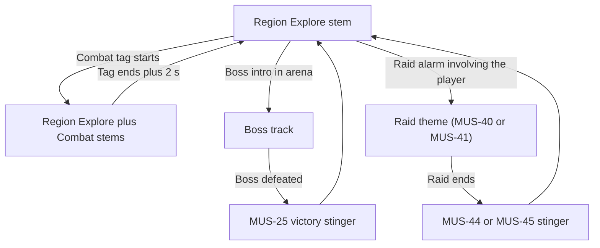

# Music Direction

Music for the hub, each region, the player base, combat, bosses, raids and PvP, plus the stingers for rarity reveals, ascension and raid outcomes (MUS-01 to MUS-49). Mixing rules are in [[Audio Mixing and Priority]]; sound identity in [[Sound Bible]].

> [!warning] UNDECIDED
> How music is sourced (original commission, licensed production library, or audio already available to Roblox creators) is **UNDECIDED** (Q-705). Whether the game uses any voice-over or announcer at launch is **UNDECIDED** (Q-706); this document assumes none. World layout is **UNDECIDED** ([[Open Questions#Q-001]]); region tracks follow [[Canonical Proposed Values]] §5.

> [!info] PROPOSED
> Everything else here is **PROPOSED**.

---

## 1. Musical identity

- **Warm adventure orchestra with playful folk colour:** pizzicato strings, woodwinds, marimba, glockenspiel, light hand percussion, brass for big moments, choir only for Mythical and Secret moments and the endgame.
- **Every region has its own instrument signature and key**, so players know where they are with their eyes closed.
- **Combat adds energy without changing the tune:** combat is a stem layered on the region track, not a separate song, so fights blend in and out seamlessly.
- **No horror, no meme, no licensed pop** ([[Sound Bible]] §1.1). Tension is adventurous (driving rhythm, brass swells), never frightening.
- **Rising sweeps are reserved for danger sound effects** ([[Sound - Bosses]]); music builds through harmony and rhythm, not through continuous pitch risers, so the telegraph language stays clear.

---

## 2. Stem system

| Element | Rule |
|---|---|
| Stems per region track | **Explore** (always on), **Combat** (percussion, bass and rhythmic strings), and on High tier an **Intensity** stem for big fights |
| Format | Stems of equal length, same tempo and key, seamless loops of 64–96 bars |
| Sync | Stems start together and stay locked; the music controller sets each stem's `TimePosition` from the master stem on start and checks drift every 8 bars (drift tolerance 20 ms, *unverified* on mobile) |
| Combat in | When the local player's combat tag starts: Combat stem fades in over 1 bar |
| Combat out | Combat tag ends (8 s) + 2 s: Combat stem fades out over 2 bars |
| Region change | Explore stems crossfade over 3 s at the region boundary, aligned to the next bar of the outgoing track where possible |
| Silence | After 2 full loops of a region track, the music rests for 45–90 s (ambience carries), then restarts; avoids fatigue |
| Voices | Music group: 2 stems on Low and Medium, 3 on High ([[Audio Mixing and Priority]] §2) |

---

## 3. Track register

### 3.1 Hub, base and regions

| ID | Track | Tempo (BPM) | Key | Signature instruments | Mood |
|---|---|---:|---|---|---|
| MUS-01 | [[Hub - Hatchling Haven]] theme | 96 | F major | Marimba, glockenspiel, light strings, whistle-like flute | Welcoming, curious; the main theme's home |
| MUS-02 | [[Region - Whisperwood Forest]] | 104 | G major | Acoustic guitar, recorder, pizzicato, hand drum | Bright first adventure |
| MUS-03 | [[Region - Sunscorch Savanna]] | 112 | D Mixolydian | Kalimba-like plucks, shakers, warm horns | Open, sunny, striding |
| MUS-04 | [[Region - Emerald Canopy]] | 100 | E minor (Dorian colour) | Marimba, wood blocks, layered flutes | Lush, rhythmic, a little mysterious |
| MUS-05 | [[Region - Coral Coast]] | 92 | A major | Steel-pan-like mallets, harp, soft strings | Breezy, sparkling |
| MUS-06 | [[Region - Frostfang Tundra]] | 84 | C minor | Celesta, glass harmonica-like pads, low strings | Crisp, spacious |
| MUS-07 | [[Region - Skyreach Peaks]] | 108 | B♭ major | French horns, alpine-style flutes, timpani rolls | Heroic altitude |
| MUS-08 | [[Region - Emberheart Caldera]] | 120 | D minor | Taiko-like drums, low brass, plucked bass | Bold, warm, adventurous (not menacing) |
| MUS-09 | [[Region - Starfall Sanctuary]] | 88 | E major (Lydian colour) | Choir, harp, music box, string pads | Wonder, endgame awe |
| MUS-10 | Own base theme | 90 | F major (hub theme variation) | Marimba, pizzicato, light percussion | "Home and building"; plays at the player's own base |

Each of MUS-02 to MUS-09 ships with Explore, Combat and Intensity stems. MUS-01 and MUS-10 have no Combat stem (no combat in the hub; base raids switch to raid music).

### 3.2 Bosses

| ID | Track | Structure | Notes |
|---|---|---|---|
| MUS-20 | Mini-boss theme | Phase 1 / Phase 2 stems + Intensity | One composition re-orchestrated per region (using that region's signature instruments and key), so eight mini-bosses share one theme family |
| MUS-21 | [[World Boss - Ironbark Colossus]] | Intro (4 s, aligned to ANI-320) → Phase 1 → Phase 2 → Phase 3 → Defeat outro | Deep woodwinds and log drums; slow, heavy groove |
| MUS-22 | [[World Boss - Thunderhoof]] | Same structure | Brass and rolling timpani; storm-like rhythm without thunder-crack hits |
| MUS-23 | [[World Boss - Abyssal Leviathan]] | Same structure | Low strings, choir, harp; wave-like 6/8 |
| MUS-24 | [[World Boss - Ashwing Condor]] | Same structure | Driving strings, horns, wind effects in the orchestration |
| MUS-25 | Boss victory stinger | 4.0 s | Plays on the boss defeat burst (ANI-334 f60); triumphant, then resolves into the region Explore stem |
| MUS-26 | World boss incoming motif | 4.0 s | Plays with the 2-minute spawn announcement (SFX-270) for players in the region |

Boss music rules:
- Region music crossfades to the boss track over 1.5 s when the boss intro starts for players within the arena.
- Phase changes switch stems on the next bar after the phase transition clip's f30 ([[Animation - Boss Attacks]]).
- During an ultimate telegraph the Intensity stem drops out for its duration, leaving a held chord, so the telegraph riser is the loudest element; it returns on the impact.
- Leaving the arena (leash or death): boss music fades over 3 s to the region track.

### 3.3 Raids and PvP

| ID | Track | Who hears it | Notes |
|---|---|---|---|
| MUS-40 | Raid — raider theme | The raider and raid allies | Sneaky-heroic: pizzicato and snare, building with each item secured |
| MUS-41 | Raid — defender theme | The defender (anywhere) and visitors at the base | Urgent but friendly: brass ostinato, quick strings |
| MUS-42 | Raid — final moments layer | Both sides | Added if the raid has a time limit near its end (duration **UNDECIDED**, [[Open Questions#Q-012]]); not produced until Q-012 is decided |
| MUS-44 | Raid success stinger | Raider only | 2.5 s, upbeat |
| MUS-45 | Raid repelled stinger | Defender only | 2.5 s, relieved and warm |
| MUS-30 | PvP encounter | Players in a PvP encounter | Optional layer over region music, activation method **UNDECIDED** ([[Open Questions#Q-011]]); a short percussive stem, not a separate track |

Raid music rules: the alarm start crossfades to the side's raid theme over 1.0 s; the raid end plays the outcome stinger, then returns to the region or base theme over 3 s. Raid music never plays for players who are not involved.

### 3.4 Stingers for rarity reveals

Stingers are 2D, play in the Stingers group (−4 dB), duck music by 12 dB, and never stack ([[Audio Mixing and Priority]] §4). Their harmony follows the rarity sound language in [[Sound - Eggs]] §1.

| ID | Rarity | Length | Orchestration | Used in |
|---|---|---:|---|---|
| MUS-31 | Common | 0.6 s | Marimba note with a soft string pad | Roll reveal, hatch edit (0.5 s), merge edit |
| MUS-32 | Uncommon | 0.9 s | Marimba and flute, rising second | Same |
| MUS-33 | Rare | 1.2 s | Glockenspiel arpeggio over strings | Same |
| MUS-34 | Epic | 1.6 s | Celesta, strings, suspended-fourth resolve | Same |
| MUS-35 | Legendary | 2.0 s | Brass fanfare, bell, timpani roll | Same |
| MUS-36 | Mythical | 2.8 s | Harp glissando, choir "ah", brass, added ninth | Same |
| MUS-37 | Secret | 3.5 s | Music box alone, then choir and full orchestra bloom on a Lydian chord | Same; during a Secret roll build the region music fades out entirely (the silence is part of the Secret build) |

**Honesty rule:** a stinger plays only at its own reveal moment. No stinger, or part of one, plays during a build ([[Animation - Egg Roll]], [[Randomised Reward Compliance]]).

### 3.5 Other stingers

| ID | Stinger | Length | Notes |
|---|---|---:|---|
| MUS-38 | Ascension fanfare A1–A4 | 2.0 s | In the animal's rarity harmony ([[Sound - Ascension]]) |
| MUS-39 | Ascension fanfare A5 | 3.5 s | Full orchestration with choir |
| MUS-46 | Region unlocked | 3.0 s | Quotes the new region's theme |
| MUS-47 | Rare wild spawn (Mythical or Secret) announcement | 3.0 s | Plays with SFX-146 for players in the region |
| MUS-48 | Player defeated | 2.0 s | Soft, gentle, encouraging (no "game over" sting) |

IDs MUS-11 to MUS-19, MUS-27 to MUS-29, MUS-43 and MUS-49 are reserved.

---

## 4. Priority between music sources

From highest to lowest: Stingers (temporary duck) → Raid theme → Boss track → PvP layer → Region track with Combat stem → Base theme → Hub theme. Only one "bed" (raid, boss, region, base or hub) plays at a time.

---

## 5. Mobile considerations

- Low and Medium tiers play 2 stems; the Intensity stem is High only.
- Tracks stream; stingers (short) are preloaded with the region.
- Music group EQ removes content below 60 Hz on Low tier.

## 6. Test hooks

| Test | Expected |
|---|---|
| Enter and leave combat 10 times in a minute | Combat stem fades on bar boundaries; no drift between stems beyond 20 ms after 10 minutes |
| Secret roll | Region music fades out during the build; MUS-37 at the reveal only |
| Defender in another region during a raid | Hears MUS-41; the raider hears MUS-40; bystanders hear neither |

---

## Related documents
- [[Sound Bible]]
- [[Audio Mixing and Priority]]
- [[Sound - Eggs]]
- [[Sound - Bosses]]
- [[Sound - Base and Raid Alerts]]
- [[Animation - Egg Roll]]
- [[Animation - Boss Attacks]]
- [[World Overview and Map]]
