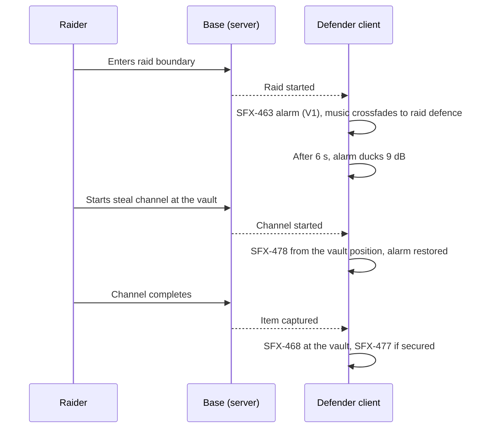

# Sound - Base and Raid Alerts

Base construction and defence props, shield life cycle, and every raid sound for raiders and defenders (SFX-440 to SFX-489). Animations: [[Animation - Base Upgrades]], [[Animation - Shield Activation]], [[Animation - Raid Interactions]].

> [!success] CONFIRMED
> Raids are optional; base eggs are stealable; backpack eggs never; defenders only after knock-out; at most three animals per successful raid; offline bases cannot be raided; shields and physical defences protect bases (D-021, D-024).

> [!warning] UNDECIDED
> Raid duration ([[Open Questions#Q-012]]), egg theft limit ([[Open Questions#Q-013]]), shield acquisition ([[Open Questions#Q-030]]) and whether captured items must be carried out (Q-704) are **UNDECIDED**. No sound here encodes a value for them.

> [!info] PROPOSED
> All sounds and rules are **PROPOSED**.

---

## 1. Alert principles

1. **The defender always knows.** The raid alarm reaches the defender wherever they are: in-world at the base (S3) and as a 2D notification away from it. Muting effects does not silence it fully ([[Audio Mixing and Priority]] §1).
2. **Direction for defenders.** Steal warnings are positional from the vault or pen being robbed, so a defender at the base can hear where to go.
3. **Fair to raiders.** Raiders hear defences acquire and fire with a clear tell; carrying an orb makes a hum others can hear within 30 studs.
4. **No gloating.** Success sounds are celebratory for the raider only; the victim hears neutral loss cues, never mocking ones.
5. **Not fatiguing.** The alarm loop ducks by 9 dB after 6 s and comes back on each new steal start.

---

## 2. Base construction and defence props

| ID | Sound | Purpose | Duration | Frequency | Priority | Spatial | Trigger | Variations | Reuse |
|---|---|---|---|---|---|---|---|---|---|
| SFX-440 | Construction start | Upgrade begins | 0.5 s | Wood and tool rattle | V2 | S2 | Beat 1 | 2 | Station builds |
| SFX-441 | Hammer hit | Build rhythm | 0.15 s | Wood knock 300 Hz–3 kHz | V3 | S2 | Each hammer beat | 4 (no repeat) | Timed build loop at −12 dB |
| SFX-442 | Scaffold clunks | Scaffold waves | 0.2 s | Wood clunk | V3 | S2 | Scaffold waves | 4 | — |
| SFX-443 | Upgrade complete L1 | Construction done | 0.8 s | Short chord | V2 | 2D for the owner, S2 for visitors | Show-off beat | 1 | — |
| SFX-444 | Upgrade complete L2 | | 0.9 s | Chord + bell | V2 | Same | Same | 1 | — |
| SFX-445 | Upgrade complete L3 | | 1.0 s | Fuller chord | V2 | Same | Same | 1 | — |
| SFX-446 | Upgrade complete L4 | | 1.1 s | Chord + brass | V2 | Same | Same | 1 | — |
| SFX-447 | Upgrade complete L5 | Max level | 1.5 s | Fanfare phrase | V2 | Same | Same | 1 | — |
| SFX-448 | Plot expansion | Land extends | 2.0 s | Earth roll + fence knocks | V2 | 2D owner / S2 | ANI-492 | 1 | — |
| SFX-449 | Upgrade refused | Not allowed | 0.3 s | Alias of SFX-399 with wood timbre | V2 | 2D | ANI-493 | 1 | — |
| SFX-450 | Turret scan | Idle servo loop (only while a raid is active or within 40 studs) | Loop | Soft whirr 500 Hz–2 kHz | V4 | S1 | Idle scan | 1 | — |
| SFX-451 | Turret acquire and fire | Tell then shot (berry pop, bubble, net) | 0.2 s acquire + 0.2 s fire | Beep-click then pop | V2 for the targeted raider / V3 | S2 | ANI-494 | 3 fire variants | — |
| SFX-452 | Barricade raise | Barrier rises | 0.8 s | Stone grind | V3 | S2 | ANI-495 | 2 | — |
| SFX-453 | Trap trigger | Trap snaps (sticky or net) | 0.4 s | Snap + splat or net whoosh | V2 | S1 | ANI-496 | 2 | — |
| SFX-454 | Trophy placed | Boss trophy added | 1.2 s | Chime + pedestal thunk | V2 | 2D owner | ANI-497 | 1 | — |

---

## 3. Shield

| ID | Sound | Purpose | Duration | Frequency | Priority | Spatial | Trigger | Variations | Reuse |
|---|---|---|---|---|---|---|---|---|---|
| SFX-455 | Generator spin-up | Shield starting | 1.0 s | Rising hum 100 Hz → 1 kHz (machine spin-up; distinct timbre from the danger riser) | V2 | S3 | ANI-500 | 1 | — |
| SFX-456 | Dome raise | Rings unfolding | 1.5 s | Ring ticks rising, lock "thoom" | V2 | S3 | ANI-501 | 1 | — |
| SFX-457 | Shield idle hum | Presence near the dome | Loop | Soft hum 200–800 Hz | V5 | S5 (`Linear`, Min 10, Max 60) | Idle | 1 | — |
| SFX-458 | Shield impact | Contact or projectile | 0.3 s | Glassy thrum 500 Hz–3 kHz | V3 | S2 | ANI-503 (max 4/s) | 3 | Guard hit at −3 dB |
| SFX-459 | Expiry tick | Last 10 s of a shield (owner and players within 40 studs) | 0.1 s | Glass tick | V2 owner / V3 | 2D owner, S2 others | ANI-504 | 1 | SFX-426 |
| SFX-460 | Collapse | Shield ends normally | 1.2 s | Descending chime, calm | V2 | S3 | ANI-505 | 1 | — |
| SFX-461 | Break | Shield broken (only if [[Shield Mechanics]] allows) | 1.0 s | Glass shatter (bright, not harsh) + whoosh | V1 | S3 | ANI-506 | 1 | — |
| SFX-462 | Raider repelled | Bounce off an active shield | 0.4 s | Rubbery boing + thrum | V2 | S1 | ANI-507 | 2 | — |

---

## 4. Raid

| ID | Sound | Purpose | Duration | Frequency | Priority | Spatial | Trigger | Variations | Reuse |
|---|---|---|---|---|---|---|---|---|---|
| SFX-463 | Raid alarm | Raid has started | 1.2 s start + 2.0 s loop | Two-tone siren 700 Hz / 1.1 kHz + bell, friendly not frightening | **V1** | S3 at the base; 2D for the defender anywhere | ANI-520, loop ANI-521 | 1 | — |
| SFX-464 | Raid notice (defender away) | The defender is not at the base | 1.0 s | Alarm motif on glass bells | **V1** | 2D | Raid start, defender off base | 1 | — |
| SFX-465 | Raider entry | Raider steps through the boundary | 0.8 s | Shimmer whoosh | V2 | S2 | ANI-522 | 1 | — |
| SFX-466 | Steal channel — egg | Channel loop; pitch rises in discrete steps with progress (25/50/75%) | Loop | Glassy hum 500 Hz–2 kHz | V2 | S2 | ANI-523 loop | 1 | — |
| SFX-467 | Steal channel — animal | Bubble-stretch loop with discrete pitch steps | Loop | Soft rubbery stretch 300 Hz–2 kHz | V2 | S2 | ANI-524 loop | 1 | — |
| SFX-468 | Egg capture | Orb forms around an egg | 0.4 s | Bubble pop + chime | V2 | S2 | ANI-525 | 1 | — |
| SFX-469 | Animal capture | Orb seals around a knocked-out defender (sleepy, gentle) | 0.6 s | Soft seal + lullaby-like two-note | V2 | S2 | ANI-526 | 1 | — |
| SFX-470 | Carry hum | A raider carrying an orb (option B of Q-704) | Loop | Quiet warble 400 Hz–1.5 kHz | V3 | S1 (Max 30) | ANI-527 | 1 | — |
| SFX-471 | Drop | Orb knocked loose | 0.4 s | Bounce plonks | V2 | S2 | ANI-528 | 2 | — |
| SFX-472 | Return | Orb flies home | 0.8 s | Whoosh + arrival pop | V2 | S2 | ANI-529 | 1 | — |
| SFX-473 | Secured (raider) | Item counts for the raider | 0.6 s | Bright chime | V2 | 2D raider | ANI-530 | 1 | — |
| SFX-474 | Channel interrupted | Steal cancelled | 0.3 s | Snap + falling tick | V2 | S2 | ANI-531 | 1 | — |
| SFX-475 | Raid success (raider) | End of a successful raid | 1.5 s | Upbeat phrase | V2 | 2D raider | Raid end | 1 | Music stinger MUS-44 |
| SFX-476 | Raid repelled (defender) | Defence held | 1.5 s | Warm relieved phrase | V2 | 2D defender | Raid end | 1 | Music stinger MUS-45 |
| SFX-477 | Item lost (defender) | An egg or animal was taken | 0.5 s | Neutral low two-note, not sad or mocking | V2 | 2D defender | Secure event | 1 | — |
| SFX-478 | Steal warning (defender) | A steal channel started on the defender's base | 0.6 s | Urgent glass motif | **V1** | S3 from the vault or pen (2D if the defender is away) | Channel start | 1 | — |
| SFX-479 | Steal cap reached (raider) | The raider has taken three animals (no more animal prompts) | 0.5 s | Neutral confirm | V2 | 2D raider | Third animal secured | 1 | — |
| SFX-480 | Guard alert | Guard animals notice the raider (layer under species call) | 0.3 s | Short alert ping | V3 | S2 | ANI-534 | 1 | — |
| SFX-481 | Sleeping dome hum | Offline base dome (recommendation in [[Animation - Shield Activation]]) | Loop | Very soft hum | V5 | S5 (Max 40) | Offline state | 1 | SFX-457 at −6 dB |

SFX-482 to SFX-489 are reserved.

---

## 5. Raid mix timeline (defender at the base)

## 6. Test hooks

| Test | Expected |
|---|---|
| Defender in another region when a raid starts | SFX-464 plays in 2D within 0.5 s of the server event |
| Defender at the base with SFX muted | Alarm audible at 30% of reference |
| Raider takes a third animal | SFX-479 plays; no further animal channel sounds possible |
| Raid succeeds | Raider hears SFX-475; defender hears only SFX-477 cues and the end summary, never SFX-475 |

---

## Related documents
- [[Animation - Raid Interactions]]
- [[Animation - Shield Activation]]
- [[Animation - Base Upgrades]]
- [[Base Raiding System]]
- [[Raid Lifecycle and States]]
- [[Shield Mechanics]]
- [[Sound Bible]]
- [[Audio Mixing and Priority]]
- [[Music Direction]]
- [[UI - Raid Interface]]
