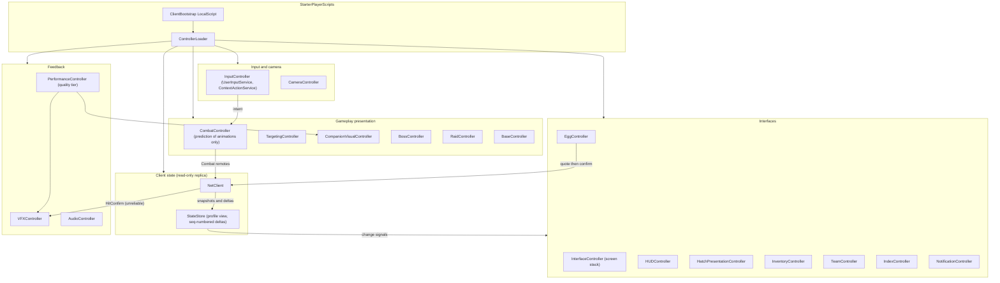
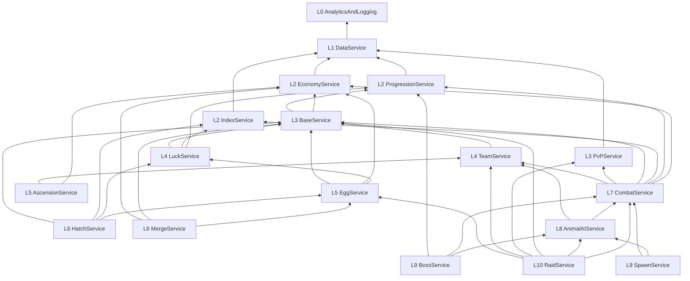
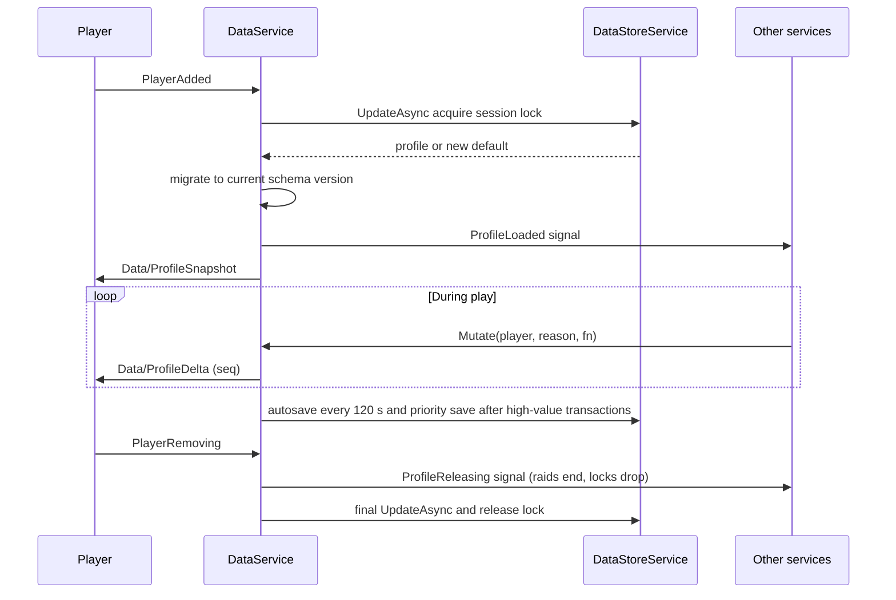

# Architecture Overview

The one-page picture of how *Fight Animals for Eggs* is built on Roblox. It shows the server, the client, how the 18 services depend on each other and how data flows through the core loop ([[Core Gameplay Loop]], D-002). Detail lives in the linked pages; this page is the map.

> [!success] CONFIRMED constraints the architecture must enforce
> Team of exactly **3** (D-006), team changes only at the player's own base (D-010), hatch up to **5** at once (D-016), two-stage randomness (D-015), odds disclosed before commit and never silently changed (D-017), independent hatches (D-018), storage Backpack **10** + Base **50** = **60** with backpack eggs never stealable (D-021), max **3** animals stolen per successful raid, KO-before-steal and no raids on offline bases (D-024), merge **3 → 1** (D-020).

> [!info] PROPOSED
> The architecture itself (service split, layering, remote patterns, budgets) is **PROPOSED**. It is designed so that every **UNDECIDED** value (raid duration Q-012, egg theft limit Q-013, PvP activation Q-011, defeat penalties Q-014, boss rewards Q-015, storage expansion Q-009/Q-010) is a configuration hook, not a code change.

## 1. Architectural style

| Aspect | Choice (**PROPOSED**) | Rationale |
|---|---|---|
| Authority | Server-authoritative for every outcome; client sends intent | Exploit resistance ([[Security Architecture]], [[Threat Model]]) |
| Server structure | 18 domain services in 11 dependency layers + stateless systems | Clear ownership, testable, no cycles ([[Service Architecture]]) |
| Client structure | Controllers mirroring services + a read-only client state store | UI never computes outcomes ([[Client Controllers]]) |
| Persistence | One profile per player in DataStoreService, session-locked, autosaved, with priority saves after high-value transactions | [[Service - DataService]], [[Save, Load and Recovery]] |
| Networking | Request/response through client-to-server RemoteFunctions with strict validation and server-issued quote IDs; server pushes state via RemoteEvents; cosmetic high-rate data via UnreliableRemoteEvent; **no server-to-client RemoteFunction** | [[Remote Communication Contract]] |
| World | One shared world per server, StreamingEnabled, server-owned AI entities with level-of-detail ticking | [[Performance Guidelines]], [[Shared World and Player Sessions]] |
| Raids | Same-server only (defender must be online and in the same server, which follows from the offline protection rule) | Both profiles are in memory, so theft is an in-memory atomic transfer. See [[Service - RaidService]] |

## 2. Server architecture

```mermaid
flowchart TB
    subgraph Platform["Roblox platform services"]
        DSS["DataStoreService"]
        MPS["MarketplaceService"]
        PS["PolicyService"]
        AS["AnalyticsService"]
        PFS["PathfindingService"]
        CS["CollectionService"]
    end

    subgraph Boot["ServerScriptService"]
        BOOT["Bootstrap Script"] --> LOADER["Systems/ServiceLoader"]
        NET["Systems/Net (remotes, gate)"]
    end

    subgraph Core["Core services (layers 0 to 4)"]
        LOG["AnalyticsAndLoggingService"]
        DATA["DataService"]
        ECO["EconomyService"]
        PROG["ProgressionService"]
        IDX["IndexService"]
        BASE["BaseService"]
        PVP["PvPService"]
        LUCK["LuckService"]
        TEAM["TeamService"]
    end

    subgraph Eggs["Egg services (layers 5 to 6)"]
        EGG["EggService"]
        HATCH["HatchService"]
        MERGE["MergeService"]
        ASC["AscensionService"]
    end

    subgraph World["World and combat (layers 7 to 10)"]
        COMBAT["CombatService"]
        AI["AnimalAIService"]
        SPAWN["SpawnService"]
        BOSS["BossService"]
        RAID["RaidService"]
    end

    subgraph Systems["Systems (stateless helpers)"]
        WR["WeightedRandom"]
        DMG["DamagePipeline"]
        LEDGER["AnimalLedger"]
        LOCKS["AssetLocks"]
        QUOTES["QuoteStore"]
        ZONES["ZoneQuery"]
    end

    LOADER --> Core
    LOADER --> Eggs
    LOADER --> World
    NET --> Eggs
    NET --> World
    NET --> Core
    DATA --> DSS
    ECO --> MPS
    EGG --> PS
    LOG --> AS
    AI --> PFS
    SPAWN --> CS
    HATCH --> WR
    EGG --> WR
    COMBAT --> DMG
    HATCH --> LEDGER
    ASC --> LEDGER
    RAID --> LEDGER
    RAID --> LOCKS
    LUCK --> QUOTES
    BASE --> ZONES
```

## 3. Client architecture

The client **never** writes to `StateStore` except from server messages. Controllers that want an outcome (a roll, a hatch, a merge) ask the server and render the answer. See [[Client Controllers]].

## 4. Service dependency graph

Arrows point from a service to the services it calls. Lower layers never call upwards; upward communication is by signal ([[Service Architecture#4. Dependency layers]]). Every service also depends on DataService and AnalyticsAndLoggingService; those edges are omitted except where they are the only dependency.

| Signal (upward notification) | Fired by | Consumed by |
|---|---|---|
| `ProfileLoaded`, `ProfileReleasing` | DataService | Every service with per-player state |
| `LevelChanged`, `RegionUnlocked`, `BossFirstDefeat` | ProgressionService | LuckService (PS), CombatService (player stats) |
| `SpeciesDiscovered`, `SpeciesOwned` | IndexService | LuckService (PS) |
| `ModuleLevelChanged`, `AtBaseChanged` | BaseService | LuckService (PS), TeamService (lock), CombatService (bonuses) |
| `TeamChanged`, `TeamLockChanged` | TeamService | AnimalAIService (companions) |
| `EntityDamaged`, `EntityKnockedOut`, `EntityDefeated` | CombatService | AnimalAIService, SpawnService, BossService, RaidService |
| `OddsInvalidated` | LuckService | EggService, HatchService (drop open quotes) |

## 5. Core data flow

The core loop from defeating a wild animal to equipping a hatched animal. Every box marked *server* is authoritative.

```mermaid
flowchart LR
    A["Player and team attack wild animal (client intent)"] --> B["CombatService validates and applies damage (server)"]
    B --> C{"Target HP reaches 0"}
    C -- "yes" --> D["Kill credit: every contributor with at least 10 percent damage in the combat-tag window (server)"]
    D --> E["EconomyService.Credit cash = base x region x bonuses (server)"]
    D --> F["ProgressionService.AddXP (server)"]
    D --> G["IndexService.RegisterDiscovery (server)"]
    F --> H["LuckService recomputes Progression Score, bumps oddsVersion (server)"]
    G --> H
    E --> I["Client opens Egg Rolling UI"]
    I --> J["Eggs/GetRollQuote returns odds, price, quoteId, oddsVersion (server)"]
    H -. "invalidates open quotes" .-> J
    J --> K["Player confirms"]
    K --> L["Eggs/RequestRoll: debit and rarity roll in one commit (server)"]
    L --> M["Egg stored in backpack or base (server)"]
    M --> N["Hatch/GetHatchQuote for up to 5 eggs (server)"]
    N --> O["Hatch/RequestHatch: consume eggs, pick species per egg independently (server)"]
    O --> P["AnimalLedger adds animals, IndexService marks owned (server)"]
    P --> Q["At own base: Team/SetTeam with exactly 3 slots (server)"]
    Q --> R["AnimalAIService spawns companions (server)"]
    R --> A
    P --> S["Duplicates feed AscensionService (server)"]
    M --> T["Three same-rarity eggs feed MergeService at the base (server)"]
```

### Persistence flow

## 6. Cross-cutting concerns

| Concern | Owner page |
|---|---|
| Remote validation and rate limits | [[Remote Communication Contract]], [[Implementation - Remote Validation Layer]], [[Implementation - Rate Limiting]] |
| Transactions and atomicity | [[Data Consistency and Transactions]], [[Service Architecture#7. Transactions]] |
| Replication and network ownership | [[Replication Strategy]], [[Network Ownership]] |
| Latency and prediction | [[Latency Handling]] |
| Disconnects | [[Disconnect Handling]], [[Raid Disconnection Handling]] |
| Logging, errors, analytics | [[Logging and Error Handling]] |
| Performance budgets | [[Performance Guidelines]], [[Animal Scalability and Performance Budgets]] |
| Randomness | [[Implementation - Weighted Random Selection]], [[Independent Random Outcomes]] |
| Compliance of random rewards | [[Randomised Reward Compliance]], [[Roblox Monetisation Policy Requirements]] |

## 7. Build order

The service layers map onto the milestones: DataService, Logging and Net in [[M02 - Core Project Setup]]; CombatService in [[M04 - Player Combat]]; AnimalAIService and SpawnService in [[M05 - Animal AI]]; TeamService in [[M06 - Animal Combat]]; IndexService in [[M07 - Animal Collection]]; EggService and LuckService in [[M08 - Egg Rolling]]; HatchService in [[M09 - Hatching]]; AscensionService in [[M10 - Ascension]]; MergeService in [[M11 - Egg Merging]]; BaseService in [[M12 - Player Bases]] and [[M13 - Base Upgrades]]; RaidService and PvPService in [[M15 - Base Raids]]; BossService in [[M17 - Boss Encounters]].

## Related documents
- [[Technical Architecture Index]]
- [[Service Architecture]]
- [[Roblox Project Hierarchy]]
- [[Server-Client Responsibilities]]
- [[Remote Communication Contract]]
- [[Client Controllers]]
- [[Multiplayer Architecture]]
- [[Data Architecture Overview]]
- [[Security Architecture]]
