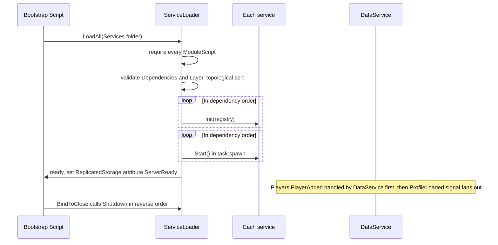

# Service Architecture

> [!info] PROPOSED
> Everything on this page is a **PROPOSED** engineering standard. No code here has been run in Roblox Studio. Code is illustrative Luau with type annotations.

This page defines **how a server service is built**: its module shape, lifecycle, dependency rules, signals, transactions, configuration and feature flags. The list of services and what each owns is in [[Architecture Overview]]. Folder placement is in [[Roblox Project Hierarchy]]. Coding style (naming, `--!strict`, formatting) is in [[Luau Coding Standards]], and the generic loader implementation is in [[Module Patterns and Bootstrapping]].

## 1. Principles

| # | Principle | Consequence |
|---:|---|---|
| 1 | **The server owns every outcome.** | Cash, egg rolls, hatch results, ownership, ascension, merging, capacity, damage, raid eligibility, theft and progression are computed only in services. Clients send *intent*. See [[Server-Client Responsibilities]]. |
| 2 | **One owner per piece of state.** | Each profile field has exactly one writing service (table in §6). Other services read through that owner's API. |
| 3 | **Acyclic dependencies.** | Services form layers. A service may call only services in lower layers. Upward communication uses signals. |
| 4 | **Transactions do not yield.** | Validation may yield (for example, reading a quote). The mutation block that changes profile data never yields, so it is atomic on Roblox's single-threaded Luau scheduler. See [[Data Consistency and Transactions]]. |
| 5 | **Configuration is data.** | Every number lives in `ReplicatedStorage/Config` (or `ServerScriptService/Data/ServerConfig` when secret) and mirrors [[Canonical Proposed Values]]. See [[Configuration Modules]]. |
| 6 | **Undecided means disabled.** | A feature whose key value is **UNDECIDED** (for example raid duration, [[Open Questions#Q-012]]) ships with that config value set to `nil`, and the service refuses to start the feature while it is `nil`. Nobody may "temporarily" hard-code a value. |

## 2. Module shape

Every service is one ModuleScript in `ServerScriptService/Services` that returns a table with a fixed shape.

```lua
--!strict
-- Illustrative Luau. Not tested.
export type Registry = {
	Get: (self: Registry, name: string) -> any,
}

export type Service = {
	Name: string,
	Layer: number,                -- see §4
	Dependencies: { string },     -- hard dependencies (may call their APIs)
	Init: (self: any, registry: Registry) -> (),   -- must not yield
	Start: (self: any) -> (),                       -- may spawn loops
	Shutdown: ((self: any) -> ())?,                 -- called from game:BindToClose
}
```

A minimal service:

```lua
--!strict
local Signal = require(game:GetService("ReplicatedStorage").Shared.Signal)

local IndexService = {
	Name = "IndexService",
	Layer = 2,
	Dependencies = { "AnalyticsAndLoggingService", "DataService" },
}

local Data, Log

IndexService.SpeciesDiscovered = Signal.new() -- (player: Player, speciesId: string)

function IndexService:Init(registry)
	Data = registry:Get("DataService")
	Log = registry:Get("AnalyticsAndLoggingService"):Scope("Index")
end

function IndexService:Start()
	-- connect remotes and signals here, never in Init
end

return IndexService
```

## 3. Lifecycle



| Phase | Allowed | Forbidden |
|---|---|---|
| `Init` | Caching references to dependencies, creating Signals, reading config, building lookup tables | Yielding, connecting remotes, touching players, reading DataStores |
| `Start` | Connecting remotes, connecting `PlayerAdded`, starting `RunService.Heartbeat` loops, spawning threads | Calling a service that is not in `Dependencies` |
| `Shutdown` | Flushing state, ending raids safely, final saves (DataService last) | Starting new work |

Rules:
- A service that errors in `Init` stops the boot. The loader logs `BOOT_FAILED` with the service name and the server refuses to mark itself ready. In live servers this is caught by [[Logging and Error Handling]] alerts.
- A service that errors in `Start` is logged; the loader continues so unrelated features still work, but `FeatureFlags` for that service are forced off.
- `Players.PlayerAdded` may fire before `Start` finishes. Every service that handles players also iterates `Players:GetPlayers()` once at the end of `Start`.

## 4. Dependency layers

Lower layers never call higher layers. The full graph is drawn in [[Architecture Overview#4. Service dependency graph]].

| Layer | Services | Notes |
|---:|---|---|
| 0 | [[Service - AnalyticsAndLoggingService]] | Everything may log |
| 1 | [[Service - DataService]] | Profiles, session locks, replication of the owner's data |
| 2 | [[Service - EconomyService]], [[Service - ProgressionService]], [[Service - IndexService]] | Ledgers of cash, XP and level, discoveries |
| 3 | [[Service - BaseService]], [[Service - PvPService]] | Plot, modules, at-base detection, shields; PvP and raid participation state |
| 4 | [[Service - LuckService]], [[Service - TeamService]] | Odds and tokens; team slots and base lock |
| 5 | [[Service - EggService]], [[Service - AscensionService]] | Egg inventory and rolls; ascension |
| 6 | [[Service - HatchService]], [[Service - MergeService]] | Need EggService |
| 7 | [[Service - CombatService]] | Entities, damage, kill credit, reward dispatch |
| 8 | [[Service - AnimalAIService]] | Wild, companion and guard AI |
| 9 | [[Service - SpawnService]], [[Service - BossService]] | World population and boss encounters |
| 10 | [[Service - RaidService]] | Orchestrates base, combat, AI, eggs, team and data |

Resolving the common cycles:
- **Cash multipliers.** EconomyService is a pure ledger. The reward amount (base × region × bonuses) is computed by CombatService's reward dispatcher, which reads BaseService bonuses and then calls `EconomyService:Credit`.
- **Companion spawning.** TeamService (layer 4) does not know about AI. AnimalAIService (layer 8) subscribes to `TeamService.TeamChanged` and `Player.CharacterAdded` and spawns companions.
- **Asset locks.** Several services must know whether an animal or egg is "busy" (being stolen, being consumed, equipped). This lives in `ServerScriptService/Systems/AssetLocks`, a dependency-free system module (§7), not in a service.

## 5. Signals versus remotes

| Mechanism | Use | Example |
|---|---|---|
| `Shared/Signal` (pure Luau signal class) | Server-to-server events between services; client-to-client events between controllers | `CombatService.EntityDefeated:Connect(...)` |
| `RemoteEvent` / `RemoteFunction` / `UnreliableRemoteEvent` | Client ↔ server only, through the `Net` system module | See [[Remote Communication Contract]] |
| `BindableEvent` | **Not used** between services | Bindables deep-copy tables and strip metatables, which is wasteful and loses type information |

Signals fire synchronously in connection order. A handler that needs to yield must `task.spawn` its own work. Handlers must never throw; the Signal class wraps each handler in `xpcall` and reports failures to the logger.

## 6. State ownership

| Profile area | Writing service | Schema |
|---|---|---|
| Cash balance, lifetime earned and spent | EconomyService | [[Schema - Economy]] |
| Level, XP, region unlocks, boss defeats | ProgressionService | [[Schema - Player Progression]], [[Schema - Unlocks and Boss Progress]] |
| Discovered and owned species | IndexService | [[Schema - Discovery Index]] |
| Owned animals (instances, ascension level, variant) | HatchService (create), AscensionService (level, consume), RaidService (transfer) through `Systems/AnimalLedger` | [[Schema - Animal Collection]] |
| Eggs and storage capacity | EggService (MergeService, HatchService and RaidService call EggService APIs) | [[Schema - Egg Inventory]] |
| Team slots | TeamService | [[Schema - Equipped Team]] |
| Base modules, plot stage, station level, shields | BaseService | [[Schema - Base Data]] |
| PvP and raid preferences | PvPService | [[Schema - Player Profile]] |

`Systems/AnimalLedger` is the only code that inserts or deletes animal records. It is called by three services, each of which is responsible for validating its own preconditions first. This keeps the ownership rule ("one writer") enforceable by code review: grep for `AnimalLedger.` and every call site must be in one of those three services.

## 7. Transactions

All multi-step mutations follow the same five steps. Implementation detail lives in [[Implementation - Ascension Transaction]], [[Implementation - Egg Merge Transaction]] and [[Implementation - Egg Roll and Hatch Flow]].

1. **Gate**: rate limit and payload shape ([[Implementation - Remote Validation Layer]], [[Implementation - Rate Limiting]]).
2. **Load**: get the loaded profile; reject with `E_NOT_READY` if absent.
3. **Validate**: every precondition, using only server state. May read quotes and locks.
4. **Commit**: one non-yielding block inside `DataService:Mutate`. If any assertion fails inside, the mutation function returns `false` and DataService restores the declared sections (see [[Service - DataService#Mutation model]]).
5. **Publish**: fire signals, send the client response, log analytics, and request a priority save where the transaction is high-value.

```lua
--!strict
-- Illustrative Luau: the shape every transactional handler follows.
local function handleMerge(player: Player, payload: unknown): Result<MergeResult>
	local gate = Validation.gate(player, "Merge/RequestMerge", payload, MergePayloadSchema)
	if not gate.ok then return gate end

	local profile = Data:GetProfile(player)
	if not profile then return Err("E_NOT_READY") end

	local check = validateMerge(player, profile, gate.data) -- may read AssetLocks, BaseService
	if not check.ok then return check end

	local output
	local committed = Data:Mutate(player, "merge", { "eggs", "economy" }, function(p)
		-- no yields in here
		if not Eggs:RemoveEggs(p, check.inputIds) then return false end
		if not Economy:DebitInProfile(p, check.fee, "MergeFee") then return false end
		output = Eggs:AddEgg(p, check.outputRarity, "Base", "Merge")
		return output ~= nil
	end)
	if not committed then return Err("E_INTERNAL") end

	MergeService.EggsMerged:Fire(player, check.inputRarity, output)
	Log:Event("egg_merged", player, { from = check.inputRarity, fee = check.fee })
	return Ok(output)
end
```

> [!danger] Never split a commit
> Debiting cash in one `Mutate` call and granting the item in another creates a window in which a server crash, `PlayerRemoving` or a thrown error leaves the player charged without the item. Every exchange is one `Mutate` call.

## 8. Shared result and error type

Every client-facing API returns a `Result`. Codes are listed in [[Logging and Error Handling#Player-facing error codes]].

```lua
--!strict
export type ErrorCode = string -- one of the codes in Logging and Error Handling
export type Result<T> = { ok: true, data: T } | { ok: false, code: ErrorCode, detail: string? }
```

`detail` is for server logs only and is stripped by `Net` before a response crosses to the client.

## 9. Configuration and feature flags

```lua
--!strict
-- ReplicatedStorage/Config/FeatureFlags (illustrative)
return {
	Raids = false,          -- stays false until Q-012 and Q-013 are answered and set in RaidConfig
	PvP = false,            -- stays false until Q-011 is answered
	StorageExpansion = false, -- stays false until Q-009 and Q-010 are answered
	EggMerging = true,
	WorldBosses = true,
}
```

| Rule | Detail |
|---|---|
| Server reads flags at boot and on a live-config refresh | Live refresh source is described in [[Configuration Modules]] |
| A flag cannot enable a feature whose required config is `nil` | The owning service logs `CONFIG_INCOMPLETE` and keeps the feature off |
| Clients receive flags for UI only | A client that ignores a flag gains nothing because the server re-checks |

## 10. Service checklist (definition of done)

Use [[Template - Technical Service]] for new services. A service is not done until:

- [ ] It declares `Name`, `Layer`, `Dependencies`, and only calls declared dependencies.
- [ ] Every remote it owns appears in [[Remote Communication Contract]] with schema and rate limit.
- [ ] Every outcome it decides is listed in [[Server-Client Responsibilities]].
- [ ] All mutations go through `DataService:Mutate`.
- [ ] It emits the analytics events listed in its own page and in [[Logging and Error Handling]].
- [ ] It has unit tests for validation, and at least one exploit test from [[Test Cases - Exploit Prevention]].
- [ ] Its Heartbeat work fits the budget in [[Performance Guidelines#Server frame budget]].

## Related documents
- [[Technical Architecture Index]]
- [[Architecture Overview]]
- [[Roblox Project Hierarchy]]
- [[Module Patterns and Bootstrapping]]
- [[Luau Coding Standards]]
- [[Configuration Modules]]
- [[Data Consistency and Transactions]]
- [[Template - Technical Service]]
- [[Definition of Done]]
