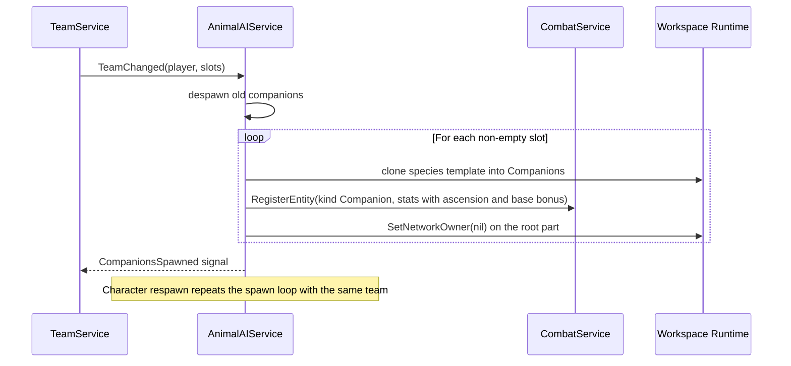

# Service - AnimalAIService

> [!info] PROPOSED
> Layer **8**. Design is **PROPOSED**; code is illustrative Luau, not tested. Behaviour design: [[Wild Animal AI]], [[Animal Combat Behaviour]], [[Targeting and Command System]], [[Animal Guards and Base Defence AI]]. State machine implementation: [[Implementation - Animal AI State Machine]]. Budgets: [[Performance Guidelines#AI tick rates and level of detail]].

> [!success] CONFIRMED rules enforced here
> Animals auto-target nearby enemies and players can issue manual target commands (D-009). Abilities can be manual or automatic (D-008). Exactly three companions per player (D-006).

## Responsibility

- Run the AI for every non-player combat entity: **companions**, **wild animals**, **raid guards** and **boss adds** (bosses themselves are driven by [[Service - BossService]] using this service's scheduler).
- Spawn and despawn the player's three companions from `ServerStorage/AnimalTemplates` when the team changes or the character respawns.
- Schedule AI ticks by level-of-detail tier within the 4 ms frame budget.
- Queue and rate-limit `PathfindingService` requests (8 per second per server).
- Execute **automatic** abilities on companions and **manual** abilities when CombatService forwards a validated `UseAnimalAbility`.
- Apply manual target commands (Attack, Follow, Hold) to the owner's companions.
- Enforce the wild-animal leash (60 studs from spawn, then reset to full HP).
- Set server network ownership on every AI assembly (`BasePart:SetNetworkOwner(nil)`).

## Inputs

| Input | Source |
|---|---|
| `TeamService.TeamChanged`, `Player.CharacterAdded` | TeamService, Roblox |
| `SpawnWild(spec)` | SpawnService |
| `SpawnGuards(raid, animals)` | RaidService |
| `CombatService.EntityDamaged` / `EntityKnockedOut` / `EntityDefeated` | CombatService (aggro, state changes) |
| Validated manual abilities and target commands | CombatService |

## Outputs

| Output | Consumer |
|---|---|
| `CombatService:RequestAttack` calls | CombatService |
| Models in `Workspace/Runtime/{Companions, WildAnimals, Guards}` | Clients (replication) |
| Animation state attribute `AIState` on models (for client animation selection) | `CompanionVisualController`, `EntityPresentationController` |
| `WildReset(entity)` signal (after leash) | SpawnService |

## Dependencies

[[Service - CombatService]], [[Service - TeamService]], [[Service - DataService]], [[Service - AnalyticsAndLoggingService]]. Roblox: `PathfindingService`, `RunService.Heartbeat`, `CollectionService`.

## Events

| Kind | Name | Payload |
|---|---|---|
| Signal | `CompanionsSpawned` | `(player: Player, entities: { CombatEntity })` |
| Signal | `WildReset` | `(entity: CombatEntity)` |
| Signal | `TierChanged` | `(entity: CombatEntity, tier: LodTier)` (debug only) |
| Remotes | None owned directly | Manual commands arrive via `Combat/UseAnimalAbility` and `Combat/CommandTarget` |

## Data structures

```lua
--!strict
export type LodTier = "Active" | "Near" | "Far" | "Dormant"
export type AIRole = "Companion" | "Wild" | "Guard" | "BossAdd"
export type AIStateName = "Idle" | "Wander" | "Follow" | "Alert" | "Chase" | "Attack"
	| "Ability" | "Return" | "Hold" | "Guard" | "KnockedOut"

export type Command = { mode: "Attack" | "Follow" | "Hold", targetId: string?, issuedAt: number }

export type AIAgent = {
	entity: CombatEntity,       -- from CombatService
	role: AIRole,
	state: AIStateName,
	tier: LodTier,
	phase: number,              -- 0..5 frame offset for staggering
	nextTickAt: number,
	targetId: string?,
	command: Command?,          -- companions only
	home: Vector3,              -- spawn point (wild) or guard post
	path: { Vector3 }?,
	pathRequestPending: boolean,
	abilities: { { id: string, manual: boolean, readyAt: number } },
}
```

**PROPOSED values introduced here** (add to [[Canonical Proposed Values]]):

| Value | Proposal |
|---|---|
| Companion auto-target radius | 30 studs around the owner |
| Companion follow distance | 6 to 10 studs behind the owner, formation by slot |
| Companion teleport-to-owner | If more than 80 studs from the owner for 3 s |
| Manual Attack command duration | Until the target is defeated, leashes or becomes invalid, a new command arrives, or 8 s pass ([[Targeting and Command System]]) |
| LOD radii | Active ≤ 80 studs (or in combat), Near ≤ 200, Far ≤ 400, Dormant beyond |
| Tick rates | 10 / 4 / 1 / 0 Hz |
| Pathfinding budget | 8 `ComputeAsync` per second per server, FIFO queue, companions first |

## Public API

```lua
--!strict
function AnimalAIService:SpawnWild(spec: { speciesId: string, regionId: string, spawnPoint: BasePart, rarity: string }): AIAgent
function AnimalAIService:SpawnGuards(raidId: string, defender: Player, animalIds: { string }, posts: { CFrame }): { AIAgent }
function AnimalAIService:Despawn(entityId: string): ()

function AnimalAIService:IssueCommand(owner: Player, command: Command): ()           -- called by CombatService after validation
function AnimalAIService:CastManualAbility(owner: Player, slot: number, targetId: string?): boolean

function AnimalAIService:GetAgent(entityId: string): AIAgent?
function AnimalAIService:GetTierCounts(): { [LodTier]: number }                       -- for metrics
```

## Scheduler

```lua
--!strict
-- Illustrative Luau, not tested. One Heartbeat connection for all AI.
local BUDGET_SECONDS = 0.004

RunService.Heartbeat:Connect(function()
	debug.profilebegin("AnimalAI")
	local started = os.clock()
	local now = workspace:GetServerTimeNow()

	reassignTiersIfDue(now)                 -- every 0.5 s, nearest-player distance per agent

	for _, agent in activeQueue:iterateDue(now) do
		tickAgent(agent, now)               -- state machine step
		agent.nextTickAt = now + TICK_INTERVAL[agent.tier]
		if os.clock() - started > BUDGET_SECONDS then
			Metrics.budgetOverruns += 1     -- remaining agents tick next frame
			break
		end
	end

	PathQueue.pump(now)                     -- at most 8 ComputeAsync per second, in task.spawn
	debug.profileend()
end)
```

If `budgetOverruns` exceeds 30 per minute, the scheduler widens Near and Far intervals by 50% and logs `ai.degraded`; Active combat ticks are never slowed below 10 Hz for companions, bosses and guards.

## Companion lifecycle



Because the team only changes at the base (D-010), companion respawns away from the base always reuse the locked team.

## Movement technique

> [!warning] UNDECIDED (Q-809)
> Physics-driven, server-owned assemblies versus server-moved anchored models. Both must be prototyped in [[M05 - Animal AI]] and measured. See [[Performance Guidelines#AI tick rates and level of detail]] and [[Network Ownership]].

Either way, AI models use `AnimationController` plus `Animator` (no `Humanoid`) unless a prototype shows Humanoid locomotion is cheaper overall (*unverified*; measure).

## Error handling

| Case | Behaviour |
|---|---|
| Template missing for a species | Log `Error` `ai.template_missing`; spawn nothing; SpawnService marks the point faulty for 5 min |
| Path computation fails or `NoPath` | Fall back to direct steering; after 3 failures return to home |
| Agent stuck (moved < 1 stud in 3 s while chasing) | Return to home; if still stuck, teleport to home |
| Owner leaves | Despawn companions in the same frame as `ProfileReleasing` |
| State machine error | Agent reset to `Idle`; `Error` log with agent ID and state |

## Security requirements

- AI assemblies are always server-owned, so clients cannot move or fling animals.
- Manual commands and abilities only arrive through CombatService after rate limiting and validation; this service trusts nothing from the client directly.
- Companion stats are read from the profile (ascension, species) at spawn, never from client data.
- Guards spawned for a raid are flagged with `raidId` so theft eligibility can be checked ([[Service - RaidService]]).

## Testing requirements

| Test | Type |
|---|---|
| Tier assignment matches distance thresholds | Unit |
| 240 agents: AI work ≤ 4 ms average, ≤ 8 ms p99 | Load test |
| Never more than 60 wild agents in Active tier | Load test |
| Leash: wild animal dragged 61 studs resets to full HP and returns home | Unit, [[Test Cases - Animal AI]] |
| Companion auto-targets the nearest hostile within 30 studs; manual Attack overrides it | Unit |
| Character respawn away from base spawns the same 3 companions | Integration |
| A client calling `SetNetworkOwner`-style physics exploits cannot move a companion (server-owned) | Exploit test |

## Related documents
- [[Technical Architecture Index]]
- [[Wild Animal AI]]
- [[Animal Combat Behaviour]]
- [[Targeting and Command System]]
- [[Implementation - Animal AI State Machine]]
- [[Animal Scalability and Performance Budgets]]
- [[Network Ownership]]
- [[Service - SpawnService]]
- [[Test Cases - Animal AI]]
