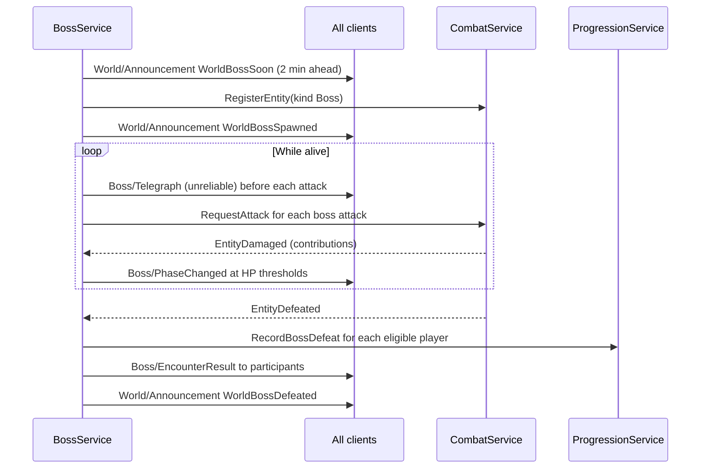

# Service - BossService

> [!info] PROPOSED
> Layer **9**. Design is **PROPOSED**; code is illustrative Luau, not tested. Design: [[Boss Design Overview]], [[Boss AI]], the individual boss pages (for example [[Mini-Boss - Bramblehorn]] and [[World Boss - Thunderhoof]]). Schedules: [[Canonical Proposed Values#5. Regions (PROPOSED — world layout is UNDECIDED, Q-001)]].

> [!success] CONFIRMED rule (D-012)
> Mini-bosses and world bosses exist.

> [!warning] UNDECIDED: boss rewards ([[Open Questions#Q-015]])
> No reward is granted by code until the owner decides. BossService exposes a `RewardResolver` hook that is `nil` by default; it still records defeats (which feed progression, region unlocks and the Progression Score) and reward **eligibility**.

## Responsibility

- Spawn mini-bosses (one per region, 10 min respawn per server) and run the world boss schedule (Ironbark Colossus every 45 min, Thunderhoof 50, Abyssal Leviathan 55, Ashwing Condor 60; announced 2 min ahead).
- Drive boss behaviour (phases, telegraphed attacks, adds) using AnimalAIService's scheduler and CombatService's damage pipeline.
- Track per-player contribution and decide **reward eligibility once per player per spawn**.
- Record unique boss defeats with ProgressionService.
- Reset a boss that has been abandoned.

## Inputs

| Input | Source |
|---|---|
| `BossSpawn` markers (attributes `BossId`, `Kind`, `ArenaRadius`) | Workspace |
| Boss definitions (HP, phases, attacks) | `BossConfig` and server config |
| `CombatService.EntityDamaged`, `EntityDefeated` | CombatService |
| Scheduler slots | [[Service - AnimalAIService]] |

## Outputs

| Output | Consumer |
|---|---|
| `World/Announcement` (`WorldBossSoon`, `WorldBossSpawned`, `WorldBossDefeated`) | All clients |
| `Boss/PhaseChanged`, `Boss/Telegraph`, `Boss/EncounterResult` | Clients |
| `ProgressionService:RecordBossDefeat(player, bossId, kind)` | ProgressionService |
| `BossDefeated(bossId, eligiblePlayers)` signal | Analytics, future reward module |

## Dependencies

[[Service - CombatService]], [[Service - AnimalAIService]], [[Service - ProgressionService]], [[Service - DataService]], [[Service - AnalyticsAndLoggingService]].

## Events

| Kind | Name | Payload |
|---|---|---|
| Signal | `BossSpawned` | `(instance: BossInstance)` |
| Signal | `BossPhaseChanged` | `(instance: BossInstance, phase: number)` |
| Signal | `BossDefeated` | `(instance: BossInstance, eligible: { Player })` |
| Remotes | See [[Remote Communication Contract#2.3 World, spawns and bosses]] | |

## Data structures

```lua
--!strict
export type BossKind = "Mini" | "World"

export type BossDefinition = {
	bossId: string,
	kind: BossKind,
	regionId: string,
	respawnSeconds: number?,          -- Mini: 600
	scheduleMinutes: number?,         -- World: 45 / 50 / 55 / 60
	announceAheadSeconds: number?,    -- World: 120
	phases: { { hpFraction: number, attacks: { string } } },
	eligibilityFraction: number,      -- see below
}

export type BossInstance = {
	instanceId: string,
	def: BossDefinition,
	entity: CombatEntity,
	phase: number,
	spawnedAt: number,
	contributions: { [number]: number },  -- userId -> damage dealt (player + companions)
	lastEngagedAt: number,
}

export type RewardResolver = (player: Player, instance: BossInstance) -> () -- Q-015; nil by default
```

**PROPOSED values introduced here:** reward eligibility threshold of **5% of current scaled max HP** (or 50% of the fight in combat in the arena) for mini-bosses and **2.5%** (or 60 s in combat in the arena) for world bosses, as owned by [[Boss Design Overview]]; contribution counts damage plus animal healing and shielding 1:1, so a full 16-player server does not exclude contributors. Other values: abandoned-boss reset after **30 s** with no player inside `ArenaRadius`; world boss despawn if not defeated within **15 min** of spawning.

## Public API

```lua
--!strict
function BossService:GetActiveBosses(): { BossInstance }
function BossService:GetNextWorldBoss(): (string, number)         -- bossId, spawn time
function BossService:SetRewardResolver(resolver: RewardResolver?): () -- installed only after Q-015 is decided
function BossService:ForceSpawn(bossId: string): ()                -- Studio and admin only
```

## World boss schedule



Schedules are per server and start from server boot with a random offset (0–10 min, **PROPOSED**) so that servers started together do not all spawn the same boss at once.

## Error handling

| Case | Behaviour |
|---|---|
| Boss template missing | Boss skipped for that cycle; `Error` log |
| Boss stuck or out of arena | Teleport to arena centre; after 3 occurrences reset |
| No eligible players at defeat (only environmental damage) | No progression recorded; `Info` log |
| Reward resolver `nil` | Eligibility recorded and shown; no reward granted |

## Security requirements

- Contributions are counted from server-applied damage only.
- Eligibility is once per player per spawn, keyed by `instanceId`, even if the player leaves and rejoins the same server.
- Telegraph data is cosmetic; hit resolution is server-side against server positions.
- `ForceSpawn` is restricted to Studio and allow-listed admins.

## Testing requirements

| Test | Type |
|---|---|
| Mini-boss respawns 600 s after defeat | Unit with fake clock |
| World boss announcement precedes spawn by 120 s | Unit |
| Player with 2.4% world boss contribution and 50 s in combat not eligible; 2.5% eligible; 0% but 60 s in combat eligible | Unit |
| Leaving and rejoining does not grant eligibility twice for one spawn | Integration |
| Unique defeat recorded once per player per boss for PS | Unit ([[Service - LuckService]]) |
| Boss reset after 30 s abandoned | Integration |
| Boss work within 0.8 ms average per frame during a 16-player fight | Load test |

Full list: [[Test Cases - Bosses]].

## Related documents
- [[Technical Architecture Index]]
- [[Boss Design Overview]]
- [[Boss AI]]
- [[Boss Rewards]]
- [[Service - CombatService]]
- [[Service - ProgressionService]]
- [[UI - Boss Health Bar]]
- [[Sound - Bosses]]
- [[Test Cases - Bosses]]
