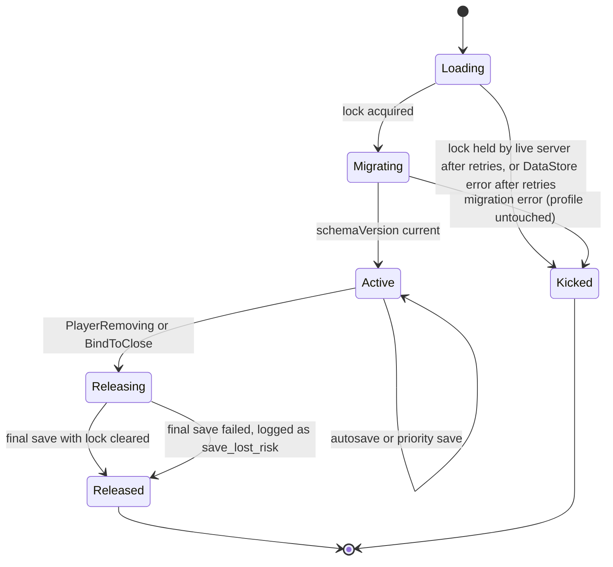

# Service - DataService

> [!info] PROPOSED
> Layer **1**. Design is **PROPOSED**; code is illustrative Luau, not tested. Profile shape is owned by [[Schema - Player Profile]]; consistency rules by [[Data Consistency and Transactions]]; recovery by [[Save, Load and Recovery]]; migrations by [[Data Validation and Migration]].

## Responsibility

- Load each player's profile from DataStoreService on join, with a **session lock** so two servers never write the same profile.
- Migrate old profiles to the current schema version before any other service sees them.
- Provide the **only** mutation entry point (`Mutate`) and generate replication deltas from it.
- Replicate the owner's client view (`Data/ProfileSnapshot`, `Data/ProfileDelta`).
- Autosave, priority-save after high-value transactions, final-save on leave and on server shutdown.
- Never let a player play on a profile that failed to load.

It does **not** decide any game rule. It does not know what an egg or a cash balance means; owning services do.

## Inputs

| Input | Source |
|---|---|
| `Players.PlayerAdded`, `Players.PlayerRemoving` | Roblox |
| `game:BindToClose` | Roblox (via the bootstrap) |
| `Mutate` calls | Every state-owning service |
| `RequestPrioritySave` calls | EconomyService (purchases), RaidService (raid result), HatchService (Legendary or rarer hatches, **PROPOSED**) |
| `Session/ClientReady`, `Data/RequestResync`, `Settings/Save` | Client |

## Outputs

| Output | Consumer |
|---|---|
| `ProfileLoaded(player, profile)` / `ProfileReleasing(player, profile)` signals | All per-player services |
| `Data/ProfileSnapshot`, `Data/ProfileDelta` remotes | Client `StateStore` |
| DataStore writes via `DataStoreAdapter` | DataStoreService |
| `data.*` logs and alerts | [[Service - AnalyticsAndLoggingService]] |

## Dependencies

| Dependency | Use |
|---|---|
| [[Service - AnalyticsAndLoggingService]] | Logging |
| `Data/DataStoreAdapter` | Only module calling `DataStoreService:GetDataStore`, `UpdateAsync`, `GetAsync` |
| `Data/ProfileSchema`, `Data/Migrations` | Defaults and migrations |

## Events

| Kind | Name | Payload |
|---|---|---|
| Signal | `ProfileLoaded` | `(player: Player, profile: Profile)` |
| Signal | `ProfileReleasing` | `(player: Player, profile: Profile)`; fired before the final save so services can end raids and release locks |
| Signal | `SaveFailed` | `(player: Player, attempt: number, err: string)` |
| Remote S→C | `Data/ProfileSnapshot`, `Data/ProfileDelta` | See [[Remote Communication Contract#2.1 Session, data, settings, notifications]] |
| Remote C→S | `Session/ClientReady`, `Data/RequestResync`, `Settings/Save` | Same |

## Data structures

```lua
--!strict
export type ProfileMeta = {
	schemaVersion: number,
	lockJobId: string?,     -- game.JobId of the server holding the session lock
	lockTime: number,       -- os.time() of the last lock refresh
	saveCount: number,
	lastSavedAt: number,
}

export type ProfileRecord = {   -- exactly what is stored under the key
	meta: ProfileMeta,
	data: ProfileData,          -- defined by Schema - Player Profile
}

export type Profile = {
	player: Player,
	record: ProfileRecord,
	data: ProfileData,          -- alias of record.data
	dirty: boolean,
	seq: number,                -- replication sequence number
	pendingChanges: { { path: string, value: any } },
	releasing: boolean,
}
```

**PROPOSED storage constants** (new values):

| Constant | Value |
|---|---|
| DataStore name | `PlayerProfiles_v1` |
| Key | `u_<UserId>` (well under the 50-character key limit) |
| Autosave interval | 120 s per player, staggered |
| Session lock stale after | 600 s without refresh |
| Lock acquire retries | 5 attempts, 1/2/4/8/16 s backoff |
| Priority save minimum spacing | 10 s per player (later requests coalesce) |

Roblox data store limits relevant here (from the Creator Hub "error codes and limits" page at the time of writing; re-check before launch): a value may be at most 4,194,304 characters when serialised; key names are at most 50 characters; per-server request budgets scale with player count (for example reads `60 + players × 40` per minute, and `UpdateAsync` consumes both read and write budget); per-key throughput is limited to 4 MB of writes per minute. A full profile is estimated at under 40 KB (100 animals, 225 eggs, base, index), so size is not a constraint.

## Public API

```lua
--!strict
-- Illustrative signatures.
function DataService:GetProfile(player: Player): Profile?
function DataService:WaitForProfile(player: Player, timeout: number?): Profile?   -- yields; never call from a remote handler

-- The only way to change profile data. See "Mutation model".
function DataService:Mutate(
	player: Player,
	reason: string,                        -- analytics and audit tag, e.g. "egg_roll"
	sections: { string },                  -- top-level sections the mutation may touch, e.g. { "economy", "eggs" }
	fn: (data: ProfileData) -> boolean     -- must not yield; return false to abort
): boolean

-- Mutate two loaded profiles atomically (raid theft). Both must be loaded in this server.
function DataService:MutatePair(
	a: Player, b: Player, reason: string, sections: { string },
	fn: (dataA: ProfileData, dataB: ProfileData) -> boolean
): boolean

export type SaveTicket = { Wait: (self: SaveTicket) -> boolean } -- yields until the save finishes; true on success
function DataService:RequestPrioritySave(player: Player, reason: string): SaveTicket
function DataService:IsLoaded(player: Player): boolean
```

## Mutation model

`Mutate` makes every transaction atomic without yielding:

1. Look up the loaded profile; return `false` if absent or `releasing`.
2. Deep-copy only the declared `sections` (bounded cost; most transactions declare two or three small sections).
3. Run `fn(data)` inside `xpcall`. **`fn` must not yield**; in Studio builds DataService wraps `fn` with a yield detector (a coroutine check after return) and errors loudly if it yielded.
4. If `fn` returned `false` or errored, restore the declared sections from the copies and return `false`.
5. Otherwise diff the declared sections against the copies and append the changed paths to `pendingChanges`, set `dirty = true`, return `true`.
6. Once per Heartbeat, pending changes for each player are filtered through the client-view filter (server-only fields removed) and sent as one `Data/ProfileDelta` with `seq + 1`.

In Studio builds, sections not declared are frozen with `table.freeze` for the duration of `fn` so an undeclared write raises an error during development.

```lua
--!strict
function DataService:Mutate(player, reason, sections, fn)
	local profile = profiles[player]
	if not profile or profile.releasing then return false end

	local backups = {}
	for _, name in sections do
		backups[name] = deepCopy(profile.data[name])
	end

	local ok, result = xpcall(fn, debug.traceback, profile.data)
	if not ok or result ~= true then
		for name, copy in backups do
			profile.data[name] = copy
		end
		if not ok then Log:Error("mutate_error", player, { reason = reason, trace = result }) end
		return false
	end

	for name, copy in backups do
		diffInto(profile.pendingChanges, name, copy, profile.data[name])
	end
	profile.dirty = true
	return true
end
```

## Load and save flow



- **Acquire:** `UpdateAsync` reads the record; if `meta.lockJobId` is another server and `lockTime` is newer than 600 s, the transform returns `nil` (no write) and DataService retries. Otherwise it writes `lockJobId = game.JobId`, `lockTime = os.time()`.
- **Autosave:** `UpdateAsync` that verifies `lockJobId == game.JobId` before writing; if not, the lock was taken over and this server must stop saving and kick the player (`data.lock_lost`).
- **Final save:** on `PlayerRemoving`, fire `ProfileReleasing`, wait one frame for services to finish, save with `lockJobId = nil`.
- **Shutdown:** `BindToClose` saves every remaining profile in parallel threads and waits until all finish or the shutdown window ends (Roblox allows about 30 s; *unverified* exact figure).

## Error handling

| Failure | Behaviour |
|---|---|
| DataStore unavailable on join | Retry 5 times; then kick with `E_DATA_UNAVAILABLE`. Never start the player on defaults, because a later save would overwrite real data |
| Profile locked by a live server | Same retry; most cases are a fast rejoin and the old server releases within seconds |
| Migration throws | Kick, log `data.migration_failed` with schema version; do not save |
| Autosave failure | Keep `dirty`; retry next cycle; `SaveFailed` signal; HUD banner after 2 failed cycles |
| `Mutate` handler error | Sections restored; caller gets `false` and returns `E_INTERNAL` |
| Corrupt or invalid field detected on load | Repair to default for that field only, keep a copy under `meta.quarantine`, log `data.repaired` ([[Data Validation and Migration]]) |

## Security requirements

- Clients can never write profile data. `Settings/Save` writes only whitelisted keys in the `settings` section, after range checks.
- The client view excludes `meta`, purchase receipts, suspicion data and any luck internals.
- `MutatePair` refuses unless both profiles are loaded **in this server** and neither is `releasing`, so cross-server theft is impossible by construction ([[Service - RaidService]]).
- Purchase receipt IDs are stored in the profile so `ProcessReceipt` grants are idempotent ([[Service - EconomyService]]).

## Testing requirements

| Test | Type |
|---|---|
| `Mutate` returning `false` restores every declared section byte-for-byte | Unit |
| `Mutate` that errors after a partial write restores state and emits no delta | Unit |
| Writing to an undeclared section errors in Studio mode | Unit |
| Two servers (two Studio test sessions) cannot both hold the lock; second join is rejected until release | Integration ([[Test Cases - Persistence]]) |
| Lock older than 600 s is taken over; the old server detects `lock_lost` on its next save | Integration |
| Kill the server process mid-session; on rejoin, data is at most one autosave old, and nothing granted by a priority-saved transaction is lost | Integration |
| Migration from every past schema version produces a valid current profile | Unit, one fixture per version |
| Client view never contains `meta` or server-only fields | Unit |

## Related documents
- [[Technical Architecture Index]]
- [[Service Architecture]]
- [[Schema - Player Profile]]
- [[Data Architecture Overview]]
- [[Data Consistency and Transactions]]
- [[Save, Load and Recovery]]
- [[Data Validation and Migration]]
- [[Disconnect Handling]]
- [[Test Cases - Persistence]]
