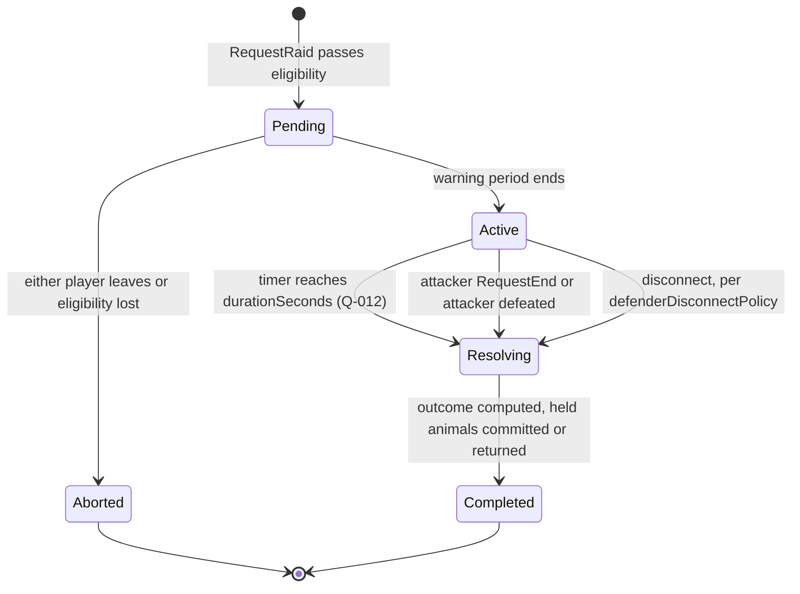

# Service - RaidService

> [!info] PROPOSED
> Layer **10**. Design is **PROPOSED**; code is illustrative Luau, not tested. Rules: [[Base Raiding System]], [[Raid Lifecycle and States]], [[Raid Eligibility and Offline Protection]], [[Egg Theft Rules]], [[Animal Theft Rules]], [[Raid Disconnection Handling]], [[Raid Anti-Exploit Validation]], [[Raid Rewards and Defender Compensation]]. Session implementation: [[Implementation - Raid Session Controller]].

> [!success] CONFIRMED rules enforced here (D-021, D-024)
> Raids are optional. Eggs stored in the base can be stolen; **backpack eggs can never be stolen**. A defending animal can be stolen **only after it has been knocked out**; undefeated defenders cannot be stolen. **Maximum three animals** stolen per successful raid. **Offline bases cannot be raided.** Bases are protected by shields and physical defences.

> [!warning] UNDECIDED values: no defaults
> Raid duration is **UNDECIDED** ([[Open Questions#Q-012]]). The egg theft limit is **UNDECIDED** ([[Open Questions#Q-013]]). Both ship in `RaidConfig` as `nil`. While either is `nil`, RaidService refuses to start any raid (`E_RAID_DISABLED`) and logs `CONFIG_INCOMPLETE` at boot. Prototype builds set them in a **local test config only**, never in the shared config. Also open: how players opt in to raiding (Q-207, raised in [[Base Raiding System]]; [[Open Questions#Q-011]] covers PvP activation only), matchmaking bands ([[Open Questions#Q-029]]), shield acquisition ([[Open Questions#Q-030]]), which animals defend ([[Open Questions#Q-033]], [[Open Questions#Q-035]]) and what a stolen animal keeps ([[Open Questions#Q-025]]).

## Responsibility

- Decide **raid eligibility** server-side: both players opted in, defender online **in this server**, not shielded, within band, not already raided, raids enabled.
- Run the raid session state machine and its timer (duration from config).
- Spawn and tag defenders and physical defences for the raid (through AnimalAIService and CombatService).
- Track **knockouts during this raid**; allow an animal claim only for a defender knocked out in this raid.
- Track egg claims from the defender's **base** storage up to the configured limit.
- Cap animal claims at **3**.
- Commit each stolen **egg** the moment it is **secured** at the extraction point (journal entry first, then a `MutatePair` for that one egg), as defined in [[Egg Theft Rules]]. Commit captured **animals** atomically when a **successful** raid resolves, and roll back any animal still held otherwise ([[Raid Disconnection Handling]]).
- Apply the disconnect policy, lock defender assets during the raid, set post-raid shields, and save both profiles immediately.

## Inputs

| Input | Source |
|---|---|
| `Raid/GetEligibleTargets`, `RequestRaid`, `ClaimEgg`, `ClaimAnimal`, `RequestEnd` | Attacker client |
| Participation flags | [[Service - PvPService]] |
| Plot, shield, defence layout, `IsInsidePlot` | [[Service - BaseService]] |
| KO and defeat events | [[Service - CombatService]] |
| Guard spawning | [[Service - AnimalAIService]] |
| Team (defender's equipped animals; attacker's team for combat) | [[Service - TeamService]] |
| Egg transfer helper | [[Service - EggService]] |
| `ProfileReleasing` (disconnects) | [[Service - DataService]] |

## Outputs

| Output | Consumer |
|---|---|
| `Raid/IncomingAlert`, `StateChanged`, `ClaimsUpdated`, `Result` | Attacker and defender clients |
| `RaidStarted`, `RaidResolved` signals | Analytics, BaseService (shields), notifications |
| Profile changes for both players in one transaction | DataService |
| `raid_started`, `raid_resolved`, `security.raid_*` logs | AnalyticsAndLoggingService |

## Dependencies

[[Service - CombatService]], [[Service - AnimalAIService]], [[Service - BaseService]], [[Service - PvPService]], [[Service - TeamService]], [[Service - EggService]], [[Service - DataService]], [[Service - AnalyticsAndLoggingService]]. Systems: `AnimalLedger`, `AssetLocks`, `ZoneQuery`, `RaidContext` (written here).

## Events

| Kind | Name | Payload |
|---|---|---|
| Signal | `RaidStarted` | `(session: RaidSession)` |
| Signal | `RaidResolved` | `(session: RaidSession, outcome: RaidOutcome)` |
| Remotes | See [[Remote Communication Contract#2.6 Raids and PvP]] | |

## Data structures

```lua
--!strict
export type RaidState = "Pending" | "Active" | "Resolving" | "Completed" | "Aborted"
export type RaidOutcome = "Success" | "Failed" | "Aborted"

export type RaidConfig = {
	durationSeconds: number?,          -- UNDECIDED (Q-012); nil = raids disabled
	eggTheftLimit: number?,            -- UNDECIDED (Q-013); nil = raids disabled
	maxAnimalsStolen: number,          -- 3, CONFIRMED
	claimRangeStuds: number,           -- PROPOSED 12
	maxConcurrentRaidsPerServer: number, -- PROPOSED 2
	defenderDisconnectPolicy: ("VoidClaims" | "CommitClaims" | "Pause")?, -- set from Raid Disconnection Handling; nil = raids disabled
	matchmaking: ((attacker: Player, defender: Player) -> boolean)?,       -- Q-029 hook
}

export type RaidSession = {
	raidId: string,
	attacker: Player,
	defender: Player,
	state: RaidState,
	startedAt: number,
	endsAt: number,
	knockedOut: { [string]: true },    -- defender animal IDs knocked out during THIS raid
	claimedAnimals: { string },        -- length <= 3
	claimedEggs: { string },           -- length <= eggTheftLimit, base-stored only
	defenderEntities: { [string]: string }, -- entityId -> animalId
}
```

## Eligibility

| # | Check | Code | Rule source |
|---:|---|---|---|
| 1 | Raids feature on and every required config value non-`nil` | `E_RAID_DISABLED` | Q-012, Q-013 |
| 2 | Attacker opted in (method Q-207) | `E_RAID_NOT_ELIGIBLE` | D-024 optional |
| 3 | Defender **online, in this server, profile loaded and not releasing** | `E_RAID_TARGET_OFFLINE` | D-024 offline protection |
| 4 | Defender opted in (method Q-207) | `E_RAID_NOT_ELIGIBLE` | D-024 optional |
| 5 | Defender not shielded | `E_RAID_SHIELDED` | [[Shield Mechanics]] |
| 6 | Neither player in another raid; defender not raided right now | `E_RAID_NOT_ELIGIBLE` | **PROPOSED** |
| 7 | Server below the concurrent raid cap (2, **PROPOSED**) | `E_RAID_NOT_ELIGIBLE` | [[Performance Guidelines]] |
| 8 | Matchmaking band hook passes | `E_RAID_NOT_ELIGIBLE` | Q-029 |
| 9 | Attacker not the defender | `E_RAID_NOT_ELIGIBLE` | — |

Because a raid requires the defender to be in the same server, **offline bases are unraidable by construction**: an offline player's profile is not loaded anywhere a raid could run. Whether cross-server raiding (raiding an online player who is in a different server) is ever supported is **UNDECIDED** (Q-807, the same question as Q-209 in [[Base Raiding System]]); the working assumption is that it is out of scope, which keeps theft an in-memory transaction.

## Session lifecycle



The exact states, warning period and success criteria are owned by [[Raid Lifecycle and States]]; this service implements whatever that page specifies.

## Claims

```lua
--!strict
-- Illustrative Luau, not tested.
function RaidService:HandleClaimAnimal(player, p: { raidId: string, animalId: string })
	local s = sessions[p.raidId]
	if not s or s.state ~= "Active" or s.attacker ~= player then return Err("E_RAID_NOT_ELIGIBLE") end
	if #s.claimedAnimals >= Config.maxAnimalsStolen then return Err("E_RAID_ANIMAL_LIMIT") end -- 3
	if not s.knockedOut[p.animalId] then return Err("E_RAID_NOT_KNOCKED_OUT") end            -- KO-before-steal
	local entity = defenderEntityFor(s, p.animalId)
	if not entity or entity.state ~= "KnockedOut" then return Err("E_RAID_NOT_KNOCKED_OUT") end
	if not withinRange(player, entity.model, Config.claimRangeStuds) then return Err("E_OUT_OF_RANGE") end
	if AnimalLedger.freeSlotsFor(player) <= #s.claimedAnimals then return Err("E_ANIMAL_STORAGE_FULL") end
	if not AssetLocks:TryLock(s.defender, "Animal", p.animalId, "RaidClaim", p.raidId) then
		return Err("E_ASSET_LOCKED")
	end
	table.insert(s.claimedAnimals, p.animalId)
	pushClaims(s)
	return Ok({ animalsClaimed = #s.claimedAnimals, animalLimit = Config.maxAnimalsStolen })
end
```

`HandleClaimEgg` mirrors this with: egg exists in the defender's profile with `location == "Base"` (else `E_RAID_NOT_STEALABLE`; **backpack eggs always fail**), attacker within range of the defender's Egg Vault, `#claimedEggs < eggTheftLimit` (`E_RAID_EGG_LIMIT`), attacker has egg capacity, and the egg is lockable.

`knockedOut[animalId]` is set only from `CombatService.EntityKnockedOut` for an entity whose `raidId` equals this raid and whose owner is the defender. An animal that was never knocked out in this raid can never be claimed.

## Resolution commit

On `Resolving`:

1. Compute the outcome per [[Raid Lifecycle and States]].
2. Eggs are **not** handled here: each egg was already committed when it was secured at the extraction point (`HandleSecureEgg`: write the journal entry, then `DataService:MutatePair(attacker, defender, "raid_egg", { "eggs" }, fn)` calling `EggService:TransferBaseEggsInPair(defender, attacker, { eggId }, destination)` with the destination rule from [[Egg Theft Rules]]). Secured eggs stay with the attacker whatever the raid's outcome.
3. If `Success`: `DataService:MutatePair(attacker, defender, "raid_theft", { "animals", "team", "index" }, fn)` where `fn`:
   - re-checks every captured animal still exists;
   - calls `AnimalLedger.transferInPair(defender, attacker, claimedAnimals, retentionPolicy)` where `retentionPolicy` encodes what a stolen animal keeps (**UNDECIDED**, Q-025);
   - clears any defender team slot that referenced a stolen animal (policy Q-025);
   - marks the species as owned in the attacker's index;
   - asserts `#claimedAnimals <= 3`.
4. If not `Success`: held animals return to the defender; eggs already secured are unaffected.
5. Two profiles live under two DataStore keys, so their saves cannot be atomic. Before saving either profile, write a **raid journal entry** (separate key per `raidId`, listing the exact transfer) with `UpdateAsync`; each profile records the `raidId` as applied when it saves. On a later load, a profile whose journal entry exists but whose applied list lacks the `raidId` is reconciled. The journal pattern and its failure cases are specified in [[Data Consistency and Transactions]].
6. Release locks, despawn guards and defences, set the post-raid shield via `BaseService:SetShield` (rules Q-030), send `Raid/Result` to both, `RequestPrioritySave` for **both** players.

## Asset locks during a raid

> [!warning] UNDECIDED (Q-808): defender actions during a raid
> To stop a defender from emptying base storage mid-raid, the working assumption is that while a raid on their base is `Pending` or `Active`, the defender's **base-stored** eggs cannot be moved, hatched or merged, and open hatch quotes covering base eggs are invalidated. Backpack eggs are unaffected. The owner must confirm this restriction; it is implemented as `RaidConfig.lockDefenderBaseEggs` (working value `true`).

## Error handling

| Case | Behaviour |
|---|---|
| Config incomplete | No raids; `E_RAID_DISABLED`; boot `Warn` |
| Attacker leaves | Raid resolves as defined in [[Raid Disconnection Handling]]: eggs already secured stay with the attacker; a carried egg returns to the vault; held animals transfer only if the raid already counts as successful (**PROPOSED**) |
| Defender leaves | `defenderDisconnectPolicy` (set from [[Raid Disconnection Handling]]; while `nil`, raids are disabled) |
| `MutatePair` fails | That transfer is refused (egg stays in the vault, or the animal returns); both players notified with `E_INTERNAL`; `Error` log `raid.commit_failed` with session dump; the journal guarantees no half-applied transfer |
| Server shutdown during a raid | `Shutdown` resolves every session before DataService saves: secured eggs are already committed; held animals follow the shutdown rule in [[Raid Disconnection Handling]] |

## Security requirements

- Every claim is validated against server state: session, role, KO state, `raidId` tag, range from server positions, limits, capacity, locks.
- **Backpack eggs are never transferable**: enforced twice (claim time and inside `TransferBaseEggsInPair`).
- **Never more than 3 animals**: enforced at claim time and asserted at commit.
- **KO-before-steal**: only animals in `knockedOut` and currently `KnockedOut` can be claimed.
- **Offline protection**: raids require both profiles loaded in this server; `MutatePair` refuses otherwise.
- Claims are not ownership: an egg moves only when secured, and an animal only at a successful resolution, each through a journalled transfer, so an aborted or failed raid can never leak or duplicate assets.
- Anti-exploit checks (noclip into vaults, speed, repeated raids on one victim) are listed in [[Raid Anti-Exploit Validation]].

## Testing requirements

| Test | Type |
|---|---|
| With `durationSeconds = nil` or `eggTheftLimit = nil`, `RequestRaid` returns `E_RAID_DISABLED` | Unit |
| Defender not in server → `E_RAID_TARGET_OFFLINE` | Unit |
| Claim of a guard that was never knocked out → `E_RAID_NOT_KNOCKED_OUT` | Unit |
| Fourth animal claim → `E_RAID_ANIMAL_LIMIT` | Unit |
| Backpack egg claim → `E_RAID_NOT_STEALABLE` | Unit |
| Egg claims stop at the configured limit for several test values (1, 5, 10) | Parameterised unit test (no default value implied) |
| Failed raid transfers nothing; locks released | Integration |
| Successful raid: defender loses exactly the claimed assets; attacker gains exactly them; both saved | Integration |
| Server crash after commit, between the two profile saves: after the raid journal is reconciled on next load, both players are consistent (no duplicated and no lost asset) | Integration ([[Data Consistency and Transactions]]) |
| Defender tries to hatch base eggs during an active raid → `E_ASSET_LOCKED` | Integration |

Full list: [[Test Cases - Raiding]].

## Related documents
- [[Technical Architecture Index]]
- [[Base Raiding System]]
- [[Raid Lifecycle and States]]
- [[Raid Eligibility and Offline Protection]]
- [[Egg Theft Rules]]
- [[Animal Theft Rules]]
- [[Raid Disconnection Handling]]
- [[Raid Anti-Exploit Validation]]
- [[Implementation - Raid Session Controller]]
- [[Test Cases - Raiding]]
