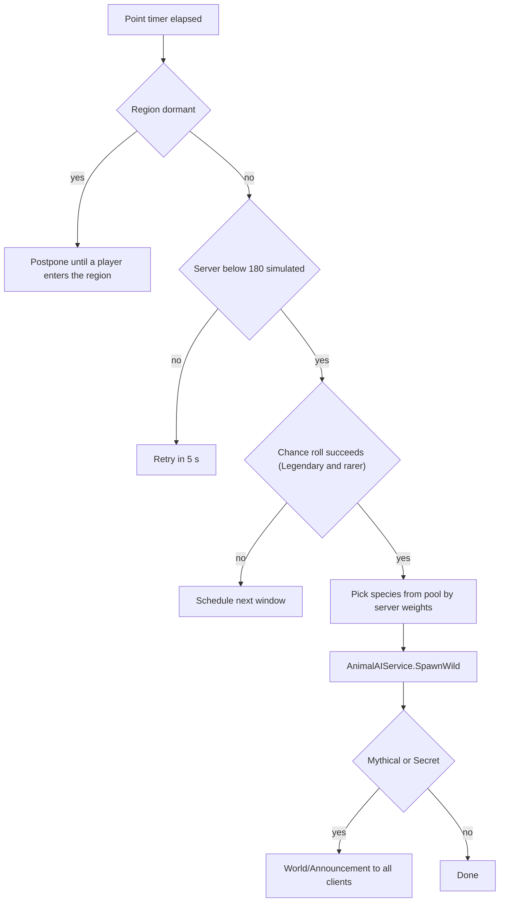

# Service - SpawnService

> [!info] PROPOSED
> Layer **9**. Design is **PROPOSED**; code is illustrative Luau, not tested. Design source: [[Wild Animal Spawning and Respawn]]. Respawn timers and rare-spawn chances: [[Canonical Proposed Values#6. Wild rewards and respawn (PROPOSED)]].

> [!success] CONFIRMED rules enforced here
> Wild animals respawn, and rarer animals respawn more slowly (D-011). Progression luck **does not** change wild encounter rarity (D-017): SpawnService never reads LuckService and has no dependency on it.

## Responsibility

- Discover spawn points tagged `AnimalSpawn` in `Workspace/AnimalSpawns` with `CollectionService`.
- Keep each spawn point populated up to its `MaxAlive`, choosing a species from the point's pool (server-only weights).
- Run respawn timers per rarity: Common 20 s, Uncommon 35 s, Rare 60 s, Epic 120 s, Legendary 300 s (50% chance per window, one point per region), Mythical 900 s window (25% chance, announced), Secret 2,700 s window (10% chance, announced).
- Enforce the population cap of **≤ 180 simulated** wild animals per server and dormancy for regions with no players.
- Announce Mythical and Secret rare spawns server-wide (`World/Announcement`).

## Inputs

| Input | Source |
|---|---|
| Tagged spawn markers with attributes `RegionId`, `Rarity`, `PoolId`, `MaxAlive` | Workspace (designers) |
| Spawn pools and rare-spawn chances | `ServerScriptService/Data/ServerConfig` (not replicated) |
| `CombatService.EntityDefeated` | CombatService |
| `AnimalAIService.WildReset` | AnimalAIService |
| Player region occupancy | `ZoneQuery` (region volumes) |

## Outputs

| Output | Consumer |
|---|---|
| `AnimalAIService:SpawnWild` / `Despawn` calls | AnimalAIService |
| `World/Announcement` (`RareSpawn`) | All clients |
| `WildSpawned(entity)`, `RareSpawnStarted(regionId, speciesId)` signals | Analytics, BossService (optional scheduling coordination) |

## Dependencies

[[Service - AnimalAIService]], [[Service - CombatService]], [[Service - DataService]] (none of its data, only for loaded-player checks), [[Service - AnalyticsAndLoggingService]]. Systems: `WeightedRandom`, `ZoneQuery`.

## Events

| Kind | Name | Payload |
|---|---|---|
| Signal | `WildSpawned` | `(entity: CombatEntity, pointId: string)` |
| Signal | `RareSpawnStarted` | `(regionId: string, speciesId: string, rarity: string)` |
| Remote S→C | `World/Announcement` | `{ kind = "RareSpawn", regionId, subjectId = speciesId, at }` |

## Data structures

```lua
--!strict
export type SpawnPoint = {
	id: string,                  -- derived from the marker's full name, stable across servers
	part: BasePart,
	regionId: string,
	rarity: string,
	poolId: string,
	maxAlive: number,
	alive: { [string]: true },   -- entity IDs currently alive from this point
	nextSpawnAt: number,
	faultyUntil: number?,
}

export type RespawnRule = {
	seconds: number,
	chance: number,              -- 1.0 for guaranteed respawn
	announce: boolean,
}

-- Mirrors Canonical Proposed Values §6 (PROPOSED)
local RESPAWN: { [string]: RespawnRule } = {
	Common    = { seconds = 20,   chance = 1.0,  announce = false },
	Uncommon  = { seconds = 35,   chance = 1.0,  announce = false },
	Rare      = { seconds = 60,   chance = 1.0,  announce = false },
	Epic      = { seconds = 120,  chance = 1.0,  announce = false },
	Legendary = { seconds = 300,  chance = 0.5,  announce = false },
	Mythical  = { seconds = 900,  chance = 0.25, announce = true },
	Secret    = { seconds = 2700, chance = 0.10, announce = true },
}
```

## Public API

```lua
--!strict
function SpawnService:GetPoint(pointId: string): SpawnPoint?
function SpawnService:GetAliveCount(): number
function SpawnService:SetRegionDormant(regionId: string, dormant: boolean): ()  -- driven by occupancy
function SpawnService:ForceSpawn(pointId: string, speciesId: string?): ()        -- Studio and admin only
```

## Spawn cycle



Dormancy (**PROPOSED**): when a region has had no players for 60 s, its wild animals at full HP are despawned and their points remember they were alive. When a player enters, points refill immediately up to the remembered count rather than waiting for timers, so the region never looks empty to an arriving player.

Timer semantics: the respawn timer starts when the animal is **defeated** (from `EntityDefeated`), not when it spawned. A leash reset does not restart the timer.

## Error handling

| Case | Behaviour |
|---|---|
| Marker missing attributes or unknown `PoolId` | Ignored at boot; `Warn` log `spawn.bad_marker` with the marker path |
| Template missing (AI reports) | Point marked faulty for 5 min |
| Population cap reached | Points wait; `Info` log once per minute with counts |
| Pool weights do not include the point's rarity | Boot-time validation error; the point is disabled |

## Security requirements

- Spawn pools, species weights and rare-spawn chances are server-only. Markers expose only `PoolId`.
- No remote can trigger a spawn. `ForceSpawn` is callable only in Studio or by allow-listed admin user IDs.
- Wild encounter rarity is independent of any player's luck or purchases (D-017). A unit test asserts SpawnService does not require LuckService.

## Testing requirements

| Test | Type |
|---|---|
| Respawn times per rarity match config ±1 s | Unit with a fake clock |
| Over 10,000 simulated windows, Legendary/Mythical/Secret spawn rates fall within confidence intervals of 50%/25%/10% | Statistical ([[Statistical Testing of Probabilities]]) |
| Never more than 180 wild entities alive | Load test |
| Region empties → animals despawn after 60 s; player returns → refill immediately | Integration |
| SpawnService module has no dependency on LuckService | Static test on `Dependencies` |
| Rare-spawn announcement reaches every client once | Integration |

## Related documents
- [[Technical Architecture Index]]
- [[Wild Animal Spawning and Respawn]]
- [[World Overview and Map]]
- [[Region Unlock Progression]]
- [[Service - AnimalAIService]]
- [[Service - BossService]]
- [[Dynamic Progression Luck]]
- [[Test Cases - Animal AI]]
