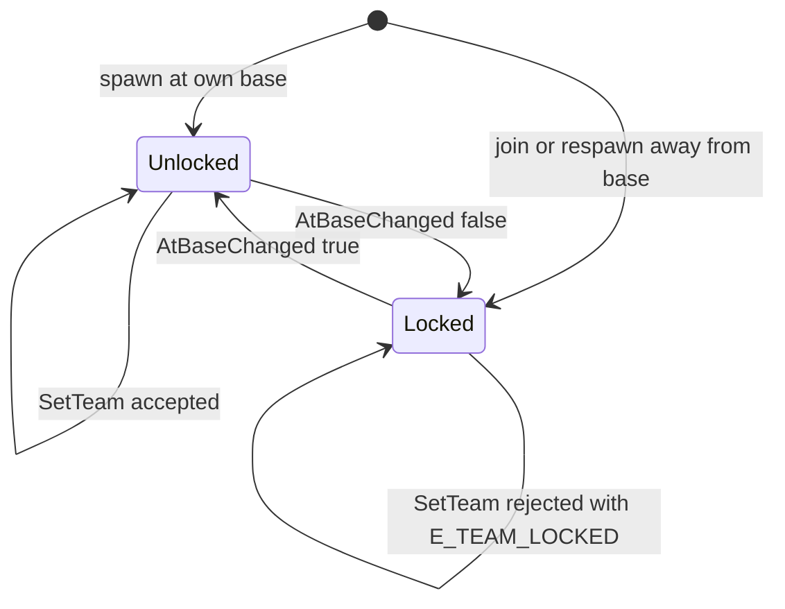

# Service - TeamService

> [!info] PROPOSED
> Layer **4**. Design is **PROPOSED**; code is illustrative Luau, not tested. Design: [[Team Equipping and Base Lock Rule]]. Schema: [[Schema - Equipped Team]]. Screens: [[UI - Team Selection]], [[UI - Animal Team Display]].

> [!success] CONFIRMED rules enforced here
> A player equips **exactly three** animals (D-006). The team can be changed **only at the player's own base**, and it is **locked** from leaving the base until returning (D-010).

## Responsibility

- Own the team: an array of **exactly 3 slots**.
- Validate and commit team changes: only at the player's own base, only owned animals, no duplicates, no locked animals.
- Maintain the **base lock**: locked whenever `BaseService:IsAtOwnBase` is false; unlocked when it becomes true.
- Clear slots whose animal leaves the collection (stolen in a raid; ascension cannot consume equipped animals).
- Notify AnimalAIService so companions are spawned or replaced.

## Inputs

| Input | Source |
|---|---|
| `Team/SetTeam` | Client |
| `BaseService.AtBaseChanged`, `IsAtOwnBase` | [[Service - BaseService]] |
| Animal records | Profile `animals` section |
| Combat tags | `Systems/CombatTags` |
| Asset locks | `Systems/AssetLocks` |
| Raid context (own base under raid) | `Systems/RaidContext` |

## Outputs

| Output | Consumer |
|---|---|
| `team` profile section | Client via deltas |
| `TeamChanged(player, slots)` | [[Service - AnimalAIService]] (companions), CombatService (stats cache), analytics |
| `TeamLockChanged(player, locked)` and `Team/LockChanged` | Client lock icon |

## Dependencies

[[Service - BaseService]], [[Service - DataService]], [[Service - AnalyticsAndLoggingService]]. Systems: `CombatTags`, `AssetLocks`, `RaidContext`.

## Events

| Kind | Name | Payload |
|---|---|---|
| Signal | `TeamChanged` | `(player, slots: { string })` (3 entries, `""` = empty) |
| Signal | `TeamLockChanged` | `(player, locked: boolean)` |
| Remotes | `Team/SetTeam`, `Team/LockChanged` | [[Remote Communication Contract#2.5 Ascension, merging, base, team]] |

## Data structures

```lua
--!strict
local TEAM_SIZE = 3 -- CONFIRMED (D-006)

export type TeamSection = {
	slots: { string },   -- always exactly 3 entries; "" means empty
	updatedAt: number,
}

-- Lock is runtime state, not saved: it is derived from position on every check.
export type TeamRuntime = { locked: boolean, lockedSince: number? }
```

## Empty slots

> [!warning] UNDECIDED (Q-803): may a slot be left empty on purpose?
> A new player owns fewer than three animals, so empty slots must be representable. Open: whether a player who owns three or more animals may deliberately leave a slot empty. Options: (a) allowed; (b) not allowed: if the player owns at least 3 eligible animals, all 3 slots must be filled. Working assumption **(a)**, controlled by `TeamConfig.allowVoluntaryEmptySlots = true`. The array always has exactly 3 entries either way.

## Public API

```lua
--!strict
function TeamService:GetTeam(player: Player): { string }
function TeamService:IsEquipped(player: Player, animalId: string): boolean
function TeamService:IsLocked(player: Player): boolean
function TeamService:HandleSetTeam(player: Player, p: { slots: { string } }): Result<{ slots: { string } }>
function TeamService:RemoveFromTeamInProfile(data: ProfileData, animalId: string): boolean -- inside Mutate with "team"
```

```lua
--!strict
-- Illustrative Luau, not tested.
function TeamService:HandleSetTeam(player, p)
	if #p.slots ~= TEAM_SIZE then return Err("E_TEAM_INVALID") end
	if not Base:IsAtOwnBase(player) then return Err("E_TEAM_LOCKED") end            -- D-010
	if CombatTags.isTagged(player) or RaidContext.isDefending(player) then return Err("E_IN_COMBAT") end

	local profile = Data:GetProfile(player)
	if not profile then return Err("E_NOT_READY") end
	local animals = profile.data.animals.records

	local seen, filled = {}, 0
	for _, id in p.slots do
		if id ~= "" then
			if seen[id] then return Err("E_TEAM_INVALID") end
			if not animals[id] then return Err("E_NOT_OWNED") end
			if AssetLocks:IsLocked(player, "Animal", id) then return Err("E_ASSET_LOCKED") end
			seen[id] = true
			filled += 1
		end
	end
	if not Config.allowVoluntaryEmptySlots and filled < math.min(TEAM_SIZE, countOwned(animals)) then
		return Err("E_TEAM_INVALID")
	end

	Data:Mutate(player, "team_set", { "team" }, function(data)
		data.team.slots = table.clone(p.slots)
		data.team.updatedAt = os.time()
		return true
	end)
	TeamService.TeamChanged:Fire(player, p.slots)
	return Ok({ slots = p.slots })
end
```

## Base lock behaviour



- The lock is evaluated at request time from the **server's** at-base test; the `locked` runtime flag only drives the UI.
- Respawn after a defeat: if the player respawns at their base (the plot `SpawnLocation`), the team is unlocked; if a battle type respawns them elsewhere, it stays locked. Respawn location per battle type belongs to [[Player Defeat and Penalties]].
- The team itself is never changed by leaving the base; only the ability to change it.

## Error handling

| Case | Code |
|---|---|
| Not exactly 3 entries, duplicate ID, voluntary empty slot when disallowed | `E_TEAM_INVALID` |
| Not at own base | `E_TEAM_LOCKED` |
| In combat or defending a raid | `E_IN_COMBAT` |
| Animal not owned | `E_NOT_OWNED` |
| Animal locked | `E_ASSET_LOCKED` |

## Security requirements

- At-base status is computed server-side from the character's server position; the client cannot assert it.
- Animal IDs are checked against the profile; species and stats are never taken from the client.
- An exploit that teleports the character into the plot is caught by movement checks ([[Exploit Prevention]]); even if missed, the only gain is changing the team, which is a normal action at the base.
- When a raid transfers an equipped animal, `RemoveFromTeamInProfile` runs inside the same `MutatePair`, so the defender's team can never reference an animal they no longer own. What else happens to the victim's team is **UNDECIDED** ([[Open Questions#Q-025]]).

## Testing requirements

| Test | Type |
|---|---|
| 2 or 4 slots rejected; 3 accepted | Unit |
| Request one stud outside `PlotBounds` + margin rejected | Integration |
| Same animal in two slots rejected | Unit |
| Another player's animal ID rejected | Exploit test |
| Leaving base sets lock within 0.75 s; returning clears it | Integration ([[Test Cases - Inventory and Storage]]) |
| Stolen equipped animal leaves the slot empty in the same transaction | Integration ([[Test Cases - Raiding]]) |
| Companions respawn with the locked team after a defeat away from base | Integration |

## Related documents
- [[Technical Architecture Index]]
- [[Team Equipping and Base Lock Rule]]
- [[Schema - Equipped Team]]
- [[Service - BaseService]]
- [[Service - AnimalAIService]]
- [[UI - Team Selection]]
- [[UI - Animal Team Display]]
- [[Test Cases - Combat]]
