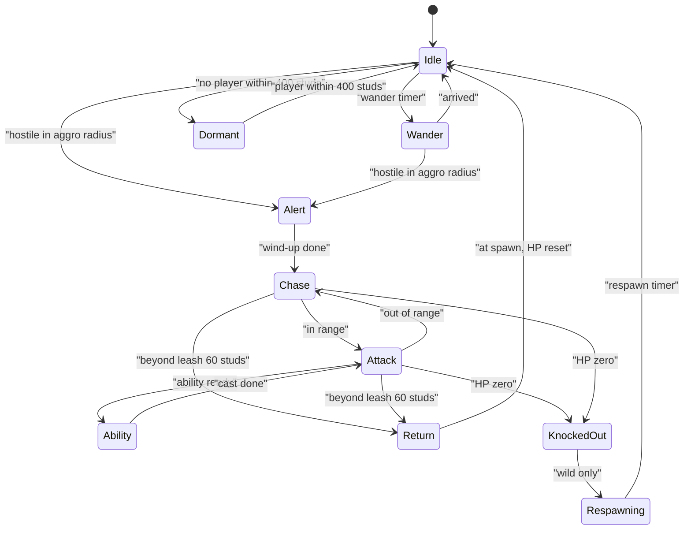

# Implementation - Animal AI State Machine

One server-side state machine drives every non-player combatant: wild animals, companions and base guards. Bosses reuse the scheduler with their own phase logic ([[Boss AI]]). Behaviour design is owned by [[Wild Animal AI]], [[Animal Combat Behaviour]] and [[Animal Guards and Base Defence AI]]; the combat state model is in [[Combat States and State Machine]]. Budgets and capacity analysis are in [[Animal Scalability and Performance Budgets]].

> [!info] PROPOSED
> States, transitions, radii, tick rates and the scheduler design are **PROPOSED**. Leash range 60 studs and combat-tag 8 s come from [[Canonical Proposed Values]] §4. Code is **illustrative — not executed**.

## 1. States

| State | Applies to | Purpose | Exit conditions |
|---|---|---|---|
| `Idle` | Wild, Guard | Stand at spawn or post | Hostile within aggro radius → `Alert`; timer → `Wander` (wild) |
| `Wander` | Wild | Short random walk within 15 studs of spawn | Hostile in aggro radius → `Alert`; arrived → `Idle` |
| `Alert` | Wild, Guard | 0.4 s wind-up (readability: head turn, sound) | Timer → `Chase`; target lost → `Idle` |
| `Follow` | Companion | Stay 6–10 studs behind owner | Owner in combat or target command → `Chase`; owner > 80 studs away → `Regroup` |
| `Chase` | All | Move toward target | In range → `Attack`; leash exceeded → `Return`; target lost 3 s → previous rest state |
| `Attack` | All | Basic attacks at attack speed | Out of range → `Chase`; ability ready → `Ability`; target dead → reselect |
| `Ability` | All | Automatic ability (manual abilities are queued by the owner, D-008) | Cast complete → `Attack` |
| `Return` | Wild, Guard | Walk back to spawn or post, invulnerable, then full HP reset | Arrived → `Idle` |
| `Regroup` | Companion | Teleport to owner if path fails or distance > 80 studs | Done → `Follow` |
| `Stunned` | All | Controlled by an effect | Timer → previous state |
| `KnockedOut` | All | HP = 0. Wild: despawn after death animation. Companion: out for the fight. Guard: becomes stealable in a raid | Wild → `Respawning`; Companion → revive rules ([[Player Defeat and Penalties]]); Guard → raid end |
| `Respawning` | Wild | Waiting for the rarity respawn timer ([[Wild Animal Spawning and Respawn]]) | Timer → `Idle` at spawn |
| `Dormant` | Wild | LOD tier D: not simulated | Player comes within 400 studs → `Idle` |



Companions replace `Idle/Wander/Alert/Return` with `Follow/Regroup`; they never leash because they belong to the player.

## 2. Tunables (PROPOSED)

| Tunable | Value | Notes |
|---|---|---|
| Wild aggro radius (aggressive profile) | 20 studs | Passive profiles only aggro when hit; profile per species in [[Wild Animal AI]] |
| Alert wind-up | 0.4 s | Telegraph for readability ([[Combat Feedback and Readability]]) |
| Leash | 60 studs from spawn | Canonical §4 |
| Companion auto-target acquisition | 30 studs from owner | D-009 auto-target |
| Companion follow distance | 6–10 studs | |
| Companion regroup distance | 80 studs | Teleport to owner |
| Target lost timeout | 3 s without sight or in leash | |
| Attack cadence | `1 / AttackSpeed` seconds | Role AS from canonical §3 |
| Basic attack range | Role range (5 / 28 / 18 / 12) + target radius | Canonical §3 |

## LOD scheduler

AI does not run every frame. A single scheduler connected to `RunService.Heartbeat` ticks each entity at a rate set by its LOD tier, with a hard per-frame time budget.

| Tier | Condition | Tick rate | Movement between ticks | Status |
|---|---|---:|---|---|
| A — full | Within 80 studs of any player, or in combat, or a companion in combat | 10 Hz | Server steps position each tick; client interpolates | **PROPOSED** |
| B — reduced | 80–200 studs from nearest player | 4 Hz | Coarse steering, no abilities | **PROPOSED** |
| C — minimal | 200–400 studs | 1 Hz | Idle/wander only | **PROPOSED** |
| D — dormant | Beyond 400 studs | 0 Hz | Frozen; not replicated | **PROPOSED** |
| Companion, out of combat | Any | 5 Hz | Follow only | **PROPOSED** |
| Boss | In encounter | 10 Hz plus scheduled telegraph timers | | **PROPOSED** |

Caps from canonical §15: ≤ 180 wild animals simulated and ≤ 60 with full AI near players. When more than 60 wild entities qualify for tier A, the scheduler keeps those in combat first, then the nearest, and demotes the rest to tier B for that second.

```lua
--!strict
-- Illustrative — not executed
-- ServerScriptService/Services/AnimalAIService/Scheduler

local RunService = game:GetService("RunService")

export type Tier = "A" | "B" | "C" | "D" | "Companion"

export type Entity = {
	id: number,
	kind: "Wild" | "Companion" | "Guard" | "Boss",
	state: string,
	stateSince: number,
	tier: Tier,
	nextTickAt: number,
	position: Vector3,
	inCombat: boolean,
	-- many more fields; see Brain below
}

local PERIOD: { [Tier]: number } = {
	A = 1 / 10,
	B = 1 / 4,
	C = 1,
	D = math.huge,
	Companion = 1 / 5,
}
local MAX_TIER_A_WILD = 60        -- canonical §15
local FRAME_BUDGET_SECONDS = 0.003 -- 3 ms per Heartbeat, PROPOSED

local Scheduler = {}
local entities: { Entity } = {}
local cursor = 1

function Scheduler.add(e: Entity)
	-- Stagger start times by id so that 100 entities spawned together do not all tick on one frame.
	e.nextTickAt = os.clock() + (e.id % 10) / 100
	table.insert(entities, e)
end

function Scheduler.remove(e: Entity)
	local i = table.find(entities, e)
	if i then
		-- swap-remove: O(1), order does not matter
		entities[i] = entities[#entities]
		entities[#entities] = nil
	end
end

-- Re-tier once per second (cheap relative to per-tick work).
function Scheduler.retier(nearestPlayerDistance: (Vector3) -> number)
	local candidates: { Entity } = {}
	for _, e in entities do
		if e.kind == "Companion" then
			e.tier = if e.inCombat then "A" else "Companion"
		elseif e.kind == "Boss" then
			e.tier = "A"
		else
			local d = nearestPlayerDistance(e.position)
			if e.inCombat or d <= 80 then
				table.insert(candidates, e)
				e.tier = "A"
			elseif d <= 200 then
				e.tier = "B"
			elseif d <= 400 then
				e.tier = "C"
			else
				e.tier = "D"
			end
		end
	end
	if #candidates > MAX_TIER_A_WILD then
		table.sort(candidates, function(a, b)
			if a.inCombat ~= b.inCombat then
				return a.inCombat
			end
			return nearestPlayerDistance(a.position) < nearestPlayerDistance(b.position)
		end)
		for i = MAX_TIER_A_WILD + 1, #candidates do
			candidates[i].tier = "B"
		end
	end
end

function Scheduler.start(tickEntity: (Entity, number) -> ())
	RunService.Heartbeat:Connect(function()
		local start = os.clock()
		local n = #entities
		if n == 0 then
			return
		end
		-- Round-robin from where the previous frame stopped, so budget overruns
		-- delay entities fairly instead of starving the end of the list.
		for _ = 1, n do
			if cursor > #entities then
				cursor = 1
			end
			local e = entities[cursor]
			cursor += 1
			local t = os.clock()
			if e and t >= e.nextTickAt then
				local dt = PERIOD[e.tier]
				e.nextTickAt = t + dt
				debug.profilebegin("AI_Tick")
				tickEntity(e, dt)
				debug.profileend()
			end
			if os.clock() - start > FRAME_BUDGET_SECONDS then
				break -- carry the rest to the next frame
			end
		end
	end)
end

return Scheduler
```

`debug.profilebegin` / `debug.profileend` label the work in the MicroProfiler (*unverified* names; confirm in Studio).

## 3. Brain — transition logic

```lua
--!strict
-- Illustrative — not executed
-- ServerScriptService/Services/AnimalAIService/Brain

local Brain = {}

type Ctx = {
	now: number,
	findHostile: (e: any, radius: number) -> any?,
	distance: (a: Vector3, b: Vector3) -> number,
	attack: (e: any, target: any) -> (),
	castAuto: (e: any, target: any) -> boolean,
	moveToward: (e: any, pos: Vector3, dt: number) -> (),
	teleport: (e: any, pos: Vector3) -> (),
}

local AGGRO_RADIUS = 20
local LEASH = 60
local ALERT_WINDUP = 0.4
local ACQUIRE_RADIUS = 30
local REGROUP_DISTANCE = 80
local LOST_TIMEOUT = 3

local function enter(e: any, state: string, now: number)
	if e.state ~= state then
		e.state = state
		e.stateSince = now
		e.dirtyState = true -- picked up by replication batching
	end
end

local handlers: { [string]: (e: any, dt: number, c: Ctx) -> () } = {}

handlers.Idle = function(e, dt, c)
	local h = if e.profile.aggressive then c.findHostile(e, AGGRO_RADIUS) else nil
	if h then
		e.target = h
		enter(e, "Alert", c.now)
	elseif e.kind == "Wild" and c.now - e.stateSince > e.profile.wanderEvery then
		enter(e, "Wander", c.now)
	end
end

handlers.Alert = function(e, dt, c)
	if e.target == nil or e.target.hp <= 0 then
		enter(e, "Idle", c.now)
	elseif c.now - e.stateSince >= ALERT_WINDUP then
		enter(e, "Chase", c.now)
	end
end

handlers.Follow = function(e, dt, c)
	local owner = e.owner
	local d = c.distance(e.position, owner.position)
	if d > REGROUP_DISTANCE then
		enter(e, "Regroup", c.now)
		return
	end
	-- Manual command (D-009) overrides auto-target.
	local t = e.commandTarget or (if owner.inCombat then c.findHostile(e, ACQUIRE_RADIUS) else nil)
	if t then
		e.target = t
		enter(e, "Chase", c.now)
	elseif d > 10 then
		c.moveToward(e, owner.position, dt)
	end
end

handlers.Chase = function(e, dt, c)
	local t = e.target
	if t == nil or t.hp <= 0 then
		e.target = nil
		enter(e, if e.kind == "Companion" then "Follow" else "Idle", c.now)
		return
	end
	if e.kind ~= "Companion" and c.distance(e.position, e.spawnPoint) > LEASH then
		enter(e, "Return", c.now)
		return
	end
	if c.distance(e.position, t.position) <= e.range + t.radius then
		enter(e, "Attack", c.now)
	else
		c.moveToward(e, t.position, dt)
		if not e.canSee(t) and c.now - e.lastSawTargetAt > LOST_TIMEOUT then
			e.target = nil
			enter(e, if e.kind == "Companion" then "Follow" else "Idle", c.now)
		end
	end
end

handlers.Attack = function(e, dt, c)
	local t = e.target
	if t == nil or t.hp <= 0 then
		e.target = nil
		enter(e, "Chase", c.now) -- Chase reselects or returns to rest
		return
	end
	if c.distance(e.position, t.position) > e.range + t.radius then
		enter(e, "Chase", c.now)
		return
	end
	if e.autoAbilityReadyAt <= c.now and c.castAuto(e, t) then
		enter(e, "Ability", c.now)
		return
	end
	if c.now >= e.nextAttackAt then
		c.attack(e, t) -- calls CombatService.applyHit with the canonical formula
		e.nextAttackAt = c.now + 1 / e.attackSpeed
	end
end

handlers.Return = function(e, dt, c)
	e.invulnerable = true
	c.moveToward(e, e.spawnPoint, dt)
	if c.distance(e.position, e.spawnPoint) < 2 then
		e.hp = e.maxHp -- canonical §4: reset to full HP
		e.invulnerable = false
		e.contributions = {}
		enter(e, "Idle", c.now)
	end
end

handlers.Regroup = function(e, dt, c)
	c.teleport(e, e.owner.position + Vector3.new(4, 0, 4))
	enter(e, "Follow", c.now)
end

function Brain.tick(e: any, dt: number, c: Ctx)
	local h = handlers[e.state]
	if h then
		h(e, dt, c)
	end
end

return Brain
```

`Wander`, `Ability`, `Stunned`, `KnockedOut`, `Respawning` and `Dormant` follow the same pattern and are omitted for length.

## 4. Movement

| Approach | Used when | Cost |
|---|---|---|
| Direct steering (`moveToward` with a short forward raycast) | Clear line to target; most open-world chases | Very low |
| `PathfindingService:CreatePath` + `ComputeAsync` | Steering blocked for more than 0.5 s | High; server-wide limit of 10 path computations per second (**PROPOSED**), queued |
| Teleport (`Regroup`) | Companion too far or stuck | Trivial |

`ComputeAsync` yields, so it runs in a separate task; the entity keeps steering until a path arrives. It must never be called inside the Heartbeat callback.

## 5. Manual target commands

`TargetCommand { targetId }` from the owner sets `commandTarget` on all three companions (or one, if the command names a slot). The server validates that the target exists, is hostile, and is within 40 studs of the owner (**PROPOSED**, owned by [[Targeting and Command System]]). Commands expire when the target dies, leashes or becomes invalid, or after 8 s (**PROPOSED**). Design in [[Targeting and Command System]].

## 6. Test hooks

[[Test Cases - Animal AI]]: each transition; leash reset restores full HP and clears contributions; 61 tier-A candidates demote one; scheduler stays within 3 ms with 228 entities in a stress place; companion regroup at 81 studs; no `ComputeAsync` inside Heartbeat (static check).

## Related documents
- [[Wild Animal AI]]
- [[Animal Combat Behaviour]]
- [[Animal Guards and Base Defence AI]]
- [[Boss AI]]
- [[Combat States and State Machine]]
- [[Animal Scalability and Performance Budgets]]
- [[Replication Strategy]]
- [[Network Ownership]]
- [[Service - AnimalAIService]]
- [[Implementation - Combat Damage Pipeline]]
