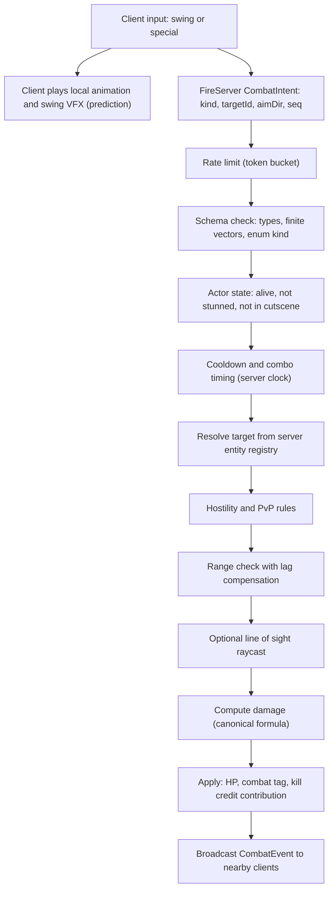

# Implementation - Combat Damage Pipeline

How a player's or animal's attack becomes damage. The client sends **intent only**; the server validates and computes everything. Combat design is owned by [[Combat System Overview]], [[Player Combat]] and [[Damage, Defence and Health Model]]; latency tolerances are explained in [[Latency Handling]].

> [!success] CONFIRMED
> Real-time hybrid combat: player and animals fight together; the player has basic attacks and special moves with cooldowns (D-005). Player strength is separate from animal strength (D-007). Animals auto-target and accept manual target commands (D-009).

> [!info] PROPOSED
> The damage formula, combo, specials and timings come from [[Canonical Proposed Values]] §4 (**PROPOSED**). Pipeline stages, tolerances and reach values introduced here are **PROPOSED** (listed in §8). Code is **illustrative — not executed**.

## 1. Pipeline stages



Any stage failing drops the intent silently (no damage) and increments the violation score only for stages that indicate tampering (schema, impossible cooldown, gross range). Ordinary misses due to latency are not violations.

## 2. Intent payload

```lua
-- CombatIntent (RemoteEvent, client -> server). Illustrative.
{
	kind: "Basic" | "PowerStrike" | "GroundSlam" | "RallyCry" | "Dodge",
	targetId: number?,     -- server entity id; optional for Basic (server picks nearest in arc)
	aimDir: Vector3?,      -- unit vector; used for arc selection and Dodge direction
	seq: number,           -- monotonically increasing per client; replays and reorders dropped
}
```

What the client **never** sends: damage, hit position, target HP, cooldown remaining, combo index, a timestamp the server trusts.

Animal manual abilities use a separate `AbilityIntent { slot: 1 | 2 | 3, targetId: number? }`, gated by the 0.5 s global cooldown between manual animal abilities (canonical §4). Animal automatic attacks never involve the client ([[Implementation - Animal AI State Machine]]).

## 3. Code — pure damage function

```lua
--!strict
-- Illustrative — not executed
-- ReplicatedStorage/Shared/Combat/DamageMath
-- Shared so the client can PREVIEW numbers in tooltips; the server is the only caller that applies damage.

local DamageMath = {}

-- Canonical (PROPOSED): Damage = ATK × SkillMultiplier × (100 / (100 + DEF_target)) × Random(0.95, 1.05)
-- `variance` is the Random(0.95, 1.05) draw, passed in so the function stays pure.
function DamageMath.compute(atk: number, skillMultiplier: number, defTarget: number, variance: number): number
	assert(atk >= 0 and skillMultiplier >= 0, "negative inputs")
	assert(variance >= 0.95 and variance <= 1.05, "variance out of range")
	local def = math.max(defTarget, 0)
	local raw = atk * skillMultiplier * (100 / (100 + def)) * variance
	-- Rounding rule PROPOSED: nearest integer, minimum 1 on any successful hit.
	return math.max(1, math.round(raw))
end

-- Player attack value: effective Strength (canonical §4).
function DamageMath.playerEffectiveStrength(level: number, trainingGroundsLevel: number, otherBonuses: number): number
	local base = 10 + 2 * (level - 1)
	local training = 0.05 * trainingGroundsLevel -- +5% per Training Grounds level (canonical §12)
	return base * (1 + training + otherBonuses)
end

-- Animal ATK including ascension and Training Grounds (canonical §3, §9, §12).
function DamageMath.animalAtk(referenceAtk: number, tierM: number, roleM: number, tweak: number, ascension: number, trainingGroundsLevel: number): number
	return referenceAtk * tierM * roleM * tweak * (1 + 0.08 * ascension) * (1 + 0.04 * trainingGroundsLevel)
end

return DamageMath
```

Team damage buffs such as Rally Cry (+15% for 6 s) are applied as a multiplier on the attacker's ATK before `compute`, so the canonical formula itself stays unchanged.

## 4. Code — server intent handler

```lua
--!strict
-- Illustrative — not executed
-- ServerScriptService/Services/CombatService (excerpt)

local ReplicatedStorage = game:GetService("ReplicatedStorage")
local Workspace = game:GetService("Workspace")

local DamageMath = require(ReplicatedStorage.Shared.Combat.DamageMath)
local Registry = require(script.Parent.Parent.Registry)

local rng = Random.new()

-- Canonical §4 (PROPOSED)
local COMBO_MULT = { 0.8, 0.8, 1.4 }
local COMBO_INTERVAL = 0.45
local COMBO_RESET = 1.2
local SPECIALS = {
	PowerStrike = { mult = 3.0, cooldown = 6, reach = 7, minLevel = 1 },   -- reach PROPOSED (local)
	GroundSlam  = { mult = 2.0, cooldown = 12, radius = 10, minLevel = 10 },
	RallyCry    = { cooldown = 25, duration = 6, bonus = 0.15, minLevel = 25 },
	Dodge       = { cooldown = 4, iframes = 0.3, distance = 12 },
}

-- Local PROPOSED values (see section 8)
local BASIC_REACH = 6
local RANGE_TOLERANCE = 3
local TIMING_TOLERANCE = 0.05
local MAX_REWIND = 0.25

type ActorState = {
	comboIndex: number,
	lastBasicAt: number,
	cooldownUntil: { [string]: number },
	lastSeq: number,
}
local actors: { [Player]: ActorState } = {}

local CombatService = { Name = "CombatService" }

local function now(): number
	return os.clock()
end

local function canAct(player: Player): boolean
	local EntityRegistry = Registry.get("AnimalAIService").entities
	local self = EntityRegistry.forPlayer(player)
	return self ~= nil and self.hp > 0 and not self.stunned and not self.inCutscene
end

-- Range check against the target's position as the attacker most likely saw it.
local function inRange(player: Player, target: any, reach: number): boolean
	local EntityRegistry = Registry.get("AnimalAIService").entities
	local attackerPos = EntityRegistry.forPlayer(player).position
	local ping = math.clamp(player:GetNetworkPing(), 0, MAX_REWIND) -- unit assumed seconds; *unverified*
	local seenPos = target.history:sampleAt(Workspace:GetServerTimeNow() - ping) or target.position
	local limit = reach + target.radius + RANGE_TOLERANCE
	return (seenPos - attackerPos).Magnitude <= limit
end

local function hasLineOfSight(fromPos: Vector3, toPos: Vector3, ignore: { Instance }): boolean
	local params = RaycastParams.new()
	params.FilterType = Enum.RaycastFilterType.Exclude
	params.FilterDescendantsInstances = ignore
	local result = Workspace:Raycast(fromPos, toPos - fromPos, params)
	return result == nil -- nothing solid in between
end

function CombatService.onIntent(player: Player, intent: any)
	-- Gateway has already rate-limited and schema-checked `intent`.
	local st = actors[player]
	if not st then
		return
	end
	if intent.seq <= st.lastSeq then
		return -- replay or reorder
	end
	st.lastSeq = intent.seq
	if not canAct(player) then
		return
	end

	local t = now()
	local Entities = Registry.get("AnimalAIService").entities
	local selfEntity = Entities.forPlayer(player)
	local profile = Registry.get("DataService").getLoadedProfile(player)
	if not profile then
		return
	end
	local level = profile.data.progression.level
	local strength = DamageMath.playerEffectiveStrength(level, profile.data.base.modules.TrainingGrounds or 0, selfEntity.strengthBonus)

	if intent.kind == "Basic" then
		if t - st.lastBasicAt < COMBO_INTERVAL - TIMING_TOLERANCE then
			Registry.get("RemoteGateway").flag(player, "combat_cadence", 2)
			return
		end
		if t - st.lastBasicAt > COMBO_RESET then
			st.comboIndex = 1
		end
		local target = Entities.resolveTargetForBasic(selfEntity, intent.targetId, intent.aimDir, BASIC_REACH)
		if target and Entities.isHostile(selfEntity, target) and inRange(player, target, BASIC_REACH) then
			CombatService.applyHit(selfEntity, target, strength, COMBO_MULT[st.comboIndex])
		end
		st.lastBasicAt = t
		st.comboIndex = (st.comboIndex % 3) + 1
		return
	end

	local spec = SPECIALS[intent.kind]
	if spec == nil then
		return
	end
	if level < (spec.minLevel or 1) then
		Registry.get("RemoteGateway").flag(player, "locked_special", 5)
		return
	end
	if t < (st.cooldownUntil[intent.kind] or 0) - TIMING_TOLERANCE then
		Registry.get("RemoteGateway").flag(player, "cooldown", 2)
		return
	end
	st.cooldownUntil[intent.kind] = t + spec.cooldown

	if intent.kind == "PowerStrike" then
		local target = Entities.get(intent.targetId)
		if target and Entities.isHostile(selfEntity, target) and inRange(player, target, spec.reach)
			and hasLineOfSight(selfEntity.position, target.position, { selfEntity.model, target.model }) then
			CombatService.applyHit(selfEntity, target, strength, spec.mult)
		end
	elseif intent.kind == "GroundSlam" then
		for _, target in Entities.hostilesWithin(selfEntity, selfEntity.position, spec.radius + RANGE_TOLERANCE) do
			CombatService.applyHit(selfEntity, target, strength, spec.mult)
		end
	elseif intent.kind == "RallyCry" then
		Registry.get("TeamService").applyTeamBuff(player, "RallyCry", spec.bonus, spec.duration)
	elseif intent.kind == "Dodge" then
		-- I-frames start at server receipt, back-dated by at most 0.1 s (PROPOSED, see Latency Handling).
		selfEntity.invulnerableUntil = t + spec.iframes
		selfEntity.invulnerableFrom = t - math.min(player:GetNetworkPing() / 2, 0.1)
	end
end

-- Shared by player hits and animal AI hits.
function CombatService.applyHit(attacker: any, target: any, atk: number, skillMultiplier: number)
	local t = now()
	if target.hp <= 0 then
		return
	end
	if target.invulnerableUntil and t >= (target.invulnerableFrom or 0) and t <= target.invulnerableUntil then
		return -- dodged
	end
	local variance = rng:NextNumber(0.95, 1.05)
	local dmg = DamageMath.compute(atk * attacker.damageBuffMultiplier, skillMultiplier, target.def, variance)
	target.hp = math.max(0, target.hp - dmg)

	-- Combat tag (8 s) and kill-credit contribution (>= 10% of max HP, canonical §6).
	attacker.lastCombatAt = t
	target.lastCombatAt = t
	local owner = attacker.ownerPlayer -- player, or the player who owns the companion
	if owner then
		target.contributions[owner] = (target.contributions[owner] or 0) + dmg
	end

	-- Replication batching module owned by AnimalAIService (see Replication Strategy).
	Registry.get("AnimalAIService").replication.queueCombatEvent(target, {
		attackerId = attacker.id, targetId = target.id, amount = dmg, hpAfter = target.hp,
	})
	if target.hp == 0 then
		CombatService.onKnockedOut(target) -- KO record used by raids and kill credit
	end
end

return CombatService
```

## 5. Target resolution and hostility

| Attacker | Valid targets | Rule source |
|---|---|---|
| Player | Wild animals, bosses, raid defenders during a raid in which the player is the attacker, other players only under PvP rules | [[Multiplayer Combat Rules]], [[PvP System]] |
| Companion | Same as owner | [[Animal Combat Behaviour]] |
| Wild animal | Players and companions | [[Wild Animal AI]] |
| Raid defender / guard | Raid attacker and the attacker's companions only | [[Animal Guards and Base Defence AI]] |

> [!warning] UNDECIDED — PvP activation
> How a player enters PvP is **UNDECIDED** ([[Open Questions#Q-011]]). The pipeline exposes a single predicate `PvPService.canDamage(a, b)`. Until Q-011 is decided it returns `false` in live builds.

## 6. Worked examples

Assuming `SpeciesTweak = 1.00` (actual tweaks in [[Animal Statistics Database]]), no Training Grounds and `variance = 1.00`:

| Attacker | ATK | Target | Target DEF | Skill | Damage |
|---|---:|---|---:|---:|---:|
| [[Tiger]] companion (Epic Assassin, A0): 20 × 2.2 × 1.45 | 63.8 | Wild [[Rabbit]] (Common Skirmisher, Whisperwood): 10 × 1.0 × 0.8 | 8 | 1.0 | 63.8 × 100/108 = 59.07 → **59** |
| Player level 10, basic hit 3: Strength 28 | 28 | Same Rabbit | 8 | 1.4 | 28 × 1.4 × 100/108 = 36.30 → **36** |
| Player level 10, Power Strike | 28 | Same Rabbit | 8 | 3.0 | 77.78 → **78** |

The wild Rabbit has `200 × 1.0 × 0.85 × 2.0 × 1.0 = 340` HP (wild ×2.0, region ×1.0), so the Tiger alone needs six basic hits.

## 7. Server-side cooldown authority

| Item | Server state | Client role |
|---|---|---|
| Combo index | `comboIndex`, `lastBasicAt` | Predicts animation only |
| Special cooldowns | `cooldownUntil[kind]` | Shows a timer predicted from its own press; corrected by `CooldownSync` events |
| Dodge i-frames | `invulnerableFrom/Until` | Plays roll animation immediately |
| Global ability cooldown (0.5 s) | Per player | Greys out buttons |

## 8. PROPOSED values introduced here

| Value | Proposal | Why |
|---|---|---|
| Player basic reach | 6 studs | Slightly above animal melee range (5) so the player can hit the target their animals engage |
| Power Strike reach | 7 studs | Single-target lunge |
| Range tolerance | +3 studs plus target radius | Absorbs replication jitter ([[Latency Handling]]) |
| Timing tolerance | 0.05 s early | Absorbs server frame and network jitter |
| Lag compensation rewind | ≤ 0.25 s | Caps the "shot around a corner" advantage for high-ping players |
| Dodge i-frame back-date | ≤ 0.1 s | Favours the dodger slightly without letting late dodges cancel landed hits |
| Damage rounding | Nearest integer, minimum 1 | Readable numbers |

## 9. Test hooks

[[Test Cases - Combat]] and [[Test Cases - Exploit Prevention]]: forged high `seq`; intents at 2× cadence; special before unlock level; out-of-range by 4 studs (accept) and 20 studs (reject + flag); NaN `aimDir`; Ground Slam hitting 0, 1 and many targets; variance bounds; dodge timing at 0.05 s and 0.2 s late.

## Related documents
- [[Combat System Overview]]
- [[Player Combat]]
- [[Damage, Defence and Health Model]]
- [[Abilities and Cooldowns]]
- [[Targeting and Command System]]
- [[Multiplayer Combat Rules]]
- [[Latency Handling]]
- [[Exploit Prevention]]
- [[Service - CombatService]]
