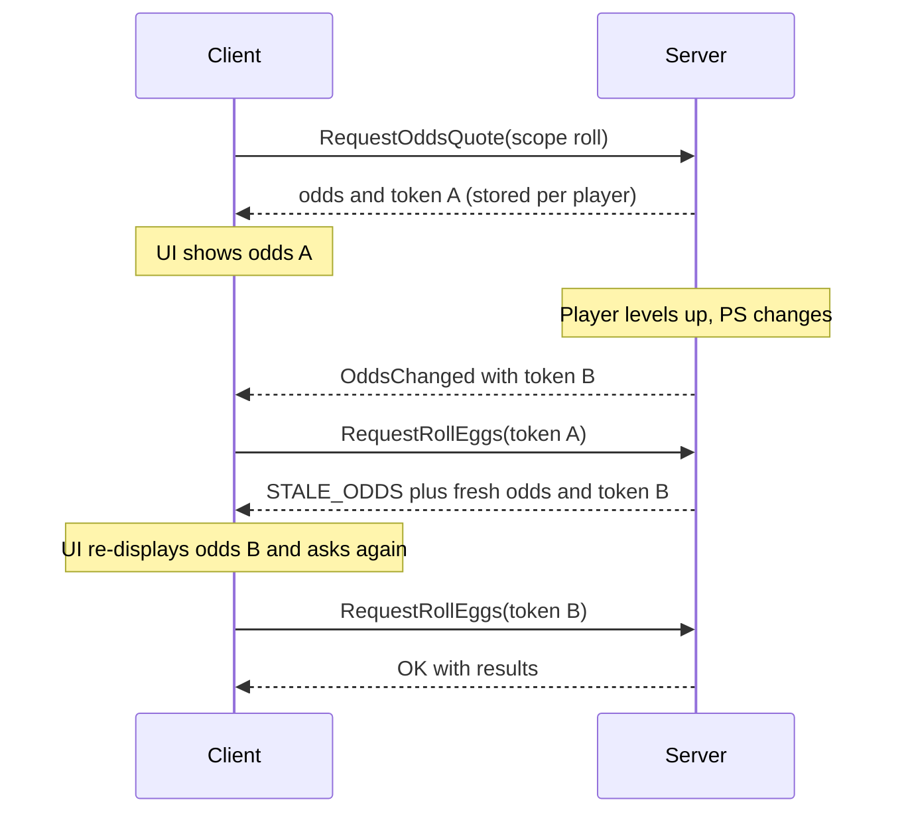

# Implementation - Dynamic Luck Calculation

This document implements the dynamic progression luck model in [[Canonical Proposed Values]] §8 exactly, together with the `oddsVersion` token that enforces the disclosure rule. The design rationale lives in [[Dynamic Progression Luck]]; the input definitions live in [[Progression Score Specification]]; the generated odds live in [[Dynamic Luck Probability Tables]] and [[Hatch Pool Tables]].

> [!success] CONFIRMED (D-017)
> Hidden progression luck changes egg-rarity and hatch odds, never wild encounter rarity. The formula may stay hidden. The **actual odds must be shown before the player commits**, and odds must never change silently after a purchase.

> [!info] PROPOSED (D-036, D-041)
> The Progression Score model, the slopes, the hatch tilt and the `oddsVersion` token are **PROPOSED**. The final formula is **UNDECIDED** ([[Open Questions#Q-017]]); final odds are **UNDECIDED** ([[Open Questions#Q-016]], [[Open Questions#Q-018]]). Code is **illustrative — not executed**.

## 1. Formulas (canonical §8, reproduced for implementation)

**Progression Score** `PS ∈ [0, 1000]`:

| Input | Points | Max |
|---|---|---:|
| Player level (cap 100) | 4 per level | 400 |
| Unique species discovered | 3 each | 180 |
| Unique mini-bosses defeated | 10 each (8) | 80 |
| Unique world bosses defeated | 20 each (4) | 80 |
| Regions unlocked beyond the first | 20 each (7) | 140 |
| Base progression | `round(120 × TotalModuleLevels / 44)` | 120 |

`P = clamp(PS / 1000, 0, 1)`, pivot `P₀ = 0.30`.

**Egg-rarity weights:** `w_r(P) = Base_r × (1 + s_r × (P − 0.30))`, normalised to 100%.

**Hatch-pool weights:** `w_i(P) = ClassWeight_i × (1 + H × (P − 0.30) × Tilt_i)`, normalised within the pool, with `H = 1.0`, Tilt Standard 0, Scarce 0.5, Elusive 1.0, and ClassWeight Standard 10, Scarce 6, Elusive 3.

> [!note] Level 1 is not PS 0
> A new player at level 1 has 4 points from level alone, so P starts at 0.004, not 0. The P = 0 column below is a theoretical floor.

## 2. Code — pure luck functions

```lua
--!strict
-- Illustrative — not executed
-- ServerScriptService/Services/LuckService/LuckMath
-- Pure functions. Data comes from ServerStorage/Config/LuckConfig (secret).

local Types = require(game:GetService("ReplicatedStorage").Shared.Types)

type RarityName = Types.RarityName
type PoolClass = Types.PoolClass

export type PSInputs = {
	level: number,                 -- 1..100
	uniqueDiscovered: number,      -- 0..60
	uniqueMiniBosses: number,      -- 0..8
	uniqueWorldBosses: number,     -- 0..4
	regionsUnlocked: number,       -- 1..8 (including the first)
	totalModuleLevels: number,     -- 0..44
}

export type LuckConfig = {
	PIVOT: number,
	BASE: { [RarityName]: number },
	SLOPE: { [RarityName]: number },
	CLASS_WEIGHT: { [PoolClass]: number },
	TILT: { [PoolClass]: number },
	H: number,
}

local RARITY_ORDER: { RarityName } = { "Common", "Uncommon", "Rare", "Epic", "Legendary", "Mythical", "Secret" }
local MAX_MODULE_LEVELS = 44 -- canonical §12

local LuckMath = {}

local function clamp(x: number, lo: number, hi: number): number
	return math.max(lo, math.min(hi, x))
end

function LuckMath.progressionScore(i: PSInputs): number
	local level = clamp(math.floor(i.level), 1, 100)
	local discovered = clamp(math.floor(i.uniqueDiscovered), 0, 60)
	local mini = clamp(math.floor(i.uniqueMiniBosses), 0, 8)
	local world = clamp(math.floor(i.uniqueWorldBosses), 0, 4)
	local regionsBeyondFirst = clamp(math.floor(i.regionsUnlocked) - 1, 0, 7)
	local moduleLevels = clamp(i.totalModuleLevels, 0, MAX_MODULE_LEVELS)

	local ps = 4 * level
		+ 3 * discovered
		+ 10 * mini
		+ 20 * world
		+ 20 * regionsBeyondFirst
		+ math.round(120 * moduleLevels / MAX_MODULE_LEVELS)
	return clamp(ps, 0, 1000)
end

function LuckMath.normalisedP(ps: number): number
	return clamp(ps / 1000, 0, 1)
end

-- Returns percentages (sum = 100) in canonical rarity order.
function LuckMath.eggRarityOdds(P: number, cfg: LuckConfig): { [RarityName]: number }
	local raw: { [RarityName]: number } = {}
	local total = 0
	for _, r in RARITY_ORDER do
		local w = cfg.BASE[r] * (1 + cfg.SLOPE[r] * (P - cfg.PIVOT))
		assert(w > 0, "non-positive egg weight for " .. r) -- guaranteed by ConfigLoader for P in [0,1]
		raw[r] = w
		total += w
	end
	local out: { [RarityName]: number } = {}
	for _, r in RARITY_ORDER do
		out[r] = 100 * raw[r] / total
	end
	return out
end

export type PoolMember = { speciesId: string, poolClass: PoolClass }

-- Returns { speciesId -> percentage } for one rarity pool (sum = 100).
function LuckMath.hatchPoolOdds(P: number, pool: { PoolMember }, cfg: LuckConfig): { [string]: number }
	local total = 0
	local raw: { [string]: number } = {}
	for _, m in pool do
		local w = cfg.CLASS_WEIGHT[m.poolClass] * (1 + cfg.H * (P - cfg.PIVOT) * cfg.TILT[m.poolClass])
		assert(w > 0, "non-positive pool weight for " .. m.speciesId)
		raw[m.speciesId] = w
		total += w
	end
	local out: { [string]: number } = {}
	for id, w in raw do
		out[id] = 100 * w / total
	end
	return out
end

LuckMath.RARITY_ORDER = RARITY_ORDER
return LuckMath
```

The percentages feed straight into [[Implementation - Weighted Random Selection]] as weights. Using percentages (not the raw weights) as the selection weights guarantees the roll uses exactly the numbers the player saw.

## 3. Worked examples (computed from the formula)

Egg-rarity odds, percent. The authoritative generated table is [[Dynamic Luck Probability Tables]]; these figures are for implementation tests.

| P | Common | Uncommon | Rare | Epic | Legendary | Mythical | Secret | Raw weight total |
|---:|---:|---:|---:|---:|---:|---:|---:|---:|
| 0.00 | 71.8759 | 19.9483 | 6.3693 | 1.5260 | 0.2477 | 0.0318 | 0.0009 | 90.4336 |
| 0.30 | 65.0000 | 22.0000 | 9.0000 | 3.0000 | 0.8000 | 0.1800 | 0.0200 | 100.0000 |
| 0.50 | 61.1031 | 23.1628 | 10.4909 | 3.8354 | 1.1130 | 0.2640 | 0.0308 | 106.3776 |
| 1.00 | 53.1386 | 25.5392 | 13.5381 | 5.5428 | 1.7528 | 0.4356 | 0.0530 | 122.3216 |

Common hatch pool (8 Standard, 2 Scarce, 2 Elusive per canonical §2), percent per individual species:

| P | Each Standard | Each Scarce | Each Elusive | Raw total |
|---:|---:|---:|---:|---:|
| 0.00 | 10.5932 | 5.4025 | 2.2246 | 94.4 |
| 0.30 | 10.2041 | 6.1224 | 3.0612 | 98.0 |
| 1.00 | 9.3985 | 7.6128 | 4.7932 | 106.4 |

Check at P = 1.00: 8 × 9.3985 + 2 × 7.6128 + 2 × 4.7932 = 100.0 (rounding aside).

## 4. The `oddsVersion` token

### 4.1 Purpose

The token binds a commit (roll or hatch) to the exact odds the client displayed. If anything that affects odds changes between display and commit, the server rejects the commit with `STALE_ODDS` and sends fresh odds, so the player always sees the odds they are about to get (D-017, D-041).

### 4.2 Definition

`token = FNV1a32(ConfigVersion .. "|" .. PS .. "|" .. bucket)`, formatted as eight hex digits, where `bucket = floor(serverUnixTime / TOKEN_BUCKET_SECONDS)`.

| Parameter | Value | Status |
|---|---|---|
| `TOKEN_BUCKET_SECONDS` | 60 | **PROPOSED** (local; listed for [[Canonical Proposed Values]]) |
| Accept previous bucket | Yes; a token is valid for 60–120 s after issue | **PROPOSED** (local) |
| Storage | Server memory, per player, per scope (`"roll"`, `"hatch"`) | **PROPOSED** |
| Persistence | Not saved; a rejoin needs a fresh quote | **PROPOSED** |

> [!info] Why a non-cryptographic hash is acceptable
> The token is not a secret and not a signature. Its authority comes from two server-side checks: (1) it must equal the token the server stored when it issued the quote, and (2) the server recomputes the current token from the current PS, ConfigVersion and bucket. A client that computes a token itself gains nothing: the odds applied are always the server's stored quote, which equals the current odds whenever the token is accepted.

### 4.3 Code — quotes and validation

```lua
--!strict
-- Illustrative — not executed
-- ServerScriptService/Services/LuckService (excerpt)

local ReplicatedStorage = game:GetService("ReplicatedStorage")
local ServerStorage = game:GetService("ServerStorage")
local Players = game:GetService("Players")

local LuckMath = require(script.LuckMath)
local LuckConfig = require(ServerStorage.Config.LuckConfig)
local ConfigVersion = require(ReplicatedStorage.Shared.Config.ConfigVersion) :: string
local Types = require(ReplicatedStorage.Shared.Types)

export type Scope = "roll" | "hatch"

export type Quote = {
	token: string,
	scope: Scope,
	ps: number,
	bucket: number,
	configVersion: string,
	issuedAt: number,
	-- roll: { [RarityName]: percent }
	-- hatch: { [RarityName]: { [speciesId]: percent } }
	odds: any,
}

local quotes: { [Player]: { [Scope]: Quote } } = {}

local LuckService = { Name = "LuckService" }

-- 32-bit FNV-1a with exact integer arithmetic.
-- 16777619 = 2^24 + 403, so h * prime mod 2^32 = (h * 403 + (h << 24)) mod 2^32,
-- which keeps every intermediate below 2^53.
local function fnv1a32(s: string): number
	local h = 2166136261
	for i = 1, #s do
		h = bit32.bxor(h, string.byte(s, i))
		h = (h * 403 + bit32.lshift(h, 24)) % 4294967296
	end
	return h
end

local function currentBucket(): number
	return math.floor(os.time() / LuckConfig.TOKEN_BUCKET_SECONDS)
end

local function makeToken(ps: number, bucket: number): string
	return string.format("%08x", fnv1a32(ConfigVersion .. "|" .. tostring(ps) .. "|" .. tostring(bucket)))
end

-- getPSInputs is provided by ProgressionService (reads the loaded profile).
local function currentPS(player: Player): number
	local ProgressionService = require(script.Parent.ProgressionService) :: any
	return LuckMath.progressionScore(ProgressionService.getPSInputs(player))
end

local function buildOdds(scope: Scope, P: number): any
	if scope == "roll" then
		return LuckMath.eggRarityOdds(P, LuckConfig)
	end
	local Pools = require(script.Parent.HatchService.Pools) :: any -- built from RosterConfig at boot
	local all = {}
	for _, rarity in LuckMath.RARITY_ORDER do
		all[rarity] = LuckMath.hatchPoolOdds(P, Pools.members(rarity), LuckConfig)
	end
	return all
end

-- Called by the RequestOddsQuote remote and after every PS change.
function LuckService.issueQuote(player: Player, scope: Scope): Quote
	local ps = currentPS(player)
	local bucket = currentBucket()
	local q: Quote = {
		token = makeToken(ps, bucket),
		scope = scope,
		ps = ps,
		bucket = bucket,
		configVersion = ConfigVersion,
		issuedAt = os.time(),
		odds = buildOdds(scope, LuckMath.normalisedP(ps)),
	}
	quotes[player] = quotes[player] or {}
	quotes[player][scope] = q
	return q
end

export type TokenCheck = { ok: true, quote: Quote } | { ok: false, reason: Types.ReasonCode, fresh: Quote }

-- Must be called inside the commit flow with NO yield between this check and the mutation.
function LuckService.validateToken(player: Player, scope: Scope, submitted: unknown): TokenCheck
	local stored = quotes[player] and quotes[player][scope]
	local function stale(): TokenCheck
		return { ok = false, reason = "STALE_ODDS", fresh = LuckService.issueQuote(player, scope) }
	end

	if stored == nil or typeof(submitted) ~= "string" or submitted ~= stored.token then
		return stale()
	end
	if stored.configVersion ~= ConfigVersion then
		return stale() -- balance changed since display
	end
	if currentPS(player) ~= stored.ps then
		return stale() -- player progressed since display (level-up, discovery, boss, module)
	end
	local age = currentBucket() - stored.bucket
	local maxAge = if LuckConfig.TOKEN_ACCEPT_PREVIOUS_BUCKET then 1 else 0
	if age < 0 or age > maxAge then
		return stale() -- expired
	end
	-- Defensive recomputation: the stored token must match its own inputs.
	if makeToken(stored.ps, stored.bucket) ~= stored.token then
		return stale()
	end
	return { ok = true, quote = stored }
end

-- Single-use: consume after a successful commit so a token cannot authorise twice.
function LuckService.consumeToken(player: Player, scope: Scope)
	if quotes[player] then
		quotes[player][scope] = nil
	end
end

-- ProgressionService calls this whenever PS changes; the client refreshes its display.
function LuckService.onProgressionChanged(player: Player)
	local OddsChanged = ReplicatedStorage.Remotes.OddsChanged :: RemoteEvent
	for _, scope in { "roll", "hatch" } :: { Scope } do
		if quotes[player] and quotes[player][scope] then
			local q = LuckService.issueQuote(player, scope)
			OddsChanged:FireClient(player, { scope = scope, token = q.token, odds = q.odds })
		end
	end
end

Players.PlayerRemoving:Connect(function(p)
	quotes[p] = nil
end)

return LuckService
```

### 4.4 Stale-token flow



| Situation | Result |
|---|---|
| Token matches, PS and config unchanged, same or previous bucket | Accept; roll uses `quote.odds` |
| Player levelled up after display | `STALE_ODDS` + fresh quote |
| Hot-fix changed `ConfigVersion` | `STALE_ODDS` + fresh quote |
| Quote older than two buckets | `STALE_ODDS` + fresh quote |
| Token from another player | Mismatch with this player's stored token → `STALE_ODDS` |
| Token reused after a successful commit | Consumed → `STALE_ODDS` |
| Client invents a token | Mismatch → `STALE_ODDS` |

> [!danger] Never change odds after commit
> Once `validateToken` succeeds, the commit must use `quote.odds` and must not yield before selecting outcomes. A yield would allow PS to change mid-commit; the selection must still use the stored quote, which is what the player saw.

## 5. Edge cases

- **PS changes during a 5× roll or a 5-egg hatch.** All draws in one commit use the same quote. If a hatch result itself changes PS (for example, if hatching an undiscovered species also counts as a discovery, a rule owned by [[Animal Index Feature Specification]]), the change applies to the next quote only, never to the remaining eggs of the current commit.
- **Bucket boundary.** A quote issued at second 59 of a bucket is valid until the end of the next bucket (61–120 s total). A quote issued at second 0 lasts up to 120 s. UI should re-request a quote if the confirm dialogue has been open for more than 60 s.
- **Clock.** Only the server clock is used. `os.time()` drift between servers is irrelevant because quotes never cross servers.
- **Rounding for display.** The client receives full-precision percentages and rounds for display (rules in [[UI - Egg Rolling]]). The server never rounds the odds it selects with.
- **Wild encounters.** `LuckService` is never called by `SpawnService`. A unit test asserts that `SpawnService` does not require `LuckService` (D-017 **CONFIRMED**).

## 6. Test hooks

| Test | Expectation |
|---|---|
| Egg odds at P = 0.30 | Exactly the baseline table |
| Egg odds sum | 100 ± 1e-9 for P in steps of 0.01 |
| Hatch pool sums | 100 ± 1e-9 for every pool and P |
| PS maximum | All inputs at max → 1000 |
| Token determinism | Same inputs → same token; any changed input → different token |
| Stale cases | Every row of the §4.4 table |
| Single use | Second commit with the same token → `STALE_ODDS` |

See [[Test Cases - Egg Rolls and Hatching]] and [[Statistical Testing of Probabilities]].

## Related documents
- [[Dynamic Progression Luck]]
- [[Progression Score Specification]]
- [[Dynamic Luck Probability Tables]]
- [[Hatch Pool Tables]]
- [[Randomised Reward Compliance]]
- [[Implementation - Weighted Random Selection]]
- [[Implementation - Egg Roll and Hatch Flow]]
- [[Service - LuckService]]
- [[Configuration Modules]]
