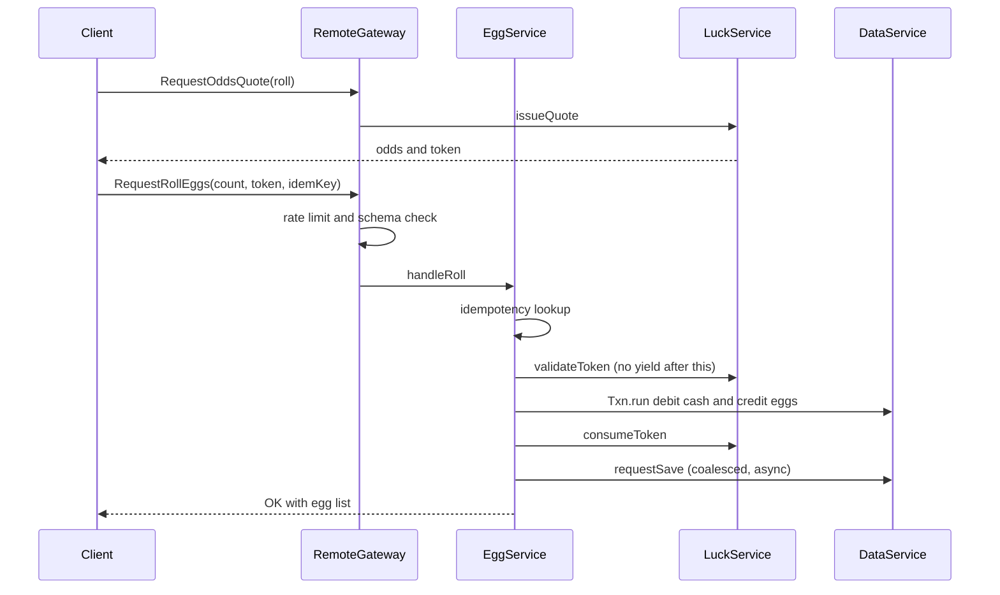

# Implementation - Egg Roll and Hatch Flow

The full server flow for buying egg rolls with Cash and hatching eggs into animals. Game rules are owned by [[Egg Roll System]], [[Hatch System]] and [[Egg Storage]]; this page shows how the server enforces them. Odds come from [[Implementation - Dynamic Luck Calculation]]; selection from [[Implementation - Weighted Random Selection]].

> [!success] CONFIRMED rules enforced here
> Two-stage randomness: roll decides rarity, hatch picks a species from that rarity's pool (D-015). Up to **5** eggs hatched at once (D-016). Odds shown before commit and never changed silently (D-017). Hatches are independent (D-018). Backpack 10 + base 50 (D-021).

> [!info] PROPOSED
> Payloads, reason codes, the transaction helper, idempotency, egg routing and save cadence are **PROPOSED**. Code is **illustrative — not executed**.

## Flow overview



Hatching follows the same shape with `RequestHatchEggs` and scope `hatch`.

## Payloads

| Remote | Type | Payload | Response |
|---|---|---|---|
| `RequestOddsQuote` | RemoteFunction | `{ scope: "roll" \| "hatch" }` | `{ ok, token, odds }` |
| `RequestRollEggs` | RemoteFunction | `{ count: 1 \| 5, oddsToken: string, idemKey: string }` | `{ ok, reason?, eggs?, fresh? }` |
| `RequestHatchEggs` | RemoteFunction | `{ eggUids: { string } (1–5), oddsToken: string, idemKey: string }` | `{ ok, reason?, animals?, fresh? }` |
| `OddsChanged` | RemoteEvent (server → client) | `{ scope, token, odds }` | — |

Schemas are enforced by [[Implementation - Remote Validation Layer]]. Remote names are illustrative; the canonical list is in [[Remote Communication Contract]].

## Transaction helper

Every economy mutation in the game goes through `Txn.run`. It guarantees all-or-nothing behaviour **in memory**; durability is the save step that follows ([[Data Consistency and Transactions]]).

```lua
--!strict
-- Illustrative — not executed
-- ServerScriptService/Shared/Txn

local Types = require(game:GetService("ReplicatedStorage").Shared.Types)

local Txn = {}

local function deepCopy<T>(v: T): T
	if typeof(v) ~= "table" then
		return v
	end
	local out = {}
	for k, x in v :: any do
		out[k] = deepCopy(x)
	end
	return out :: any
end

export type Mutator = (data: any) -> (boolean, Types.ReasonCode?)
export type Invariant = (data: any) -> (boolean, string?)

-- sections: top-level profile keys the mutator may touch, e.g. { "economy", "eggs" }.
-- Returns (ok, reasonCode).
function Txn.run(profile: { data: any }, sections: { string }, mutate: Mutator, invariants: { Invariant }?): (boolean, Types.ReasonCode?)
	local data = profile.data
	local snapshot: { [string]: any } = {}
	for _, key in sections do
		snapshot[key] = deepCopy(data[key])
	end

	local function rollback()
		for _, key in sections do
			data[key] = snapshot[key]
		end
	end

	-- Run the mutator in a coroutine so that an accidental yield is DETECTED
	-- (the coroutine would be suspended rather than dead) instead of silently
	-- opening a race window.
	local okFlag, reason
	local co = coroutine.create(function()
		okFlag, reason = mutate(data)
	end)
	local resumed, err = coroutine.resume(co)

	if coroutine.status(co) ~= "dead" then
		coroutine.close(co)
		rollback()
		error("Txn mutator yielded — forbidden (see Luau Coding Standards §4)")
	end
	if not resumed then
		rollback()
		error("Txn mutator errored: " .. tostring(err))
	end
	if not okFlag then
		rollback()
		return false, reason
	end
	for _, inv in invariants or {} do
		local good, why = inv(data)
		if not good then
			rollback()
			error("Txn invariant failed: " .. tostring(why))
		end
	end
	profile.dirty = true
	return true, nil
end

return Txn
```

| Property | How it is achieved |
|---|---|
| Atomic | Single synchronous call; snapshot restore on any failure |
| Consistent | Invariants checked before the change is kept (e.g. cash ≥ 0, storage within capacity) |
| Isolated | No yield is possible inside; any yield is detected and rolled back |
| Durable | Not provided here; `DataService.requestSave` follows |

Snapshot cost: deep-copying the `eggs` section (≤ 60 eggs at start, ≤ 225 at maximum expansion) is cheap relative to a remote call. Copy only the sections listed.

## Idempotency

Mobile taps, UI double-fires and client retries after a timeout must not double-charge. The client generates a fresh `idemKey` (a GUID from `HttpService:GenerateGUID(false)`) each time the player presses **Confirm**, and reuses it only when retrying the same confirmation.

```lua
--!strict
-- Illustrative — not executed
-- ServerScriptService/Shared/Idempotency

local Players = game:GetService("Players")

local MAX_KEYS = 64          -- PROPOSED (local)
local TTL_SECONDS = 300      -- PROPOSED (local)

type Entry = { result: any, at: number }
local store: { [Player]: { map: { [string]: Entry }, order: { string } } } = {}

local Idem = {}

function Idem.get(player: Player, key: string): any?
	local s = store[player]
	local e = s and s.map[key]
	if e and os.clock() - e.at <= TTL_SECONDS then
		return e.result
	end
	return nil
end

-- Only terminal results are recorded: OK, and failures that a retry cannot change
-- (e.g. INSUFFICIENT_CASH). Retryable results (STALE_ODDS, RATE_LIMITED, NOT_READY,
-- BUSY) are not recorded, so the retry is evaluated afresh.
function Idem.put(player: Player, key: string, result: any)
	local s = store[player]
	if not s then
		s = { map = {}, order = {} }
		store[player] = s
	end
	if s.map[key] == nil then
		table.insert(s.order, key)
		if #s.order > MAX_KEYS then
			local old = table.remove(s.order, 1)
			s.map[old :: string] = nil
		end
	end
	s.map[key] = { result = result, at = os.clock() }
end

Players.PlayerRemoving:Connect(function(p)
	store[p] = nil
end)

return Idem
```

> [!note] Scope of idempotency
> Keys live in server memory only. If the server shuts down before the save, the transaction itself is lost (cash and eggs both revert), so there is nothing to deduplicate after a rejoin. See [[Disconnect Handling]].

## Egg roll handler

```lua
--!strict
-- Illustrative — not executed
-- ServerScriptService/Services/EggService (excerpt)

local ReplicatedStorage = game:GetService("ReplicatedStorage")
local HttpService = game:GetService("HttpService")

local Txn = require(script.Parent.Parent.Shared.Txn)
local Idem = require(script.Parent.Parent.Shared.Idempotency)
local WeightedRandom = require(ReplicatedStorage.Shared.WeightedRandom)
local EggConfig = require(ReplicatedStorage.Shared.Config.EggConfig)
local Registry = require(script.Parent.Parent.Registry)

local rng = Random.new()
local RARITY_ORDER = { "Common", "Uncommon", "Rare", "Epic", "Legendary", "Mythical", "Secret" }

export type RollRequest = { count: number, oddsToken: string, idemKey: string }

local EggService = { Name = "EggService" }

local function capacity(data: any): (number, number)
	return data.eggs.backpackCapacity, data.eggs.baseCapacity
end

local function countByLocation(data: any): (number, number)
	local b, s = 0, 0
	for _, egg in data.eggs.items do
		if egg.location == "Backpack" then b += 1 else s += 1 end
	end
	return b, s
end

local function invariantsEggs(data: any): (boolean, string?)
	local b, s = countByLocation(data)
	local bc, sc = capacity(data)
	if b > bc or s > sc then
		return false, "egg capacity exceeded"
	end
	if data.economy.cash < 0 then
		return false, "negative cash"
	end
	return true, nil
end

function EggService.handleRoll(player: Player, req: RollRequest): any
	local DataService = Registry.get("DataService")
	local LuckService = Registry.get("LuckService")
	local CombatService = Registry.get("CombatService")

	local cached = Idem.get(player, req.idemKey)
	if cached then
		return cached -- same confirmation retried; no second charge
	end

	local profile = DataService.getLoadedProfile(player) -- non-yielding lookup
	if not profile then
		return { ok = false, reason = "NOT_READY" }
	end
	if req.count ~= 1 and req.count ~= EggConfig.BULK_ROLL_COUNT then
		return { ok = false, reason = "INVALID_PAYLOAD" }
	end
	-- Roll location (egg shrine proximity) is owned by Egg Roll System; enforced here if required.
	if not EggService.isAtShrine(player) then
		return { ok = false, reason = "OUT_OF_RANGE" }
	end

	-- ===== No yields from here until the response is built =====
	local check = LuckService.validateToken(player, "roll", req.oddsToken)
	if not check.ok then
		return { ok = false, reason = check.reason, fresh = { token = check.fresh.token, odds = check.fresh.odds } }
	end
	local odds = check.quote.odds :: { [string]: number }

	local price = if req.count == 1 then EggConfig.ROLL_PRICE_CASH else EggConfig.BULK_ROLL_PRICE_CASH

	-- Build selection entries from the DISPLAYED odds (percentages).
	local entries = table.create(7)
	for _, r in RARITY_ORDER do
		table.insert(entries, { value = r, weight = odds[r] })
	end

	local created: { any } = {}
	local ok, reason = Txn.run(profile, { "economy", "eggs" }, function(data)
		if data.economy.cash < price then
			return false, "INSUFFICIENT_CASH"
		end
		local b, s = countByLocation(data)
		local bc, sc = capacity(data)
		local free = (bc - b) + (sc - s)
		if free < req.count then
			return false, "STORAGE_FULL" -- all-or-nothing: a 5x roll needs 5 free slots
		end

		data.economy.cash -= price
		data.economy.lifetimeCashSpentOnRolls += price

		for _ = 1, req.count do
			local rarity = WeightedRandom.select(entries, rng)
			-- Routing: backpack first, then base storage. PROPOSED; UNDECIDED (Q-904).
			local location = if b < bc then "Backpack" else "Base"
			if location == "Backpack" then b += 1 else s += 1 end
			local egg = {
				uid = HttpService:GenerateGUID(false),
				rarity = rarity,
				location = location,
				source = "Roll",
				acquiredAt = os.time(),
			}
			table.insert(data.eggs.items, egg)
			table.insert(created, egg)
		end
		return true, nil
	end, { invariantsEggs })

	local response
	if ok then
		LuckService.consumeToken(player, "roll")
		response = { ok = true, eggs = created }
		Registry.get("AnalyticsAndLoggingService").logRoll(player, check.quote.token, check.quote.configVersion, created)
		DataService.requestSave(player, "roll")
	else
		response = { ok = false, reason = reason }
	end
	-- ===== End of no-yield region =====

	if ok or reason == "INSUFFICIENT_CASH" or reason == "STORAGE_FULL" then
		Idem.put(player, req.idemKey, response)
	end
	return response
end

return EggService
```

> [!info] PROPOSED — egg routing
> New eggs go to the backpack while it has space, then to base storage. Whether rolls should route differently (base first, or player choice) is **UNDECIDED** (Q-904). Note that routing affects raid exposure, because only base eggs are stealable (D-021).

## Hatch handler

```lua
--!strict
-- Illustrative — not executed
-- ServerScriptService/Services/HatchService (excerpt)

local ReplicatedStorage = game:GetService("ReplicatedStorage")
local HttpService = game:GetService("HttpService")

local Txn = require(script.Parent.Parent.Shared.Txn)
local Idem = require(script.Parent.Parent.Shared.Idempotency)
local WeightedRandom = require(ReplicatedStorage.Shared.WeightedRandom)
local EggConfig = require(ReplicatedStorage.Shared.Config.EggConfig)
local Registry = require(script.Parent.Parent.Registry)

local rng = Random.new()
local MAX_HATCH_BATCH = EggConfig.MAX_HATCH_BATCH -- 5, CONFIRMED (D-016)

export type HatchRequest = { eggUids: { string }, oddsToken: string, idemKey: string }

local HatchService = { Name = "HatchService" }

function HatchService.handleHatch(player: Player, req: HatchRequest): any
	local DataService = Registry.get("DataService")
	local LuckService = Registry.get("LuckService")
	local CombatService = Registry.get("CombatService")
	local BaseService = Registry.get("BaseService")
	local RaidService = Registry.get("RaidService")

	local cached = Idem.get(player, req.idemKey)
	if cached then
		return cached
	end
	local profile = DataService.getLoadedProfile(player)
	if not profile then
		return { ok = false, reason = "NOT_READY" }
	end

	-- 1. Batch size: 1..5 (CONFIRMED maximum of five).
	local n = #req.eggUids
	if n < 1 or n > MAX_HATCH_BATCH then
		return { ok = false, reason = "TOO_MANY_EGGS" }
	end

	-- 2. Context checks.
	if CombatService.isCombatTagged(player) then
		return { ok = false, reason = "IN_COMBAT" }
	end
	if RaidService.isInActiveRaid(player) then
		return { ok = false, reason = "IN_RAID" }
	end
	local atBase = BaseService.isAtOwnBase(player)

	-- ===== No yields from here until the response is built =====
	local check = LuckService.validateToken(player, "hatch", req.oddsToken)
	if not check.ok then
		return { ok = false, reason = check.reason, fresh = { token = check.fresh.token, odds = check.fresh.odds } }
	end
	local poolOdds = check.quote.odds :: { [string]: { [string]: number } }

	local results: { any } = {}
	local ok, reason = Txn.run(profile, { "eggs", "animals", "index" }, function(data)
		-- 3. Ownership, uniqueness, locks and location.
		local byUid: { [string]: any } = {}
		for _, egg in data.eggs.items do
			byUid[egg.uid] = egg
		end
		local seen: { [string]: boolean } = {}
		for _, uid in req.eggUids do
			if seen[uid] then
				return false, "INVALID_PAYLOAD" -- duplicate uid in one request
			end
			seen[uid] = true
			local egg = byUid[uid]
			if egg == nil then
				return false, "EGG_NOT_FOUND"
			end
			if egg.lockedBy ~= nil then
				return false, "EGG_LOCKED" -- e.g. raid escrow or another flow
			end
			if egg.location == "Base" and not atBase then
				return false, "NOT_AT_BASE" -- PROPOSED hatch-location rule (canonical §7)
			end
		end

		-- 4. Animal capacity for ALL n results (all-or-nothing).
		local cap = data.animals.capacity -- working assumption 100, UNDECIDED (Q-022)
		if #data.animals.items + n > cap then
			return false, "ANIMAL_STORAGE_FULL"
		end

		-- 5. Remove eggs and create animals. Each draw is independent (D-018):
		--    the selector sees only the pool odds, never the collection.
		local keep = table.create(#data.eggs.items)
		for _, egg in data.eggs.items do
			if not seen[egg.uid] then
				table.insert(keep, egg)
			end
		end
		for _, uid in req.eggUids do
			local egg = byUid[uid]
			local odds = poolOdds[egg.rarity]
			local entries = {}
			for speciesId, pct in odds do
				table.insert(entries, { value = speciesId, weight = pct })
			end
			table.sort(entries, function(a, b) return a.value < b.value end) -- stable order for seeded tests
			local speciesId = WeightedRandom.select(entries, rng)
			local animal = {
				uid = HttpService:GenerateGUID(false),
				speciesId = speciesId,
				ascension = 0,
				variant = nil, -- acquisition UNDECIDED (Q-006); no variant roll here
				source = "Hatch",
				fromEggRarity = egg.rarity,
				acquiredAt = os.time(),
			}
			table.insert(data.animals.items, animal)
			data.index.owned[speciesId] = true
			table.insert(results, animal)
		end
		data.eggs.items = keep
		return true, nil
	end, {
		function(data)
			return #data.animals.items <= data.animals.capacity, "animal capacity exceeded"
		end,
	})

	local response
	if ok then
		LuckService.consumeToken(player, "hatch")
		response = { ok = true, animals = results }
		Registry.get("AnalyticsAndLoggingService").logHatch(player, check.quote.token, results)
		DataService.requestSave(player, "hatch")
	else
		response = { ok = false, reason = reason }
	end
	-- ===== End of no-yield region =====

	if ok or reason == "EGG_NOT_FOUND" or reason == "ANIMAL_STORAGE_FULL" then
		Idem.put(player, req.idemKey, response)
	end
	return response
end

return HatchService
```

The result is decided instantly; the 3.5 s (single) or 5.0 s (multi) animation is client presentation only (canonical §7, **PROPOSED**; timed incubation is an alternative, [[Open Questions#Q-023]]). The server never waits for the animation, so a disconnect during the animation cannot change the outcome ([[Disconnect Handling]]).

## Reason codes

Codes returned by the roll and hatch flows. The shared enum lives in [[Implementation - Remote Validation Layer#Reason codes]].

| Code | Flow | Meaning | Retry with same idemKey? | Client behaviour |
|---|---|---|---|---|
| `OK` | Both | Committed | — | Play animation |
| `INVALID_PAYLOAD` | Both | Shape, type or bounds check failed | No | Log; show generic error |
| `RATE_LIMITED` | Both | Token bucket empty ([[Implementation - Rate Limiting]]) | Yes, after delay | Disable button briefly |
| `NOT_READY` | Both | Profile not loaded yet | Yes | Show loading state |
| `STALE_ODDS` | Both | Token stale; `fresh` carries new odds and token | New confirmation | Re-display odds, ask again |
| `INSUFFICIENT_CASH` | Roll | Cash below price | No | Show shortfall |
| `STORAGE_FULL` | Roll | Not enough free egg slots for all eggs | No | Offer storage screen ([[UI - Egg Storage]]) |
| `OUT_OF_RANGE` | Roll | Not at the egg shrine | No | Prompt to approach |
| `TOO_MANY_EGGS` | Hatch | Zero or more than five eggs selected | No | Clamp selection to 5 |
| `EGG_NOT_FOUND` | Hatch | A uid is not owned by this player | No | Refresh inventory |
| `EGG_LOCKED` | Hatch | Egg reserved by another flow (raid escrow, merge) | Yes, later | Show lock icon |
| `NOT_AT_BASE` | Hatch | Base-stored egg selected away from base | No | Explain rule |
| `IN_COMBAT` | Hatch | Combat-tagged (8 s, canonical §4) | Yes, later | Show timer |
| `IN_RAID` | Hatch | Attacker or defender in an active raid | Yes, later | Explain |
| `ANIMAL_STORAGE_FULL` | Hatch | Owned animals + n would exceed capacity (Q-022) | No | Suggest ascension |
| `FEATURE_DISABLED` | Both | Service failed to start or is switched off | Yes, later | Maintenance notice |
| `POLICY_RESTRICTED` | Both | Reserved for a paid-random-item restriction if any Robux path reaches rolls ([[Open Questions#Q-032]]) | No | Explain |
| `INTERNAL_ERROR` | Both | Unexpected error; transaction rolled back | Yes | Generic error |

## Saving after the transaction

| Step | Rule | Status |
|---|---|---|
| Mark dirty | `Txn.run` sets `profile.dirty = true` | **PROPOSED** |
| Coalesce | `DataService.requestSave` schedules one write per player at most every 6 s; a burst of five rolls produces one write | **PROPOSED**. Whether a per-key write cooldown still exists is *unverified*; coalescing is safe either way |
| Write | `UpdateAsync` with session-lock check ([[Data Consistency and Transactions]]) | **PROPOSED** |
| Failure | Retry with back-off; profile stays dirty; autosave and `PlayerRemoving` retry again | **PROPOSED** |

Because cash debit and egg credit are in the same profile and the same save, any crash before the save reverts **both**. The player can never keep the eggs without paying, or pay without receiving eggs, once the save succeeds.

## Edge cases

| Case | Handling |
|---|---|
| Double tap on Confirm | Same `idemKey` → cached response |
| Two different confirmations sent at once | Processed sequentially (no yields); the second sees the debited cash |
| Level-up between display and confirm | `STALE_ODDS`, fresh odds shown ([[Implementation - Dynamic Luck Calculation]]) |
| Hatch of 5 with only 4 animal slots | `ANIMAL_STORAGE_FULL`; nothing hatches |
| Egg being stolen in a raid while hatching | Egg carries `lockedBy = raidId` → `EGG_LOCKED`. The defender cannot hatch base eggs during a raid anyway (`IN_RAID`) |
| Mixed rarities in one hatch | Allowed; each egg uses its own rarity pool |
| Server shutdown mid-request | Either the transaction ran (saved by `BindToClose`) or it did not; never partial |

## Test hooks

Covered in [[Test Cases - Egg Rolls and Hatching]] and [[Test Cases - Inventory and Storage]]: every reason code; idempotent replay; 5× roll with 4 free slots; hatch of 6; duplicate uid; base egg away from base; forced yield inside a mutator (must error and roll back); statistical runs per [[Statistical Testing of Probabilities]].

## Related documents
- [[Egg Roll System]]
- [[Hatch System]]
- [[Egg Storage]]
- [[Implementation - Dynamic Luck Calculation]]
- [[Implementation - Weighted Random Selection]]
- [[Implementation - Remote Validation Layer]]
- [[Data Consistency and Transactions]]
- [[Disconnect Handling]]
- [[Service - EggService]]
- [[Service - HatchService]]
- [[UI - Egg Rolling]]
- [[UI - Egg Hatching]]
