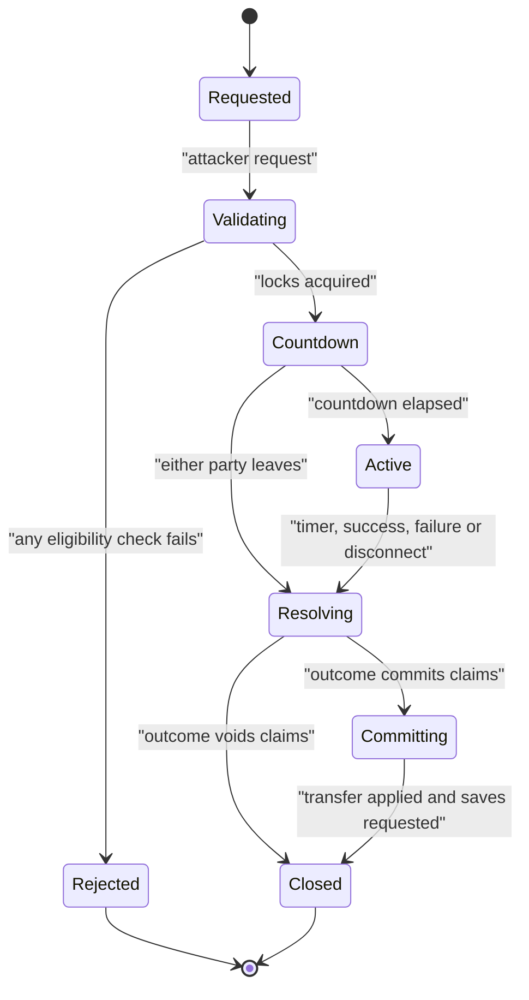

# Implementation - Raid Session Controller

The server object that owns one raid from request to transfer commit. It enforces the confirmed theft rules, keeps the undecided values configurable, and guarantees that stolen items move between two profiles exactly once. The game design is owned by [[Base Raiding System]], [[Raid Lifecycle and States]], [[Egg Theft Rules]], [[Animal Theft Rules]] and [[Raid Disconnection Handling]]. Exploit cases are catalogued in [[Raid Anti-Exploit Validation]] and [[Exploit Prevention]].

> [!success] CONFIRMED (D-021, D-024)
> Raids are optional. Base-stored eggs can be stolen; **backpack eggs never**. A defending animal can be stolen **only after it has been knocked out**; undefeated defenders cannot be stolen. **At most three animals** are stolen per successful raid. **Offline bases cannot be raided.** Bases are protected by shields and physical defences.

> [!warning] UNDECIDED
> Raid duration ([[Open Questions#Q-012]]) and the egg theft limit ([[Open Questions#Q-013]]) have **no default**. Also open: PvP/raid activation ([[Open Questions#Q-011]]), matchmaking ([[Open Questions#Q-029]]), shields ([[Open Questions#Q-030]]), which animals defend ([[Open Questions#Q-033]], [[Open Questions#Q-035]]), what a stolen animal keeps ([[Open Questions#Q-025]]), same-server versus cross-server raids (Q-901), and whether claims made before a defender disconnect transfer (Q-906).

> [!info] PROPOSED
> The controller states, escrow model, claim checks, interaction ranges, lock design and commit procedure are **PROPOSED**. Code is **illustrative — not executed**.

## 1. State machine



| State | Claims accepted? | Defender base frozen? | Notes |
|---|---|---|---|
| `Requested` / `Validating` | No | No | Synchronous checks, then lock acquisition (yields) |
| `Countdown` | No | Yes | Short warning to the defender ([[Sound - Base and Raid Alerts]], [[UI - Raid Interface]]) |
| `Active` | Yes | Yes | Timer running |
| `Resolving` | No | Yes | Outcome fixed; no further theft |
| `Committing` | No | Yes | Transfer applied in one two-profile transaction |
| `Closed` | No | No | Locks released |

"Defender base frozen" means the defender cannot merge, hatch from base storage, move eggs between backpack and base, or reassign guards. This keeps the stealable set stable for the whole raid ([[Implementation - Egg Merge Transaction]]).

## 2. Outcomes and commit policy

> [!important] Rule owner: [[Raid Disconnection Handling]] and [[Egg Theft Rules]]
> **Secured is final; provisional is reversible.** Each stolen egg is committed the moment the attacker secures it at the extraction point, through its own journalled transfer, and stays with the attacker whatever the outcome. The table below therefore governs only **held animals** (captured, not yet transferred) and any egg still being carried, which always returns to the vault.

> [!warning] Code below is a simplified prototype
> The illustrative `RaidSession` code escrows `claimedEggs` until `endRaid`. Before [[M15 - Base Raids]], replace the egg path with a per-egg commit at securing (`HandleSecureEgg`, as in [[Service - RaidService]]), and keep escrow only for held animals.

| Outcome | Trigger | Held animals | Status |
|---|---|---|---|
| `Success` | Success condition defined in [[Raid Lifecycle and States]] | Transfer (≤ 3) | **PROPOSED** |
| `Failed` | Attacker knocked out or defeated | Void (returned) | **PROPOSED** |
| `TimedOut` | Configured duration elapsed with the attacker still in the raid | Transfer if the vault was breached ([[Raid Lifecycle and States]]), otherwise return | **PROPOSED** |
| `AttackerDisconnected` | Attacker leaves the server | Return to the defender (secured eggs stay with the attacker) | **PROPOSED**: prevents "disconnect to escape" from keeping loot without finishing |
| `DefenderDisconnected` | Defender leaves the server | Raid ends at once; **no further theft**; animals held from a raid already breached transfer, otherwise return | **PROPOSED** per offline protection (D-024); confirmation needed (Q-906) |
| `Cancelled` | Server shutdown before `Active`, admin action | Void | **PROPOSED** |
| `ServerShutdown` during `Active` | `BindToClose` | Return (secured eggs stay) | **PROPOSED**: both saves cannot be guaranteed in the shutdown window |

> [!warning] UNDECIDED (Q-906)
> Committing claims secured before a defender disconnect removes the incentive for defenders to quit to cancel a raid (combat logging). The alternative, returning everything, is friendlier to defenders with unstable connections. The code reads `RaidConfig.COMMIT_ON_DEFENDER_DISCONNECT`; the prototyping value is `true`.

## 3. Configuration

```lua
--!strict
-- Illustrative — not executed
-- ServerStorage/Config/RaidConfig (full)

return {
	MAX_ANIMALS_STOLEN = 3,                 -- CONFIRMED (D-024)
	DURATION_SECONDS = nil :: number?,      -- UNDECIDED (Q-012) — no default
	EGG_THEFT_CAP = nil :: number?,         -- UNDECIDED (Q-013) — no default
	COUNTDOWN_SECONDS = 5,                  -- PROPOSED (local)
	CLAIM_RANGE_STUDS = 10,                 -- PROPOSED (local): attacker must be near the vault / KO'd animal
	LOCK_GRACE_SECONDS = 60,                -- PROPOSED (local): MemoryStore lock outlives the raid by this
	COMMIT_ON_DEFENDER_DISCONNECT = true,   -- PROPOSED; UNDECIDED (Q-906)
	SAME_SERVER_ONLY = true,                -- PROPOSED; UNDECIDED (Q-901)
}
```

The controller refuses to start when `DURATION_SECONDS` or `EGG_THEFT_CAP` is `nil` and returns `FEATURE_DISABLED`. Test places inject values through `RaidConfigOverride` ([[Configuration Modules]]).

## 4. Eligibility (Validating)

| # | Check | Reason code | Status |
|---|---|---|---|
| E1 | Raid feature configured (duration and egg cap set) | `FEATURE_DISABLED` | **PROPOSED** |
| E2 | Defender is **online** and in this server | `DEFENDER_OFFLINE` | Online **CONFIRMED**; same-server **PROPOSED** (Q-901) |
| E3 | Both have opted in to raiding under the activation rules | `NOT_OPTED_IN` | Optional **CONFIRMED**; method **UNDECIDED** (Q-011) |
| E4 | Defender shield not active | `SHIELDED` | Shields **CONFIRMED**; acquisition **UNDECIDED** (Q-030) |
| E5 | Matchmaking band allows the pair | `NOT_ELIGIBLE` | **UNDECIDED** (Q-029) |
| E6 | Neither party in another raid, boss encounter or PvP session | `IN_RAID` / `BUSY` | **PROPOSED** |
| E7 | Both profiles loaded and session-locked by this server | `NOT_READY` | **PROPOSED** |
| E8 | Attacker has at least one free egg or animal slot | `STORAGE_FULL` | **PROPOSED** |
| E9 | Pair cooldown (same attacker → same defender) not active | `NOT_ELIGIBLE` | **UNDECIDED** (Q-907) |
| E10 | Cross-server raid lock for the defender acquired | `BUSY` | **PROPOSED** |

## 5. Code

```lua
--!strict
-- Illustrative — not executed
-- ServerScriptService/Services/RaidService/RaidSession

local Players = game:GetService("Players")
local HttpService = game:GetService("HttpService")
local MemoryStoreService = game:GetService("MemoryStoreService")
local ServerStorage = game:GetService("ServerStorage")

local RaidConfig = require(ServerStorage.Config.RaidConfig)
local Registry = require(script.Parent.Parent.Parent.Registry)

local raidLocks = MemoryStoreService:GetSortedMap("RaidLocks")

export type RaidState = "Requested" | "Validating" | "Countdown" | "Active" | "Resolving" | "Committing" | "Closed" | "Rejected"
export type Outcome = "Success" | "Failed" | "TimedOut" | "AttackerDisconnected" | "DefenderDisconnected" | "Cancelled" | "ServerShutdown"

export type RaidSession = {
	id: string,
	state: RaidState,
	attacker: Player,
	defender: Player,
	startedAt: number?,
	endsAt: number?,
	outcome: Outcome?,
	eggCap: number,
	claimedEggs: { [string]: boolean },   -- egg uid -> true (escrow)
	claimedEggCount: number,
	claimedAnimals: { [string]: boolean },
	stolenAnimalCount: number,             -- hard-capped at MAX_ANIMALS_STOLEN (3)
	defenderRoster: { [string]: boolean }, -- animal uids registered as defenders at raid start (Q-033)
	koRecords: { [string]: { at: number, byAttacker: boolean } },
}

local RaidSession = {}
RaidSession.__index = RaidSession

local sessions: { [string]: RaidSession } = {}
local byPlayer: { [Player]: RaidSession } = {}

local function reject(code: string): any
	return { ok = false, reason = code }
end

-- ===== Cross-server lock (MemoryStore) =====
-- Prevents two servers from raiding the same defender (relevant if Q-901 allows cross-server raids,
-- and as a guard against a defender profile being loaded elsewhere mid-raid).
local function acquireLock(defenderId: number, raidId: string, ttl: number): boolean
	local ok, result = pcall(function()
		return raidLocks:UpdateAsync(tostring(defenderId), function(old: any)
			if old ~= nil and old.raidId ~= raidId then
				return nil -- another raid holds the lock: abort the update
			end
			return { raidId = raidId, jobId = game.JobId }
		end, ttl)
	end)
	return ok and result ~= nil and result.raidId == raidId
end

local function releaseLock(defenderId: number, raidId: string)
	pcall(function()
		local key = tostring(defenderId)
		local current = raidLocks:GetAsync(key)
		-- Only remove our own lock. The read-then-remove gap is acceptable: another raid can only
		-- take the key after ours has expired, and then GetAsync returns its raidId, not ours.
		if current ~= nil and current.raidId == raidId then
			raidLocks:RemoveAsync(key)
		end
	end)
	-- If release fails, the lock expires after duration + countdown + grace (LOCK_GRACE_SECONDS).
end

-- ===== Creation and validation =====
function RaidSession.request(attacker: Player, defender: Player): any
	if RaidConfig.DURATION_SECONDS == nil or RaidConfig.EGG_THEFT_CAP == nil then
		return reject("FEATURE_DISABLED") -- Q-012 / Q-013 undecided; no defaults
	end
	if defender.Parent ~= Players then
		return reject("DEFENDER_OFFLINE") -- offline bases never raidable (CONFIRMED)
	end
	if byPlayer[attacker] or byPlayer[defender] then
		return reject("IN_RAID")
	end
	local Eligibility = Registry.get("RaidService").eligibility
	local okElig, code = Eligibility.check(attacker, defender) -- E3, E4, E5, E6, E7, E8, E9
	if not okElig then
		return reject(code :: string)
	end

	local self: RaidSession = setmetatable({
		id = HttpService:GenerateGUID(false),
		state = "Validating",
		attacker = attacker,
		defender = defender,
		eggCap = RaidConfig.EGG_THEFT_CAP :: number,
		claimedEggs = {},
		claimedEggCount = 0,
		claimedAnimals = {},
		stolenAnimalCount = 0,
		defenderRoster = Registry.get("BaseService").registerDefenders(defender), -- which animals: Q-033
		koRecords = {},
	}, RaidSession) :: any

	-- Reserve both players BEFORE yielding on the lock, so no second request slips in.
	byPlayer[attacker] = self
	byPlayer[defender] = self
	sessions[self.id] = self

	local ttl = (RaidConfig.DURATION_SECONDS :: number) + RaidConfig.COUNTDOWN_SECONDS + RaidConfig.LOCK_GRACE_SECONDS
	if not acquireLock(defender.UserId, self.id, ttl) then -- yields
		self:_teardown()
		return reject("BUSY")
	end
	-- Re-check after the yield: either player may have left meanwhile.
	if attacker.Parent ~= Players or defender.Parent ~= Players then
		releaseLock(defender.UserId, self.id)
		self:_teardown()
		return reject("DEFENDER_OFFLINE")
	end

	self:_enterCountdown()
	return { ok = true, raidId = self.id }
end

function RaidSession:_enterCountdown()
	self.state = "Countdown"
	Registry.get("BaseService").setBaseFrozen(self.defender, self.id, true)
	Registry.get("RaidService").notify(self, "Countdown", RaidConfig.COUNTDOWN_SECONDS)
	task.delay(RaidConfig.COUNTDOWN_SECONDS, function()
		if self.state == "Countdown" then
			self:_enterActive()
		end
	end)
end

function RaidSession:_enterActive()
	self.state = "Active"
	local duration = RaidConfig.DURATION_SECONDS :: number
	self.startedAt = os.clock()
	self.endsAt = self.startedAt + duration
	Registry.get("RaidService").notify(self, "Active", duration)
	task.delay(duration, function()
		if self.state == "Active" then
			self:endRaid("TimedOut")
		end
	end)
end

-- ===== KO verification (called by CombatService when a defender's HP reaches 0) =====
function RaidSession:onDefenderKnockedOut(animalUid: string, killerIsAttackerSide: boolean)
	if self.state ~= "Active" or not self.defenderRoster[animalUid] then
		return
	end
	-- The KO is recorded by the SERVER at the moment HP reached 0 in this raid.
	self.koRecords[animalUid] = { at = os.clock(), byAttacker = killerIsAttackerSide }
end

-- ===== Claims =====
local function within(player: Player, pos: Vector3, range: number): boolean
	local char = player.Character
	local root = char and char:FindFirstChild("HumanoidRootPart") :: BasePart?
	return root ~= nil and (root.Position - pos).Magnitude <= range
end

function RaidSession:claimEgg(caller: Player, eggUid: string): any
	if self.state ~= "Active" then
		return reject("RAID_NOT_ACTIVE")
	end
	if caller ~= self.attacker then
		return reject("NOT_ATTACKER")
	end
	if Registry.get("CombatService").isKnockedOut(caller) then
		return reject("ATTACKER_DOWN")
	end
	if self.claimedEggCount >= self.eggCap then
		return reject("THEFT_CAP_REACHED") -- cap value UNDECIDED (Q-013)
	end
	if self.claimedEggs[eggUid] then
		return reject("ALREADY_CLAIMED")
	end
	local DataService = Registry.get("DataService")
	local dprof = DataService.getLoadedProfile(self.defender)
	if not dprof then
		return reject("NOT_READY")
	end
	local egg = DataService.findEgg(dprof, eggUid)
	if egg == nil then
		return reject("EGG_NOT_FOUND")
	end
	if egg.location ~= "Base" then
		-- Backpack eggs are NEVER stealable (CONFIRMED). This is the only branch for them.
		Registry.get("RemoteGateway").flag(caller, "raid_backpack_claim", 10)
		return reject("NOT_STEALABLE")
	end
	if egg.lockedBy ~= nil then
		return reject("EGG_LOCKED")
	end
	local vaultPos = Registry.get("BaseService").getVaultPosition(self.defender)
	if not within(caller, vaultPos, RaidConfig.CLAIM_RANGE_STUDS) then
		return reject("OUT_OF_RANGE")
	end
	if not Registry.get("RaidService").attackerHasRoomFor(self, 1, 0) then
		return reject("STORAGE_FULL")
	end

	egg.lockedBy = self.id -- escrow: stays in defender data until commit
	self.claimedEggs[eggUid] = true
	self.claimedEggCount += 1
	Registry.get("RaidService").notify(self, "EggClaimed", eggUid)
	return { ok = true, eggsClaimed = self.claimedEggCount }
end

function RaidSession:claimAnimal(caller: Player, animalUid: string): any
	if self.state ~= "Active" then
		return reject("RAID_NOT_ACTIVE")
	end
	if caller ~= self.attacker then
		return reject("NOT_ATTACKER")
	end
	if Registry.get("CombatService").isKnockedOut(caller) then
		return reject("ATTACKER_DOWN")
	end
	-- CONFIRMED hard cap: never a fourth animal.
	if self.stolenAnimalCount >= RaidConfig.MAX_ANIMALS_STOLEN then
		return reject("THEFT_CAP_REACHED")
	end
	if not self.defenderRoster[animalUid] then
		Registry.get("RemoteGateway").flag(caller, "raid_non_defender_claim", 10)
		return reject("NOT_STEALABLE") -- only animals defending in this raid
	end
	if self.claimedAnimals[animalUid] then
		return reject("ALREADY_CLAIMED")
	end
	-- CONFIRMED: undefeated defenders cannot be stolen. The KO must be a server record from THIS raid.
	local ko = self.koRecords[animalUid]
	local entity = Registry.get("AnimalAIService").entities.byAnimalUid(animalUid)
	if ko == nil or entity == nil or entity.state ~= "KnockedOut" then
		Registry.get("RemoteGateway").flag(caller, "raid_unko_claim", 5)
		return reject("DEFENDER_NOT_KO")
	end
	if not within(caller, entity.position, RaidConfig.CLAIM_RANGE_STUDS) then
		return reject("OUT_OF_RANGE")
	end
	if not Registry.get("RaidService").attackerHasRoomFor(self, 0, 1) then
		return reject("ANIMAL_STORAGE_FULL")
	end

	local DataService = Registry.get("DataService")
	local animal = DataService.findAnimal(DataService.getLoadedProfile(self.defender), animalUid)
	if animal == nil or animal.lockedBy ~= nil then
		return reject("ANIMAL_LOCKED")
	end
	animal.lockedBy = self.id
	self.claimedAnimals[animalUid] = true
	self.stolenAnimalCount += 1 -- reaches at most 3
	Registry.get("RaidService").notify(self, "AnimalClaimed", animalUid)
	return { ok = true, animalsClaimed = self.stolenAnimalCount }
end

-- ===== Ending =====
local COMMITS: { [Outcome]: boolean } = {
	Success = true,
	TimedOut = true,
	Failed = false,
	AttackerDisconnected = false,
	DefenderDisconnected = RaidConfig.COMMIT_ON_DEFENDER_DISCONNECT, -- Q-906
	Cancelled = false,
	ServerShutdown = false,
}

-- Synchronous up to the save request: safe to call from PlayerRemoving.
function RaidSession:endRaid(outcome: Outcome)
	if self.state == "Resolving" or self.state == "Committing" or self.state == "Closed" then
		return -- idempotent
	end
	self.state = "Resolving" -- from this line no claim can succeed
	self.outcome = outcome

	if COMMITS[outcome] and (self.claimedEggCount > 0 or self.stolenAnimalCount > 0) then
		self.state = "Committing"
		local ok = Registry.get("RaidService").transfer.commit(self) -- see section 6
		if not ok then
			self:_releaseEscrow() -- commit failed validation: return everything
		end
	else
		self:_releaseEscrow()
	end

	Registry.get("BaseService").setBaseFrozen(self.defender, self.id, false)
	Registry.get("RaidService").notify(self, "Closed", outcome)
	self.state = "Closed"
	local defenderId = self.defender.UserId
	local raidId = self.id
	self:_teardown()
	task.spawn(releaseLock, defenderId, raidId) -- yields; off the critical path
end

function RaidSession:_releaseEscrow()
	local DataService = Registry.get("DataService")
	local dprof = DataService.getLoadedProfile(self.defender)
	if not dprof then
		return -- profile already released; escrow flags are never saved (see below)
	end
	for uid in self.claimedEggs do
		local e = DataService.findEgg(dprof, uid)
		if e and e.lockedBy == self.id then e.lockedBy = nil end
	end
	for uid in self.claimedAnimals do
		local a = DataService.findAnimal(dprof, uid)
		if a and a.lockedBy == self.id then a.lockedBy = nil end
	end
end

function RaidSession:_teardown()
	byPlayer[self.attacker] = nil
	byPlayer[self.defender] = nil
	sessions[self.id] = nil
end

-- ===== Disconnects =====
-- DataService runs this BEFORE it saves and releases the leaving player's profile.
function RaidSession.onPlayerLeaving(player: Player)
	local s = byPlayer[player]
	if not s then
		return
	end
	if player == s.defender then
		s:endRaid("DefenderDisconnected") -- offline protection: no further theft
	else
		s:endRaid("AttackerDisconnected")
	end
end

function RaidSession.forPlayer(player: Player): RaidSession?
	return byPlayer[player]
end

return RaidSession
```

> [!note] Escrow flags are never persisted
> `lockedBy` is stripped by the DataService serialiser. If the server crashes mid-raid, both profiles revert to their last saves with no locks and no transfer, which is a consistent state.

## 6. Transfer commit

The commit moves claimed eggs and animals from the defender profile to the attacker profile inside **one** two-profile transaction, then writes a journal entry and saves both.

```lua
--!strict
-- Illustrative — not executed
-- ServerScriptService/Services/RaidService/Transfer

local Registry = require(script.Parent.Parent.Parent.Registry)
local Transfer = {}

function Transfer.commit(s: any): boolean
	local DataService = Registry.get("DataService")
	local TheftPolicy = Registry.get("RaidService").theftPolicy -- Q-025 hooks
	local a = DataService.getLoadedProfile(s.attacker)
	local d = DataService.getLoadedProfile(s.defender)
	if not a or not d then
		return false
	end

	local ok = DataService.txn2(a, d, { "eggs", "animals", "team", "raids" }, function(ad, dd)
		-- Idempotency: a raid id is applied at most once per profile.
		if ad.raids.applied[s.id] or dd.raids.applied[s.id] then
			return false, "DUPLICATE_REQUEST"
		end
		-- Re-validate every claim against current data.
		local eggs, animals = {}, {}
		for i = #dd.eggs.items, 1, -1 do
			local e = dd.eggs.items[i]
			if s.claimedEggs[e.uid] then
				if e.location ~= "Base" or e.lockedBy ~= s.id then
					return false, "NOT_STEALABLE" -- backpack egg can never pass
				end
				table.remove(dd.eggs.items, i)
				e.lockedBy = nil
				e.location = "Base" -- PROPOSED: stolen eggs land in attacker base storage
				e.source = "Raid"
				table.insert(eggs, e)
			end
		end
		if #eggs ~= s.claimedEggCount or #eggs > s.eggCap then
			return false, "INVARIANT"
		end
		for i = #dd.animals.items, 1, -1 do
			local x = dd.animals.items[i]
			if s.claimedAnimals[x.uid] then
				if x.lockedBy ~= s.id or s.koRecords[x.uid] == nil then
					return false, "DEFENDER_NOT_KO"
				end
				table.remove(dd.animals.items, i)
				TheftPolicy.onAnimalStolen(dd, x) -- e.g. clear from defender team (Q-025)
				x.lockedBy = nil
				x = TheftPolicy.transformStolenAnimal(x) -- what it keeps: UNDECIDED (Q-025)
				table.insert(animals, x)
			end
		end
		if #animals ~= s.stolenAnimalCount or #animals > 3 then
			return false, "INVARIANT" -- CONFIRMED cap
		end
		for _, e in eggs do table.insert(ad.eggs.items, e) end
		for _, x in animals do table.insert(ad.animals.items, x) end
		ad.raids.applied[s.id] = os.time()
		dd.raids.applied[s.id] = os.time()
		return true, nil
	end)
	if not ok then
		return false
	end

	-- Durable ordering: journal first, then both profiles at high priority.
	-- See Data Consistency and Transactions for the recovery procedure.
	task.spawn(function()
		DataService.writeRaidJournal(s.id, s.attacker.UserId, s.defender.UserId, s.claimedEggs, s.claimedAnimals)
		DataService.saveNow(s.defender, "raid_commit")
		DataService.saveNow(s.attacker, "raid_commit")
	end)
	return true
end

return Transfer
```

`DataService.txn2` is the two-profile form of `Txn.run` ([[Implementation - Egg Roll and Hatch Flow#Transaction helper]]): it snapshots the listed sections of **both** profiles and restores both on any failure. Conservation invariant: defender eggs lost = attacker eggs gained, and likewise for animals.

## 7. Exploit coverage summary

| Exploit | Blocked by |
|---|---|
| Steal backpack eggs | `egg.location ~= "Base"` check at claim and again at commit |
| Steal an undefeated defender | Server KO record in this raid **and** live entity state `KnockedOut` |
| Steal a fourth animal | Counter check at claim; `#animals > 3` invariant at commit |
| Steal a non-defending animal | `defenderRoster` registered at raid start |
| Raid an offline player | E2 at request; defender disconnect ends the raid instantly |
| Spam claims | Rate limit on `RaidAction` ([[Implementation - Rate Limiting]]) |
| Claim from across the map | `CLAIM_RANGE_STUDS` against server-side positions |
| Defender hides eggs mid-raid | Base frozen from `Countdown` to `Closed` |
| Double commit | `raids.applied[raidId]` in both profiles |

Full analysis in [[Exploit Prevention]] and [[Threat Model]].

## 8. Test hooks

[[Test Cases - Raiding]]: raid refused with nil config; backpack egg claim; fourth animal claim; claim before KO, after KO, after the KO'd animal was revived; defender disconnect at each state; attacker disconnect with claims; timer expiry; egg cap reached (with a test value only); commit re-validation failure returns everything; double `endRaid`.

## Related documents
- [[Base Raiding System]]
- [[Raid Lifecycle and States]]
- [[Raid Eligibility and Offline Protection]]
- [[Egg Theft Rules]]
- [[Animal Theft Rules]]
- [[Raid Disconnection Handling]]
- [[Raid Anti-Exploit Validation]]
- [[Shield Mechanics]]
- [[Data Consistency and Transactions]]
- [[Disconnect Handling]]
- [[Service - RaidService]]
