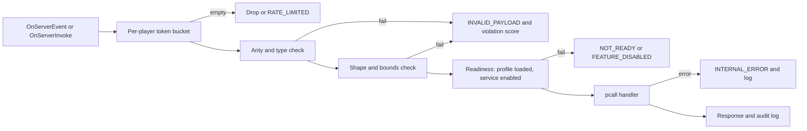

# Implementation - Remote Validation Layer

Every client-to-server remote enters the server through one gateway that applies, in order: **rate limiting → type and shape validation → sanity bounds → readiness → handler → logging**. Handlers receive only well-typed, bounded payloads. The remote list is owned by [[Remote Communication Contract]]; this page owns the enforcement mechanism.

> [!info] PROPOSED
> The gateway, validator combinators, bounds and violation scoring are **PROPOSED**. Code is **illustrative — not executed**. Remote argument behaviour described below is based on the Roblox remote events guide (checked 2026-11-14; see [[Roblox API Reference Notes]]).

> [!danger] Everything a client sends is hostile until validated
> Exploit clients can fire any remote with any arguments at any rate, including wrong types, `NaN`, infinite numbers, enormous strings, deeply nested tables and Instances they do not own ([[Threat Model]]).

## 1. Pipeline



Rate limiting runs **first** so that the cost of validating spam is bounded ([[Implementation - Rate Limiting]]).

## 2. Remote argument facts the validator relies on

| Fact | Consequence for validation |
|---|---|
| Functions do not replicate; the receiver gets `nil` | Never expect a function |
| Metatables are stripped | Never rely on a client "class"; validate raw fields |
| Mixed numeric and string keys in one table are not supported | Reject tables that mix; arrays must be sequential |
| Non-string keys (for example Instances) are converted to strings | Dictionaries must have string keys from an allow-list |
| Instances that do not exist on the server arrive as `nil` | Treat every Instance argument as optional and verify ownership |
| `UnreliableRemoteEvent` payloads over 1,000 bytes are dropped | Client-to-server unreliable traffic is not used for requests |

## 3. Validator combinators

```lua
--!strict
-- Illustrative — not executed
-- ServerScriptService/Net/Check
-- Small t-style combinators. (The community "t" library offers similar functions; we keep our own
-- minimal set so every rule is reviewed in-house.)

export type Validator = (value: any, path: string) -> (boolean, string?)

local Check = {}

local function fail(path: string, why: string): (boolean, string?)
	return false, path .. ": " .. why
end

function Check.finiteNumber(min: number, max: number): Validator
	return function(v, path)
		if typeof(v) ~= "number" then return fail(path, "not a number") end
		if v ~= v then return fail(path, "NaN") end
		if v == math.huge or v == -math.huge then return fail(path, "infinite") end
		if v < min or v > max then return fail(path, "out of bounds") end
		return true, nil
	end
end

function Check.integer(min: number, max: number): Validator
	local base = Check.finiteNumber(min, max)
	return function(v, path)
		local ok, why = base(v, path)
		if not ok then return ok, why end
		if v % 1 ~= 0 then return fail(path, "not an integer") end
		return true, nil
	end
end

function Check.string(minLen: number, maxLen: number, pattern: string?): Validator
	return function(v, path)
		if typeof(v) ~= "string" then return fail(path, "not a string") end
		if #v < minLen or #v > maxLen then return fail(path, "bad length") end
		if pattern and not string.match(v, pattern) then return fail(path, "bad format") end
		return true, nil
	end
end

-- GUID without braces, as produced by HttpService:GenerateGUID(false): 36 chars, hex and hyphens.
Check.guid = Check.string(36, 36, "^[%x%-]+$")

function Check.literal(...: any): Validator
	local allowed = {}
	for _, x in { ... } do allowed[x] = true end
	return function(v, path)
		if allowed[v] then return true, nil end
		return fail(path, "not an allowed value")
	end
end

function Check.boolean(): Validator
	return function(v, path)
		if typeof(v) ~= "boolean" then return fail(path, "not a boolean") end
		return true, nil
	end
end

function Check.optional(inner: Validator): Validator
	return function(v, path)
		if v == nil then return true, nil end
		return inner(v, path)
	end
end

-- Unit-ish vector: finite components, magnitude within [minMag, maxMag].
function Check.vector3(maxComponent: number, minMag: number?, maxMag: number?): Validator
	return function(v, path)
		if typeof(v) ~= "Vector3" then return fail(path, "not a Vector3") end
		for _, c in { v.X, v.Y, v.Z } do
			if c ~= c or math.abs(c) > maxComponent then return fail(path, "bad component") end
		end
		local m = v.Magnitude
		if minMag and m < minMag then return fail(path, "too short") end
		if maxMag and m > maxMag then return fail(path, "too long") end
		return true, nil
	end
end

function Check.array(inner: Validator, minLen: number, maxLen: number, unique: boolean?): Validator
	return function(v, path)
		if typeof(v) ~= "table" then return fail(path, "not a table") end
		local n = #v
		if n < minLen or n > maxLen then return fail(path, "bad length") end
		local count = 0
		for k in v do
			count += 1
			if typeof(k) ~= "number" or k < 1 or k > n or k % 1 ~= 0 then
				return fail(path, "not a sequential array")
			end
		end
		if count ~= n then return fail(path, "holes in array") end
		local seen = {}
		for i = 1, n do
			local ok, why = inner(v[i], path .. "[" .. i .. "]")
			if not ok then return ok, why end
			if unique then
				if seen[v[i]] then return fail(path, "duplicate entry") end
				seen[v[i]] = true
			end
		end
		return true, nil
	end
end

-- Strict record: only the listed keys may appear.
function Check.record(fields: { [string]: Validator }): Validator
	return function(v, path)
		if typeof(v) ~= "table" then return fail(path, "not a table") end
		for k in v do
			if typeof(k) ~= "string" or fields[k] == nil then
				return fail(path, "unexpected key " .. tostring(k))
			end
		end
		for k, check in fields do
			local ok, why = check(v[k], path .. "." .. k)
			if not ok then return ok, why end
		end
		return true, nil
	end
end

return Check
```

## 4. Schemas

```lua
--!strict
-- Illustrative — not executed
-- ServerScriptService/Net/Schemas

local Check = require(script.Parent.Check)

local WORLD_LIMIT = 20000 -- studs; PROPOSED sanity bound on any client-sent position component
local MAX_ENTITY_ID = 2 ^ 31 - 1

return {
	OddsQuote = Check.record({
		scope = Check.literal("roll", "hatch"),
	}),
	RollEggs = Check.record({
		count = Check.literal(1, 5),
		oddsToken = Check.string(8, 8, "^%x+$"),
		idemKey = Check.guid,
	}),
	HatchEggs = Check.record({
		eggUids = Check.array(Check.guid, 1, 5, true), -- five max (CONFIRMED D-016)
		oddsToken = Check.string(8, 8, "^%x+$"),
		idemKey = Check.guid,
	}),
	Ascend = Check.record({
		targetUid = Check.guid,
		duplicateUids = Check.array(Check.guid, 1, 5, true),
		confirmHighValue = Check.optional(Check.boolean()),
		idemKey = Check.guid,
	}),
	MergeEggs = Check.record({
		eggUids = Check.array(Check.guid, 3, 3, true), -- exactly three (CONFIRMED D-020)
		idemKey = Check.guid,
	}),
	CombatIntent = Check.record({
		kind = Check.literal("Basic", "PowerStrike", "GroundSlam", "RallyCry", "Dodge"),
		targetId = Check.optional(Check.integer(1, MAX_ENTITY_ID)),
		aimDir = Check.optional(Check.vector3(1.01, 0.9, 1.1)), -- unit vector with tolerance
		seq = Check.integer(1, MAX_ENTITY_ID),
	}),
	AbilityIntent = Check.record({
		slot = Check.literal(1, 2, 3), -- team of three (CONFIRMED D-006)
		targetId = Check.optional(Check.integer(1, MAX_ENTITY_ID)),
		seq = Check.integer(1, MAX_ENTITY_ID),
	}),
	TargetCommand = Check.record({
		targetId = Check.integer(1, MAX_ENTITY_ID),
		slot = Check.optional(Check.literal(1, 2, 3)),
	}),
	RaidAction = Check.record({
		action = Check.literal("Request", "ClaimEgg", "ClaimAnimal", "Leave"),
		defenderUserId = Check.optional(Check.integer(1, 2 ^ 53)),
		eggUid = Check.optional(Check.guid),
		animalUid = Check.optional(Check.guid),
	}),
	PlaceMarker = Check.record({ -- example of a client-sent position, e.g. a ping marker
		position = Check.vector3(WORLD_LIMIT),
	}),
}
```

Cross-field rules (for example, `ClaimEgg` requires `eggUid`) are checked by the handler immediately after the schema.

## 5. Sanity bounds

| Field kind | Bound | Status |
|---|---|---|
| Any string | ≤ 64 characters unless the schema says otherwise | **PROPOSED** |
| Any array | ≤ 5 entries in gameplay remotes (the largest legitimate batch is a 5-egg hatch) | **PROPOSED** |
| Table nesting | One level (records of scalars or arrays of scalars) | **PROPOSED** |
| Positions | Each component within ±20,000 studs; never trusted for gameplay, only for UI markers | **PROPOSED** |
| Direction vectors | Magnitude 0.9–1.1 | **PROPOSED** |
| Entity ids | Positive integers; resolved through the server registry, never as Instances | **PROPOSED** |
| Instances as arguments | Not accepted in gameplay remotes. Use ids. | **PROPOSED** |

## 6. Gateway

```lua
--!strict
-- Illustrative — not executed
-- ServerScriptService/Services/RemoteGateway (excerpt)

local ReplicatedStorage = game:GetService("ReplicatedStorage")
local Players = game:GetService("Players")

local Schemas = require(script.Parent.Parent.Net.Schemas)
local RateLimiter = require(script.Parent.Parent.Net.RateLimiter)
local Registry = require(script.Parent.Parent.Registry)

type Options = { schema: any, bucket: string, requiresProfile: boolean }

local RemoteGateway = { Name = "RemoteGateway" }
local remotesFolder: Folder

function RemoteGateway:Init()
	remotesFolder = Instance.new("Folder")
	remotesFolder.Name = "Remotes"
	remotesFolder.Parent = ReplicatedStorage
end

function RemoteGateway:Start() end

local function ready(player: Player, opts: Options): boolean
	if not opts.requiresProfile then return true end
	return Registry.get("DataService").getLoadedProfile(player) ~= nil
end

function RemoteGateway.flag(player: Player, kind: string, weight: number)
	RateLimiter.addViolation(player, kind, weight)
end

function RemoteGateway.bindFunction(name: string, handler: (Player, any) -> any, opts: Options)
	local rf = Instance.new("RemoteFunction")
	rf.Name = name
	rf.Parent = remotesFolder
	rf.OnServerInvoke = function(player: Player, payload: any)
		if not RateLimiter.consume(player, opts.bucket) then
			return { ok = false, reason = "RATE_LIMITED" }
		end
		local ok, why = opts.schema(payload, name)
		if not ok then
			RemoteGateway.flag(player, "schema:" .. name, 5)
			Registry.get("AnalyticsAndLoggingService").security(player, "INVALID_PAYLOAD", name, why)
			return { ok = false, reason = "INVALID_PAYLOAD" }
		end
		if not ready(player, opts) then
			return { ok = false, reason = "NOT_READY" }
		end
		local success, result = pcall(handler, player, payload)
		if not success then
			Registry.get("AnalyticsAndLoggingService").error(name, result, player.UserId)
			return { ok = false, reason = "INTERNAL_ERROR" }
		end
		return result
	end
end

function RemoteGateway.bindEvent(name: string, handler: (Player, any) -> (), opts: Options)
	local re = Instance.new("RemoteEvent")
	re.Name = name
	re.Parent = remotesFolder
	re.OnServerEvent:Connect(function(player: Player, payload: any, ...)
		if select("#", ...) > 0 then
			RemoteGateway.flag(player, "arity:" .. name, 5) -- extra arguments: forged call
			return
		end
		if not RateLimiter.consume(player, opts.bucket) then
			return -- events are dropped silently
		end
		local ok = opts.schema(payload, name)
		if not ok then
			RemoteGateway.flag(player, "schema:" .. name, 5)
			return
		end
		if not ready(player, opts) then
			return
		end
		local success, err = pcall(handler, player, payload)
		if not success then
			Registry.get("AnalyticsAndLoggingService").error(name, err, player.UserId)
		end
	end)
end

return RemoteGateway
```

Handlers are bound in each service's `Start()` ([[Module Patterns and Bootstrapping]]). The same arity check applies to `bindFunction` in production code; it is omitted above for brevity.

## Reason codes

The shared enum. Each flow documents which codes it can return.

| Code | Meaning | Typical sources |
|---|---|---|
| `OK` | Success | All |
| `INVALID_PAYLOAD` | Type, shape, bounds or cross-field check failed | Gateway, all handlers |
| `RATE_LIMITED` | Token bucket empty | Gateway |
| `NOT_READY` | Profile not loaded | Gateway, handlers |
| `FEATURE_DISABLED` | Service failed to start, or a feature is switched off (raids while Q-012/Q-013 are unset) | Gateway, RaidService |
| `BUSY` | A conflicting flow with a yielding stage is in progress, or a lock is held | Raid, DataService |
| `DUPLICATE_REQUEST` | Idempotency or raid-apply duplicate | Transactions |
| `INTERNAL_ERROR` | Unexpected error; transaction rolled back | Gateway |
| `STALE_ODDS` | Odds token stale; fresh odds attached | Roll, hatch |
| `INSUFFICIENT_CASH` | Not enough Cash | Roll, ascension, merge |
| `STORAGE_FULL` | Not enough egg slots | Roll, raid |
| `BASE_STORAGE_FULL` | No base slot for a merge output | Merge |
| `ANIMAL_STORAGE_FULL` | Not enough animal slots (Q-022) | Hatch, raid |
| `TOO_MANY_EGGS` | Hatch batch not in 1–5 | Hatch |
| `EGG_NOT_FOUND` / `ANIMAL_NOT_FOUND` | Not owned by caller | Hatch, merge, ascension, raid |
| `EGG_LOCKED` / `ANIMAL_LOCKED` | Reserved by another flow, equipped, or in raid escrow | Hatch, merge, ascension |
| `NOT_AT_BASE` | Action requires the player's own base | Hatch (base eggs), merge |
| `OUT_OF_RANGE` | Too far from shrine, station, vault, target | Roll, merge, combat, raid |
| `IN_COMBAT` | Combat-tagged | Hatch |
| `IN_RAID` | In an active raid, or base under raid | Hatch, merge, ascension |
| `SPECIES_MISMATCH` | Duplicate is a different species | Ascension |
| `WRONG_DUPLICATE_COUNT` | Duplicate count ≠ requirement | Ascension |
| `MAX_ASCENSION` | Already at the top level | Ascension |
| `VARIANT_NOT_ALLOWED` | Variant used as a duplicate under the current policy (Q-902) | Ascension |
| `CONFIRMATION_REQUIRED` | High-value consumption needs explicit confirmation | Ascension |
| `RARITY_MISMATCH` | Merge inputs differ in rarity | Merge |
| `MAX_RARITY` | Secret cannot be merged | Merge |
| `STATION_NOT_OWNED` / `STATION_LEVEL_TOO_LOW` | Merge station gate | Merge |
| `DEFENDER_OFFLINE` | Target offline or not in this server | Raid |
| `NOT_OPTED_IN` / `SHIELDED` / `NOT_ELIGIBLE` | Raid eligibility | Raid |
| `RAID_NOT_ACTIVE` / `NOT_ATTACKER` / `ATTACKER_DOWN` | Raid claim context | Raid |
| `ALREADY_CLAIMED` / `THEFT_CAP_REACHED` | Raid claim limits | Raid |
| `NOT_STEALABLE` | Backpack egg or non-defending animal | Raid |
| `DEFENDER_NOT_KO` | Defender not knocked out in this raid | Raid |
| `POLICY_RESTRICTED` | Reserved for paid-random-item restrictions (Q-032) | Roll |

## 7. Violation scoring

Violations are weighted (schema failure 5, forged arity 5, impossible cooldown 2, raid rule probe 5–10) and decay over time. Thresholds and actions are in [[Implementation - Rate Limiting#Violation scoring]] and [[Exploit Prevention]].

## 8. Test hooks

[[Test Cases - Exploit Prevention]]: fuzz every schema with random types, `NaN`, `math.huge`, 10 KB strings, nested tables, mixed-key tables, extra arguments, nil payloads; assert no handler runs and no error escapes the gateway.

## Related documents
- [[Implementation - Rate Limiting]]
- [[Remote Communication Contract]]
- [[Server-Client Responsibilities]]
- [[Security Architecture]]
- [[Exploit Prevention]]
- [[Threat Model]]
- [[Logging and Error Handling]]
- [[Roblox API Reference Notes]]
