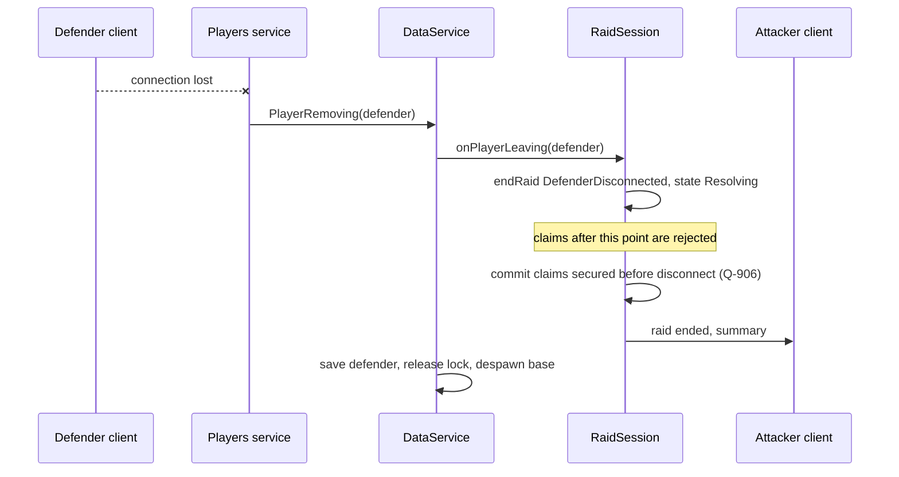

# Disconnect Handling

What happens to every in-flight action when a player leaves, loses connection, or the server shuts down. The guiding rule: **every action is either fully applied or not applied at all, and a disconnect can never be used to gain an item, avoid a cost, or cancel a loss that already happened.** Raid-specific design is owned by [[Raid Disconnection Handling]]; this page is the technical behaviour across all systems.

> [!success] CONFIRMED (D-024)
> Offline bases cannot be raided. A defender who disconnects ends the raid.

> [!info] PROPOSED
> Behaviour per case is **PROPOSED**. Defeat penalties, including whether a mid-fight disconnect counts as a defeat, are **UNDECIDED** ([[Open Questions#Q-014]]).

## 1. Mechanics we rely on

| Mechanism | Guarantee we design for |
|---|---|
| `Players.PlayerRemoving` | Fires for normal leaves and most disconnects; the `Player` object is still usable during the handler |
| Synchronous leaving callbacks | `DataService` runs every registered `onPlayerLeaving(player)` callback **before** it saves and releases the profile ([[Module Patterns and Bootstrapping]]) |
| `game:BindToClose` | Runs on shutdown; saves all profiles. Maximum wait is *unverified*, so saves are also made after every transaction |
| Session lock | A profile can be loaded by only one server at a time ([[Data Consistency and Transactions]]) |
| In-memory transactions | Never partially applied ([[Implementation - Egg Roll and Hatch Flow#Transaction helper]]) |
| Server crash | No callbacks run. The profile reverts to the last successful save. The session lock expires after its timeout |

## 2. Case matrix

| Case | When the disconnect happens | Outcome | Player sees on return | Status |
|---|---|---|---|---|
| **Mid-roll** | Before the request reaches the server | Nothing happened | Cash unchanged | **PROPOSED** |
| | After the transaction, before the save | `PlayerRemoving` save persists both debit and eggs | Eggs present, Cash debited | **PROPOSED** |
| | After the transaction, server crashes before any save | Both debit and eggs revert together | Cash unchanged, no eggs | **PROPOSED** |
| **Mid-hatch** | During the hatch animation | Result was committed before the animation started; saved on leave | Animals in inventory; "new" badges shown ([[UI - Notifications]]) | **PROPOSED** |
| | Crash before save | Eggs and animals revert together; eggs back, no animals | Eggs present | **PROPOSED** |
| **Mid-merge** | During the merge animation | Committed and saved on leave | Output egg in base storage | **PROPOSED** |
| | Crash before save | Inputs back, no output, fee not charged | As before the merge | **PROPOSED** |
| **Mid-ascension** | Any | Same pattern as merge | Committed or not, never partial | **PROPOSED** |
| **Mid-team-change** | Any | Team change is one transaction at the base; committed or not | Team as saved | **PROPOSED** |
| **Mid-raid, attacker leaves** | `Countdown` or `Active` | Raid ends `AttackerDisconnected`; escrow released; nothing transferred; defender's base unfrozen | Attacker: no loot. Defender: notified raid ended | **PROPOSED** |
| | `Committing` (after `endRaid` began) | Commit already applied in memory for both profiles; both saved (attacker on leave, defender immediately) | Loot present if the outcome committed | **PROPOSED** |
| **Mid-raid, defender leaves** | `Countdown` | Raid ends `DefenderDisconnected`; no claims exist; nothing transferred | — | **CONFIRMED** principle (offline protection) |
| | `Active` | Raid ends **immediately** in the leaving handler; state becomes `Resolving` so **no further theft** is possible; claims secured before the disconnect commit (PROPOSED, Q-906); base despawns after save | Defender: summary of what was taken before leaving | Offline protection **CONFIRMED**; commit of earlier claims **PROPOSED** (Q-906) |
| | `Committing` | Commit completes, then the defender profile saves and releases | As above | **PROPOSED** |
| **Mid-boss** | Fighting a mini-boss or world boss | Player removed from the encounter; damage contribution kept until the boss dies or despawns; reward eligibility on return is **UNDECIDED** with boss rewards ([[Open Questions#Q-015]]). Proposed: rewards are granted only to players present at the kill | Nothing, unless rewards are granted offline (not proposed) | **PROPOSED** |
| | Last player in the encounter leaves | Boss resets to full HP after the leash or encounter timeout | — | **PROPOSED** |
| **Mid-PvP** | In a PvP session | Session ends for that player; penalty treatment **UNDECIDED** (Q-014) | — | **UNDECIDED** |
| **Mid-wild-fight** | Combat-tagged | Wild animal returns to spawn on leash or target loss and resets | Nothing lost | **PROPOSED** |
| **During profile load** | Before `ProfileLoaded` | Load aborted; lock released if acquired | Normal join next time | **PROPOSED** |
| **During save** | `UpdateAsync` in flight | Save completes server-side if the server stays up; otherwise last good save stands | — | **PROPOSED** |
| **Server shutdown (update)** | Any | `BindToClose` saves all; active raids end as `ServerShutdown` (claims voided); bosses vanish | All committed transactions present | **PROPOSED** |
| **DataStore outage** | Any | Saves retried; profile stays dirty; on leave, retries until `BindToClose` or give-up; analytics alert | If all retries fail, last good save stands | **PROPOSED** |

## 3. Raid disconnect sequence

The essential property is the order: the raid moves to `Resolving` **inside** the leaving callback, before any yield, so an attacker request queued behind the disconnect arrives at a session that no longer accepts claims.

## 4. Anti-abuse considerations

| Abuse | Protection |
|---|---|
| Defender quits to cancel a raid in progress | Earlier claims still commit (PROPOSED, Q-906); the raid itself ends (offline protection) |
| Attacker quits after claiming to "bank" loot without risk | Attacker disconnect voids escrow |
| Player quits mid-roll hoping for a re-roll | Outcome decided before reveal; re-joining shows the same eggs |
| Player crashes the server deliberately (e.g. by remote spam) to revert a loss | Rate limits and validation ([[Implementation - Rate Limiting]]); losses are saved immediately after raid commits |
| Duplication by disconnecting during a two-profile transfer | Raid journal and `appliedRaids` ([[Data Consistency and Transactions]]) |
| Disconnect to dodge a defeat penalty | Part of the penalty design, **UNDECIDED** (Q-014) |

## 5. Rejoin behaviour

1. The new server attempts to load the profile. If the old server still holds the session lock (it is mid-save), the load retries with back-off up to the lock timeout.
2. On load, `appliedRaids` and the raid journal are reconciled ([[Data Consistency and Transactions]]).
3. The client receives a "while you were away" summary only for events that completed (raid outcomes against the player's base, hatch results already shown).

## 6. Test hooks

[[Test Cases - Persistence]], [[Test Cases - Raiding]] and [[Test Cases - Multiplayer]]: kill the client during each animation; stop the server between transaction and save (Studio stop); defender leave in each raid state; attacker leave with three claimed animals; rejoin while the old server is saving; `BindToClose` with 16 dirty profiles.

## Related documents
- [[Raid Disconnection Handling]]
- [[Data Consistency and Transactions]]
- [[Implementation - Raid Session Controller]]
- [[Implementation - Egg Roll and Hatch Flow]]
- [[Shared World and Player Sessions]]
- [[Save, Load and Recovery]]
- [[Player Defeat and Penalties]]
- [[Service - DataService]]
