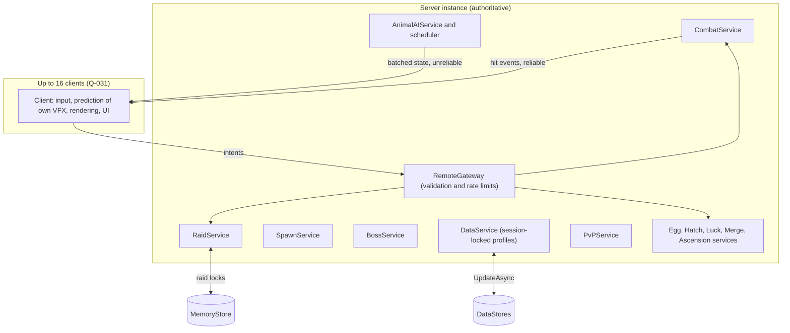

# Multiplayer Architecture

How *Fight Animals for Eggs* runs as one shared world in which players play alone or together, fight wild animals and bosses side by side, and optionally raid or duel each other. This document is the top-level map; each topic links to its owning document.

> [!success] CONFIRMED (D-025, D-023, D-024)
> One large shared world supporting single-player and multiplayer play. PvP is optional. Raids are optional; offline bases cannot be raided.

> [!info] PROPOSED
> Topology, authority split, session types and synchronisation approach are **PROPOSED**. Maximum players per server is **UNDECIDED** with a working assumption of 16 ([[Open Questions#Q-031]]).

## 1. Topology

| Layer | Description | Status |
|---|---|---|
| Server instance | One Roblox server runs a complete copy of the world: hub, all eight regions, every connected player's base plot | **PROPOSED** |
| Players per server | Working assumption 16 (Q-031) | **UNDECIDED** |
| Base plots | One plot per connected player; a player's base exists only while they are in the server ([[Shared World and Player Sessions]]) | **PROPOSED** |
| Cross-server | No gameplay crosses servers at launch except profile persistence and optional announcements; raids are same-server (Q-901) | **PROPOSED** |
| Reserved or private servers | Not required at launch | **PROPOSED** |

## 2. Authority model

The server is authoritative for everything that affects progression, economy, combat outcomes or another player. The client is authoritative only for its own input and its own presentation.

| Domain | Authority | Client role | Owning document |
|---|---|---|---|
| Player character movement | Client (Roblox default physics ownership), **validated** by the server | Moves own character | [[Network Ownership]], [[Exploit Prevention]] |
| Companion and wild animal simulation | Server | Renders visual models, interpolates | [[Replication Strategy]] |
| Combat hits and damage | Server | Sends intent, predicts own swing VFX | [[Implementation - Combat Damage Pipeline]] |
| Cooldowns | Server | Displays predicted timers | [[Latency Handling]] |
| Cash, eggs, animals, base levels | Server | Displays | [[Data Consistency and Transactions]] |
| Odds and random outcomes | Server | Displays odds before commit | [[Implementation - Dynamic Luck Calculation]] |
| Raid state and theft | Server | Requests claims | [[Implementation - Raid Session Controller]] |
| Camera, UI, audio, VFX | Client | Full | [[Client Controllers]] |

Detailed split: [[Server-Client Responsibilities]].

## 3. Session types inside one server

A player is always in exactly one **context** at a time. Contexts determine which rules apply to damage, rewards and defeat.

| Context | Who | Hostility | Rewards | Defeat penalty | Status |
|---|---|---|---|---|---|
| Open world (PvE) | Any players nearby | Players + companions versus wild animals; players never damage each other | Shared kill credit, ≥ 10% damage, full reward each (D-040) | **UNDECIDED** (Q-014) | Kill credit **PROPOSED** |
| Mini-boss encounter | Players in the encounter zone | Versus boss | Once per player per spawn; rewards **UNDECIDED** (Q-015) | **UNDECIDED** (Q-014) | **PROPOSED** |
| World boss encounter | All players who join | Versus boss | As above | **UNDECIDED** (Q-014) | **PROPOSED** |
| PvP session | Two or more players who have opted in | Players and companions versus each other | **UNDECIDED** | **UNDECIDED** (Q-014) | Activation **UNDECIDED** (Q-011) |
| Raid session | One attacker, one defender (and the defender's defences) | Attacker side versus defender side | Theft per [[Egg Theft Rules]] and [[Animal Theft Rules]] | **UNDECIDED** (Q-014) | **PROPOSED** |
| At own base | Owner | None unless a raid is active | — | — | **PROPOSED** |
| Hub | All | None (safe zone) | — | — | **PROPOSED** |

`PvPService.canDamage(a, b)` and `RaidService.sideOf(entity)` are the only predicates the combat pipeline consults for player-versus-player hostility. Nothing else may make players hostile.

## 4. Combat synchronisation

1. The client sends a `CombatIntent` (kind, optional target id, aim direction, sequence number).
2. The client immediately plays its own swing animation and swing VFX (prediction of player-only effects; [[Latency Handling]]).
3. The server validates and resolves the hit against its own entity positions, with lag compensation capped at 0.25 s (**PROPOSED**).
4. The server broadcasts a reliable `CombatEvent` (attacker, target, amount, HP after) to clients within relevance range.
5. All clients, including the attacker, play hit reactions, damage numbers and HP bar changes **only** on `CombatEvent`. The attacker never shows a damage number the server did not confirm.

Animal attacks are server-originated: the AI decides, `CombatService.applyHit` resolves, and the `CombatEvent` drives client visuals. Attack animations for animals are triggered by state changes in the replicated animal state ([[Replication Strategy]]).

## 5. Boss encounters

| Aspect | Approach | Status |
|---|---|---|
| Simulation | Server-owned, AI tier A at 10 Hz plus scheduled attack timers ([[Boss AI]]) | **PROPOSED** |
| Telegraphs | Server sends `BossTelegraph { attackId, startServerTime, impactServerTime, area }` ahead of impact; clients render warnings on the shared server timeline (`workspace:GetServerTimeNow()`) | **PROPOSED** |
| Impact resolution | At `impactServerTime` the server tests player positions as the server last received them; players inside the area take damage unless their dodge i-frames cover the instant | **PROPOSED** |
| Fairness under latency | Telegraph lead time must exceed the slowest supported round trip by a margin; minimum 0.8 s lead for any dodgeable attack | **PROPOSED** |
| Participation | Reward eligibility uses the same ≥ 10% contribution rule as wild kills, or a boss-specific rule from [[Boss Rewards]] | Rewards **UNDECIDED** (Q-015) |
| Spawn and announcement | World bosses every 45–60 min per server, announced 2 min ahead (canonical §5) | **PROPOSED** |
| Disconnect | [[Disconnect Handling]] | **PROPOSED** |

## 6. Raid sessions

A raid is a two-player session inside the shared world: the attacker travels to the defender's base plot in the same server and the server opens a `RaidSession` ([[Implementation - Raid Session Controller]]). Other players nearby are bystanders: they cannot damage either side, cannot claim, and see the raid only as ambient activity (**PROPOSED**). The defender's base is frozen for economy actions during the raid. Duration and egg cap are **UNDECIDED** (Q-012, Q-013).

## 7. PvP sessions

> [!warning] UNDECIDED (Q-011)
> The activation method (toggle, zones, duel invites, arenas) is not decided ([[PvP Activation Options]]). The network design below is independent of the choice.

- PvP state is held per player on the server (`pvpEnabled`, `pvpContextId`).
- Damage between players requires `PvPService.canDamage(a, b) == true` for the pair.
- Opting out must take effect only when the player has not been in PvP combat for the combat-tag timeout (8 s, canonical §4), preventing "toggle off to escape" (**PROPOSED**).
- Companions inherit their owner's PvP state.

## 8. Scale and budgets

Up to 16 players × 3 companions = 48 companions, up to 180 simulated wild animals with ≤ 60 at full AI, plus bosses and raid guards. Analysis and budgets: [[Animal Scalability and Performance Budgets]].

## 9. Persistence

Profiles are loaded with a session lock, mutated by in-memory transactions and saved with `UpdateAsync` ([[Data Consistency and Transactions]]). No gameplay state other than profiles and raid journals is persisted.

## Related documents
- [[Multiplayer and Security Index]]
- [[Shared World and Player Sessions]]
- [[Replication Strategy]]
- [[Network Ownership]]
- [[Latency Handling]]
- [[Disconnect Handling]]
- [[Data Consistency and Transactions]]
- [[Security Architecture]]
- [[Multiplayer Combat Rules]]
- [[Architecture Overview]]
