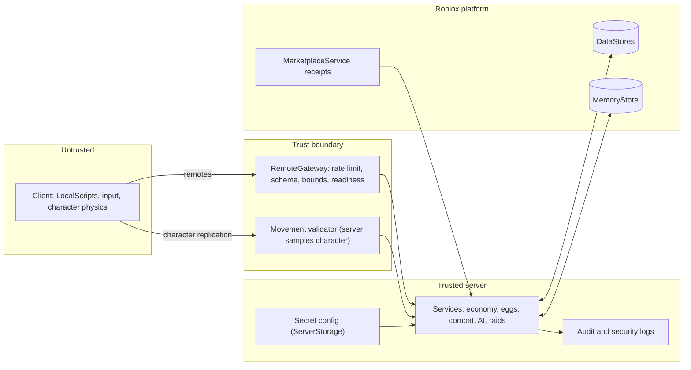

# Security Architecture

The security model for *Fight Animals for Eggs*. The game has three properties that make it an attractive target: a Cash economy that buys randomised rewards, rare animals with social status, and raids that move items between players. The architecture assumes every client may be modified and every remote may be called with arbitrary data. Specific exploits and mitigations are catalogued in [[Exploit Prevention]]; risks are rated in [[Threat Model]].

> [!info] PROPOSED
> All controls are **PROPOSED**. They implement **CONFIRMED** rules such as disclosed odds (D-017), independent hatches (D-018), backpack eggs never stealable (D-021) and the raid theft rules (D-024).

## 1. Principles

| # | Principle | Consequence |
|---|---|---|
| P1 | **The server is the only authority** for economy, inventory, randomness, combat outcomes and raid state | Clients send intents; the server decides ([[Server-Client Responsibilities]]) |
| P2 | **Validate everything at the boundary** | One gateway: rate limit, type, shape, bounds ([[Implementation - Remote Validation Layer]]) |
| P3 | **Make invalid states unrepresentable where possible** | Backpack eggs have no code path into raid escrow; offline bases do not exist in the world |
| P4 | **Atomic, idempotent mutations** | `Txn.run`, idempotency keys, raid journal ([[Data Consistency and Transactions]]) |
| P5 | **Least exposure** | Secret config in `ServerStorage`; other players' inventories never replicated |
| P6 | **Detect, do not only prevent** | Violation scoring, economy anomaly telemetry, audit logs |
| P7 | **Proportionate response** | Drop → log → kick; bans are human decisions (Q-905) |
| P8 | **Fairness is a security property** | Odds tampering and silent odds changes are treated as security defects ([[Randomised Reward Compliance]]) |

## 2. Trust boundaries

| Boundary | What crosses | Control |
|---|---|---|
| Client → server remotes | Intents and requests | Gateway pipeline |
| Client → server character physics | Position, velocity of the player's own character | Movement validator, server-side range checks |
| Server → client | State the client needs | Need-to-know replication ([[Replication Strategy]]) |
| Server ↔ DataStore | Profiles, journals | Session locks, `UpdateAsync`, schema validation on load |
| Platform → server | Purchase receipts | `ProcessReceipt`, receipt-id idempotency |

## 3. Defence in depth

| Layer | Controls | Documents |
|---|---|---|
| L1 Transport | Rate limits per remote and per player; arity checks | [[Implementation - Rate Limiting]] |
| L2 Input | Type, shape, enum and bounds validation; no Instance arguments | [[Implementation - Remote Validation Layer]] |
| L3 Context | Readiness, location (base, shrine, station), combat tag, raid state | Flow docs in [[Luau Implementation Index]] |
| L4 Rules | Cooldowns, range, line of sight, ownership, locks, capacity, caps | [[Implementation - Combat Damage Pipeline]], transaction docs |
| L5 Integrity | Atomic transactions, invariants, idempotency, session locks, journal | [[Data Consistency and Transactions]] |
| L6 Detection | Violation score, economy telemetry, statistical audits of odds | [[Service - AnalyticsAndLoggingService]], [[Statistical Testing of Probabilities]] |
| L7 Response | Kick thresholds, manual review, data rollback tooling | [[Save, Load and Recovery]] |

## 4. Secrets and exposure

| Asset | Location | Why |
|---|---|---|
| Luck slopes, pool weights, pivot | `ServerStorage/Config/LuckConfig` | The formula may stay hidden (D-017); only computed odds are sent |
| Anti-cheat thresholds, rate-limit parameters | `ServerStorage/Config` | Publishing them tells exploiters the safe margin |
| Raid configuration | `ServerStorage/Config/RaidConfig` | Undecided values must not leak as "the answer" |
| Other players' inventories, storage, odds tokens | Never replicated | Prevent target selection and social engineering |
| Shared pure algorithms (weighted selection, damage maths) | `ReplicatedStorage/Shared` | Not secret; knowing them confers no advantage |

## 5. Economy integrity

- Every Cash source and sink is server-side and logged with a reason ([[Cash Sources and Sinks]]).
- Telemetry alerts (**PROPOSED** thresholds, tuned in beta): Cash gained per hour above the 99.9th percentile for the player's region; more than 3 raids per hour by one attacker; any profile with Cash increase without a matching logged source.
- No Robux path grants Cash (D-044, **PROPOSED**; [[Open Questions#Q-032]]), keeping cash egg rolls out of paid-random-item scope; `PolicyService` checks still guard any future paid random item ([[Roblox Monetisation Policy Requirements]]).
- No trading at launch (D-045, **PROPOSED**) removes the largest duplication and real-money-trading surface.

## 6. Randomness integrity

| Control | Detail |
|---|---|
| Server-only RNG | `Random.new()` per service; no client seeds |
| Disclosed odds bound to a token | `oddsVersion` with stale rejection ([[Implementation - Dynamic Luck Calculation]]) |
| Independence | Selector takes only odds; static check that hatch code never reads the collection (D-018) |
| Audit trail | Every roll and hatch logs token, config version and result for statistical audit |
| Statistical monitoring | Live chi-square checks per rarity against disclosed odds ([[Statistical Testing of Probabilities]]) |

## 7. Logging

| Log | Content | Retention | Status |
|---|---|---|---|
| Security events | UserId, kind, weight, remote, short reason | Analytics backend retention (to be set in [[Logging and Error Handling]]) | **PROPOSED** |
| Economy audit | Source or sink, amount, balance after, transaction id | Same | **PROPOSED** |
| Roll and hatch audit | Token, config version, outcomes | Same | **PROPOSED** |
| Raid audit | Raid id, parties, claims, outcome, journal status | Same | **PROPOSED** |

Logs never contain chat text or personal information beyond the Roblox UserId.

## 8. Response policy

| Signal | Automated action | Human action | Status |
|---|---|---|---|
| Single invalid request | Drop | — | **PROPOSED** |
| Violation score ≥ 50 | Log and flag | Review queue | **PROPOSED** |
| Violation score ≥ 150 | Kick | Review | **PROPOSED**; enabling at launch **UNDECIDED** (Q-905) |
| Confirmed exploit or duplication | — | Data rollback from versions, moderation report through Roblox tools | **PROPOSED** |
| Economy anomaly | Flag | Investigate before any action | **PROPOSED** |

## 9. Security gates in the roadmap

| Milestone | Gate |
|---|---|
| [[M02 - Core Project Setup]] | Gateway, validator and rate limiter in place before the first gameplay remote |
| [[M08 - Egg Rolling]] / [[M09 - Hatching]] | Odds token, idempotency and statistical tests pass |
| [[M15 - Base Raids]] | Every row of the raid section in [[Exploit Prevention]] has a passing test |
| [[M19 - Multiplayer Testing]] | Exploit-simulation session with modified clients in a private test place |
| [[M22 - Launch]] | [[Threat Model]] reviewed; no open High risks without accepted mitigation |

## Related documents
- [[Exploit Prevention]]
- [[Threat Model]]
- [[Implementation - Remote Validation Layer]]
- [[Implementation - Rate Limiting]]
- [[Data Consistency and Transactions]]
- [[Server-Client Responsibilities]]
- [[Randomised Reward Compliance]]
- [[Raid Anti-Exploit Validation]]
- [[Multiplayer and Security Index]]
