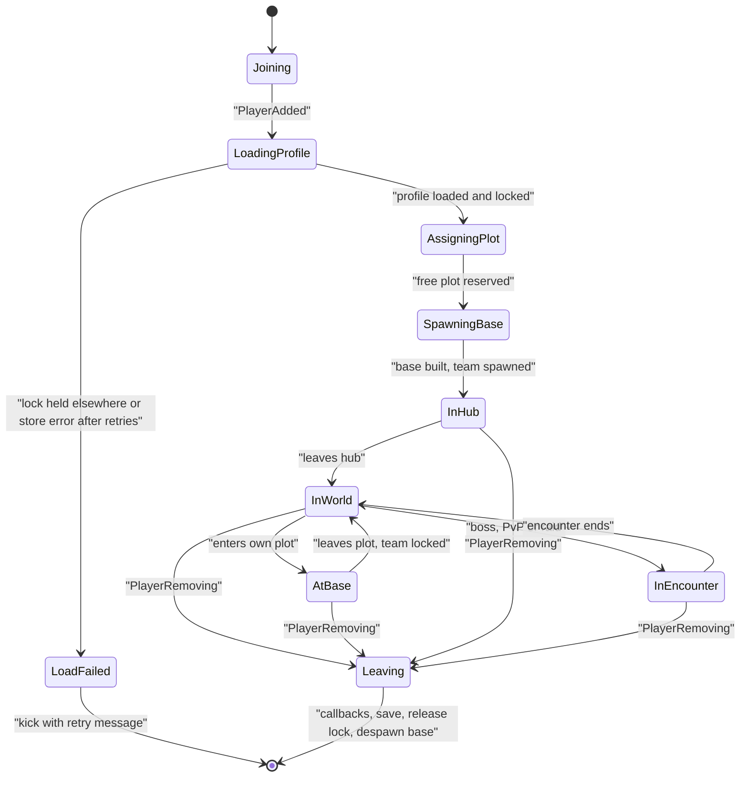

# Shared World and Player Sessions

What happens from the moment a player joins a server until they leave, and how many players share one world. World content is owned by [[World Overview and Map]]; the session flow from the player's point of view is in [[Session Flow and Player Journey]].

> [!success] CONFIRMED (D-025)
> One large shared world that supports both single-player and multiplayer play. Each player owns a personal modular base (D-022). Offline bases cannot be raided (D-024).

> [!warning] UNDECIDED (Q-031)
> Maximum players per server. Working assumption for prototyping: **16** ([[Canonical Proposed Values]] §15).

## 1. What "shared world" means in practice

| Shared between players in a server | Per player (private) |
|---|---|
| The hub, all regions, terrain and props | Cash, eggs, animals, index, levels |
| Wild animal population and respawn timers | Odds quotes and tokens |
| Mini-boss and world boss spawns | Egg roll and hatch results (visible to others only as optional celebration events) |
| Base plots (each player's base is visible to everyone) | Base module levels (visible as models), base storage contents (never replicated to others) |
| Combat events near you | Team composition (visible as companions in the world) |

A solo player in a busy server plays exactly as a solo player in an empty one: no system requires a group, and shared kill credit (D-040, **PROPOSED**) means nearby players never reduce each other's rewards.

## 2. Session lifecycle

| Phase | Server work | Budget | Status |
|---|---|---|---|
| `LoadingProfile` | `UpdateAsync` to read and acquire the session lock ([[Data Consistency and Transactions]]); schema migration ([[Data Validation and Migration]]) | Target < 3 s; retries up to 5 with back-off | **PROPOSED** |
| `AssigningPlot` | Reserve one of N plots (N = server capacity) | Instant | **PROPOSED** |
| `SpawningBase` | Build modules from saved levels; spawn guards if pens display is adopted ([[Open Questions#Q-008]]) | Spread over frames | **PROPOSED** |
| Team spawn | Three companions created as server entities ([[Replication Strategy]]) | Instant | Team size **CONFIRMED** |
| `Leaving` | Run `onPlayerLeaving` callbacks (raid end, PvP end, encounter cleanup), final save, release lock, despawn base and companions | Synchronous callbacks; save yields | **PROPOSED** |

Until `ProfileLoaded` fires, every economy remote returns `NOT_READY` and the client shows a loading state.

## 3. Base plots

| Rule | Detail | Status |
|---|---|---|
| One plot per connected player | Plots are pre-placed around the hub or regions as defined in [[Base Layout and Plot Expansion]] | **PROPOSED** |
| Plot count | Equals server capacity (16 under the working assumption) | **PROPOSED** (Q-031) |
| Base exists only while the owner is online | On leave, the base model is removed. A removed base is not a raid target, which enforces offline protection structurally, not only by rule | Offline protection **CONFIRMED**; mechanism **PROPOSED** |
| Re-join | The base is rebuilt from saved data on a plot in whichever server the player joins | **PROPOSED** |
| Plot ownership | Only the owner can change modules, team or storage on their plot ([[Team Equipping and Base Lock Rule]]) | Team change at base **CONFIRMED** |

> [!info] PROPOSED — why bases despawn on leave
> Keeping a base model in the world after its owner leaves would invite players to try to interact with it. Removing it makes "offline bases cannot be raided" true by construction: there is nothing to raid ([[Raid Eligibility and Offline Protection]]).

## 4. Joining a server with friends

| Situation | Behaviour | Status |
|---|---|---|
| Join a friend | Standard Roblox join-friend flow places the player in the friend's server if not full | Platform behaviour, *unverified* details |
| Server full | Player is placed in another server; no in-game party system at launch | **PROPOSED** |
| Party teleport | Not at launch. Would require TeleportService and is out of scope | **PROPOSED** |

## 5. Interest management

Clients do not need the whole world at full detail.

| Mechanism | Purpose | Status |
|---|---|---|
| `StreamingEnabled` | Stream world geometry around the player; reduces memory on mobile | **PROPOSED**; behaviour details *unverified* |
| Animal state relevance | Server sends animal state only for entities within 300 studs of each client ([[Replication Strategy]]) | **PROPOSED** |
| Combat event relevance | `CombatEvent` sent only to clients within 150 studs of the target, plus the attacker's owner | **PROPOSED** |
| Server-wide events | Rare spawns and world boss announcements go to every client in the server | **PROPOSED** |

## 6. Player density and contention

With 16 players in eight regions, average density is two per region, but players cluster in the region matching their level and at world bosses.

| Contention point | Mitigation | Status |
|---|---|---|
| Wild animals in a popular region | Shared kill credit; respawn timers by rarity ([[Wild Animal Spawning and Respawn]]) | **PROPOSED** |
| Legendary spawn point (single per region) | Shared credit for all contributors ≥ 10% | **PROPOSED** |
| World boss with 16 players | AI scheduler keeps the boss at tier A; combat events batched ([[Animal Scalability and Performance Budgets]]) | **PROPOSED** |
| Egg shrine in the hub | Rolls are per player; no physical queue | **PROPOSED** |

## 7. Social visibility

| Event | Who sees it | Status |
|---|---|---|
| Another player's companions | Everyone nearby | **PROPOSED** |
| Hatch of Legendary or rarer | Optional server announcement (player can opt out in [[UI - Settings]]) | **PROPOSED** |
| Raid in progress | Bystanders see combat at the plot; storage contents never shown | **PROPOSED** |
| Base storage contents | Owner only | **PROPOSED** |

## 8. Edge cases

- **Rejoin while the previous server is still saving.** The new server's load finds the session lock held and retries; see [[Data Consistency and Transactions]].
- **Two devices, same account.** Roblox normally removes the first session; if both briefly coexist in different servers, the session lock prevents double loading.
- **Server shutdown (update).** `BindToClose` saves all profiles; active raids end as `ServerShutdown` with claims voided ([[Disconnect Handling]]).
- **Player joins mid world boss.** May join the fight; eligibility from contribution, not presence at spawn.

## Related documents
- [[Multiplayer Architecture]]
- [[Session Flow and Player Journey]]
- [[World Overview and Map]]
- [[Base Layout and Plot Expansion]]
- [[Raid Eligibility and Offline Protection]]
- [[Disconnect Handling]]
- [[Data Consistency and Transactions]]
- [[Replication Strategy]]
- [[Service - DataService]]
- [[Service - BaseService]]
