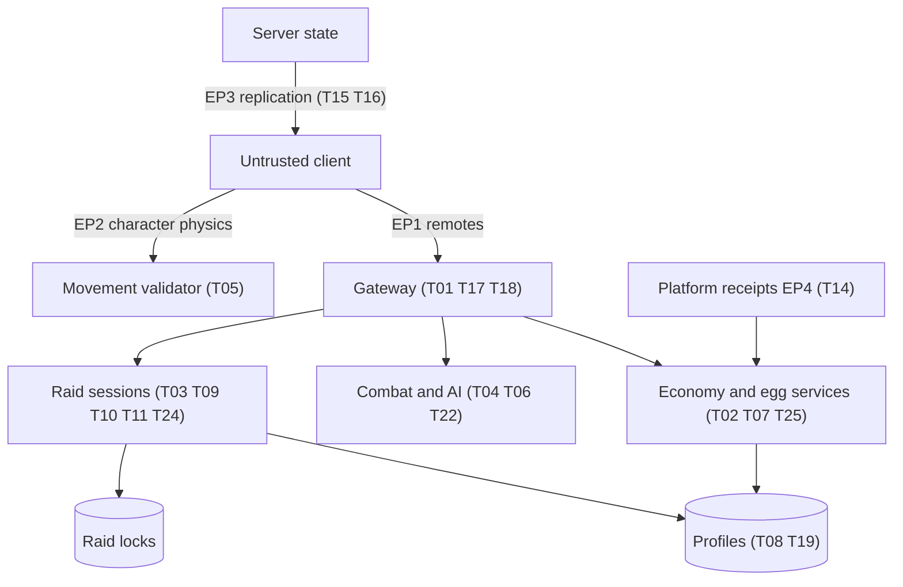

# Threat Model

A STRIDE-style threat model for *Fight Animals for Eggs*. It lists what we protect, who attacks it, where they can reach it, and how each threat is mitigated. Controls are specified in [[Security Architecture]] and [[Exploit Prevention]]. Project-level risks are in [[Risk Register]].

> [!info] PROPOSED
> Ratings and mitigations are **PROPOSED** and must be reviewed before [[M22 - Launch]]. Review cadence: at every milestone that adds a remote, and after any confirmed exploit.

## 1. Assets

| ID | Asset | Why it matters |
|---|---|---|
| AS1 | Player profile (Cash, eggs, animals, ascension, base levels, index) | Core progression; loss or duplication destroys trust and economy |
| AS2 | Fairness of randomness (disclosed odds, independence) | **CONFIRMED** requirements D-017 and D-018; compliance ([[Randomised Reward Compliance]]) |
| AS3 | Raid outcomes | Items move between players; **CONFIRMED** theft rules D-021 and D-024 |
| AS4 | Combat integrity | PvE fairness, PvP fairness, boss rewards |
| AS5 | Server availability | One crashed server ends sixteen sessions |
| AS6 | Hidden configuration (luck slopes, thresholds) | D-017 allows the formula to stay hidden; thresholds aid exploiters |
| AS7 | Purchases | Real money; must be granted exactly once |
| AS8 | Player privacy | Other players' inventories and storage |

## 2. Actors

| Actor | Capability | Motivation |
|---|---|---|
| Casual cheater | Public exploit scripts; speed, teleport, auto-farm | Faster progression |
| Skilled exploiter | Custom scripts; remote fuzzing; timing attacks on races | Duplication, rare animals, notoriety, selling accounts |
| Griefer | Spam, server crash attempts, harassment through raids | Disruption |
| Alt-account farmer | Multiple accounts; cooperative "victim" | Feeding a main account through raids |
| Malicious insider or compromised tooling | Access to place files or admin commands | Any |
| Platform failure | DataStore outage, server crash | Not malicious; same integrity impact |

## 3. Entry points

| ID | Entry point | Notes |
|---|---|---|
| EP1 | Client → server remotes | All gameplay requests ([[Remote Communication Contract]]) |
| EP2 | Client-owned character physics | Position and velocity of the player's own character |
| EP3 | Replicated data visible to the client | Anything under `Workspace`, `ReplicatedStorage`, attributes, remote payloads |
| EP4 | Platform callbacks | `ProcessReceipt`, `PlayerRemoving`, `BindToClose` |
| EP5 | DataStore and MemoryStore | Indirect: through server code only |
| EP6 | Studio and publishing access | Place files, packages, admin tooling |

## 4. STRIDE table

Likelihood (L) and impact (I) are rated 1 (low) to 3 (high); risk = L × I (1–2 Low, 3–4 Medium, 6–9 High). Ratings are **before** mitigation; "Residual" is after.

| ID | STRIDE | Threat | Asset | Entry | L | I | Risk | Mitigation | Residual |
|---|---|---|---|---|---:|---:|---|---|---|
| T01 | Spoofing | Client sends requests claiming to act for another player (forged UserId in payload) | AS1 | EP1 | 2 | 3 | High | Identity taken only from the `Player` argument the engine supplies; payloads never carry an acting UserId except as a target id validated server-side | Low |
| T02 | Spoofing | Forged odds token to keep old favourable odds | AS2 | EP1 | 2 | 3 | High | Server-stored quote, recomputation from PS, config version and bucket, single use ([[Implementation - Dynamic Luck Calculation]]) | Low |
| T03 | Spoofing | Raid claim as a non-attacker (bystander or defender) | AS3 | EP1 | 2 | 3 | High | `caller == attacker` check; session lookup by player | Low |
| T04 | Tampering | Damage forging | AS4 | EP1 | 3 | 2 | High | Intent-only payload; server computes damage | Low |
| T05 | Tampering | Speed hack, teleport, fly | AS4, AS3 | EP2 | 3 | 2 | High | Movement validator; server-position range checks; claim range | Medium (some advantage within tolerances remains) |
| T06 | Tampering | Cooldown and combo bypass | AS4 | EP1 | 3 | 2 | High | Server-side cooldown timestamps, 0.05 s tolerance | Low |
| T07 | Tampering | Duplication via yield race or double submit | AS1 | EP1 | 2 | 3 | High | No-yield transactions with yield detection; idempotency keys ([[Implementation - Egg Roll and Hatch Flow]]) | Low |
| T08 | Tampering | Duplication via disconnect or server hop during transfer | AS1, AS3 | EP4 | 2 | 3 | High | Session locks; raid journal as commit point; `appliedRaids` ([[Data Consistency and Transactions]]) | Low |
| T09 | Tampering | Stealing backpack eggs | AS3 | EP1 | 2 | 3 | High | Location check at claim and commit; never listed in raid UI | Low |
| T10 | Tampering | Stealing an undefeated defender, or a fourth animal | AS3 | EP1 | 2 | 3 | High | Server KO record in this raid and live KO state; counter and commit invariant ≤ 3 | Low |
| T11 | Tampering | Raiding an offline player | AS3 | EP1, EP4 | 1 | 3 | Medium | Defender must be in the server; base despawns on leave; disconnect ends raid in the leaving callback | Low |
| T12 | Tampering | Client edits local config or UI to unlock features | AS1 | EP3 | 3 | 1 | Medium | All gates enforced on the server | Low |
| T13 | Repudiation | Player disputes a lost raid or a hatch outcome | AS2, AS3 | — | 2 | 2 | Medium | Audit logs of roll, hatch and raid events with tokens, ids and outcomes | Low |
| T14 | Repudiation | Purchase disputes ("I paid and got nothing") | AS7 | EP4 | 2 | 2 | Medium | `ProcessReceipt` grants only after durable save; purchase ids stored; logs | Low |
| T15 | Information disclosure | Reading other players' storage to choose raid targets | AS8, AS3 | EP3 | 2 | 2 | Medium | Need-to-know replication; storage never sent to others | Low |
| T16 | Information disclosure | Reading hidden luck slopes and anti-cheat thresholds | AS6 | EP3 | 3 | 1 | Medium | Secret config in `ServerStorage` | Low |
| T17 | Denial of service | Remote spam to lag or crash the server | AS5 | EP1 | 3 | 3 | High | Token buckets first in the pipeline; bounded payload sizes; kick threshold | Medium (platform-level floods out of our control) |
| T18 | Denial of service | Expensive request patterns (pathfinding, huge arrays) | AS5 | EP1 | 2 | 2 | Medium | Array caps of 5; pathfinding queue ≤ 10 per second; AI frame budget | Low |
| T19 | Denial of service | DataStore budget exhaustion through forced saves | AS1, AS5 | EP1 | 2 | 2 | Medium | Coalesced saves; save cadence independent of request rate | Low |
| T20 | Denial of service | Griefing via repeated raids on one player | AS3 | EP1 | 2 | 2 | Medium | Shields ([[Open Questions#Q-030]]), pair cooldown (Q-907), opt-in raiding | Medium (depends on undecided items) |
| T21 | Elevation of privilege | Calling admin or debug remotes | AS1 | EP1 | 2 | 3 | High | No debug remotes in live builds; `_testing` hooks exist only in Studio; admin actions only through server-side allow-listed UserIds | Low |
| T22 | Elevation of privilege | Taking network ownership of AI animals | AS4 | EP2 | 2 | 2 | Medium | Approach B has no animal parts; Approach A uses `SetNetworkOwner(nil)`; ownership audits ([[Network Ownership]]) | Low |
| T23 | Elevation of privilege | Compromised package or plugin injecting a backdoor remote | All | EP6 | 1 | 3 | Medium | Code in Git via Rojo; review of all packages; no free-model scripts; publish access limited | Low |
| T24 | Tampering | Alt-account feeding through raids | AS3, AS1 | EP1 | 3 | 2 | High | Theft caps; matchmaking bands ([[Open Questions#Q-029]]); pair heuristics; review flags | Medium (depends on Q-013, Q-029, Q-907) |
| T25 | Tampering | Silent odds change after purchase by server bug | AS2 | — | 1 | 3 | Medium | Commit uses the stored quote; statistical monitoring of outcomes against disclosed odds | Low |

## 5. Risk summary

| Residual | Count | Threats |
|---|---:|---|
| High | 0 | — |
| Medium | 4 | T05, T17, T20, T24 |
| Low | 21 | All others |

> [!warning] Residual risks depend on undecided items
> T20 and T24 cannot be reduced to Low until shields (Q-030), matchmaking (Q-029), the egg theft limit (Q-013) and the pair cooldown question (Q-907) are decided. They are flagged for the owner in [[Open Questions]].

## 6. Data-flow view

## 7. Review checklist for a new remote

- [ ] Added to [[Remote Communication Contract]] with a schema and a rate-limit bucket
- [ ] Payload carries intent only; no outcomes, odds, prices or acting identities
- [ ] Handler is atomic and idempotent where it mutates
- [ ] STRIDE row added or updated here
- [ ] Exploit tests added to [[Test Cases - Exploit Prevention]]

## Related documents
- [[Security Architecture]]
- [[Exploit Prevention]]
- [[Risk Register]]
- [[Raid Anti-Exploit Validation]]
- [[Data Consistency and Transactions]]
- [[Implementation - Remote Validation Layer]]
- [[Multiplayer and Security Index]]
