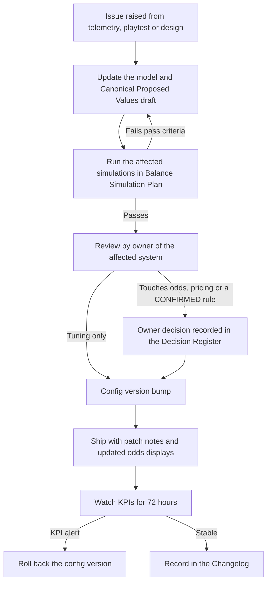

# Balancing Methodology

How the team tunes animal and player stats, the Cash economy and egg probabilities: which model each area uses, which targets it must meet, how changes are verified before release (simulation) and after release (telemetry), and how a change is shipped. Every number used here comes from [[Canonical Proposed Values]]. Concrete simulations and their pass criteria are in [[Balance Simulation Plan]]. The release procedure is [[Balance Update Process]].

> [!info] PROPOSED
> The method, the targets and the KPI thresholds on this page are **PROPOSED**. Targets introduced here that are not yet in [[Canonical Proposed Values]] are marked as such and should be added there once accepted.

## 1. Principles

1. **One source of numbers.** Tuning happens in [[Canonical Proposed Values]] and the config generated from it ([[Configuration Modules]]), never in code or in individual design pages.
2. **Model first, then simulate, then playtest, then measure.** A change that has not been through the model and the relevant simulation does not reach a playtest.
3. **Tune by levers, not by exceptions.** Prefer changing a role multiplier, a curve exponent or a region multiplier over special-casing one animal.
4. **Fairness constraints are hard limits, not levers** (**CONFIRMED**): odds shown before committing and never changed silently after a purchase (D-017); every hatch independent, with no pity or duplicate protection (D-018); fully playable without Robux (D-027).
5. **Retroactive by default.** Because derived values are never stored ([[Data Architecture Overview]]), most changes apply to existing players immediately. That is a feature, but it also means every change is a live change and must follow the change process (§8).

## 2. Lever map

| Area | Lever | Where defined | Primary effect | Risk if mis-tuned |
|---|---|---|---|---|
| Animal power | Tier multiplier *M*, role multipliers, species tweak (±0.06 PI) | Canonical §1, §3 | Relative strength of rarities and roles | Dominant roles, dead rarities |
| Ascension | +8% HP/ATK/DEF and +5% ability per level; duplicates per rarity | Canonical §9 | Long-term power and duplicate value | Grind walls, or duplicates with no value |
| Player power | Strength `10 + 2 × (L − 1)`, HP, DEF, specials | Canonical §4 | Player share of team damage, survivability | Animals feel optional, or player feels useless |
| Wild difficulty | Wild ×2.0 HP, ×0.75 ATK, region multiplier | Canonical §4, §5 | Time to kill, Cash per hour | Grind, or trivial combat |
| Income | Base Cash per rarity, region multiplier, Shrine, Trophy Hall | Canonical §6, §12 | Cash per hour | Inflation or stall |
| Sinks | Roll price, merge fees, station, modules, plot, ascension fees | Canonical §7, §9, §10, §12 | Time to milestones | Hoarding or walls |
| Odds | Baseline odds, slopes *s_r*, pivot P₀ = 0.30, hatch weight classes, *H* | Canonical §7, §8 | Rarity flow, collection pace | Compliance risk if changed carelessly |

## 3. Stats: the Power Index model

The [[Animal Stat Budget Model]] defines every animal's stats as `Reference × M(rarity) × RoleMultiplier × SpeciesTweak`. The balance check is the **Power Index**:

`PI = sqrt((ATK × AS) × (HP × (1 + DEF/100)))`, normalised so the Common reference is 1.00 within each tier.

| Rule | Target (from canonical values) |
|---|---|
| Pure combat roles (Tank, Bruiser, Assassin, Skirmisher, Ranged) | PI ≈ 1.00 ± 0.08 |
| Support | PI ≈ 0.81 (utility pays for the gap) |
| Controller | PI ≈ 0.87 |
| Species tweak | Must keep the animal within ± 0.06 of its role's PI |

Procedure for a new or changed animal:
1. Pick rarity and role. Compute the role-neutral stats.
2. Apply the species tweak and recompute PI. Reject if outside the role band.
3. Price the abilities: ability damage is a percentage of ATK, heals a percentage of the target's max HP ([[Animal Abilities Catalogue]]). An ability's expected damage per second, averaged over its cooldown, is added to the animal's effective DPS for the TTK check in §4. A Support or Controller animal must show how its utility closes its PI gap (for example "heal value per 10 s ≥ the missing 19% of damage-equivalent").
4. Regenerate the [[Animal Statistics Database]] and rerun SIM-04 (combat TTK) in [[Balance Simulation Plan]].

PI measures raw stat budget only. It does not capture abilities, targeting or range. Those are checked in playtests with the TTK and survivability targets below.

## 4. Combat targets

### Par loadout (PROPOSED, new)

Targets are measured against a **par loadout**: the power a typical free player is expected to have in each region. These assumptions should be replaced by telemetry medians after beta.

| Region | Player level | Training Grounds | Team rarity | Team ascension | Shrine level | Unique boss trophies |
|---|---:|---:|---|---:|---:|---:|
| 1 Whisperwood Forest | 5 | 0 | Common | A0 | 0 | 0 |
| 2 Sunscorch Savanna | 14 | 1 | Uncommon | A1 | 0 | 1 |
| 3 Emerald Canopy | 24 | 2 | Rare | A1 | 1 | 2 |
| 4 Coral Coast | 35 | 2 | Epic | A1 | 2 | 4 |
| 5 Frostfang Tundra | 47 | 3 | Epic | A3 | 3 | 6 |
| 6 Skyreach Peaks | 59 | 4 | Legendary | A2 | 3 | 7 |
| 7 Emberheart Caldera | 72 | 5 | Legendary | A4 | 4 | 9 |
| 8 Starfall Sanctuary | 90 | 5 | Mythical | A3 | 5 | 12 |

The reference team is one Tank, one Bruiser and one Ranged animal. Wild targets use Bruiser role multipliers at the region's multiplier.

### Time-to-kill targets (PROPOSED, new)

TTK is the time for the par player and team together to defeat one wild animal of a given rarity in the region the player is in, at full uptime.

| Wild rarity | Target TTK |
|---|---|
| Common | 3–6 s |
| Uncommon | 5–8 s |
| Rare | 7–11 s |
| Epic | 10–15 s |
| Legendary | 13–20 s |
| Mythical (rare-spawn event) | 18–30 s |
| Secret (rare-spawn event) | 25–40 s |

The flat band across regions is deliberate: the region multiplier should grow at the same rate as par power, so combat pacing feels the same while numbers grow. Mini-boss and world boss TTK targets need boss HP values, which belong to [[Boss Design Overview]]; they are not set here.

### Damage share and survivability

| Metric | Definition | Target | Status |
|---|---|---|---|
| Animal damage share | Team animals' share of total par damage | Options: (a) ≥ 50% in every region, (b) 40–60% band, (c) no target. Recommendation: (b), because the collection is the game's core fantasy ([[Vision Statement and Pillars]]) and the player must still matter in hybrid combat (D-005) | **UNDECIDED** (Q-959) |
| Player time-to-defeat | Time for one same-tier wild Bruiser in the region to defeat the par player if it focuses them | ≥ 6 s, so a player can react with the dodge roll (4 s cooldown) and retreat | **PROPOSED** (new) |

## 5. Economy targets

The economy model is `Cash per hour = kills per hour × Cash per kill`, with `Cash per kill = BaseCash × RegionMultiplier × (1 + CashBonuses)` and `kills per hour = 3600 / (TTK + overhead)`. Sources and sinks are listed in [[Cash Sources and Sinks]].

Simulation assumptions (PROPOSED, new; to be replaced by telemetry): 8 s of overhead per kill (travel, target search, looting) and a kill mix of 55% Common, 27% Uncommon, 13% Rare, 5% Epic.

### Cash-per-hour targets (PROPOSED, new)

Income is expressed as **rolls per hour of par farming**, because the roll is the core reward loop and its price is flat (D-039, **PROPOSED**; pricing model **UNDECIDED**, [[Open Questions#Q-020]]).

| Region band | Target rolls per hour at par | Reason |
|---|---|---|
| 1–2 | 15–40 | A new player can afford a roll every 2–4 minutes |
| 3–4 | 40–100 | Merging becomes the main use of eggs |
| 5–6 | 100–200 | Ascension becomes the main sink |
| 7–8 | 200–400 | Endgame. Roll throughput is limited by hatch and storage capacity, not Cash. |

### Time-to-milestone targets (PROPOSED, new)

| Milestone | Target hours of par farming in the band where it is first bought |
|---|---|
| Egg Merging Station L1 (2,500) in region 1 | ≤ 1.0 h |
| Station L2 (15,000) in region 2 | ≤ 3.0 h |
| Station L3 (60,000) in region 4 | ≤ 4.0 h |
| Station L4 (250,000) in region 6 | ≤ 8.0 h |
| Station L5 (1,000,000) in region 8 | ≤ 15.0 h |
| Any single module upgrade in its band | ≤ 2.0 h |
| A5 on one Standard-class animal of the band's rarity | 8–20 h |
| A5 on one Elusive-class animal | ≤ 3.5 × the Standard figure for the same rarity |

### Health checks

| Check | Healthy range (PROPOSED) |
|---|---|
| Median Cash balance ÷ median hourly income (active players) | ≤ 10 h. Above that, sinks are too weak (hoarding). |
| Share of Cash spent on rolls versus all other sinks | Rolls 30–70% overall, falling with progression |
| Cash earned from non-wild sources | ≤ 25% of total, so combat stays the main source (D-014) |

## 6. Probability tuning and verification

Egg-rarity odds follow `w_r(P) = Base_r × (1 + s_r × (P − 0.30))`, normalised. Hatch-pool weights follow `ClassWeight × (1 + H × (P − 0.30) × Tilt)`, normalised within each pool. Both are owned by [[Dynamic Progression Luck]], with generated tables in [[Dynamic Luck Probability Tables]] and [[Hatch Pool Tables]]. [[Probability Balancing]] covers the design rationale.

Structural checks, run on every config change:

| Check | Rule |
|---|---|
| Normalisation | Every table sums to 100% (within 1e-9) at every P in 0, 0.01, …, 1.00 |
| Positivity | Every weight > 0 at every P (for each slope, `1 + s × (0 − 0.30) > 0`) |
| Monotonicity | Rarities Uncommon to Secret never fall as P rises; Common never rises |
| Pivot | At P = 0.30 the table equals the published baseline exactly |
| Disclosure | The displayed odds come from the same function and config version as the roll ([[Randomised Reward Compliance]]) |

Statistical verification uses Monte Carlo sampling in two places: (1) an offline model, which checks the formulas, and (2) an in-engine harness that calls the real server roll function in Studio, which checks the implementation (`Random.new` seeding, weighted selection in [[Implementation - Weighted Random Selection]]). Sample sizes and pass criteria are in [[Balance Simulation Plan]] SIM-01 and [[Statistical Testing of Probabilities]].

> [!danger] Compliance
> Odds changes are player-facing. Every change to odds config bumps the odds config version, which changes every `oddsVersion` and invalidates outstanding tokens. Odds tables must be republished wherever they are displayed, and changes must appear in patch notes ([[Versioning and Changelog Policy]]). An odds change must never apply to a roll the player confirmed under the old version.

## 7. Telemetry KPIs

Events come from [[Service - AnalyticsAndLoggingService]]. Thresholds are **PROPOSED** and are checked in a daily report and a live dashboard ([[Development Dashboard]]).

| KPI | Definition | Alert when |
|---|---|---|
| Observed rarity distribution | Rolls by rarity per odds config version and PS bucket (10 buckets) | Chi-square goodness-of-fit p < 0.001 for any bucket with ≥ 50,000 rolls |
| Observed hatch distribution | Hatches by species per pool per PS bucket | As above, ≥ 20,000 hatches per pool and bucket |
| Cash per play hour | Median and P90 per region | Median outside ± 25% of the SIM-05 model for 3 days |
| TTK | Median time from first damage to defeat, per wild rarity and region | Outside the §4 band for 3 days |
| Player defeats per hour | Per region and battle type | Above 2× the previous release's median |
| Animal damage share | From combat logs (sampled) | Outside the band chosen in Q-959 |
| Hoarding ratio | Median balance ÷ median hourly income | > 10 h |
| Storage pressure | Share of sessions ending with backpack and vault both full | > 30% |
| Milestone pace | Median play hours to station L1–L5, each region unlock, first A5 | Outside ± 30% of the §5 targets |
| Ascension completions | A5 reached per rarity per 1,000 active days | Trend review only |
| Raid outcomes | Raids per defender per day, eggs and animals lost per raid, opt-in rate | Opt-in rate falls by more than 20% release over release |
| Raid churn | 7-day return rate of players after losing a raid versus not raided | Gap > 10 percentage points |
| Economy integrity | Profiles failing the Cash versus lifetime-counter invariant ([[Schema - Economy]]) | Any |
| Farming outliers | Kills per hour above 3× the P99 of the region | Any (exploit review, [[Inflation and Farming Exploit Risks]]) |

Retention (D1, D7, D30) is tracked as context. No numeric retention target is set here.

## 8. Change process

All balance changes follow [[Balance Update Process]]. In summary:

Rules:
- One lever per change where possible, so telemetry can attribute the effect.
- Nerfs to things players have already bought or earned (for example lowering a module's effect) need explicit owner approval and a communication plan.
- Config rollbacks are always possible because no derived value is stored. An odds rollback is itself an odds change and follows the compliance rules above.

## 9. Current findings from the model

Headline results from the Python model of the proposed formulas (not from the game; details in [[Balance Simulation Plan]]):

| Finding | Result | Suggested owner |
|---|---|---|
| TTK is close to the target band everywhere | Common 3.8–5.6 s across regions 1–8. Regions 2–4 run up to 7% faster than the lower bound for Rare to Mythical targets. | Combat |
| Animal damage share falls as players progress | 52% in region 1 to 30% in region 8, because player Strength grows linearly with level and the Training Grounds bonus, while par animals grow more slowly | Combat, Q-959 |
| Player survivability falls below the 6 s target from region 5 onwards | 5.9 s in region 5, down to 2.9 s in region 8 | Combat ([[Damage, Defence and Health Model]]) |
| Merging dominates direct rolling for high rarities | Full merging yields one Secret egg per about 175 rolls versus 5,000 for a direct roll (28.5×). Merge fees are 71% of the merge-path cost of a Secret egg. | Economy, [[Open Questions#Q-019]] |
| Secret ascension is slower than the A5 target | Standard-class Secret A5 takes about 30 h of region-8 par farming with merging (target 8–20 h); Common to Mythical Standard classes take 10–16 h | Economy, [[Open Questions#Q-005]] |
| Endgame roll throughput is limited by storage, not Cash | About 355 rolls per hour at region 8 par, which fills the starting 60 slots in about 10 minutes | Economy, [[Open Questions#Q-020]] |

## Related documents
- [[Canonical Proposed Values]]
- [[Balance Simulation Plan]]
- [[Balance Update Process]]
- [[Animal Stat Budget Model]]
- [[Expected Value Calculations]]
- [[Progression Bottleneck Analysis]]
- [[Statistical Testing of Probabilities]]
- [[Probability Balancing]]
- [[Data and Balancing Index]]
