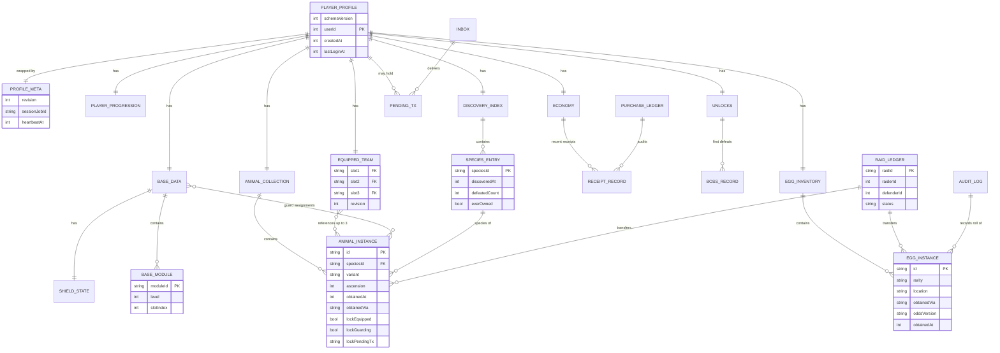
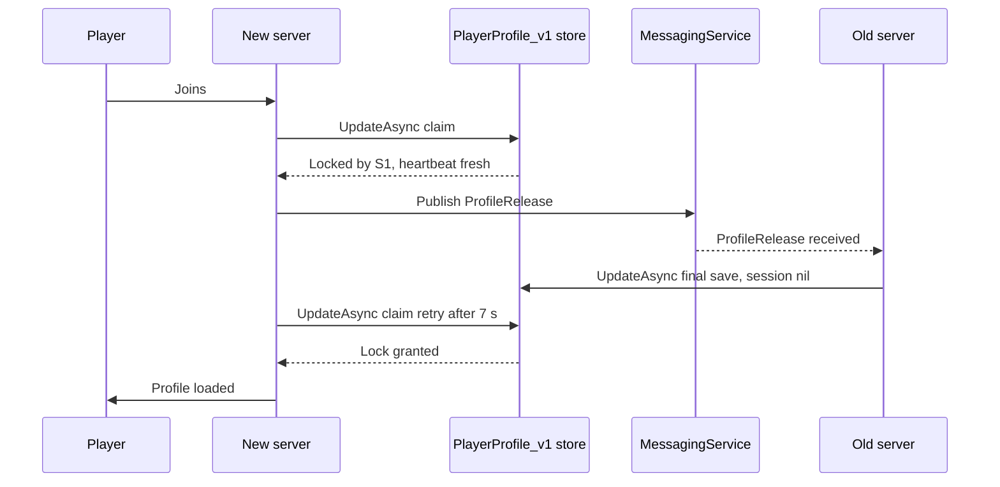
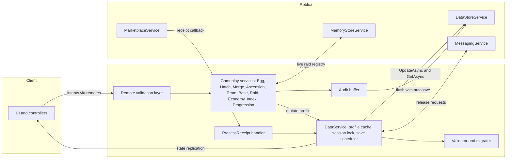

# Data Architecture Overview

How *Fight Animals for Eggs* stores player state: what lives in the player profile, which DataStores exist, how keys are named, how a server claims exclusive ownership of a profile (session locking) and how cross-player transfers (raids) and Robux purchases stay consistent. Field-level detail lives in the nine schema documents. Load, save and failure handling live in [[Save, Load and Recovery]]. Versioning and repair live in [[Data Validation and Migration]].

> [!info] PROPOSED
> Everything on this page is a **PROPOSED** architecture. The game rules it stores (team of three, storage 10 + 50, three animals per raid and so on) are **CONFIRMED** in the [[Decision Register]]. The code service that implements it is [[Service - DataService]].

## 1. Design principles

| # | Principle | Why |
|---|---|---|
| P1 | **One profile key per user** holds every piece of player-owned state. | A single `UpdateAsync` is atomic, so every transaction inside one player (roll, hatch, merge, ascension, upgrade) commits all-or-nothing without a distributed protocol. |
| P2 | **The server is authoritative.** Clients never send state, only intents. | See [[Server-Client Responsibilities]] and [[Exploit Prevention]]. |
| P3 | **Never store what can be derived.** Capacities, player Strength, Progression Score, "owned" flags and the specials a player has unlocked are computed from stored inputs. | Removes a whole class of corruption and makes tuning changes apply retroactively without a migration. |
| P4 | **Collections are dictionaries keyed by GUID**, never arrays with holes. | Arrays with `nil` gaps do not survive JSON serialisation reliably (*unverified* exact behaviour, so we avoid it entirely). Keyed maps also make "remove this instance" O(1). |
| P5 | **Audit data lives outside the profile.** Roll and hatch history, purchase ledgers and raid ledgers go to separate stores. | Keeps the profile small and stops history from ever influencing outcomes (**CONFIRMED** independence, D-018). |
| P6 | **Every profile carries `schemaVersion`** and is migrated forward on load, never backward. | [[Data Validation and Migration]]. |
| P7 | **A server writes a profile only while it holds that profile's session lock.** | Prevents two servers from overwriting each other (duplication and loss). |

## 2. Entity model

The profile is one document with nine sections. Each section has its own schema page.

| Profile section | Schema document | Contents |
|---|---|---|
| `meta` + root fields | [[Schema - Player Profile]] | Envelope, `schemaVersion`, identity, settings, pending transactions, applied-transaction ring, moderation flags |
| `progression` | [[Schema - Player Progression]] | Level, XP, permanent Strength bonuses. Player Strength itself is derived. |
| `animals` | [[Schema - Animal Collection]] | Owned animal instances, including ascension level, variant and lock flags |
| `team` | [[Schema - Equipped Team]] | Exactly three slots |
| `eggs` | [[Schema - Egg Inventory]] | Egg instances (backpack or base) and backpack expansion steps |
| `base` | [[Schema - Base Data]] | Plot stage, modules and levels, merge station level, vault expansion, guards, shield timers, trophy display |
| `economy` | [[Schema - Economy]] | Cash, lifetime counters, processed purchase receipts |
| `unlocks` | [[Schema - Unlocks and Boss Progress]] | Regions, boss first-defeats, onboarding and feature flags |
| `index` | [[Schema - Discovery Index]] | Per-species discovery, defeat counts and ownership history |



## 3. DataStore key layout (PROPOSED)

All stores are standard (not ordered) DataStores obtained with `DataStoreService:GetDataStore(name)`. The `_v1` suffix is the **store generation**: a new generation is only created for a catastrophic format change, never for an ordinary schema bump (which uses `schemaVersion` instead).

| Store name | Key pattern | Value | Written when | Read when | Retention |
|---|---|---|---|---|---|
| `PlayerProfile_v1` | `u_<UserId>` | Profile envelope (`meta` + `data`) | Autosave, critical saves, leave, shutdown | Join | Lifetime of account |
| `Inbox_v1` | `u_<UserId>` | List of pending deliveries (raid side effects, support restores, compensation) | Raid prepare, support tools | Every join (one `GetAsync`) | Entries removed once applied |
| `PurchaseLedger_v1` | `u_<UserId>/<yyyymm>` | Month list of granted developer-product purchases | After each successful receipt grant | Rollback reconciliation, support | **UNDECIDED** (Q-955) |
| `RaidLedger_v1` | `<yyyymmdd>/r_<RaidId>` | Raid transfer manifest and status | Raid prepare and commit | Crash reconciliation, support, exploit review | **UNDECIDED** (Q-955) |
| `AuditLog_v1` | `u_<UserId>/<yyyymmdd>/<chunk>` | Buffered high-value events (rolls with `oddsVersion`, hatches, merges, ascensions, thefts) | Flushed with autosave, ≤ 1 chunk per flush | Compliance review, support, exploit review | **UNDECIDED** (Q-955) |
| `Quarantine_v1` | `u_<UserId>/<unixTime>` | Raw copy of a profile that failed validation, plus the error list | On hard validation failure | Support repair | Until resolved |
| `ProfileSnapshot_v1` | `u_<UserId>/<yyyymmdd>` | Daily copy of the profile | First successful save of each UTC day | Restore | Last 7 days. Whether this store exists at all is **UNDECIDED** (Q-956) |

Key rules:
- Keys are derived from `UserId`, so every record of a user can be found with `ListKeysAsync(prefix)` for support and for right-to-erasure requests. The raid ledger is the exception (two users per record): it is purged by date prefix and its values store both user IDs.
- Keys stay under the DataStore key-length limit, believed to be 50 characters (*unverified — verify before use*). The longest pattern, `u_<11-digit UserId>/<yyyymmdd>/<3-digit chunk>`, is 25 characters.
- Every write passes the owning user's ID in the `userIds` argument of `SetAsync` or the transform result of `UpdateAsync`, so Roblox tooling can associate the data with the user (*unverified* return-signature detail).

> [!danger] Never `SetAsync` the profile key
> Profile writes always use `UpdateAsync` so the transform can check the session lock and the revision. A blind `SetAsync` would bypass the lock and could overwrite a newer copy written by another server.

Non-persistent state (never in a DataStore):

| State | Where it lives | Why not persisted |
|---|---|---|
| Team lock (left base / at base) | Server memory, recomputed from position on spawn | It is a consequence of where the player is ([[Team Equipping and Base Lock Rule]]) |
| Stolen-animal count in the current raid (max **3**, **CONFIRMED**) | Raid session object, then the raid ledger | It is per raid. It is never stored on either profile. |
| Issued `oddsVersion` tokens awaiting confirmation | Server memory per player | Short-lived. Only the token of a completed roll is persisted (on the egg and in the audit log). |
| Boss reward eligibility per spawn | Server memory per spawn | Per server instance ([[Boss Rewards]], Q-015) |
| Live raid registry, PvP presence | `MemoryStoreService` | Cross-server coordination that may expire ([[Raid Lifecycle and States]]) |

## 4. Session locking (PROPOSED)

A profile is owned by at most one server at a time. Ownership is recorded **inside the profile envelope** (`meta.session`) and changed only through `UpdateAsync`, so claiming and saving use the same atomic primitive.

```lua
-- Illustrative Luau, not executed.
export type SessionLock = {
	jobId: string,       -- game.JobId of the owning server
	placeId: number,
	lockedAt: number,    -- os.time() when claimed
	heartbeatAt: number, -- os.time() of the owner's latest successful save
}
```

| Rule | Value (PROPOSED) |
|---|---|
| Claim | On join, `UpdateAsync` sets `meta.session` to this server if it is empty, already ours, or **stale** |
| Heartbeat | Every successful save refreshes `heartbeatAt` (autosave cadence 90 s, see [[Save, Load and Recovery]]) |
| Stale threshold | `os.time() − heartbeatAt > 300` seconds |
| Release request | If the lock is fresh and held by another JobId, publish `ProfileRelease {userId, requesterJobId}` through `MessagingService` and poll the key every 7 s for up to 30 s |
| Give-up | If still locked after 60 s in total, kick with a friendly "your data is still saving on another server, please rejoin in a minute" message. Never load a default profile instead. |
| Release | The final save on leave or shutdown writes `meta.session = nil` |
| Self-fencing | Every save's transform checks `meta.session.jobId == game.JobId`. If not, it returns `nil` (cancels the write), the server discards its in-memory copy and kicks the player. A server that has lost its lock can therefore never overwrite the new owner. |

Lock claim and release flow:



> [!warning] Platform behaviour to verify
> `MessagingService` delivery is best effort (*unverified* delivery guarantees and rate limits). The design never relies on it for correctness: it only shortens the wait. Correctness comes from the stale threshold and self-fencing.

## 5. Transactions

| Transaction kind | Example | Mechanism | Owning document |
|---|---|---|---|
| Intra-profile | Roll, hatch, merge, ascension, module upgrade, team change | Mutate the in-memory profile synchronously (no yields between check and commit), then save normally. Atomic because it is one document. | [[Data Consistency and Transactions]] |
| Robux purchase | Any developer product | `ProcessReceipt` → grant and record `PurchaseId` in the same profile → forced save → `PurchaseGranted`. Ledger entry afterwards. | [[Save, Load and Recovery]], [[Schema - Economy]] |
| Cross-profile | Raid theft of eggs and knocked-out animals | Raid ledger "prepared" → inbox entries for both players → mutate both in-memory profiles → save both → ledger "committed" | [[Save, Load and Recovery]], [[Implementation - Raid Session Controller]] |
| Offline delivery | Support restore, compensation | Inbox entry applied on next join, deduplicated by `txId` | [[Schema - Player Profile]] |

> [!info] Assumption about raids
> Raids happen between two online players (offline bases cannot be raided, **CONFIRMED**). This design assumes both players are in the **same server** in the shared world, so both profiles are locked by one server. If cross-server raids are ever introduced ([[Open Questions#Q-029]]), the same ledger and inbox pattern still works, but each side's save happens on a different server.

## 6. Runtime architecture



- Gameplay services never call `DataStoreService` directly. They receive a typed profile handle from DataService and mutate it through narrow functions (for example `AnimalCollection.add(profile, instance)`), which enforce the invariants listed in each schema.
- Replication to the client is a filtered view (for example, the client sees its own eggs and animals but never the audit buffer or other players' inventories) through the [[Remote Communication Contract]] and [[Replication Strategy]].
- Analytics events go to [[Service - AnalyticsAndLoggingService]], not to the profile.

## 7. Common type conventions

| Concern | Convention (PROPOSED) |
|---|---|
| Timestamps | Integer Unix seconds from `os.time()` (UTC) |
| Instance IDs | `HttpService:GenerateGUID(false)` (36 characters, no braces), generated on the server only |
| Enumerations | Lower-case strings (`"hatch"`, `"backpack"`); rarities use their names (`"Common"` … `"Secret"`) |
| Content IDs | Stable snake_case strings: species `"great_white_shark"`, regions `"whisperwood_forest"`, bosses `"bramblehorn"`, modules `"animal_pens"`. Display names come from config, never from save data. |
| Numbers | Luau numbers (doubles). Integers are exact up to 2^53. Cash is capped at 10^15 (PROPOSED, [[Schema - Economy]]). |
| Unsupported values | No `Instance`, `Vector3`, `CFrame`, `Color3` or functions in save data: they cannot be stored in a DataStore |
| Unknown keys | Preserved under `_unknown` during validation rather than silently dropped ([[Data Validation and Migration]]) |

## 8. Size budget

The per-key value limit is believed to be 4 MB (4,194,304 characters) (*unverified — verify before use*). A Python mock of the proposed schema, JSON-encoded compactly with worst-case field contents, gives the following (these are estimates from a mock, not measurements in Roblox):

| Profile shape | Estimated size | Share of 4 MB |
|---|---:|---:|
| New player (3 animals, 10 eggs, 60 index entries filled) | 21 KiB | 0.5% |
| 100 animals (Q-022 working cap), 60 eggs | 72 KiB | 1.7% |
| 100 animals, 225 eggs (backpack 25 + vault 200 maximum expansion) | 121 KiB | 2.9% |
| Stress: 1,000 animals, 225 eggs | 450 KiB | 11.0% |

Per-record estimates: animal instance ≈ 380 bytes, egg ≈ 265 bytes, index entry ≈ 220 bytes.

| Threshold (PROPOSED) | Action |
|---|---|
| 256 KiB | Warning log and analytics event |
| 1 MiB | Error log, alert to live ops |
| 3.5 MiB | Save refused for content that grows the profile; player warned; incident opened |

## Related documents
- [[Data and Balancing Index]]
- [[Data Validation and Migration]]
- [[Save, Load and Recovery]]
- [[Service - DataService]]
- [[Data Consistency and Transactions]]
- [[Security Architecture]]
- [[Roblox API Reference Notes]]
- [[Canonical Proposed Values]]
